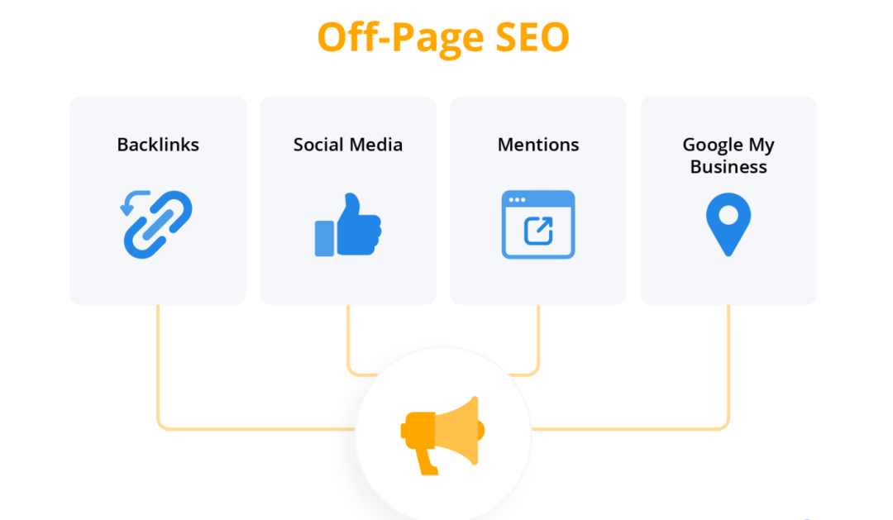

# 30天上谷歌首页：

**独立站SEO站外优化必备5大攻略**

## 一、如何有效进行链接建设？

链接建设是指让其他网站链接到你的网站的过程，在SEO中，这些链接被称为反向链接。页面或域名的反向链接越多，Google认为其权威性越高，尤其是当这些反向链接来自本身权威性高的域名时。
研究表明，域名权威得分是网页排名位置的重要预测因素之一。其他关键的站外SEO指标还包括：
- 页面权威分数：衡量单个页面的权威性。
- 引用IP数量（域）：链接到该域名的不同IP地址的数量。
- 引用域的数量（域）：链接到该域名的不同域的数量。
- 引用IP数量（URL）：链接到该页面的不同IP地址的数量。
- 引用域的数量（URL）：链接到该页面的不同域的数量。
- 反向链接数（域名）：指向该域名的反向链接总数。
- 反向链接数（URL）：指向该页面的反向链接总数。

你可以通过反向链接分析工具收集这些指标，一般来说，输入域名并进行分析即可获得详细的报告。如果你想开始建立新的反向链接，下面我和你聊聊两个比较流行的链接建设策略：
**1. 断开的链接建设**
找那些已经坏掉的链接（比如点开后显示“页面不存在”），然后告诉网站管理员，让他们把那些坏掉的链接换成你网站上相关的、能正常打开的内容链接。比如，某个行业杂志之前链接了一个已经删掉的资源，你就可以建议他们把链接改到你提供的类似资源上。
**2. 未链接的品牌提及**
别人在网上提到你的品牌，但没附上链接。这种情况很常见。你可以用一些工具去搜这些提到你品牌的地方，然后看看哪些没有链接。如果发现有新闻网站或者博客提到你品牌但没链接，就可以礼貌地联系他们，让他们加上链接。

## 二、如何构建高效的内容营销？

社交媒体虽然不能直接让Google排名变高，但它能让更多人知道你的品牌，吸引大家关注你，增加网站的访客，说不定还会有人主动给你的网站添加链接，要是想在社交媒体上做得更好，你可以试试这些策略：

#### 1.社交媒体

虽然社交媒体本身不会直接影响Google排名，但它能大大提升品牌曝光度，吸引更多关注，进而增加流量和反向链接。对此，你可以在你的社交媒体上，使用以下策略：
- 保持活跃：定期发布和分享优质内容，吸引更多人关注。
- 利用工具：借助人工智能工具（如Social Content AI）快速生成和安排社交媒体内容，节省时间和精力。
- 互动性：确保内容与品牌价值观一致，保持品牌声音的连贯性，同时积极与用户互动，提升用户参与度。

#### 2.KOL/KOC营销

出海企业可以和热门博主、社交媒体创作者合作。这些博主和创作者人气高、粉丝多，跟他们合作，能借助他们的影响力把品牌推广出去，让内容传播得更广，还能吸引到新的粉丝群体。对此，我们可以：
- 寻找合适的KOL/KOC：通过联系润杨力量团队，他们可以按照你的需求，如粉丝数量、类别、价格等条件筛选，帮你快速找到最适合品牌的合作对象。
- 建立长期关系：与KOL/KOC建立长期合作关系，共同打造品牌故事，提升品牌在目标受众中的影响力。

#### 3.内容联合

通过在其他网站重新发布内容，扩大品牌影响力，接触新的受众群体。这就要做好两方面：
- 选择平台：选择适合品牌的内容联合平台，如LinkedIn、Facebook等。
- 确保规范：在联合发布的内容中添加指向原始内容的链接，并正确配置规范标签，避免搜索引擎混淆。

## 三、SEO优化关键策略有哪些？

在SEO优化中，除了链接建设和内容营销之外，还有一些关键策略可以帮助提升网站的搜索排名和流量。以下是几个重要的SEO优化策略：
- 行业目录提交：将你的网站提交到权威的行业目录中。这些目录通常具有较高的域名权威性，能够为你的网站带来有价值的反向链接。例如，一些知名的行业博客、行业协会网站等，都是不错的提交对象。
- 资源交换：与其他网站协商，交换有价值的资源。例如，如果你的网站提供某种独特的内容或工具，可以与其他网站合作，互相推荐对方的资源，并在推荐中附上链接。
- 海外问答平台：海外问答平台（如Quora、Yahoo Answers等），找到与你业务相关的问题，提供高质量的答案并适当提及你的网站，可以提升网站流量和权威性。
- 参与海外讨论：在与你业务相关的海外论坛和社区中积极参与讨论，分享你的专业知识和见解。例如，Reddit、Stack Overflow等平台是技术类品牌的好去处，而行业垂直论坛则适合特定领域的企业。

## 四、如何应对客户评论？

客户评论不仅能影响其他人的决策，还可以提升你业务的可信度。Google在评估网站声誉时，会重点参考评论内容，因此，做出海营销的企业，最好积极回复所有评论，无论是好评还是差评，都要展示出你重视客户的声音和反馈。
下面是几个回复线上评论的小Tips:
- 鼓励所有顾客留下评论。
- 通过回复每条评论来建立信任。
- 不要通过金钱交易来获取或提供评论。

## 五、如何重视举办品牌活动？

举办活动不仅能吸引观众，还能为你的业务制造话题，带来很多好处。具体来说：
- 在活动推广阶段：通过社交媒体的宣传，你的品牌可以获得更多的曝光机会，吸引更多潜在客户的关注。
- 活动结束后：如果参与者撰写总结文章，你的品牌也可能会在其他网站上被提及，进一步扩大品牌影响力。
- 活动登录页面：如果人们对活动登录页面感兴趣，或者演讲者和有影响力的人想要推广它，你的活动页面还有机会获得反向链接，提升网站的权威性。
虽然活动的筹备和执行需要付出更多努力，但这种热度和曝光是其他方式难以复制的，同时也有助于获得非常好的公关报道。
