# Google页面上榜单前十名

**10大方法（独立站卖家必学技巧）**
以下是让您的页面到达 Google 搜索顶部的 10 种方法：
**1. 定位正确的关键词**
专注于与您的业务相关且您可以进行排名的关键字，可以让您有最好的机会到达 Google 结果的顶部。
使用 Semrush 的 Keyword Magic Tool 确定正确的关键字。
只需启动该工具，输入短尾关键词（与您的业务相关的广义术语），选择您的目标国家/地区，然后单击“**Search**”。
您还可以输入您的域名以获取个性化指标。

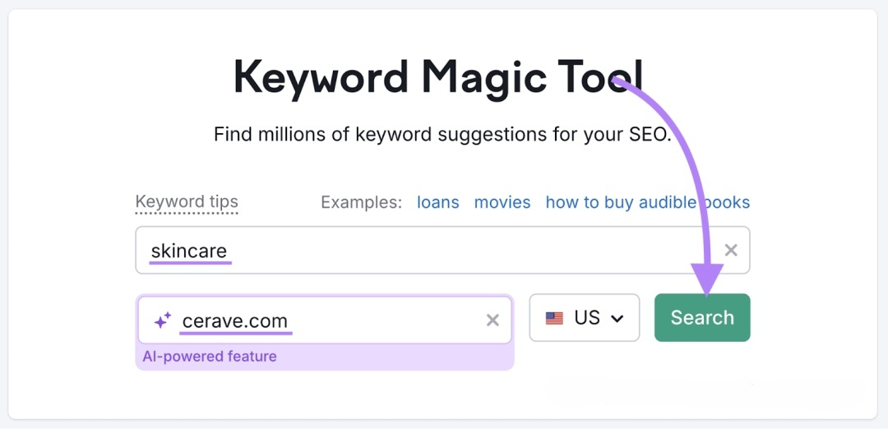

接下来，你会看到可能数千个与你的短尾关键词相关的关键词。
以及以下指标：
- **Volume（数量）：每月关键字被搜索的估计次数。您希望选择至少获得合理搜索次数的词。**
- **潜在流量：如果您获得最高预测排名，您可以吸引的流量**
- **个人关键词难度 （PKD %）：一个分数，表示您的特定网站在一个词的 Google 前 10 个结果中排名的难度。分数越低意味着排名的机会越大。**
- **搜索意图：搜索者在使用特定关键词时希望达到的效果。主要的 intent 类型包括信息性 （I）、交易性 （T）、导航性 （N） 和商业性 （C）。**

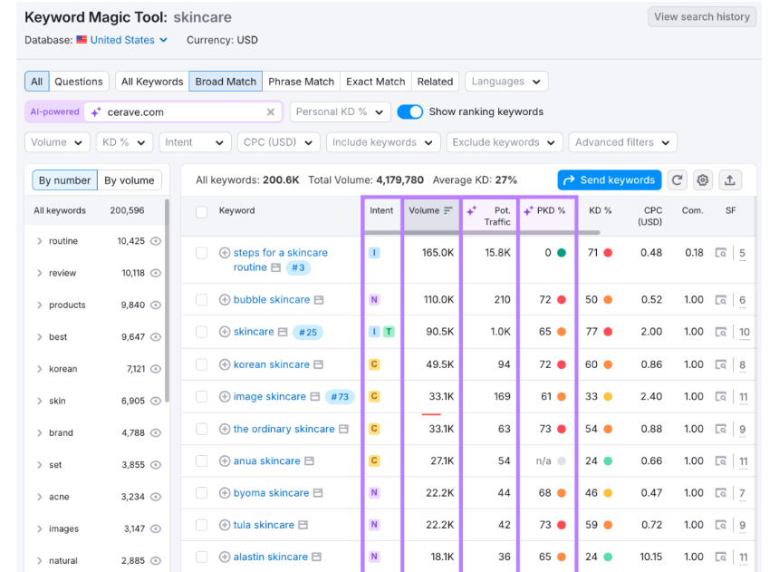

寻找优质机会的一个特别好的方法是筛选出个人关键词难度得分较低的词。特别是如果您的网站是新的或较小的。
选择“**Personal KD %**”下拉列表，设置从 0 到 29 的自定义范围，然后选择应用。然后，它将只向你显示你有很大机会排名的关键词。

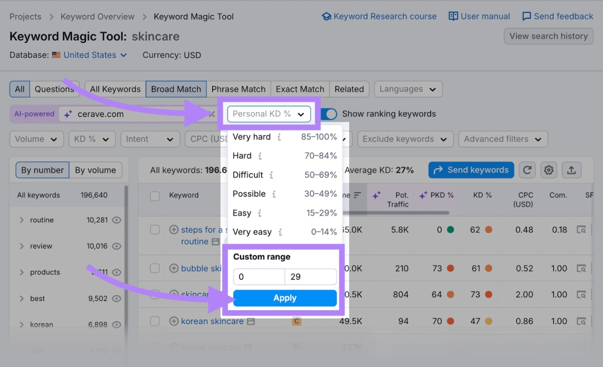

研究缩小的列表，找到与您的业务最相关的术语。使用它们来通知您的内容。

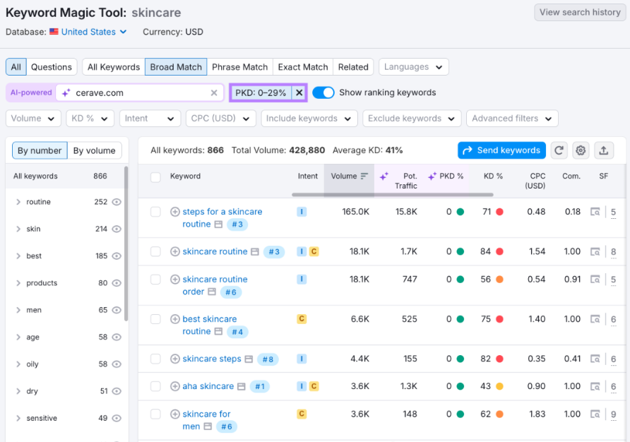

对更简单的术语进行排名可以建立权威并帮助你以后处理更具竞争力的关键词。
**2. 创建优质内容**
发布真正有用且与搜索者正在寻找的内容一致的高质量内容可以让你有很好的机会获得高排名，因为这就是 Google 想要展示的内容类型。
首先，研究搜索意图，而不仅仅是识别基本类型（信息、导航、商业或交易）。
您可以通过搜索词来查看您看到的结果类型来做到这一点。
例如，术语“痤疮洗面奶”主要显示热门商品轮播和商品页面。这意味着您应该创建类似的东西。
然后，考虑 Google 关于什么是值得排名的高质量内容的指南。这些指南讨论了经验、专业知识、权威性和可信度 （E-E-A-T）。
E-E-A-T 是 Google 搜索质量评估者指南的一部分，该指南是质量评估者（为 Google 工作的人）用来衡量搜索结果质量的手册。
以下是每个部分的含义：
- **经验：作者与主题相关的第一手经验**
- **专业知识：作者对他们所写主题的认识**
- **权威性：出版物在行业中的声誉**
- **可信度：内容准确和引用可靠来源的程度（以及其他因素）**
Google 的有益内容更新还提供了关于什么是有益、令人满意的内容的具体指导。
内容应包括：
- 原始信息、报告或研究
- 主题的全面概述
- 与其他搜索结果相比，价值巨大
- 正确的语法和拼写
**3. 针对页面 SEO 进行优化**
页面搜索引擎优化 （On-page SEO） 涉及进行网页调整，以帮助 Google 理解您的内容并将其与用户查询相匹配。
以下是一些需要优化的页面 SEO 元素：
**标题标签**
标题标签是 HTML，它为搜索引擎指定标题，并可能显示在搜索结果中，这意味着它可以是搜索者首先看到的关于您的页面的内容。
清晰且引人注目的标题标签可以提高您的搜索引擎排名和点击率。
以下是编写标题标签的一些最佳实践**：**
- 为每个页面使用唯一的标题标签
- 自然地包含您的目标关键字
- 将其保持在 60 个字符以下
- 避免使用“Home”等通用标题
- 使其引人注目，而不使用误导搜索者的点击诱饵语言
**（1）元描述**
元描述是 HTML，它提供页面的简要摘要，并且可以显示在搜索结果中。
元描述不用于排名，但它们**会影响**搜索结果中显示的点击次数。
要优化您的元描述：
- 为每个页面编写唯一的描述
- 自然地使用关键词变体
- 将其保持在 105 个字符以下
- 使用值得点击的详细信息（例如，“免费模板”、“免费送货”等）吸引用户
**（2）标题标签**
标题为您的内容提供结构，使其更易于浏览并帮助 Google 了解您页面上涵盖的关键主题。
以下是标题标签的一些最佳实践：
- 每页仅使用一个 H1
- 在 H1-H3 标签中添加关键词变体
- 保持清晰的层次结构（H2 在 H1 下，H3 在 H2 下，依此类推）
- 将标题与章节的内容相匹配
**（3）多媒体**
图片和视频使你的页面更具吸引力，并且可以带来更多的排名——如果它们针对 SEO 进行了优化。
方法如下：
- 向所有图像添加描述性 alt 文本。此简短说明可确保所有用户（如依赖屏幕阅读器的用户）都可以访问图像，并且搜索引擎可以理解。
- 压缩图像以加快加载时间。Google 更喜欢更快的加载时间。如果您的网站加载时间过长，您的用户可能不会留下来。
- 为图像选择包含与图像内容相关的宝贵信息的文件名。这可以帮助搜索引擎有效地理解和索引您的视觉对象。
**（4）内部链接**
内部链接从您网站上的一个页面指向另一个页面，以帮助用户浏览您的网站，使 Google 能够找到您的页面并了解它们之间的关系，并分配排名权重。
因此，请查看您的博客文章、产品页面和其他重要内容。查看您在哪里有机会链接到您网站上的相关内容。
然后，确保链接到与上下文相关的页面。优先考虑包含需要增加流量的有价值信息的页面也是一个好主意。
使用 Semrush 的 On Page SEO Checker 寻找内部链接机会。
按照提示配置您的项目。
进入 “**Overview**” 选项卡后，单击 “**Technical SEO Ideas**” 右侧的蓝色数字。

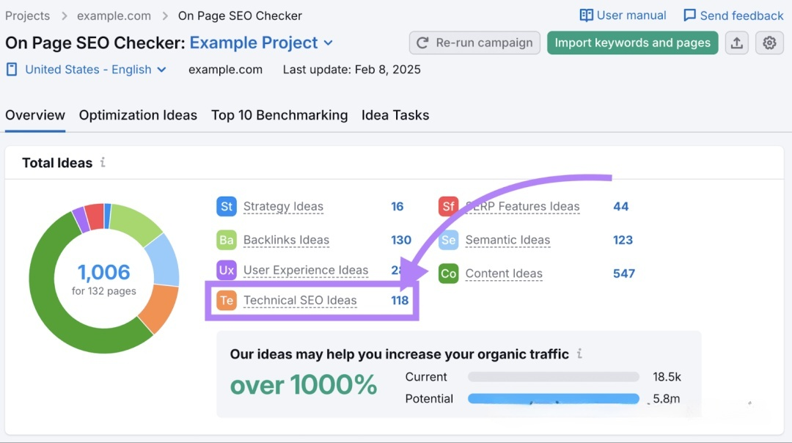

通过单击每个页面旁边的 “**# ideas**” 按钮浏览页面列表。

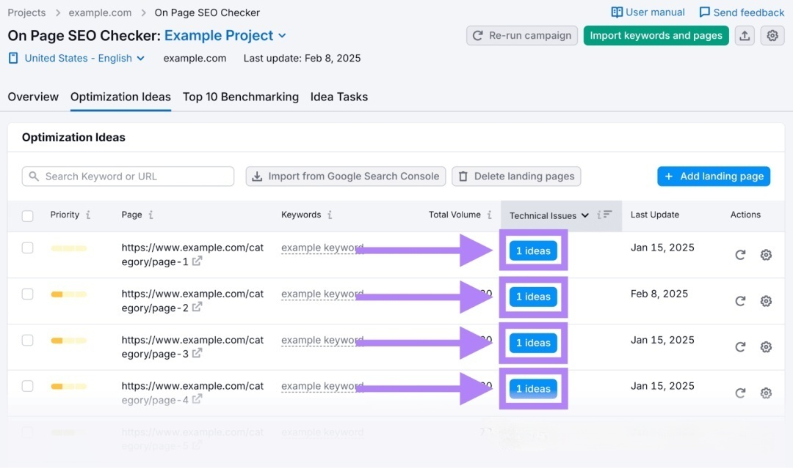

向下滚动到 “**Technical Issues**” 部分。并查看是否出现 “**Add internal links that point to this page**” 消息。

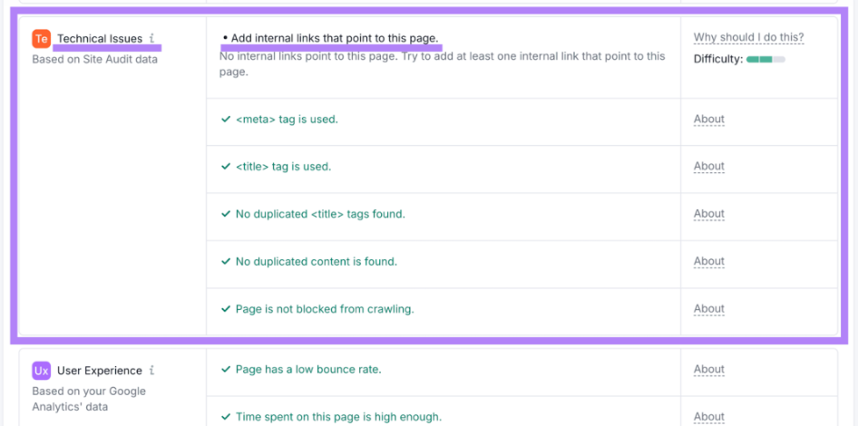

如果是这样，请努力从其他相关页面链接到该页面。
**4. 设置您的 Google 商家资料**
如果您是本地商家，使用 Google 商家资料 （GBP）（一款免费工具，可让您管理商家在 Google 搜索和 Google 地图中的显示方式）来优化您的商家信息以提高本地曝光度。
例如，您可以出现在 Google 的本地包中。这会在 Google 搜索结果中与地图一起显示排名靠前的本地企业。

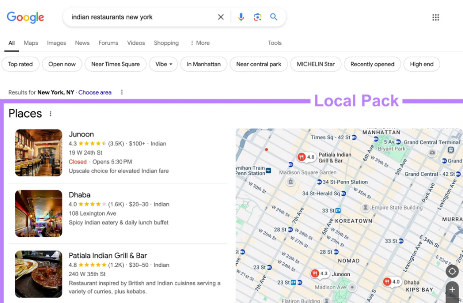

请遵循以下提示来优化您的 Google 商家资料：
- **填写您的个人资料。填写所有重要详细信息，包括您的公司名称、地址、电话号码、网站、营业时间和类别**
- **添加高质量的照片和视频。上传您的店面、团队等的清晰图片和视频，以建立信任**
- **定期发布更新。分享新闻、促销和活动，让您的个人资料保持活跃**
- **使用问答部分。回答常见问题，以便潜在客户可以更快地获得他们需要的信息**
- **保持您的营业时间更新。如果您的营业时间因节假日或特殊活动而异，请更新营业时间，以确保买家始终拥有正确的信息**
**5. 获取其他引用**
本地商家不仅可以使用 Google 商家资料来获取其他商家信息，这可以帮助您吸引更多潜在客户，甚至可以帮助 Google 验证有关您商家的信息。
此外，不同的搜索引擎直接从其他引文中提取本地搜索结果。
例如，Bing 使用来自 Facebook 和 Tripadvisor 等网站的列表。

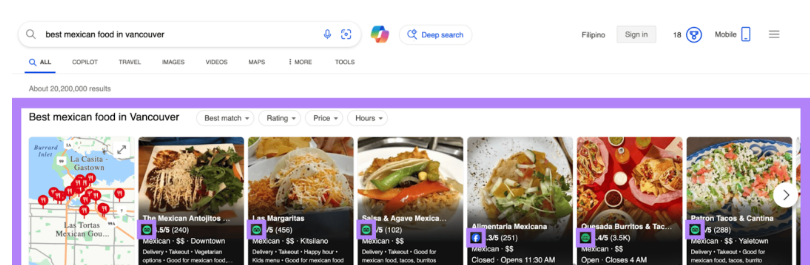

确保所有商品的名称、地址和电话号码 （NAP） 一致，以避免混淆。
您可以手动执行此作，但 Semrush 的列表管理工具可让您在关键目录之间自动分发您的业务详细信息。

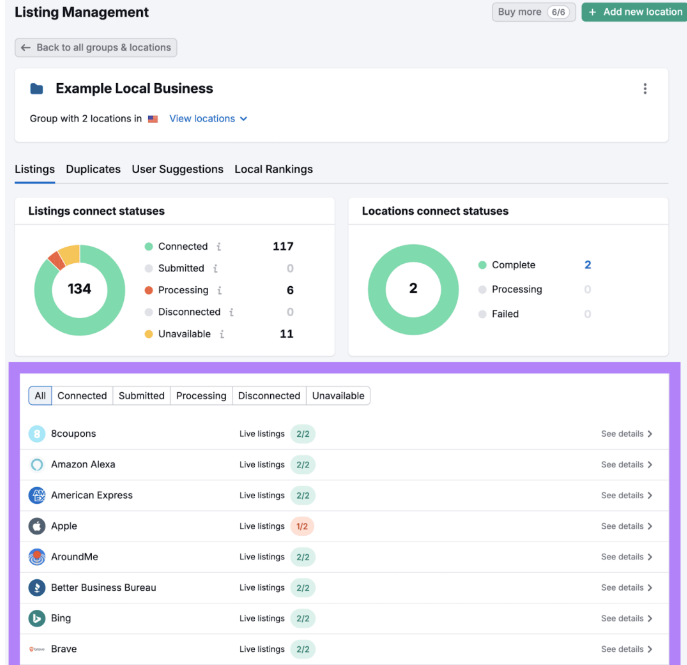

**6. 获取并回复客户评论**
评价对于本地搜索很重要，因此请鼓励客户在 Google 上分享反馈。
您可以通过在确认电子邮件中包含指向您的 Google 评论的链接、在您的实际位置包含二维码等来简化此作。
Google 还鼓励企业回复客户评论，无论它们是好的还是坏的。
为什么？
因为它：
- 向客户表明您重视反馈
- 与潜在客户建立信任和信誉
因此，养成回复 GBP 上的每条评论的习惯。
要轻松管理多个目录中的评论，请使用 Semrush 的评论管理工具。
您也可以直接在工具中直接回复 Google 评论。

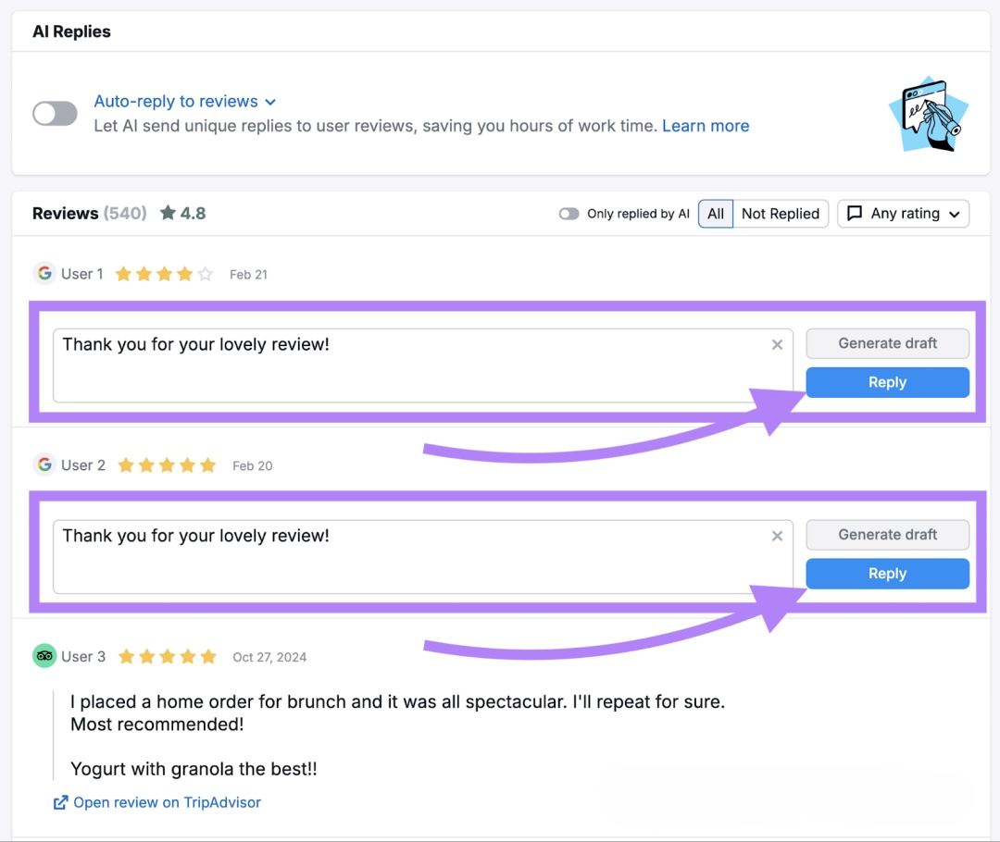

以下是回复买家评论的一些提示：
- **说声谢谢。永远从感恩开始。简单的“谢谢”大有帮助。**
- **要有礼貌。即使评论很差，也要保持尊重和专业**
- **保持简短。简短的回复是最好的。如果您正在处理重大问题，请提供一种方式让买家直接与您联系。**
- **承认任何问题。如果客户有问题，请解决它。表明您的关心。**
- **邀请客户回来。鼓励满意的买家再次获得积极的体验。还要鼓励对那些留下差评的人进行回访，并提出纠正不良体验。**
**7. 建立高质量的反向链接**
来自可信网站的反向链接（其他网站上指向您网站的链接）表明您的内容是可信的。链接到您的更可信的网站可以提高您的排名。
这是因为当信誉良好的网站链接到您的内容时，Google 将其视为信任信号。并且可能会将您的内容视为有价值且值得向用户展示。
创建高质量的内容是自然吸引外链的好方法。特别是研究度假村、信息图表、免费工具和深入指南等内容。
以下是一些其他的链接建设策略：
- **创建客座文章：为您所在行业的其他受信任的网站撰写文章，以可能获得反向链接作为回报**
- **进行失效链接建设：在目标网站上查找失效的外部链接，并推荐您的相关内容作为替代。**
- **查找未链接的品牌提及：发现在线提及的品牌不包含链接并要求链接。**
使用 Semrush 的链接构建工具简化您的链接构建工作。
要开始使用，请输入您的域名并单击 “**Start Link Building**”。

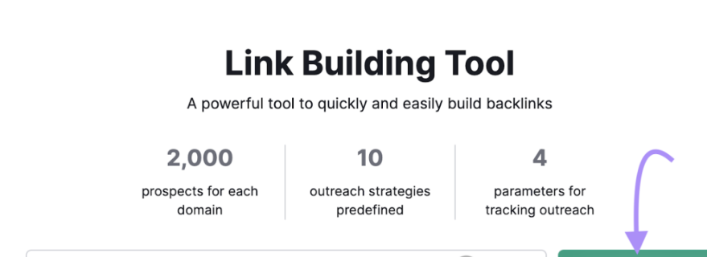

按照提示设置您的项目。这涉及添加您的关键字和竞争对手。
该工具将需要一分钟左右的时间来收集和分析数据。完成后，转到 “**Prospects**” 选项卡以查看您可以联系以获取反向链接的网站列表。

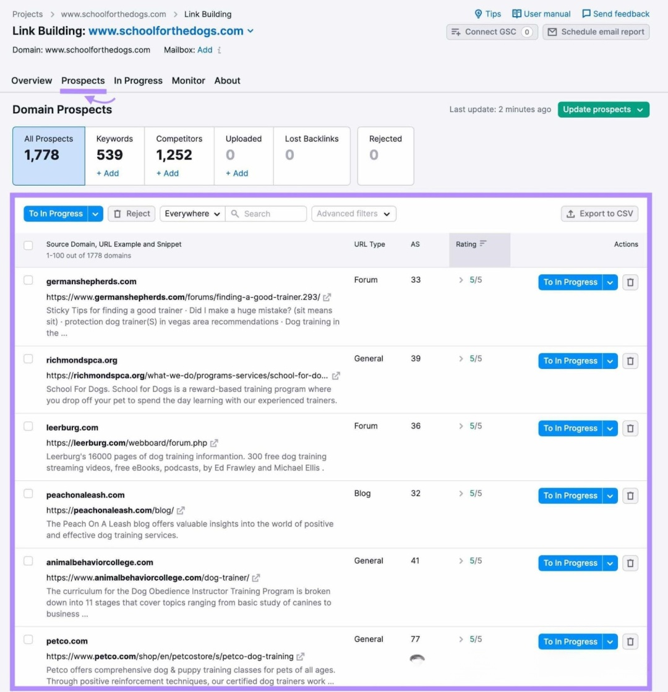

从这里，单击您要联系的任何网站旁边的“**To In Progress**”。然后，您可以直接在该工具中制作和发送个性化电子邮件。
**8. 使您的网站适合移动设备**
Google 在为页面编入索引和排名时会优先考虑您网站的移动版本，这意味着您的网站针对移动设备进行优化至关重要。
要检查您的网站是否适合移动设备，请使用 Semrush 的 Site Audit（网站诊断）工具。
只需在搜索栏中输入您的网站，然后单击“**Start Audit**”。
按照提示配置您的爬网 - 您甚至可以保留默认设置。
审核完成后，转到 “**Issues**” 报告并搜索 “**mobile**”。
这将突出特定于移动设备的问题。就像 viewport meta 标记错误一样。

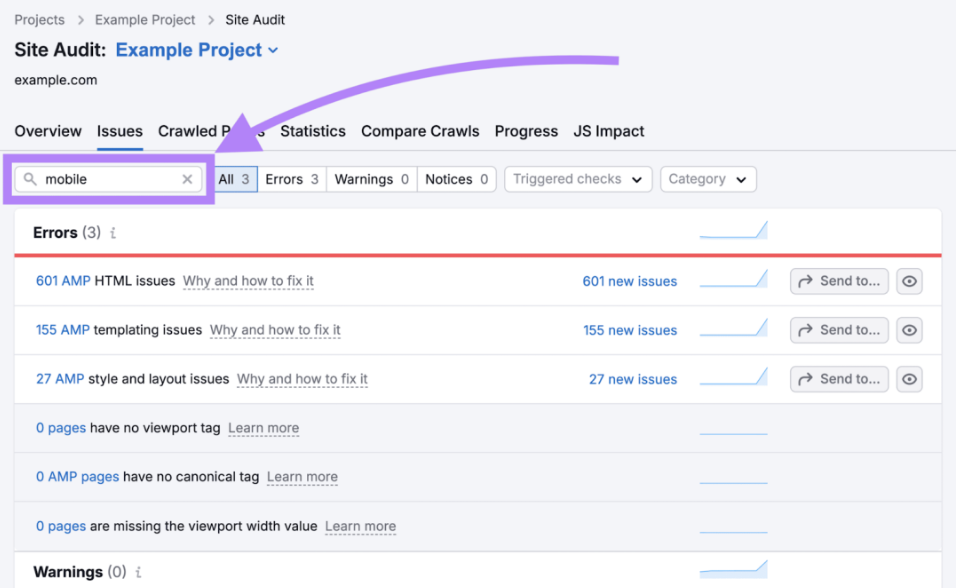

点击任何问题旁边的“**Why and how to fix it”以了解更多信息以及如何解决它。**
解决每个错误和警告。
**9. 提高页面速度**
保持你的页面加载时间尽可能快，因为 Google 使用页面速度作为排名因素——而且它对用户体验更好。
要检查您网站上任何页面的加载速度，请使用 Google 的 PageSpeed Insights 工具。
输入 URL，该工具将提供包含性能分数和要解决的问题列表的完整报告。

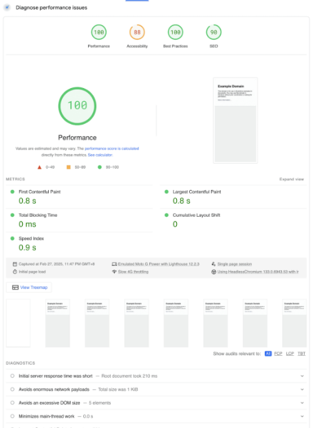

要更全面地了解您网站的表现，请使用 Semrush 的 Site Audit（网站诊断）工具，然后在“**Site Performance**”下选择“**View details”。**

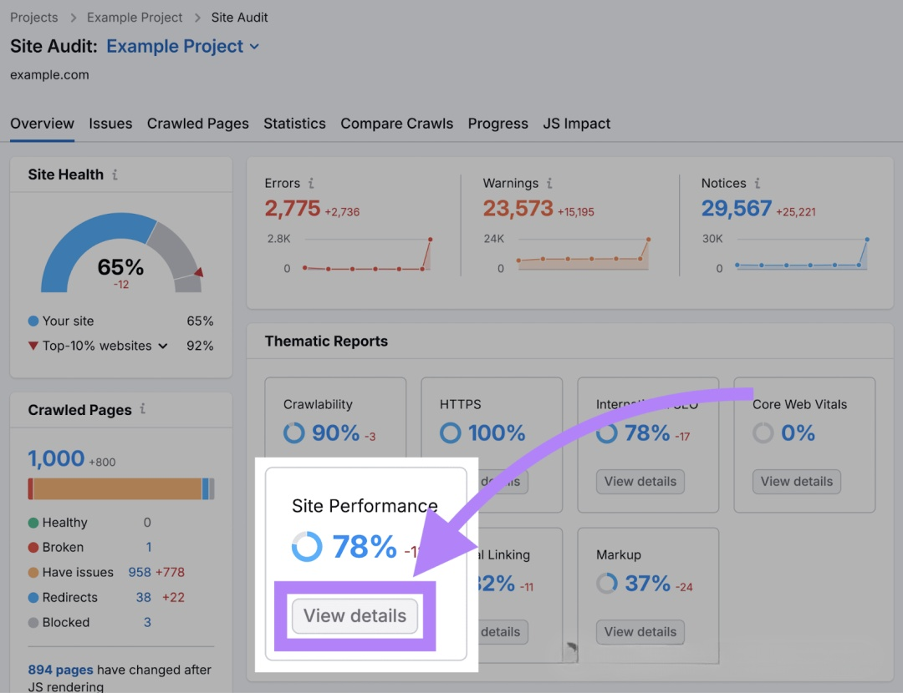

一般来说，页面加载速度不超过几秒钟。越快越好。

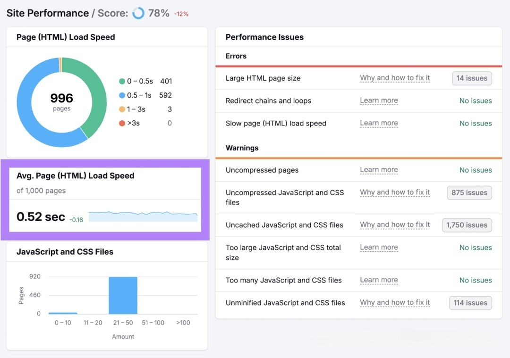

**10. 修复其他技术 SEO 问题**
修复与抓取和索引编制相关的 SEO 技术问题可以提高网站在搜索结果中的排名。
可以这样想：
如果 Google 能够找到并理解相关内容，您的网页就更有可能显示在搜索结果中。
要识别技术 SEO 问题（除了与移动和速度相关的问题），请通过 Semrush 的 Site Audit（网站诊断）工具运行您的网站。
要查找要修复的内容，请转到“**Issues**”选项卡。
您会看到在网站上发现的错误列表。

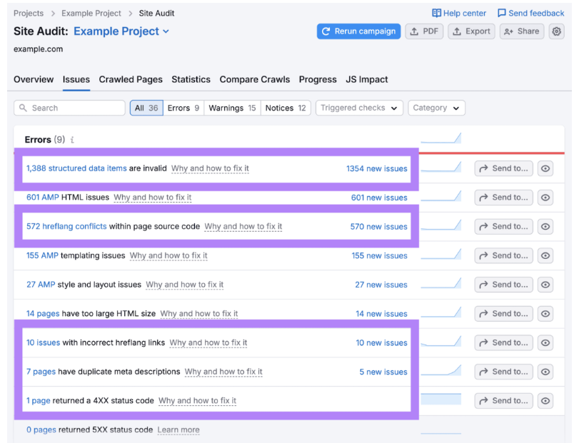

从错误（需要快速解决的最严重问题）开始。然后继续讨论警告和通知。
如果您不确定如何解决任何问题，请与开发人员合作。
