# Semrush工具优化独立站SEO教程

Semrush是一款非常强大且优秀的网站营销分析工具，使用该工具可以帮助你更好的了解竞争对手网站的情况。
它能全面追踪网站或域名的关键信息：
● 精准监测展示搜索与付费搜索关键词，用户借此可明晰自身及竞争对手的关键词策略，了解哪些词助力引流，哪些需优化。
● 详细剖析外链建设状况，涵盖外链来源、数量与质量，助您评估自身外链优势，洞察对手外链策略。
Semrush操作便捷，上手难度也不是很高。
最重要的是无需安装任何追踪代码，无论是想深度检测自家网站，还是全方位了解竞争对手网站，都能轻松搞定。

## 一、Semrush是什么？

Semrush我是比较喜欢用来研究竞争对手的SEO策略以及其他方面的指标。
从关键词分析、研究以及竞争对手的反链研究以及社交媒体状态，Semrush 都能做到。
所以Semrush是一个很综合且全面的工具，且每个工具都有独特的功能。
如果只是单纯的用它来分析关键词的难度和流量，那实属有点浪费了，它有很多功能：
● 它能帮助你进行关键词研究、竞争对手分析、网站审计、排名跟踪等多项 SEO 相关工作。通过了解 Semrush，用户可以利用这些功能来优化网站，提高在搜索引擎中的排名，增加网站流量和曝光度。
● Semrush提供了丰富的市场洞察数据，用户可以通过它了解所在行业的整体趋势、竞争对手的策略以及市场份额分布等信息。这有助于你制定更具针对性的营销策略，找到自身的竞争优势和市场定位，从而在竞争激烈的市场中脱颖而出。
● 该工具还能协助用户进行内容营销规划。它可以分析热门话题和趋势，帮助用户确定有价值的内容主题，同时评估内容的竞争力和潜在影响力。了解 Semrush 后，你就能够利用这些功能创作出更符合用户需求和搜索引擎算法的优质内容，提升内容营销的效果。
● Semrush对于广告投放也有一定的帮助。它可以提供关键词的广告竞争程度、出价建议等信息，帮助用户优化搜索引擎广告（如 Google Ads）的投放策略，提高广告的点击率和转化率，降低广告成本，使广告预算得到更有效的利用。
所以我专门把自己使用Semrush的实际操作整理了出来，这样可以帮助你清楚地了解Semrush各种工具的方方面面。

## 二、Semrush使用方法

#### 1.注册Semrush账号

访问Semrush官网，选择适合的订阅计划，按照页面提示完成注册。
可使用 QQ 邮箱，中文版网站（https://zh.semrush.com）注册更便捷，注册后需验证邮箱。
然后选择合适的套餐，当然Semrush和Ahrefs都很贵的说。

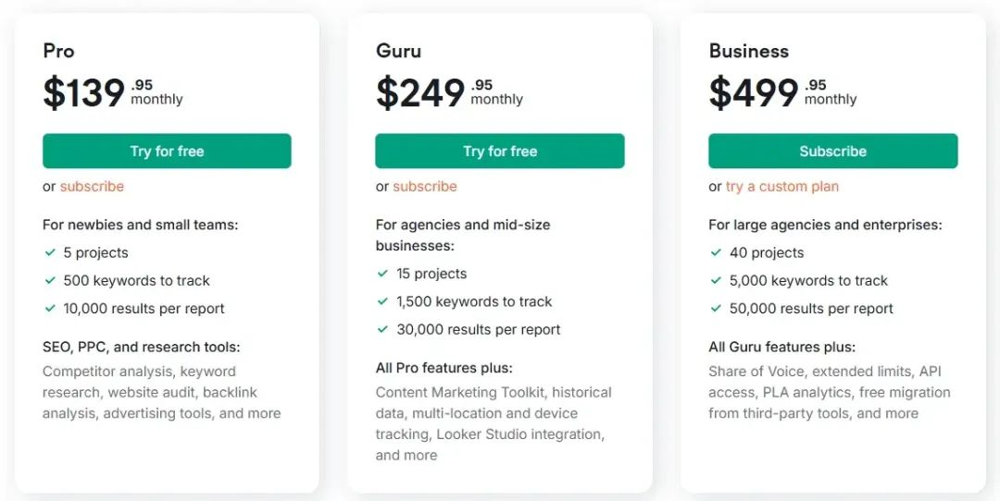

而且Semrush基础版的是限定了一些功能的，也就是说如果你想用所有的功能就要买249美金的那个套餐。
相当于一个月1500多了，如果嫌贵可以多几个伙伴拼单一起购买，或者某宝上有共享版本的。

#### 2.进入Semrush操作界面

有了Semrush的账号以后就可以看来工作台了，输入关键词和域名以后就可以开始使用Semrush了。

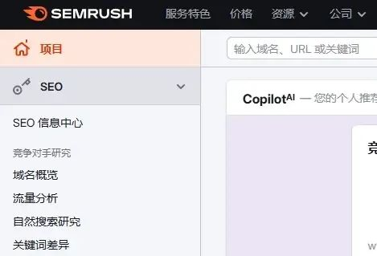

输入关键词可以研究某个关键词的流量以及竞争情况，输入域名是可以检查某个网站的流量情况。

#### 3.关键词研究

进行关键词研究非常重要。
它能帮我们洞察用户需求，像从“如何选择合适的SEO工具”这类搜索词，就说明用户想了解哪类SEO工具是比较好用的。
合理选用关键词，可提升网页与搜索意图的匹配度，助力提高搜索引擎排名，增加网站曝光。
通过研究，你能明确目标市场，挖掘细分领域的市场机会，依此制定精准的营销策略。
此外，关键词研究还为内容创作指明方向，产出贴合用户兴趣的内容，增强网站吸引力与影响力，全方位提升营销效果 。
那么我们先输入一个关键词，来看看...

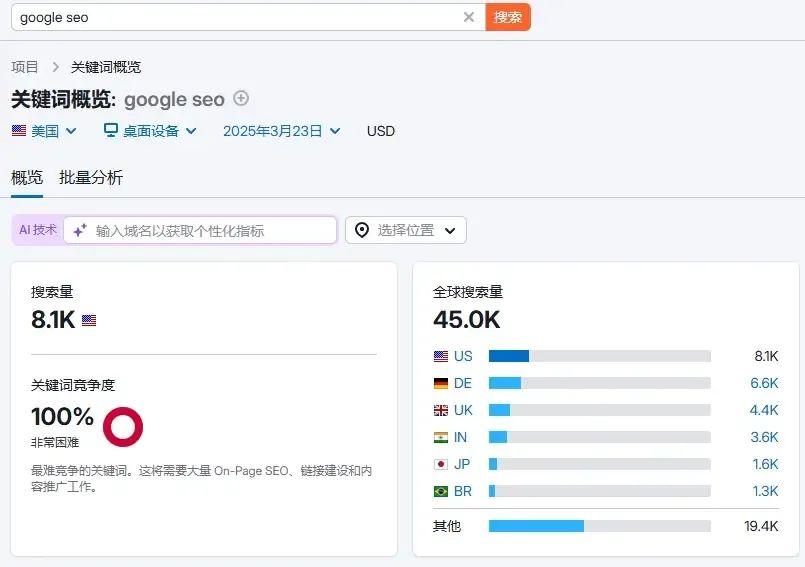

点击搜索以后关于该关键词的情况就清晰的展示出来了，默认国家是美国，如果想要了解其他国家的点击国旗小图标更换即可。
然后我们就可以了解这个关键词的总体情况了。
● 搜索量
● 关键词竞争程度
● 关键词搜索意图
● CPC点击价格

也就是说，通过这些信息你可以很明确地知道这个关键词目前适不适合自己的网站进行排名优化。
● 关键词难度是100%，说明非常困难。
● 搜索量是45K每个月，流量非常大。
● CPC价格是8.35美金一次也不便宜了。
综合下来这个关键词虽然流量很大，但是竞争程度非常的高。

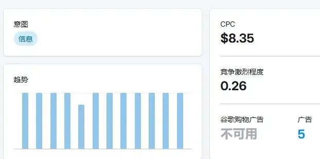

虽然是信息科普类的关键词但搜索趋势一直很稳定，说明商业价值也不低。关于关键词的搜索意图，后面也会详细的告诉大家，继续耐心看下来吧。
所以，综合下来这个关键词竞争非常大，该怎么办呢？
那挖掘一下其他关键词试试...

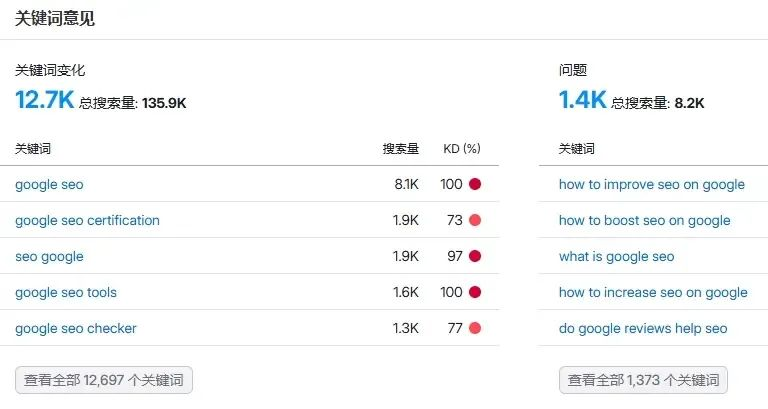

通过挖掘google seo的变体关键词以及问题关键词，都可以帮助我们挖掘很多有价值的关键词。

#### 4.确定关键词难度

网站的人力、时间和资金等资源有限。
确定关键词难度有助于将资源集中在最有价值和可实现的关键词上，避免在难度过高、难以提升排名的关键词上浪费资源，提高资源利用效率。
关键词难度（KD）是Semrush等工具衡量SEO优化难度的指标。
它综合多因素评估在SERP获高排名的难易程度。
搜索结果竞争力是其一，若某关键词搜索结果多，且前排多为高权重网站，竞争就激烈，难度高。
关键词商业价值也有影响，像“google seo”这类高商业价值词，因利益关联大，众多网站争抢，难度随之上升。
KD一般用0 - 100数值表示，数值越低，优化难度越小，利于网站初期选作目标词。
数值越高，竞争越白热化，需大量投入及优质内容、强大外链等，才有望争不错的排名。
**1）先从小词做起**
如果一上来就做像上面那种的大词，只能说要不所在行业的竞争非常低。
要么是真的不懂，把好事都揽到自己这边了。

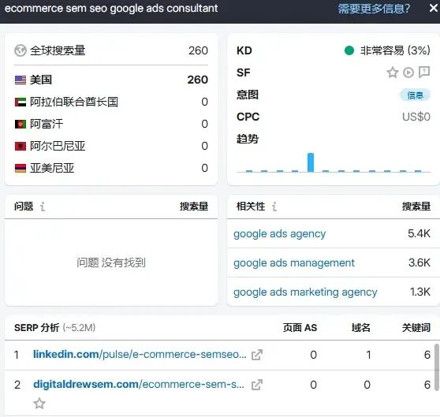

就像这个关键词，虽然搜索量只有260但是竞争难度很低。
**2）做好serp分析**
同时通过serp分析可以看出页面的as（网页权重得分）也不高，有两个都是0也能获得不错的排名。
也就是说挑选这种关键词我们要2个维度，先看关键词竞争的难度，然后再确定排在谷歌前面的网站页面AS值高不高。
如果别人都是50以上，而自己只有10，那哪怕很简单的关键词也很难。

所以在排简单的关键词的时候也要综合做好分析，只要打开概览就可以查看某个关键词的情况了。
这样就不用一个个的反复来搜索了。

#### 5.了解关键词搜索意图

搜索引擎旨在为用户提供最相关的搜索结果。
当网站内容与关键词搜索意图匹配度高时，搜索引擎会认为该网站更具价值，进而提高其在搜索结果页面中的排名，增加网站的流量和曝光度。
也就是说如果我们在进行排名的时候没有了解某个关键词的搜索意图，那么编辑的内容哪怕自己认为再用心也没用。
● 信息科普类：用户希望找到特定问题的答案。
● 商务属性：用户希望了解品牌或者产品详情。
● 交易属性：用户有交易或付款的倾向。
● 导航：用户想通过关键词找到特定的栏目。
所以这样说的话，很多朋友会认为那我全部都布局商务和交易词不就好了？
也不是不行，但这种词往往有着非常高的竞争度，除非你的网站非常的有竞争力，不然这种词就算布局也能难有关键词排名。

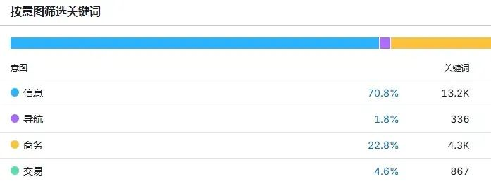

其搜索量较大，能为网站吸引大量流量，提高曝光度。
其次，用户通过此类关键词进入网站，若内容优质，可增加用户留存，降低跳出率，利于提升排名。
再者，围绕这类关键词创作内容，能丰富网站知识领域，提升专业性和权威性。
最后，信息科普类关键词可拓展出众多精准的长尾关键词，满足用户细分需求，吸引目标明确的用户群体，进一步提升商务和交易关键词的转化效果。

#### 6.挖掘优质内容和话题

先把这个内容说了，关于分析竞对的域名什么的接下来会说。
因为关键词分析，挖掘，并落地实际的内容是一套完整的逻辑，我们做好了前面的铺垫接下来就可以落地内容了。

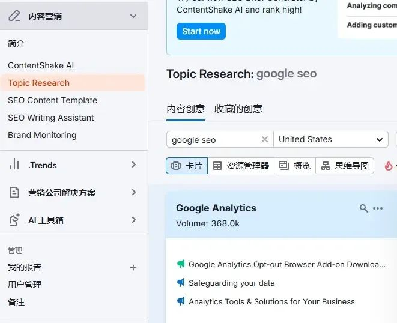

使用semrush的内容挖掘功能可以帮助你找到相匹配的话题，这样就可以很好的落地关键词。

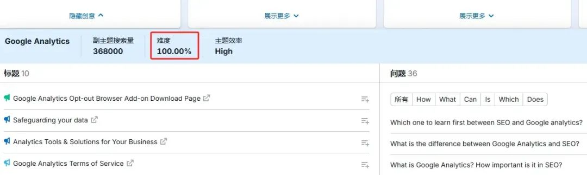

点击展示更多就可以查询更多的关键词话题了，然后关准一下难度，可以把自己认为不错的话题放入谷歌搜索一下。
如果页面的AS值都比较高，那么建议是换一下话题，如果有些AS值很低那么久可以安心的安排内容了。
这里告诉大家一个小技巧，可以把你想要写的话题放到semrush中来，然后其他的指标不要管，因为是文章标题搜索所以其他指标肯定是没有准确数据的。
我们主要是查看serp分析功能，了解一下同行网站的AS情况。

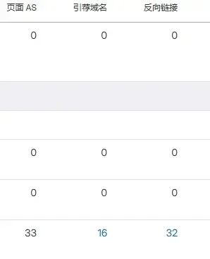

像这种情况的话，就可以了，因为一些网站的页面AS是零且也没有什么外链。
只要我们专注于内容就有机会超过他们了。

#### 7.查询反链情况

反链也是SEO排名中的重要因素，挖掘有价值且不用付费的反链也是一项非常重要的工作。
使用semrush的反链挖掘功能也是可以帮助我们挖掘竞对的反链。
然后需要自己一个个的做筛选，因为有些外链是别人通过其他手段获得的，我们只要好好挖掘一下哪些是通过正常手段注册就可以获取的就好了。

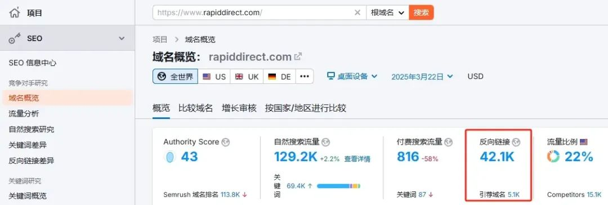

还是在搜索框输入域名，然后就可以跳入域名概览的功能栏里面了，这个时候网站什么情况就一目了然了。
然后找到反向链接的栏目，点击进来。

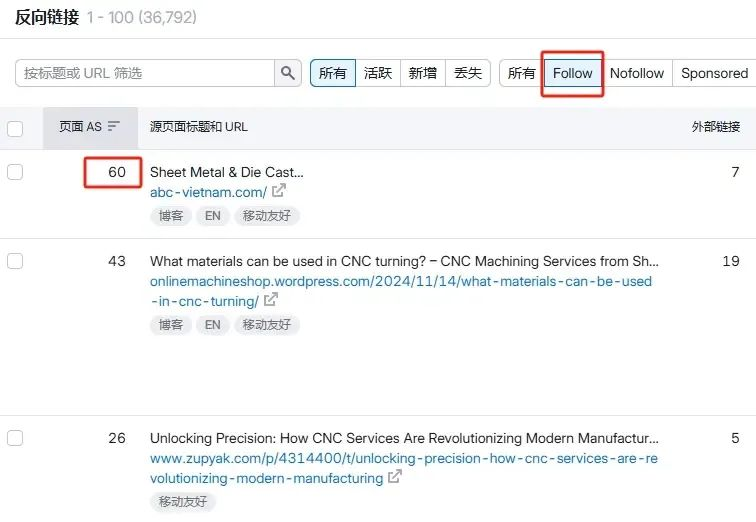

然后现在我们就可以筛选了，首先点击follow的外链，不然nofollow的哪怕你获取了但是也不传递网站权重，对你的优化其实帮助并不大。
然后关注一下外链的AS值，如果很高说明权重很高，对于你的网站是相当好的。
然后找到那些可以免费注册然后发布内容就可以获取高质量外链的平台。

## 三、使用Semrush研究竞争对手

上面详细的给各位介绍了Semrush的基础使用办法，自己用Semrush了那么久，感觉前面介绍的功能是比较实用的。
据说广告功能也还行，但是自己也不做广告，所以这一块也没有办法给各位详细的介绍了。
那其实如果前面的操作你都掌握了，那么了解分析竞对其实就是挖掘三块资源：
● 获取新的关键词
● 查看高质量外链
● 挖掘高流量的页面

#### 1.获取新的关键词建议

分析同行的关键词，可以帮助你挖掘更多好的关键词，因为一些关键词靠自己挖掘是比较有限的。
一些同行排名不高且难度不高的关键词就是我们重点的挖掘对象。

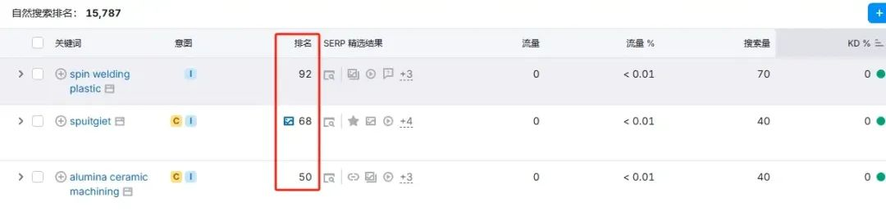

这些关键词竞对的排名也不高，且难度也不高。仔细挖掘一下然后认真布局的确是个不错的策略，同时一些难度低且有转化属性的关键词也可以被挖掘出来。
这些关键词虽然也是流量一般但转化属性非常的高。

#### 2.挖掘高流量的页面

有些话题其实排名并不难，难的是挖掘这中话题。
因为这种话题自带高流量，在配合上高质量的内容，那么网站会获的爆发式的流量增长的。

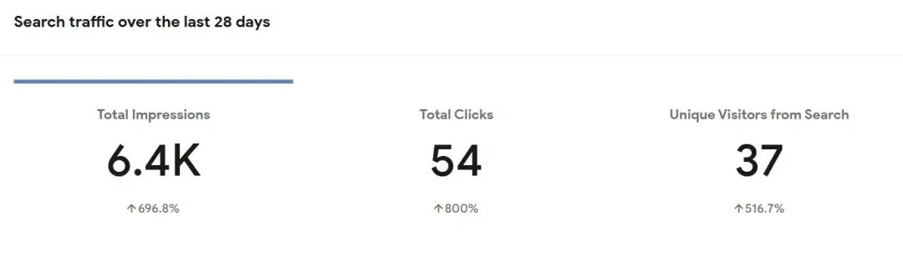

就像这篇关于谷歌SEO指南的内容，因为把谷歌SEO这个关键词排在了第二页且内容质量也很扎实，就在短时间内获取了大量的点击。
当然由于这个关键词的竞争很大，所以先稳住第二页，后面也会慢慢想办法争取到第一的。

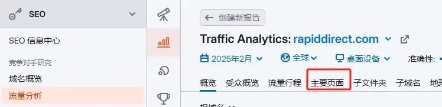

也是在搜索框输入竞对的域名，然后找到流量分析的功能按钮，点击进来找到主要页面。

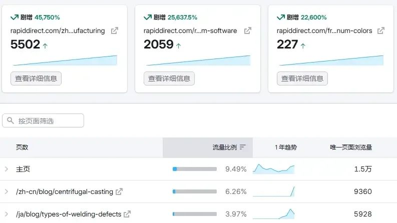

然后做针对性的收集就可以了。
当然一些朋友问我，也这样操作了，但是自己写的内容也没有获得很好的排名和流量。
如果只是单纯的模仿，炒冷饭并不会带来很好的流量支持的，肯定是基于竞对原有的内容给出更充分的内容建议才可以。

## 四、Semrush使用的补充与注意事项

Semrush是个不错的工具，但是不要过度依赖使用。
自己用这个工具主要是分析竞对的数据情况，以及挖掘有价值的关键词和内容。
但是一些伙伴把它用来当自己网站的数据查询工具，而不使用谷歌站长工具。
Semrush的数据流量是不准确的，建议搭配Google Analytics等工具进行交叉验证。

#### 1.SEMrush 流量预估偏差超 30%，过度依赖有风险

在关于Semrush的探讨中，众多文章往往着重强调其强大的多功能性，却常常忽视了这款工具在特定场景下所存在的局限性。
Semrush作为一款备受瞩目的在线营销竞争情报平台，确实在诸多方面展现出卓越的能力，例如其在关键词研究、竞争对手分析以及网站审计等方面提供了丰富且全面的数据与功能。
然而，当涉及到流量预估这一关键领域时，Semrush存在着不容忽视的问题。
它的“预估流量”数据，主要是依据关键词的排名情况以及搜索量来进行计算的。但根据自己的那么长时间的实际测算，Semrush的预估流量与网站实际所获得的流量偏差可达30%以上。
这意味着，单纯依赖Semrush所给出的预估流量数据来制定营销策略，极有可能出现较大的偏差。

#### 2.不要过度依赖

过度依赖SEMrush存在一个容易被忽视却十分严重的问题，那就是可能导致营销策略的同质化。
在SEO方面，Semrush提供了诸如关键词难度（KD）等重要指标，使得营销人员能够便捷地筛选出看似优化难度较低的关键词。
以长尾词为例，由于SEMrush显示KD<30的长尾词竞争相对较小，许多竞争对手往往会依据这一数据，不约而同地将优化重点放在这类长尾词上。
但这种一窝蜂式的做法往往会陷入同质化竞争的泥沼，使得原本本来不是特别难的词一下变的很难了。
其实谷歌上面的很多people also ask的问题长尾词就很容易被忽略，因为大家都跑去用semrush去了。
