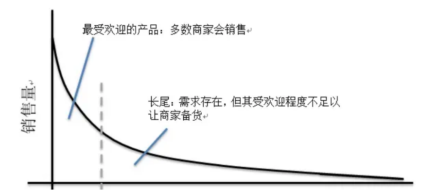
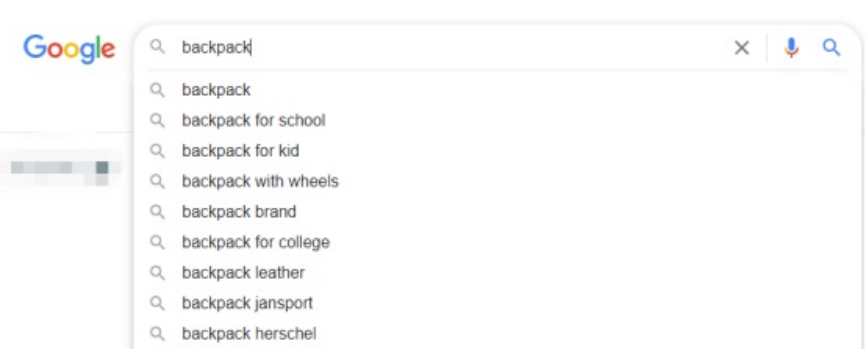
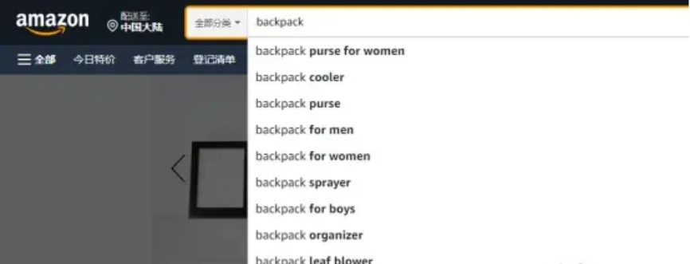
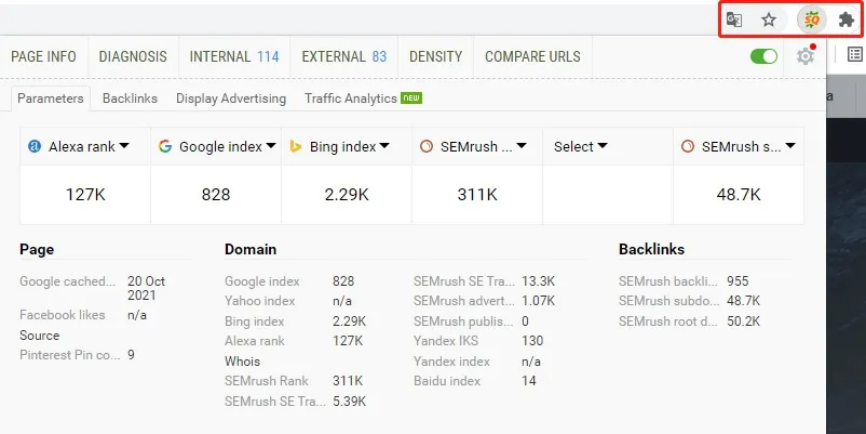
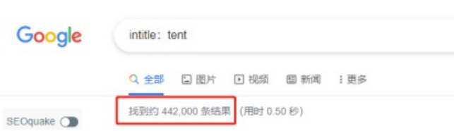
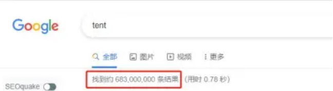
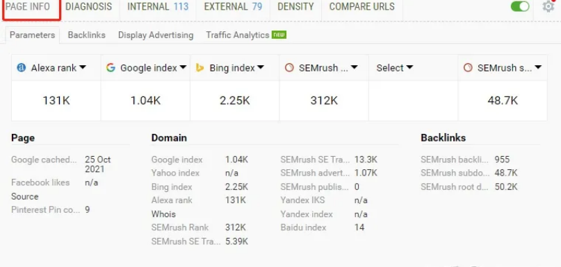
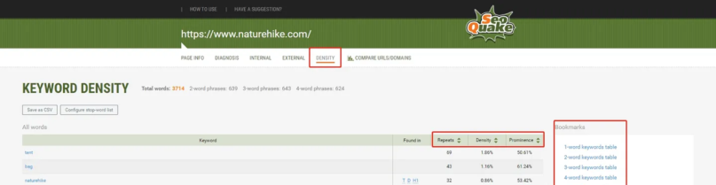
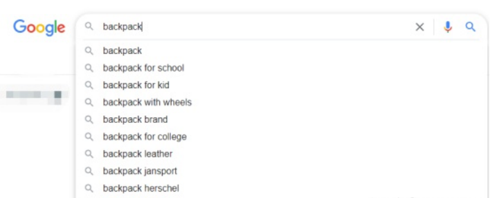
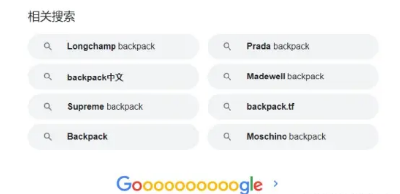

# 品牌独立站谷歌 SEO 成功秘诀 —— 关键词研究与分析

## 一、为什么要研究关键词？

无论是做SEO 优化还是广告投放，在开展工作之前，我们首先都必须研究关键词。因为你至少要先知道哪 些词是你的目标客户在搜索的，有流量的，才能继续接下来的工作。关键词研究就是要去找到这些值得关 注的关键词。

一个值得我们去下功夫的关键词一定要满足：

（1）这个关键词有一定的搜索量。我们花大量精力去做优化的词，最后发现根本没人搜索，那就太浪费时 间了。比如公司名字或不含通用词的产品名在打响品牌知名度之前不太会有用户去搜，就没必要拿去做优 化。

（2）这个关键词的优化难度在你的能力范围内。这里要说明的是，有一定搜索量的词，不代表就是最热门 的词。比如，“运动鞋、汽车、家居”这样大的产品类目的词，搜索用户非常多，但它的优化成本过高， 需要花费大量时间、人力和资金，对于小企业和个人卖家来说难度太大。

（3）这个关键词要能够给你带来流量。你可能会疑惑：一个关键词有很大的搜索量，难道不能给网站带来 流量吗？还真不一定。比如你是一个销售LED 灯具的独立站，搜索”LED lights”这个关键词的用户，也 许是你的潜在客户，但他也可能是LED 生产厂家的工作人员。搜索“律师”这个关键词的不一定是寻求律 师服务服务的客户，也可能是准备律师考试的学生。

（4）这个关键词带来的流量是有商业价值的。一个词能带来流量不等于能带来商业价值。比如：用户搜索 buy basketball shoes 这个词很大概率是想买篮球鞋，这个能带来的商业价值就比较高。用户搜索best basketball shoes 意味着有一半概率是想买篮球鞋，不过现在还处于对比阶段，不确定要买什么篮球鞋， 这个词带来的商业价值中等。用户搜索what is basketball shoes ，可能还不了解篮球鞋是啥，或者只是 想了解下篮球鞋，不一定有购买意向，所以这个词带来的商业价值比较低。

（5）关键词多样性。同一个关键词，用户的搜索习惯和我们认知范围内的热门词可能不同。如热门词“英 语培训”，用户有了更明确的需求，可能会搜索“雅思/口语培训”；甚至用户的搜索词长度变得越来越长， 如“上海浦东口语培训”，所以，企业在做关键词优化时，要尽可能考虑全面。

## 二、如何选择关键词？

#### 1、核心关键词筛选的“三要”与“三不要”

相关的关键词

关键词要与网站内容和产品有相关性，高契合度有助于 Google 排名。

热门的关键词

紧跟实时热点，搜索热点，抓取第一波流量。

## 难度低的关键词

一般搜索量相对不是很高的关键词，以长尾关键词居多。这样的关键词竞争对手一般不会特别多，难度较 小。

## 关键词避免太宽泛

过于宽泛的关键词往往竞争激烈。如何进行具体地判断？你可以在谷歌上输入该关键词，如果排名前十的 网站均为大型网站，那么说明这个关键词的竞争较大，不适合新手。同时，太宽泛的关键词往往不够精准， 不能为网站带来的高转化的精准流量。

关键词避免太冷门

个人的品牌名、自定义的产品名等这类搜索量过低的关键词，没必要浪费时间进行优化。同时，特别长的 关键词，可以用于产品页的优化，但是作为核心关键词不太合适。总的来说，建议选择搜索次数多，同时 竞争小的关键词。

## 关键词避免过于专业化

很多新手商家容易犯一个错误：选择过于专业的词汇。而有意向购买的客户往往并没有那么高的专业性。 这样容易造成网页流量过低，或者进入网站的流量多为无效流量的现象。

针对于刚开始进行 Google SEO 优化的网站，由于还没有太大竞争力度，建议可以先使用竞争低难度小的 长尾关键词。

## 2、长尾关键词筛选

长尾词Long tail keywords，就是那些目标用户可能会输入搜索的，但是比较长的词组或短语，这些词可 能单个没有那么大的流量，但是竞争相对低，用户的意向相对明确，积少成多，做好了也会有客观的量。

## 长尾理论

长尾效应最初由《连线》的总编辑克里斯 · 安德森（Chris Anderson）于2004 年发表于自家的杂志中， 用来描述诸如亚马逊公司、Netflix 和 http://Real.com/Rhapsody 之类的网站的商业和经济模式。是指那 些原来不受到重视的，销量小但种类多的产品或服务，由于总量巨大，累计起来的总收益超过主流产品的 现象。

## 1）利用谷歌搜索引擎

以在谷歌搜索引擎上搜索关键词Backpack 为例，可以看见当搜索时，搜索框下方自动出现一些相关的长 尾关键词，这是谷歌根据大数据以及智能算法推荐的。

## 以搜索 backpack 为例，谷歌搜索引擎搜索页面示例

点击进入页面，下拉到页尾处，可以看到一个“相关搜索”的部分。这一部分推荐的关键词我们同样也可 以用作长尾词的扩展。

以搜索 backpack 为例，谷歌搜索引擎页面尾部“相关搜索”部分示例截图

2）利用大型的购物网站

例如 Amazon 网站，同样也利用它可以扩展长尾关键词。在这类的大型网站中，记录了千千万万的搜索 热门词语。同样是以搜索 Wigs 为例，在其搜索推荐部分，我们也可以获得热门的搜索长尾词。

以搜索 backpack 为例，亚马逊搜索页面示例截图

3）利用竞争对手网站

比如我们的网站是售卖户外用品的垂直站，那么可以查看同样售卖户外用品的竞争对手网站，寻找长尾关 键词。

收集并扩展完充足数量的关键词后，下一步就可以对关键词进行评估。

## 三、如何判断关键词的竞争程度

我们都知道，对关键词的竞争度要进行评估筛选，根据评估结果来决定这个关键词是否适合自己的网站， 这是关键词执行过程中至关重要的一环。

那么，如何判断关键词的竞争程度？从哪些方面来进行评估呢？

#### 1、看关键词搜索次数

常用的工具就是关键词规划师Google Keyword Planner。注册后输入你的核心关键词并调整目标地区， 就会显示出这个关键词的热度搜索量趋势，以及有关该关键词所扩展的长尾关键词的月搜索量。

还可以用SEO 工具，如SEOquake。不管你想看竞争对手还是自家网站的流量情况和SEO 分析，SEOquake 都可以帮你轻轻松松实现。

SEOquake 插件

- 2、看关键词搜索结果（SERP）数量

在谷歌输入框中输入目标关键词，搜索引擎返回的结果数量越多，则表示竞争度相对越大；反之，则表示

竞争度相对越小。

一般情况下，搜索引擎返回结果数量和关键词竞争度关系如下：

- 1）搜索结果少于10 万：属于竟争较小的，认真做就有得玩。

- 2）搜索结果几十万：表示有点难度，网站质量和权重都不错的可以竞争一下。

- 3）搜索结果百万级：属于比较热门的词，优化到前几的难度很大，要整体好好规划。

- 4）搜索结果千万级：表示关键词超热门，几乎很难优化上去。

注意：有些词结果数很多，但竞争很小，因为没有什么商业价值。如，the、we、be 这种词几乎每个网站

都有，但没人搜。

还有些词结果数很少，但竞争很大，因为商业价值很高。如，特定用处的器材设备、特殊的药品等。

- 3、看intitle 结果数

根据网页标题含目标关键词的结果数，来判定关键词竞争强度，返回结果越多则竞争强度越大。查询语法： intitle：目标关键词。如，【intitle：tent】的谷歌返回结果数量是44.2W，而直接使用关键词tent 搜索得 出的数量相差甚远。这是因为页面有关键词，但title 没有关键词也会出现在结果页。但是title 中出现关键 词的页面才是真正的竞争对手。

Google 搜索 intitle：tent

Google 搜索 tent

#### 4、看竞价结果数

在Google 里搜索该关键词，看结果页面有多少广告，也是衡量竞争程度方法之一。

#### 5、看竞价价格

Google 关键词竞价价格流量估算工具：https://adwords.google.cn/selec

#### 6、看竞争对手的网站结构与内部优化

主要观察以下几点：

1）外链数和收录情况：运用搜索引擎link 查看竞争对手网站的外部链接，了解网页链接数量和质量，运用 工具查看网页的Pagerank。运用site 查看竞争对手网站的收录情况。如对方外链数较多，PR 值比较高， 收录页面多，则说明该站权重较高，关键词竞争度较大。

2）网站结构层次及其他：最多通过几次点击可以达到任何一张内容页？网站导航做得好不好？有网站地图 吗？包括html 格式和xml 格式的。

3）关键词优化：图片有优化吗？包括图片大小，alt 属性，如果是高手优化过的，为配合alt 属性里的关键 字，还会在图片周围放上目标关键字。该站是否有优化痕迹，头部和底部是否有关键词加粗，关键词连接， 关键词导航等常见手法。该关键词着陆页面是独立域名，还是二级域名？是专栏，还是单独的内容页？如 果该关键词排在第一页均为内容页，那么我们利用专栏页来优化则可能轻松超越对手。

4）title、keywords、description 标签及其他：title 是否放了目标关键词？目标关键词是不是放在前面？ title 格式是否合理？keywords 有没有优化过度？每张网页有没有不同的描述？

#### 7、内页排名数量

目标关键词搜索结果页面，排在前面的首页数量越多，说明竞争越大；数量越少，则竞争越小。 四、如何确定网站的核心关键词

1、头脑风暴。

确定核心关键词第一步，是列出与自己网站产品或服务相关的、同时比较热门的搜索词，自己先可以通过 头脑风暴列出待选词。这里建议你在确定核心关键词前问自己几个问题：

你的网站能为用户解决什么问题？

用户遇到这些问题时，会搜索什么样的关键词？ 如果你自己是用户，在寻找这些问题的答案时会怎么搜索？ 用户在买你的产品时会搜索什么关键词？

2、找朋友帮忙。

一个人的思路有局限性，有时公司内部人员对自己的产品太过熟悉，也会限制了思路，不容易从普通用户 角度出发。可以问一下公司外的亲戚朋友，要寻找你公司的产品或服务时会搜索什么关键词。 比如做camping，思路可能局限在camping tent 这些词，问了身边的人会发现camping destination 也 是潜在客户大概率会搜索的词。

3、spy 对手。

我们可以从竞争对手网站那里获取备选关键词。查看竞争对手网站首页都列出了什么关键词？标题标签中 又出现了什么关键词？可以利用工具，如SEOquake 插件。

## 可以选择关键词长度，从密度、重要性等维度对关键词进行评估

也可以看竞争对手的review，这里隐藏着大量的客户需求，并且客户的写法是符合当地受众的表达习惯的。

- 4、用工具查询词的搜索次数并做出对比。

客观而具有竞争度的核心关键词，可以借助关键词分析工具如Google trengs，Google keyword planner， 可以让你清楚了解到关键词的价值。

- 5、确定核心关键词。

确定搜索量大、竞争力较小的核心关键词，可以保证网站有足够的搜索量及优化成功后带来可观的流量， 又兼顾可行性。

## 五、关键词拓展

- 1、使用工具，如Google keyword planner；keywords everywhere。

- 2、搜索引擎的搜索建议和相关搜索。

以在谷歌搜索引擎上搜索关键词Backpack 为例，可以看见当搜索时，搜索框下方自动出现一些相关的长 尾关键词，这是谷歌根据大数据以及智能算法推荐的。

以搜索 backpack 为例，谷歌搜索引擎搜索页面示例

点击进入页面，下拉到页尾处，可以看到一个“相关搜索”的部分。这一部分推荐的关键词我们同样也可 以用作长尾词的扩展。

以搜索 backpack 为例，谷歌搜索引擎页面尾部“相关搜索”部分示例截图 3、变体词。

我们在优化某一个关键词时，不一定要用同一个关键词，可以使用多种形式的词来代替。如同义词、相关 词、简写、错写等。 4、补充词。 地名：旅游——云南旅游 品牌：手机——苹果手机 限定词：free、price、deal、promote、picture、how to 形容词：best、better、more、cheap 5、组合词。 把核心关键词和变体词、补充词组合起来。 6、流量分析。 分析用户在真正花钱买你这个品类的产品的时候，会输入什么词去进行搜索。 六、关键词分布 1、一个比较合理的整站关键词的布局应该是呈金字塔形状的。 首页（核心关键词）→栏目/频道页（二级关键词）→专题页（热门关键词）→内容页面（长尾关键词） 1）核心关键词位于塔尖，只有两三个，难度和搜过量最大，使用首页优化。

2）次一级关键词相当于塔身部分，可能有几十个，放在频道/栏目页，意义最相关的两三个关键词放在一 起，成为同一级别分类的目标关键词。

3）再次一级则放置于三级分类首页。同样，每个分类首页针对两三个关键词，整个网站在这一级的目标关 键词将达到几百上千个，小型网站经常用不到三级分类。 4）更多的长尾关键词处于塔底，放在具体产品/blog 页面。

2、关键词分组 把搜集到的关键词按相关度和竞争度进行分组。如： 一级 — 核心关键词，如云南旅游；次级关键词，如昆明旅游，大理旅游。 二级 — 包括昆明旅游景点，大理旅游攻略。 三级 — 关键词如大理洱海公园推荐玩法。

#### 3、关键词布局

- 1）每个页面只针对两到三个关键词。每个页面的关键词不宜过多，要保证页面主题突出。

2）避免内部竞争。建议每个页面内的关键词不要频繁地在其他页面出现，以避免内部竞争，分散权重和锚 文字效果。

3）内容策划。内容营销要根据关键词的布局来创作；理论上，内容越多，链接和排名机会就越多。这里要 注意文章的关键词密度，它统计的是同一个词出现的频次，建议不要让关键词密度过高，一般在2%~8% 为宜，可以考虑用同义词替代。

- 4）在URL 中带入关键词。建议尽可能使用静态URL，并让关键词出现在URL 中。关键词与目标页面对 应，URL 用关键词不要用随即词。

- 5）做好关键词库。关键词库也就是关键词与网站URL 链接的对应的表格，文件格式建议Excel。写明信 息：关键词、指数、URL、是否收录、排名情况、甚至流量情况。

- 七、关键词的三大类型

#### 1、导航类关键词

导航类关键词指的是用户在搜索特定网站时，不记得网址或懒得自己输入网址，所以在搜索引擎直接输入 品牌名称或与特定品牌有关的词。导航类关键词大致占所有搜索的10%。

有的导航型关键词非常明确，如苹果官网。这种关键词最符合用户意图的结果通常只有一个。有的导航型 搜索稍微有些模糊，如搜索亚马逊商城，用户既有可能是想访问京东商城或淘宝网站，也有可能是想看新 闻或评价等。

当自己的品牌名被搜索时，网站排在第一是必须的。而要想在竞争对手的导航型关键词中排名靠前，可以 通过关键词竞争，但增强外部链接和锚文字是最主要的方法。

#### 2、交易类关键词

交易类关键词指的是用户明显带有购买意图的搜索，商业价值大。如running shoes shopping。交易型 关键词占全部搜索的10%左右。

这类用户已经完成商品的研究比较过程，在寻找合适的卖家，离网上交易只差一步。吸引到这样的搜索用 户，转化率是最高的。

#### 3、信息类关键词

信息类关键词指的是没有明显购买意图，也不含有明确网站指向性的搜索，用户只是查询想要的信息。这 类关键词占总搜索数量的80%。

用户通常还处在了解需求、商品研究阶段。针对信息类关键词进行优化，是网站长尾页面的任务。虽然这 类关键词并不一定导致购买，但是在用户进行商品研究时进入用户视野也是非常重要的。
