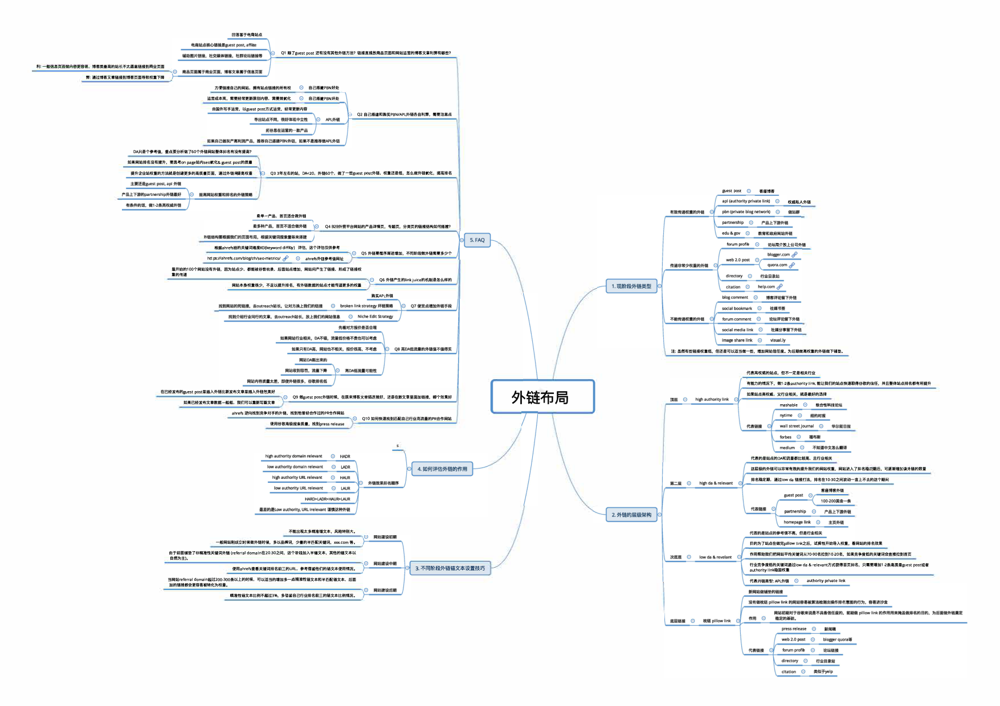

<!-- 说明：源 PDF 的文字层是坏的字库映射，提取出的文字为乱码（原内容实为一张「外链布局」思维导图，见下方图片引用）；第 2 页为公众号引流海报图片，无文字层。阅读本篇请直接查看图片。 -->

<!-- Start of picture text -->
回答基于电南站点 刁 Q1除了即est区'st 还有没有其他外链方法？悍拌盲撸节噶品页面和网站运云的婚客文章利弊有郬些？ 利 博客质噩石的站长不太愿忘链接到际业页面 弊通过搏善入阜丛接到博客页面导致权重下降 方便链接自己的网站 ， 拥有站点链接的所有权 O  目已搭煌PBN好处 运营成本两，秃要经常更新原创内容 ， 锅雯侬优化 0  自己搭湟PBN坏处 由国外写手运营，以'"est户Xt方式运营，经常更新内容 _，  Q2目已搭墟和购买PBWAP3卜链各目利弊，需要注意点 DA,气是个参考值，雷点亨分析悚了60个外链网站整体抖1名有没有提高？ 如果网站排名没有攫升，要思考onpage站内seo优化&臣estp<>st的质量 提升企业站权重的方法就是创逵更多的高质量页面，通过外链来提忘权亟 K)  Q3 3年左右的站，平<20 ， 外链60个， 傥了 一 些即estmst外链 ， 权重还是低，怎么依外链优化，完禹排名 客座博客 扣肝私人外链 卖单 产品 ， 首页玉合伐只让 ,0  Q4泣吵卜贸平台网站的产品详喟页，专匿页，分类页的恒仅扭彴如何搭建？ 根骼ah「e行给的关遣词难度灯X虹沪心rd.ffi切） 评估，这个评估仅供参考 伈rumpr的b O  论坛闯介放上公司外链 0  QS外链蔓霜序渐进增加，不同阶氐饮，.....贾多少个 呈开始的100个网站没有外链，因为站点少 ， 都能被谷歌收录 ， 后面站点墙加，网站间产生了链接 ， 形成了链接权 O  氓外链产生的ImkJUlce的机料是怎么样的 网站本身权重很少，不足以提升排名，有外链数益的站点才胚石湛更多的权霎 购买APL外链 注虽然有些钮接权重低，但还是可以适当蚀 一 些，常加网站信任度， 为后期像杰权重的外链做下镶垫， 代表岳权魔的站点，但不 一 定是相关行业 有能力的信况下，位1-2条aut比W叮li吹， 能让我们的站点快速取得谷歌的信任，井且整体站点排名都有所摆升 在已经发布的氐estpost里插入外链比新发布文壹里捆入外艳劝早好如果已经发布文壹数汇 贮般 ， 我们司以重新写篇文壹 0  Q9傻g屯st严t外链时候，在原来博七入罕1忐江饺灯，还是在新文哀昆面加链接，哪个效果好 外链布局 如杲站点点权威 ， 又行业相关，就是最好的选择mashable  O  综合性科技论坛 ah飞伈逆向找到竞争对手们，开钉，找到他艺经合作过的P'己作网站 0  Q, O 如何快逮找到匹配自己行业窝流运的PR合作网站 使用谷歌南级搜索质量，找到pmss”lease 代表的是站点的立和浣重都比较忘 ， 且行业相关 这层级的外链可以非..从旧提升我们的网站权重，网站注入了月1名粗，霸民，司忐...心江，勹诮的贮兰 排名稳定糊 ， 通过l=da 链接打法，排名在10-30之间波动 一 直上不去的这个期位] 客篷博客外链 不能出现太多疗准谱文本，风险特别大. 一般网站刚hi'，JI羡傥外链时侯，多以品牌词，少量的半匹配关谴讲，双xcom等. 目的为了站点在做完plll叩lmk之后，试探性开始导入权重，香网站的排名效杲 臼于前面镖垫了非秸准性关望己，勹煤(re化rral domaln在20-30之间，这个阶段加入半着文本，其他的懂，，本以 作用帮助我们把网站平均关键词从70-90名拉到10 20名，如果竞争度低的关过词会育梓拉利首页 自然为主）. 便用a压七查亏关键词排名前三的URL， 参考侣签他们的诅文本便用信况. -•  3.不同阶段外链铀文本设置技巧 aut比wltylln心国权重行业竞争度低的关键词涓过lowda&「elevant方式获得首页抖1名.只需要增加1 2条烹.三E'，丐t扣式或者 代表，迂类笠，心UH链 0  authorlwprlvate llnk 加的迁投都会更容易彼转化为权亟. 嘱准性毯文本比例不超过3%，多借鉴自己行业排名酌三的伍文本比例惰况 . 当网站对erral dqnam总过2OO-3OO条以上的时候 ， 可以适当的增加多一点精挫灶伍文本和半匹配韬文本 ， 后面 比tpsJiahre缸0mlblogzh/seo咋tncsi夕 0  ah飞仁外涟参考值网址 重的传递 驴est沁" 0 <!-- End of picture text -->
