# 如何让网站被Google快速收录？

提高网站在搜索引擎的可见性对于企业的业务增长非常重要，浏览用户或者潜在客户能在谷歌或者其他搜索引擎上搜索到你的网站，不仅提升用户的信任度且是选择产品和服务的重要参考。
如果输入品牌名在谷歌搜索引擎上搜索不到任何结果，客户会质疑产品的来源，
品牌曝光在谷歌首页对业务增长至关重要。能够在谷歌上看到你的网站，不仅能够提升用户的信任度，还能帮助品牌在竞争中脱颖而出。
对于许多用户而言，谷歌搜索结果中的品牌曝光是其选择产品和服务的重要参考。
接下来会详细介绍给大家网站如何操作可以在谷歌获得更多露脸的机会。

## 一、为什么网站被Google收录很重要？

网站被Google收录是获得流量的基础，根据Ahrefs数据，92%的搜索流量集中于Google平台。
如果网站没有被谷歌收录，也就相当于消失在互联网汪洋中，用户无法通过搜索发现其存在。
这意味着用户没有办法通过谷歌找到该网站，所以该网站也不会有曝光度和知名度。
Google的收录机制本质是对网站质量的初步筛选。
- 频繁更新
- 符合规范的内容更易获得高权重
- 新站优先提交XML sitemap可加速收录进程
- 建立搜索引擎信任基础
还要注意的是，收录量与品牌关键词搜索结果呈正相关，企业若忽视博客、新闻稿等内容的收录，可能错失长尾关键词带来的精准流量。
收录是SEO的基础门槛，未被收录的页面无法参与任何关键词排名竞争，即使内容优质也无法触达目标用户。
但收录并非终点，页面的点击率（CTR）和用户停留时间等行为指标，会间接影响后续SEO表现。
这要求企业在确保收录的同时，优化标题吸引力、内容相关性及用户体验，从而在网站内容被收录以后增加关键词排名。
实战中，企业应建立系统化收录策略：
- 定期通过Google Search Console监控覆盖率，及时处理未收录页面；
- 优化页面加载速度与移动端适配性；
- 利用高质量外部链接和社交分享加速收录；
更要注意"重数量轻质量"的盲目效率，哪怕后面内容再多，在谷歌上没有排名也是白白努力。
哪怕写的慢一些，哪怕一周只有一篇，只要有排名。
那慢即是快...

## 二、如何检查网站是否被Google收录？

#### 1.使用Google Search Console工具

首先登录谷歌站长工具，找个这个搜索框，把想要检查的网址输入进来。

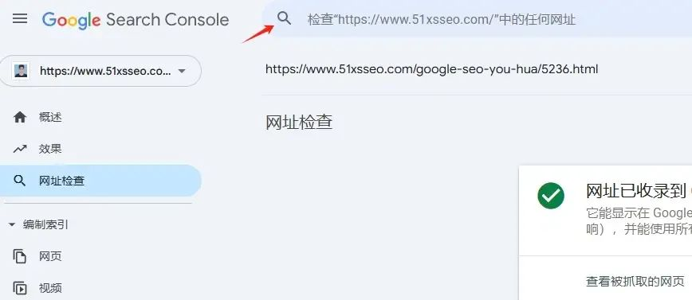

点击回车，就会变成这个样子。
这个时候就可以清晰的看到该网址页面是否被谷歌收录了。

如果还没有被谷歌收录，那么建议第一时间点击请求编入索引，这样收录会加快很多。
不然新页面要等3-7天才会被谷歌收录。

#### 2.通过Google搜索指令查询

下面几个办法也是可以帮助我们了解某个页面或者网站是否被谷歌收录了。
**1)site+具体链接**
这种办法可以直接发现某个链接是否被谷歌收录了。

就是需要去掉https，显示成图上这样的url即可。
如果是被收录了，就会显示成下面的样式，且是唯一性的。
如果有其他的链接，说明内容重复度过高，建议是优化修改一下的。
**2)site+域名**
使用这个办法，可以检查网站总体的收录情况。
适用于网站刚上线，不知道网站是否被谷歌收录的情况。

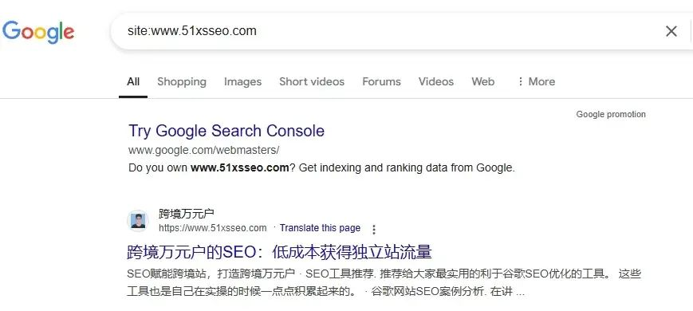

如果网站整体被收录了，那么都可以通过这个指令发现。
如果有些还没有被收录就可以使用我上面第一条的办法来针对性的排查。
**网站没有被谷歌收录的原因排查**
**1)检查index代码状态**
不同的网站后台操作系统可能在设置网站“是否可被索引”的方式存在差异。
但是设置的原理都是一样的，只要网站的前端头部的robots被设置成index状态即可。
这样你的网站就可以被谷歌抓取并收录。

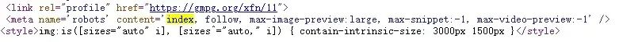

可以在网页的任何页面查看index情况，因为每个网页都是有独立的index设置的。
所以如果某个页面长期的不收录，那么就要看一下网站是否设置了noindex，如果是设置成noindex的话自然不会被谷歌搜索引擎所收录了。
如果你使用的是shopify或者wordpess这类的CMS系统，那么设置的时候也要注意一下下方：

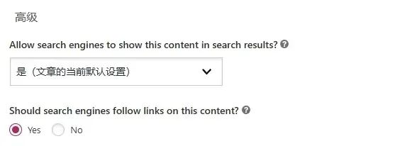

如果点击的是no的话，这个内容就没有办法被正常的收录了。
**2）使用谷歌站长工具排查**
绑定谷歌站长工具可以很好的监控网站的状态。
不仅可以精准地监控网站的收录，还能清晰地了解网站页面的情况以及问题根源，还能精确的了解关键词的排名与点击。

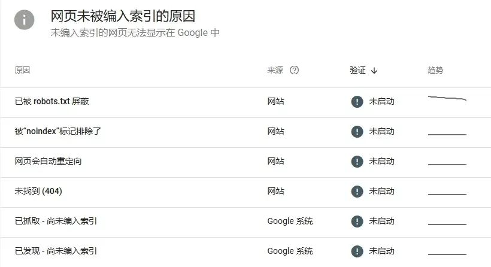

所以用好谷歌站长工具不仅可以帮助你有策略性的进行SEO，还能及时发现网页有啥问题，作为站长的你应该安装一个。

## 三、提升网站被Google收录率的具体技巧

#### 1.提交站点地图

提交站点地图是提升网站被搜索引擎收录效率的重要步骤。
首先，你需要生成网站的XML站点地图文件，可通过在线工具（如Google Sitemap Generator）或CMS插件（如WordPress的Yoast SEO）自动生成，也可手动编写。
生成后，将文件上传至网站根目录（通常命名为sitemap.xml）。
当然wordpress、shopify或者一些自建站都把这些技术性的问题都简化了。
在左侧菜单找到“索引”下的“站点地图”选项，输入sitemap.xml的完整URL并提交。

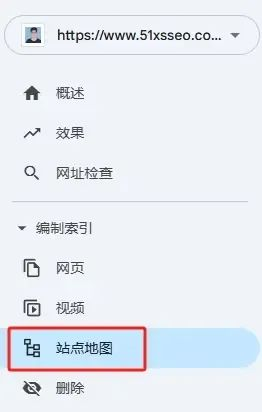

提交后，Google会在几小时至数天内抓取并处理该地图。
若需更新内容，可重新提交或通过“URL检查工具”请求重新索引。

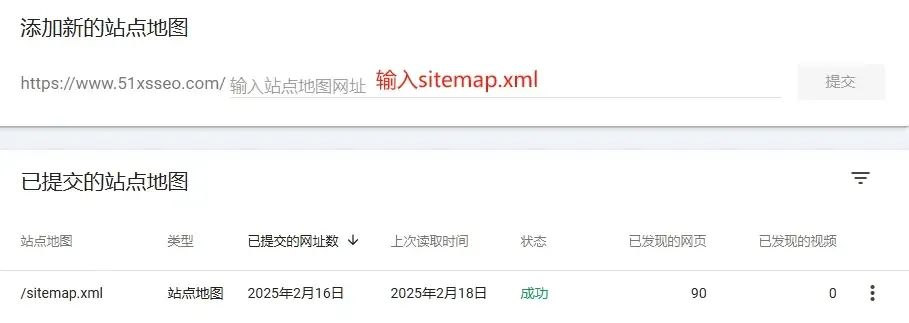

注意确保地图文件格式正确（符合XML标准），避免包含无效链接或重复页面。
然后等个几个小时，状态变成绿色的成功就可以了...

#### 2.优化网站内容质量

优化网站内容质量是提升搜索引擎排名与用户体验的核心环节，同时配合原创性和相关性是内容质量。
而合理的关键词布局则是实现SEO搜索流量的关键手段。
**1）原创性保障**
首先需建立内容创作的原创性流程。
避免直接复制现有内容，可通过行业调研、数据整合、用户访谈等方式生成独家观点。
也就是二次原创，在原有的基础上再做升级，这个办法其实自己写内容也是经常用到。
排在前面的内容可以帮我确定框架，然后按照这个框架填充自己的观点和内容。

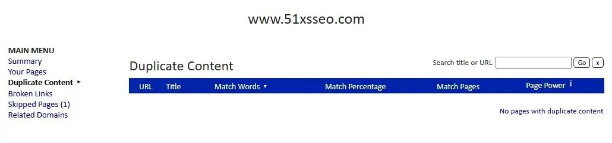

我是比较喜欢用Siteliner这个工具进行原创性检测的，建议将重复率控制在15%以内，同时对高相似度段落进行语义重构。
**2）相关性强化技巧**
内容需深度匹配用户搜索意图。
首先分析关键词背后的需求类型（如信息查询、产品购买、问题解决），例如"SEO优化教程"对应学习需求，需提供分步指南而非理论概述。
也就是要挖掘更多的长尾关键词来满足用户搜索需求和真实意图了。

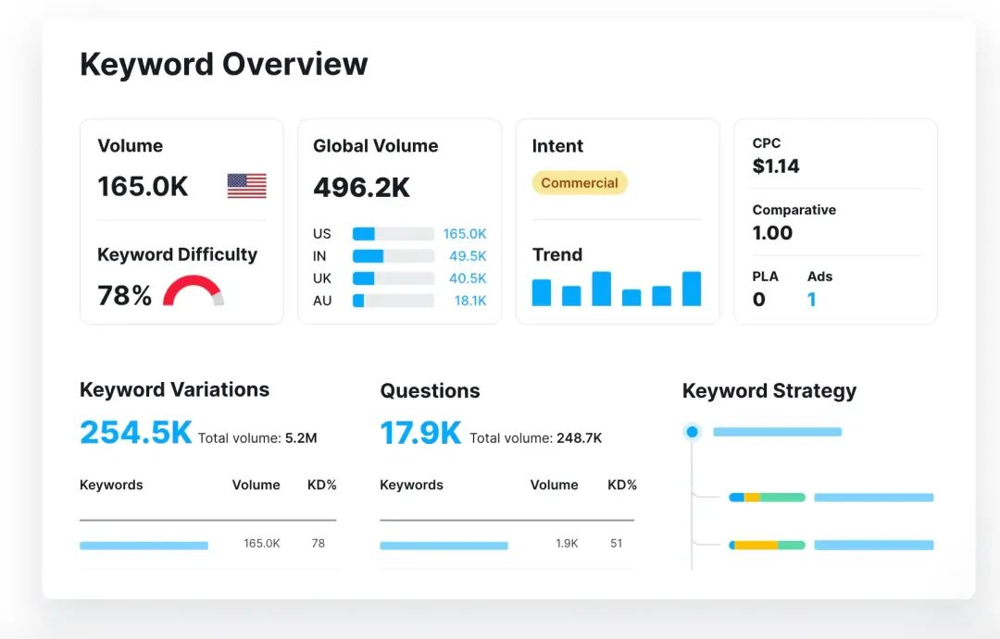

利用Semrush等工具挖掘用户长尾提问，将其整合到内容结构中，形成自然的内容模块。
所以研究一个关键词的时候，不仅要看关键词难度，也要着重看看关键词的变体和问题关键词。
比如某电商网站通过分析"如何选择降噪耳机"的搜索结果，发现同行关键词变体中有关于耳机续航时间和舒适度的关键词。
那就说明用户普遍关注续航时间和舒适度，因此在产品描述中增加这两块内容。

#### 3.修复404问题

谷歌爬虫每抓取一个404页面，相当于浪费一次抓取预算。
根据 Ahrefs 统计，网站每增加 1% 的死链接，整体抓取频率可能下降 0.8%。
当爬虫持续遇到无效链接时，会降低对该域名的信任度，导致新内容发现速度变慢。
就像之前操作过的一个电商独立站，曾因促销活动后未及时删除过期链接，导致新品页面收录延迟 3-5 天。

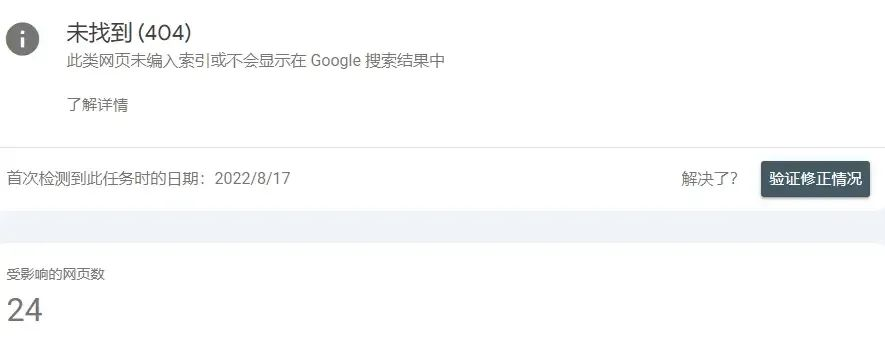

首先使用Google Search Console抓取错误报告或Ahrefs等工具检测死链接，优先清理高频访问的404页面。
对已删除内容设置301永久重定向至相关页面，保留85%以上链接权重。
对无法重定向的页面创建自定义404页面，包含网站导航、搜索框和热门内容推荐，将用户留存率提升40%。

## 四、影响网站被Google收录速度的关键因素

影响网站被Google收录速度的关键因素包括网站权威性、内容质量、技术优化水平、更新频率及外部链接质量。
首先，网站的域名年龄、历史收录记录和已建立的搜索引擎信任度直接决定爬虫访问频率，新站需通过提交XML sitemap和主动请求索引加速收录。
其次，内容的原创性与时效性是核心指标，深度解决用户问题的内容更易触发快速收录机制，而重复或低质内容会被延迟处理。
外部链接方面，来自高权重网站的引用可显著缩短收录周期，而社交媒体分享和内部链接布局能提升页面发现速度。
用户行为信号如点击率、停留时间也间接影响收录优先级，需通过优化标题和内容结构提升CTR。
持续更新频率（如博客每周3篇）可维持爬虫活跃度，而定期清理死链接和修复404页面能避免资源浪费。

#### 1.提高关键词排名

用户在搜索特定的关键词时，只有你的网站在搜索引擎中排名靠前，用户才会有机会看到你的网站。
因此为了提高网站的曝光和点击，网站需要精准的SEO优化，从而提高关键词排名。
关键词排名多了自然也能提高网站在谷歌可见度。

#### 2.优化网站meta seo标签

网站中优化标题和描述标签对于提高网站的可见性非常重要。

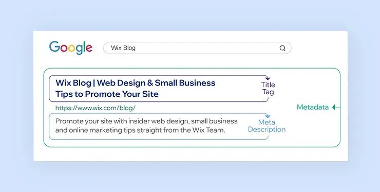

通过上图可以发现，标题是在谷歌SERP中用户最先看到的信息，好的标题可以提高网站的点击率。
一个高点击率的标题不仅简要明了且能精准传达页面的核心，也要巧妙的融入和内容页面高度契合的关键词。
然而，很多新手朋友很喜欢在标题和描述中添加很多关键词，这种做法是致命的。
这种过度堆砌的关键词不仅会让标题和描述起来很生涩、难懂，用户看着也是非常的难受。
同时这种行为也是一种过度优化的行为，也会被搜索引擎惩罚，导致网站排名下降或者从谷歌索引中剔除。

## 五、谷歌索引内容需要多长时间？

#### 1.新网站

一般通常需要几天和几周不等，一般来说大多数表现良好的网站都会在一周内被谷歌收录编入索引。
当然如果网站结构清晰且内容质量很高，且在网站的站点地图提交到谷歌站长工具后，一般24-72小时内就会被索引。

#### 2.已被收录的网站

对于已经被谷歌收录的网站，更新的内容通常在几天内就会被索引。
如果网站的权重还不错，且更新频率稳定且内容质量有保障，那么谷歌很快就会索引新内容，甚至在几小时内就能完成。

#### 3.借助谷歌站长工具

使用谷歌 Search Console 主动提交网址请求编入索引，通常能在提交后的几小时内完成索引，甚至更快。

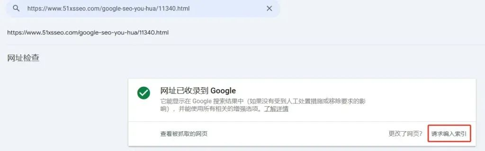

网站被谷歌收录是一件综合且持续的工作。
从确保网站被谷歌收录到优化网站的每个细节，每个SEO环节都是紧密相连且缺一不可。
品牌与网站运营者需深刻理解谷歌索引规则与用户真实搜索需求，才会慢慢提升网站的流量，而不是仅仅停留在网站被谷歌收录的阶段。
这样才能逐渐增高你的网站在谷歌上的可见性，吸引更多目标受众的目光，将流量转化为实际的业务增长动力。
