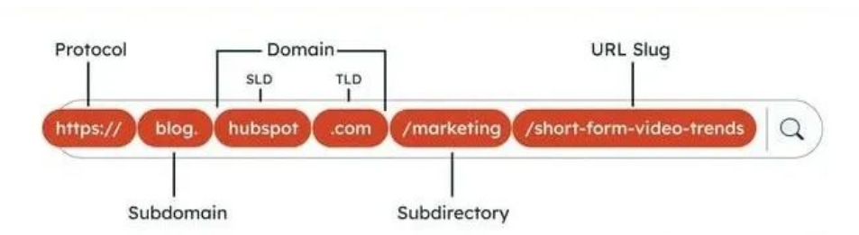
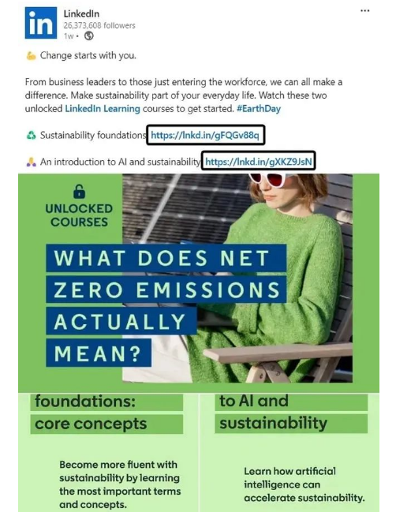
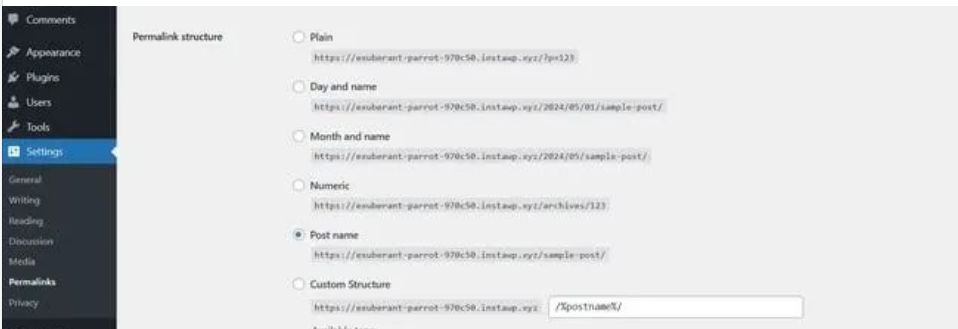
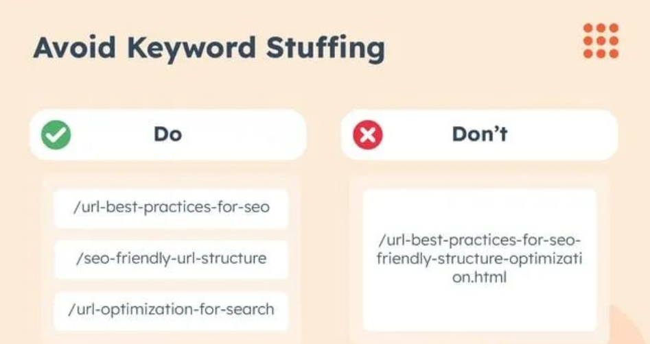

# 独立站 URL SEO优化12大技巧

## 一、什么是 URL？

URL（Uniform Resource Locator 的缩写）类似于街道地址，但用于 Internet。它不是帮助邮递员递送包裹，而是帮助互联网用户找到他们的目的地网页。实际地址包括城镇、街道、建筑物号和房间。同样，URL 具有分层级别，因此用户可以在网站的各个部分中找到特定页面。

典型的 URL 由几个部分组成：P rotocol、子域、域、子目录和 slug。协议可以是 HTTP 或 HTTPS，后者表示加密连接。子域通常是 “www”。（万维网），但像 “shop.” 和 “blog.” 这样的自定义子域并不少见。
之后是域名，它由一个顶级域（如 “.com”）和一个二级域（通常是品牌或项目名称）组成。
上述部分将帮助您访问主页。从那里，你可能会转到一个子目录（主网站内的一个文件夹）和一个用于标识单个页面的 slug。

## 二、URL 示例

请考虑以下 URL：https://blog.hubspot.com/marketing/url-best-practices-for-seo。它包含以下部分：
- 协议：HTTPS://
- 子域名：blog。
- SLD：hubspot
- 顶级域名：.com
- 子目录： /marketing
- slug：/url-best-practices-for-seo
从这个 URL 中，我可以看出我正在一个关于 URL 基础知识的博客上。它由 HubSpot 发布并使用加密连接托管。

## 三、为什么 URL 对 SEO 很重要

URL 将访问者引导至您的数字门口。此外，它们还可以建立您的页面与搜索引擎爬虫的关键字相关性。除此之外，与数字 IP 地址相比，URL 使导航 Internet 更易于访问。
只有当我们对 URL 使用 SEO 最佳实践时，这些好处才有可能。让我们进一步深入研究好的 URL 如此有影响力的原因。

#### 1.排名因素

URL 位于 Google 的确认搜索排名因素上，这有助于搜索引擎破译每个网页包含的内容。考虑到这一点，我在我的 URL 中添加相关关键字，以帮助 Google 了解我页面的内容、我制作它的原因以及它应该为哪些搜索排名。

#### 2.用户体验

关键词填充已成为过去。SEO 现在是一场取悦算法和有血有肉的读者的微妙舞蹈。我现在的目标是一个描述性的 URL，这样用户就知道该页面会发生什么。
如果有人在私信中发送了我的 URL，收件人是否确信他们点击进入了相关且有价值的页面？达到这个理想会给我带来更多的反向链接和销售。

#### 3.可访问的链接

如果说我讨厌 LinkedIn 的一件事，那就是它处理外部 URL 的方式。不能对锚文本进行超链接。相反，你必须添加一个裸链接，如果你使用非描述性链接（如 https://www.example.com/post/p123/），该链接通常会显得丑陋。

虽然我可以使用链接缩短器来使其更漂亮，但这是一个额外的步骤。我通过使用描述性、格式良好且简洁的 URL 完全避免了这个问题。
我们已经讨论了理想，所以让我们来看看 SEO 最佳实践，这些最佳实践将带您实现目标。

## 三、SEO 的 URL 最佳实践

1. 使每个 URL 尽可能简单。
2. 标准化 URL 命名约定。
3. 将 URL 结构限制为三个分层级别。
4. 避免添加日期。
5. 去掉 slug 中不必要的单词。
6. 谨慎处理动态生成的 URL。
7. 包含相关关键词。
8. 没有关键字填充。
9. 使其对读者友好。
10. 用连字符分隔单词。
11. 使用小写字母。
12. 不要使用属于其他页面的 slug。
**1. 使每个 URL 尽可能简单。**
SEO 是打了类固醇的魔方——复杂且不断变化。有时，我的救命稻草是 Google 的 URL 优化指南。我们被告知要 “创建一个简单的 URL 结构” 并使用 “在 URL 中使用简单的描述性词语”。
虽然 “简单 ”因人而异，但请根据业务选择以下良好的 URL 结构之一。
- 内容网站：https://example.com/category/post-title
- 电子商务网站： https://example.com/product-category/product-name
- 基于服务的网站：https://example.com/service-category/service-name
- 本地企业网站：https://example.com/location/service
- 作品集网站：https://example.com/portfolio/project-name
**2. 标准化您的 URL 命名约定。**
虽然我建议使用上面分享的变体之一，但我偶尔会在我的团队成员中集思广益，看看什么对我们有用。只要我们有一个标准并坚持下去，我们就很好。
“URL 是一个稳定的基础。一旦设置，更改它们可能弊大于利，导致链接断开和 SEO 汁液丢失——除非通过重定向进行适当管理，“Cascade Interactive 的创始人 Ryan Ratkowski 分享道。
我把它想象成建筑物的管道系统。我会专注于在设置过程中正确配置，而不是在五年后拆除墙壁。在网站的初始构建期间纳入 URL 的 SEO 最佳实践。
**3. 将 URL 结构限制为三个分层级别。**
第一次设置 URL 结构时，我讨论了深入研究所有内容的子文件夹和子类别。我更有经验的立场是保持简单和合乎逻辑。
First Tier 的首席执行官 Jacob Kettner 建议“最多三个层次结构级别，确保清晰而没有不必要的复杂性。
为什么？“它实现了完美的平衡，提供了分类，而不会让用户感到不知所措，”他补充道。
**4. 避免添加日期。**
在将时间戳猛烈抨击到我的 URL 上之前，我会三思而后行。这就像在我的网页上添加到期日期一样。相比之下，用户（和 Google）更喜欢新内容。让您的 URL 保持永恒，就像经典的黑色 T 恤一样。
The Blogsmith 的创始人 Maddy Osman 对此表示赞同并补充道：“在大多数情况下，文章需要三到六个月的时间才能出现在 SERP 的前 10 名中。你不想通过在 URL slug 中包含上一年来限制该排名文章的潜力。
我使用 WordPress，所以我前往“设置”>“永久链接”以确保我没有启用涉及时间信息的永久链接结构。

**5. 去掉 slug 中不必要的单词。**
测验：您应该使用哪个？
- /how-to-optimize-your-urls-for-search-quick-tip
- /how-to-optimize-urls-for-search
作家和编辑经常问我这个问题。就我个人而言，我会删除对 URL 添加很少或没有意义的单词，例如“a”、“and”和“that”。没有 “your” 和 “quick-tip” 的后一个 URL 传达了相同的含义，但看起来不像一个单词 soup，所以我更喜欢这种变体。
此外，2023 年 Backlinko 的一项研究发现，较短的 URL 往往排在较长的 URL 之上，因此我使用 60-70 个字符的限制来避免长 URL。
为了获得更短的 URL，我还可以删除 “to” 和 “for” 这两个词，但我认为最好保留它们，因为它们使 URL 对人类更具可读性。这是一种凭直觉实现的平衡，但我知道你会通过练习来获得它。
**6. 小心处理动态生成的 URL。**
虽然静态 URL 在每次访问时都保持一致，但我遇到过在网页加载时自动生成动态 URL 参数的网站构建器。
在这种情况下，我没有完全的可自定义性来更改 URL，因此我不得不使用包含随机符号和数字的 URL。处理这个问题可能是一个挑战，但我不会为此失眠。
“只要您了解网站的局限性并且可以优化您可以控制的 URL slug，您就不必担心参数化 URL 会对您的 SEO 性能产生负面影响，”经验丰富的 SEO 顾问 Lauren Galvez 向我保证。
**7. 包含相关关键字。**
由于 URL 告诉搜索爬虫网页是关于什么的，因此我建议包含相关关键字以立即将所有内容传达到您的网页。
这也提高了我在页面上的点击率 （CTR）。2023 年 Backlinko 的一项研究发现，与 URL 与搜索关键词不同的网页相比，URL 与搜索关键词相似的网页的点击率更高。
例如，如果用户搜索 “ergonomic keyboards”，我会选择包含 “ergonomic keyboards” 而不是 “flexible keyboards” 的 SEO 友好型 URL slug。
**8. 没有关键字填充**

**当一篇文章与多个主要关键词相关时，我不会将它们全部包含在 URL 中。否则，我会留下这样的混乱：**
https://blog.hubspot.com/marketing/url-best-practices-for-seo-friendly-structure-optimization.html
哇，这看起来很丑。此外，读者需要几秒钟乏味的时间才能理解网页的内容。相比之下，URL 的 SEO 最佳实践将可用性置于几乎所有其他方面。
我所做的是为我的 URL 选择一个关键字，然后让我的内容来说话。
**9. 让它对读者友好。**
虽然我之前已经提到过，但值得重申的是，URL 应该对 Internet 用户来说是不言自明的。人们应该能够根据您的 slug 立即判断他们可能会找到什么。
考虑到这一点，有时我必须重新排序我的关键词。其他时候，我必须省略单词或添加停用词。例如，URL 别名 “/google-algorithm-update-names” 对读者来说可能很拗口，所以我会把它改成 “/names-of-google-algorithm-updates”。
**10. 用连字符分隔单词。**
URL 不能包含空格。因此，为了确保我不会得到像 “/googlealogrithmupdatenames” 这样的 slug，我使用了分隔符。Google 建议使用连字符 （-） 而不是下划线 （_）。
**11. 使用小写字母。**
虽然我只关心正确的大小写（即使在短信中），但我必须接受 URL 中小写字母的胜利。首先，它使事情保持一致。此外，它还避免了与任何区分大小写的 Web 服务器的兼容性问题，因为用户输入的 URL 可能会使用小写字母而不是大写字母。
**12. 不要使用属于其他页面的 slug。**
URL 需要一个唯一的 slug——或者 Google 将页面视为您网站上的重复内容，在某些情况下可能会受到处罚。为了防止我的网页在搜索引擎结果中相互竞争，我完全避免了类似的 URL slug。
话虽如此，特别是如果您拥有一家电子商务商店，您可能会意识到您有两个类似的 URL，如下所示：
- https://www.example.com/product-category-one
- https://www.example.com/product-category-directory/product-category-one
当我遇到这种情况时，我会告诉搜索爬虫我想在 Google 搜索中出现哪个网页。更具体地说，我使用规范标签，这是一种经典的技术 SEO 实践。
