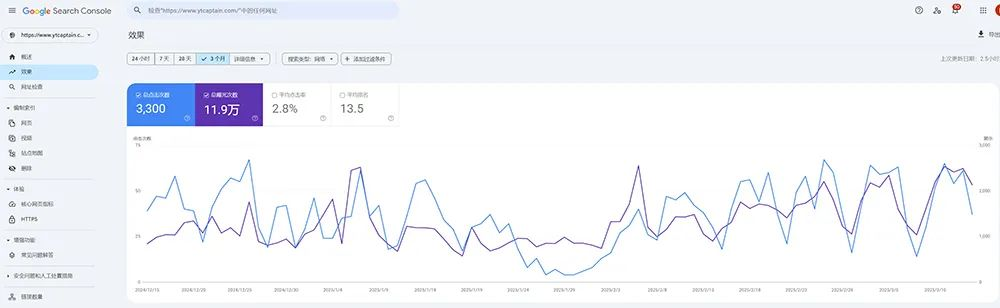
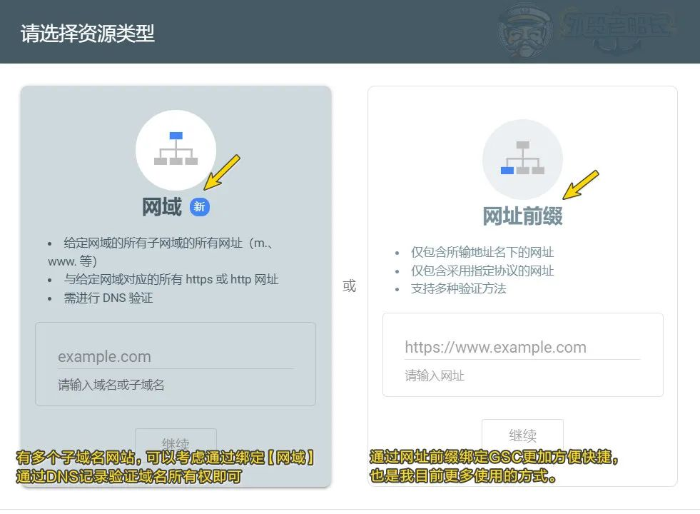
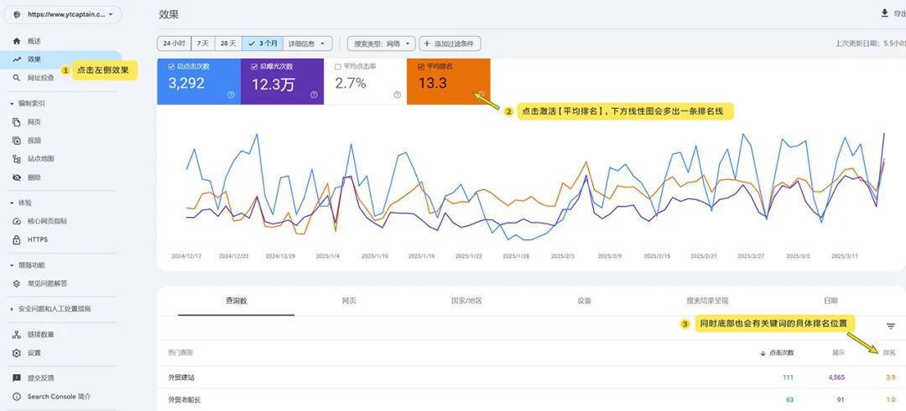
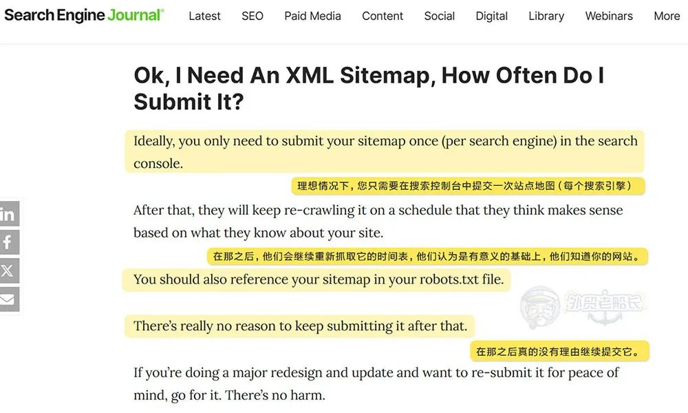

**独立站SEO优化指南：Google Search Console **
Google Search Console 谷歌搜索控制台（原谷歌站长工具），是网站SEO优化的重要分析工具。
本文是关于 Google Search Console（GSC） 的全面功能介绍、使用指南及SEO实战技巧，助你系统化提升网站的谷歌搜索表现：

## 一、Google Search Console是什么？

Google Search Console 是谷歌官方的网站管理及分析工具，方便管理者监测网站在谷歌搜索引擎的抓取，收录，曝光，点击，排名等，更加准确和全面的查看网站站内及站外SEO优化数据反馈，以及网站检查和页面检查等等。
本身绑定 Google Search Console 跟网站自身优化并无关系，只是通过它我们可以了解网站在搜索引擎的表现，针对性的进行内容和优化策略的改进和制定。

## 二、为什么Google Search Console重要？

以下可以通过使用Google Search Console来提升网站SEO性能：
- 检测网站页面抓取，索引和收录数量；
- 监控自然流量，关键词排名，CTR点击率，平均排名位置等；
- 识别删除，Disavow 外链和提交站点地图（Sitemap）
- 确保页面体验和Web Vitals正常运行；
- 排查网站页面抓取错误；（文章后面介绍索引报告分析）
- 分析网站链接数据（包含内链，外链及锚文本分配）；
这些都是谷歌GSC工具免费提供的信息，可以让我们更好地制定网站优化和改进措施。
同时，我们也可以通过Google控制台提交SEO需求和建议，有可能谷歌官方会采纳建议并反馈到Google Search Console里面。

## 三、如何使用Google Search Console？

谷歌控制台（GSC）登录链接：https://search.google.com/search-console/
- Google Search Console绑定方法
绑定Google Search Console 有两种方式，分别是【网域】和【网址前缀】。
常用的是【网址前缀】绑定GSC，更快捷和方便。

如果网站有多个子域名网站，可以考虑通过绑定【网域】的方式，通过DNS记录验证域名所有权即可，添加TXT记录到域名解析中可以生效。
需要注意之后做域名解析时，此谷歌记录不要删除。
绑定【网址前缀】的方法主要是通过GTM绑定GA，然后会自动关联到GCS，更加方便快捷。
- Google Search Console查看关键词排名
**贴士：Google Search Console 提供的关键词排名数据是抽样结果，并非网站在谷歌搜索中所有关键词的完整排名，意味着可能有一些关键词参与排名了但是在排名报告中未体现。**

- Google Search Console 提交站点地图

当网站设计完成并上线后，**主动提交站点地图给谷歌，促进谷歌发现新网站并尽快抓抓取页面数据，一旦提交之后，通常来说不用再提交了**，网站如果有大量的内容更新，可以一个季度去提交一次。
Search Engine Journal 曾经说过XML sitemap并不是影响排名的因素，你只需要在谷歌搜索控制台中提交一次站点地图就可以了。
**提升谷歌抓取频率建议：**
想要外贸网站有更好的抓取效率，网站保持稳定的更新频率更重要，谷歌爬虫程序抓取频次也会提高，新更新的页面收录的机会也增加。

## 四、谷歌GSC编入索引报告分析

以下是Google Search Console（谷歌搜索控制台） 中“网页未被编入索引”常见原因的深度解析及解决方案：
1. 网页会自动重定向（Redirected）
**原因：**
网页被永久（301）或临时（302）重定向到其他 URL，Google 认为目标页面是最终结果，因此不索引原页面。
**解决方案：**
确认原页面是否需要保留。若不需要，忽略次提示即可；若需要索引原页面，移除重定向；
2. 备用网页（有适当的规范标记）
**原因：**
网页标记了 rel=canonical（规范标签），指向其他URL，Google仅索引规范页面，忽略备用页面。
**解决方案：**
通常来说备用页面是系统默认添加的，比如分页和重复页面等，通常不需要额外处理。
3. 未找到（404）
**原因：**
页面是404状态，谷歌认为内容不存在；
**解决方案：**
恢复页面：修复错误链接；
**301重定向：**若页面已移除，做301重定向到可替代的相关页面；
**清理失效链接：**可以用“Dead Link Checker 死链接检测工具”检查站点，找到404页面的来源页面并修复；
4. 已被robots.txt屏蔽
**原因：**
网站的robots.txt 文件中包含 Disallow规则，禁止Googlebot抓取该页面；
**解决方案：**
调整Robots指令：移除对应页面的Disallow规则，允许抓取；
5. 已抓取-尚未编入索引
**原因：**
**内容质量低：**重复或内容过短（如仅有图片/视频，文本极少）**。**
**优先级低：**新站点或低权重页面可能需更长时间处理。
**解决方案：**
**内容化：**增加原创性、补充有价值内容与关键词覆盖。
6. 被“noindex”标记排除
**原因：**
页面 <meta> 标签或 HTTP 响应头包含 noindex 指令，明确禁止索引。
**解决方案：**
代码检查：查看页面源代码，搜索 <meta name=”robots” content=”noindex”>，删除或改为 index。
7. 已发现 – 尚未抓取
**原因：**
Google已经通过Sitemap或者外链发现页面，但是抓取资源有限尚未抓取页面；
**解决方案：**
**提交 Sitemap：**在 Search Console 提交 XML sitemap，帮助 Google 快速发现新页面。
**内链优化：**确保页面有足够的高权重内链（如首页、导航栏链接）。
**外链布局：**通过社交媒体或外部分享页面，加速爬虫发现。
**GSC索引报告总结：**
1. 网站重建后必然会有很多404页面发现，但是不建议做太多的301跳转，易影响谷歌爬虫发现网站过多的跳转反而不友好；
2. 绝大部分的未索引和未抓取是由于网站是新站期和谷歌的抓取资源量有限导致，并不一定是页面自身问题，做站内文本链接优化，提高页面之间的互通性，可以提高抓取效率；
