# 独立站SEO初学者必备技巧指南

SEO 是搜索引擎优化 (SEO) 的缩写。它是一种为了在提高网站在 Google 等搜索引擎上的排名，而改进网站内容、结构和可见性的做法。
SEO 对于个人和企业来说都至关重要。它可以帮助小型网站与大型网站竞争， 无需完全依赖广告即可吸引自然流量，并通过出现在搜索结果顶部来提高信誉度。
自然搜索驱动着大部分网站流量，这使得 SEO 成为最强大的数字营销策略之一。无论您运营的是博客、在线商店还是本地商业网站，了解 SEO 都能提升您的覆盖面并取得更大的成功。

## 一、SEO如何工作？

SEO 的作用是帮助搜索引擎了解您的网站内容并确保它出现在相关搜索中。
这个过程涉及三个关键步骤：爬取、索引和排名。

#### 1.爬取：搜索引擎如何发现内容

搜索引擎使用被称为“爬虫”或“蜘蛛”的自动化机器人来扫描网站。这些机器人会跟踪各个页面的链接，发现网络上的新内容和更新内容。如果您的网站结构清晰，并且内容定期更新，那么爬虫就更有可能找到您的所有页面。

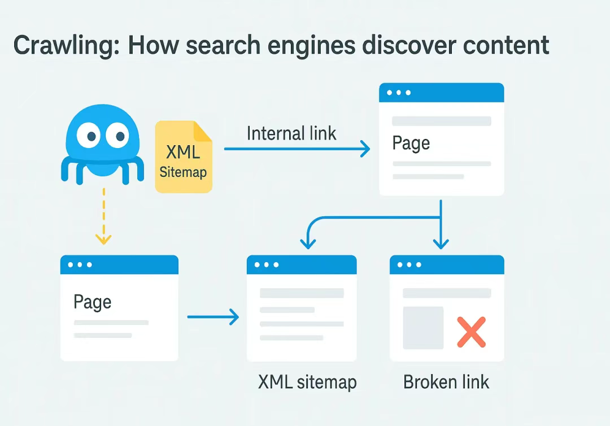

为了确保搜索机器人能够有效地抓取您的网站：
- 使用有组织的网站结构和 内部链接
- 创建 XML 站点地图来引导搜索引擎爬虫
- 定期 更新内容以保持新鲜度
- 避免 断开的链接并修复 Google Search Console 中的抓取错误

#### 2.索引：搜索引擎如何存储内容

网页一旦被抓取，就会被分析并存储在搜索引擎的索引（一个庞大的网络内容数据库）中。当用户输入相关查询时，被索引的网页就会出现在搜索结果中。

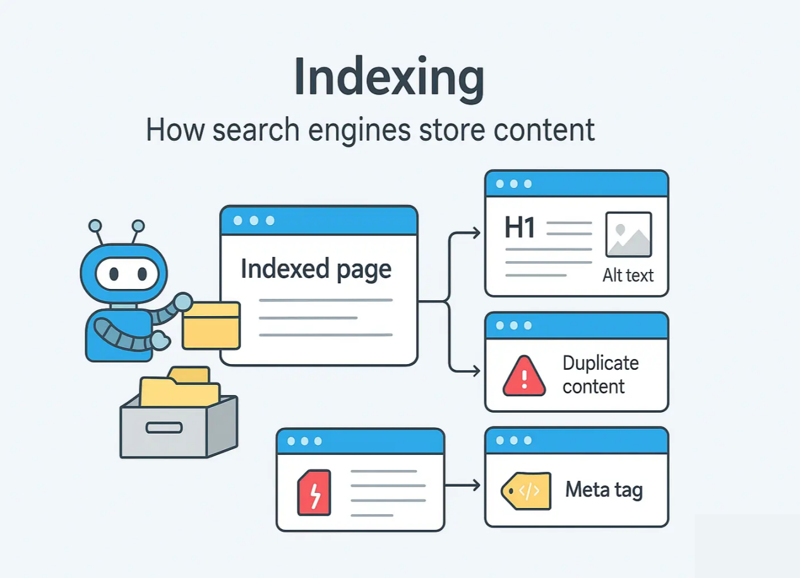

改进索引：
- 确保每个页面都有清晰、富含关键词的标题
- 使用元标签和图像替代文本以便更好地理解
- 避免 重复内容，以免搜索引擎感到困惑
- 检查 Google Search Console 是否存在索引覆盖问题

#### 3.排名：搜索引擎如何对结果进行排序

索引后，搜索引擎会根据相关性、质量和用户体验对网页进行排名。与搜索查询最匹配的网页会在搜索结果中排名更高，从而带来更多点击。

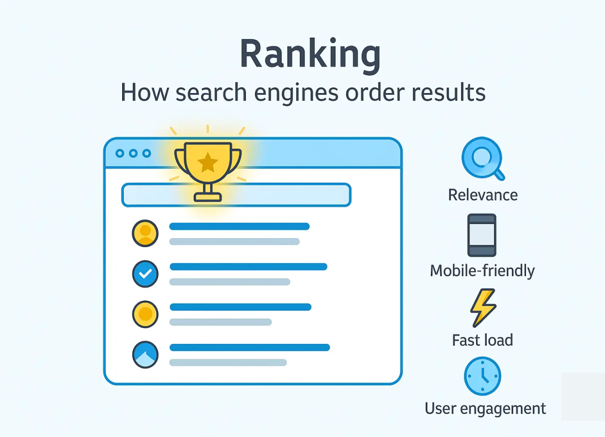

为了提高排名：
- 撰写针对用户意图的高质量、相关内容
- 确保快速的加载时间和移动响应能力
- 从权威网站建立反向链接
- 使用 Google Analytics 等 SEO 工具监控性能

## 二、为什么 SEO 很重要？

SEO 在确保您的网站触达目标受众方面发挥着至关重要的作用。除了提高搜索曝光度外，SEO 还能带来高质量的流量、提升用户体验，并帮助您的网站在搜索结果中脱颖而出。

#### 1.流量增加

在搜索结果中排名更高可以提高您网站的曝光度，从而吸引更多主动搜索您的内容、产品或服务的用户点击。与付费广告不同，这种流量是可持续的，只要您持续进行优化，流量就会不断增长。

#### 2.获得更多 SERP 功能排名

SEO 可帮助您的内容出现在传统搜索结果和搜索引擎结果页面 (SERP) 功能中，例如：
精选摘要 ：在搜索结果顶部显示快速答案，提高可见性和点击率。

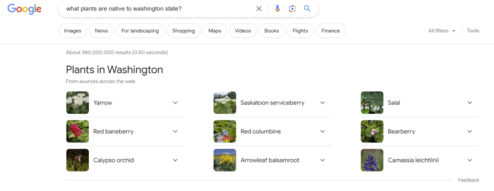

人们还问（PAA） ：突出显示相关用户问题，将您的内容定位为权威资源。

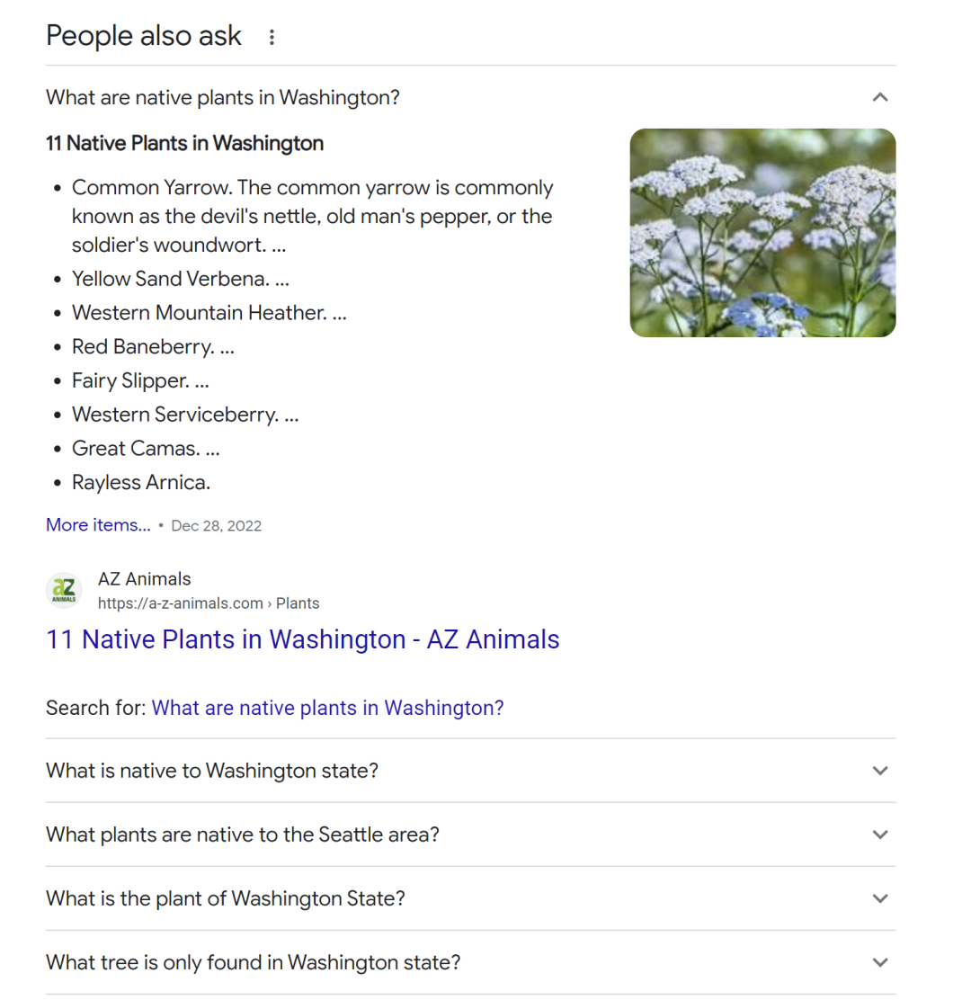

图像和视频包 ：展示视觉内容，吸引更多需要多媒体答案的搜索参与。

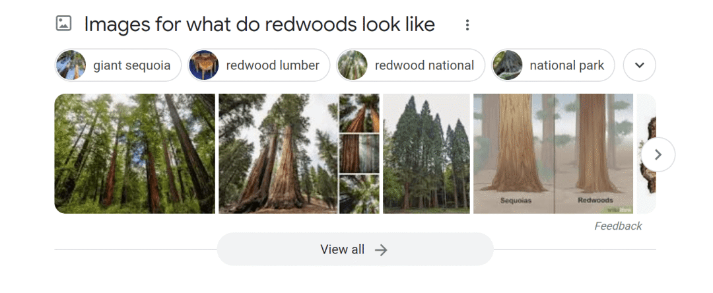

像“AI 概览”这样的生成式搜索功能，是由 AI 算法自动生成的网页摘要。它们旨在为用户提供快速、详细的答案，而无需点击进入网站。 生成式搜索功能： 像“AI 概览”这样的生成式搜索功能，是由 AI 算法自动生成的网页摘要。它们旨在为用户提供快速、详细的答案，而无需点击进入网站。
这种增强的可见性可以为您的网站带来更多的自然流量，因为用户更有可能点击带有 AI 概览的链接。

此外，  Ziff Davis 的研究表明，像 Open AI 这样的法学硕士 (LLM) 更青睐来自权威网站的内容。因此，进行 SEO 优化可以增加你的文章出现在 AI 概览、ChatGPT 和 Claude AI 等生成式搜索功能中的机会。

#### 3.提供出色的用户体验

SEO与用户体验息息相关。搜索引擎优先考虑速度快、移动设备友好且易于浏览的网站。
这就是 核心网络生命力 发挥作用的地方——一组衡量页面体验基本方面的性能指标：
加载性能是指页面内容呈现的速度（最大内容绘制）。更快的加载速度可以提高用户留存率和满意度。
互动性 是指用户与网站互动的速度（首次输入延迟）。即时响应的网站能够保持用户的参与度。
视觉稳定性 可防止页面加载时布局偏移（累积布局偏移）。稳定的页面可确保用户不会意外点击错误的元素。

## 三、SEO 有哪些类型？

优化您的网站通常涉及三个关键重点领域：页面内、页面外和技术 SEO。

#### 1.页面搜索引擎优化

页面 SEO 专注于优化单个页面，以提高搜索可见性和用户体验。它涉及根据 SEO 最佳实践调整您的内容、HTML 元素和网站结构。这不仅能确保搜索引擎理解您的页面，还能提升其对访客的吸引力。

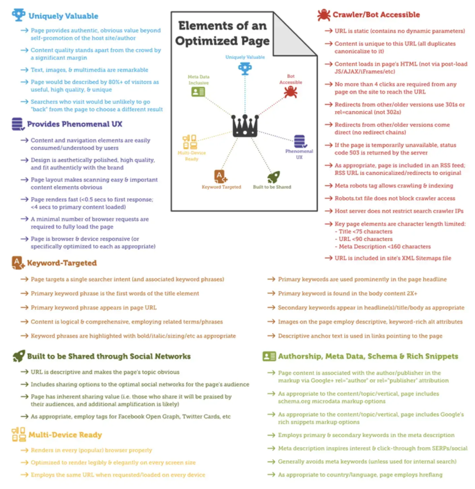

页面搜索引擎优化的关键方面包括：
- **关键词优化：**在标题、页眉和正文中自然使用相关关键词以匹配搜索意图。
- **元标签：**优化标题标签和 元描述以提高搜索结果的点击率。
- **内容质量：**确保您的内容是原创的、有价值的并且满足用户意图。
- **多媒体：**使用图像、视频和信息图表来丰富用户体验，同时 使用替代文本进行优化。
- **内部链接：**在您的网站内建立相关页面的相互链接，以帮助搜索引擎发现和排名更多内容。
- **URL 结构：**创建清晰、 描述性的 URL来反映页面内容。

#### 2.站外 SEO

是指在网站外部采取的提升搜索引擎排名的措施。它通过向搜索引擎表明其他人重视您的内容来建立权威性和可信度。站外 SEO 是指在网站外部采取的提升搜索引擎排名的措施。它通过向搜索引擎表明其他人重视您的内容来建立权威性和可信度。

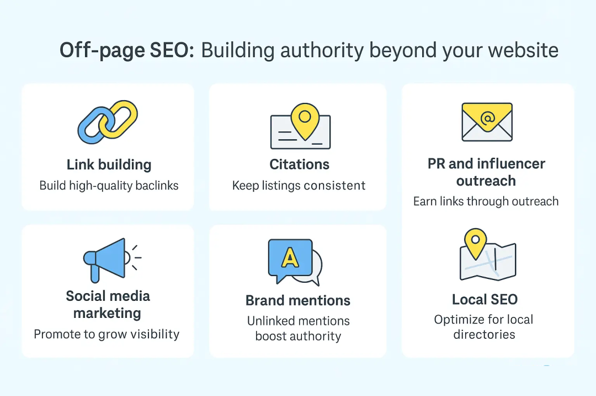

关键的站外策略包括：
- **链接建设：**通过外展、访客博客和内容推广从权威网站获得高质量的 反向链接。
- **引用：**确保您的业务信息在各个目录中保持一致。
- **社交媒体营销：**跨平台推广内容以推动参与度并吸引链接。
- **公关和影响力拓展：**通过与行业影响力人士和媒体平台合作来提高知名度。
- **品牌提及：**即使没有直接链接，品牌提及也可以向搜索引擎发出权威信号。
- **本地搜索引擎优化：**针对本地企业，创建本地企业资料并构建本地非结构化引用

#### 3.技术搜索引擎优化

技术SEO确保搜索引擎能够有效地抓取、索引和排名您的网站。它注重网站架构、速度和用户体验。

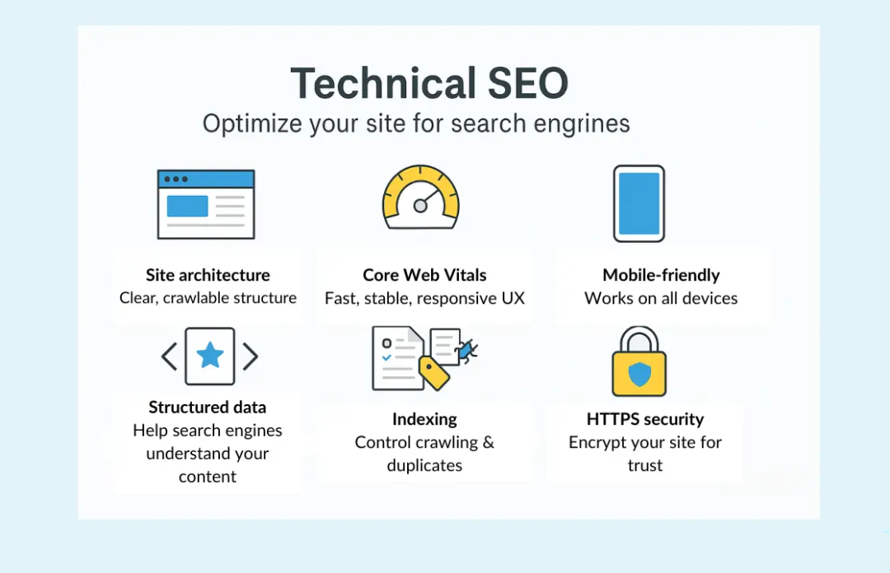

必要的技术 SEO 任务包括：
- **网站架构：**确保结构清晰、导航直观、内部链接明确。
- **核心网络生命力：**优化加载速度、交互性和视觉稳定性，以增强用户体验。
- **移动友好性：**确保 响应式设计，实现跨设备的无缝浏览。
- **结构化数据：**实施 架构标记以帮助搜索引擎更好地理解您的内容。
- **索引管理：** 使用 robots.txt 、规范标签和 XML 站点地图来引导搜索引擎爬虫。
- **安全性： **确保您的网站使用 HTTPS 来保护用户数据并提高信任度。

## 四、如何进行 SEO：初学者的最佳实践

运用 SEO 最佳实践，让您的网站更容易被找到、浏览，并在搜索结果中排名更高。无论您是刚开始做 SEO 还是改进现有工作，这些步骤都能巩固您的 SEO 基础。

#### 1.通过关键词研究找到相关主题

关键词研究可以帮助您确定受众搜索的内容，确保您的内容符合他们的需求并提高搜索可见性。

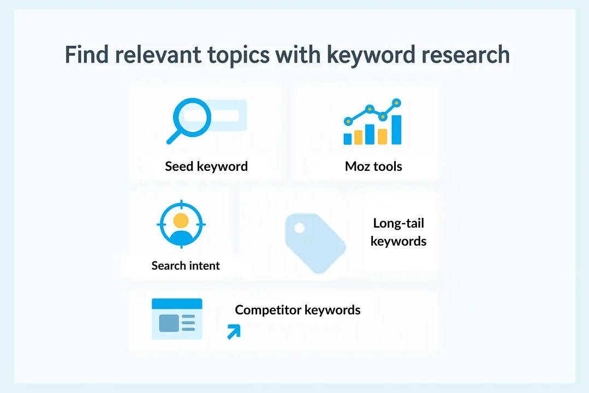

进行关键词研究的一些技巧包括：
- 根据您的核心主题或服务确定种子关键词
- 使用关键词工具获取数据
- 关注搜索意图——信息、商业、导航或交易
- 定位竞争较低、相关性较高的长尾关键词
- 分析竞争对手的关键词 ，寻找差距和机会
**2. 创建有用的内容**
内容创作在SEO中扮演着至关重要的角色，它不仅能为用户提供价值，还能帮助搜索引擎理解你的网站。高质量的内容能够解答用户的疑问，提升参与度，并增加获得反向链接的机会。

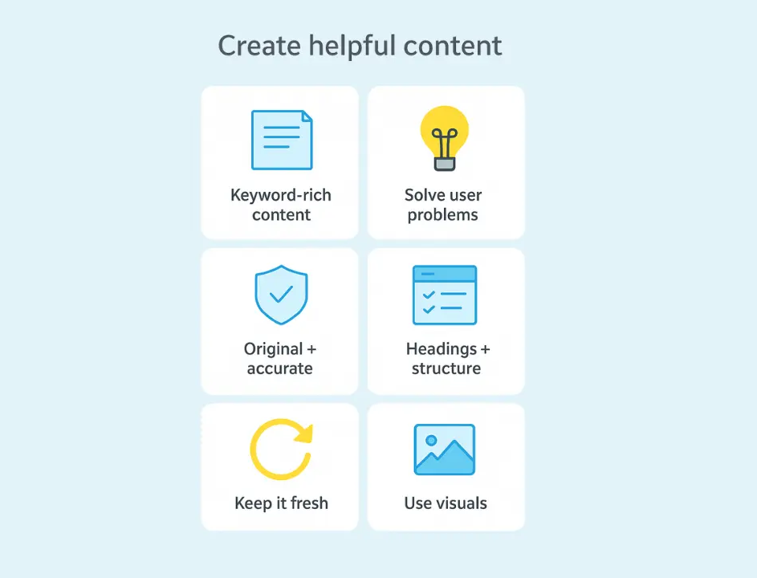

以下是一些内容创作技巧：
- 创建满足用户需求的有价值的内容，同时结合相关关键词
- 通过清晰的解决方案解决常见的用户痛点
- 使用清晰的标题和简短、可扫描的段落来构建内容
- 确保内容原创、准确且具有真正的价值
- 定期更新内容以保持其相关性和竞争力
- 使用相关图片、视频和信息图表增强内容

#### 3.优化页面SEO

页面搜索引擎优化 (SEO)可帮助用户找到相关内容并改善搜索引擎对您网站的理解。

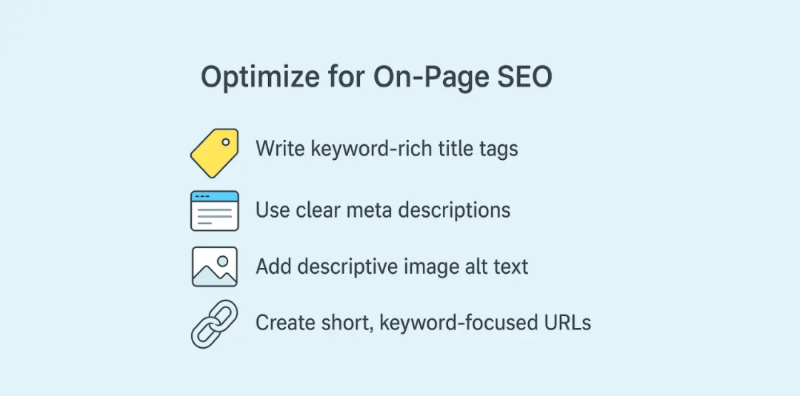

针对页面 SEO 进行优化的一些技巧包括：
- 撰写引人注目、关键词丰富的标题标签（字符数不超过 60 个）
- 撰写清晰、简洁的元描述以提高点击率
- 为图像添加描述性替代文本，以提高 可访问性和 SEO
- 创建包含目标关键词的简短描述性 URL
**4. 从相关网站建立链接**
来自可信网站的反向链接表明权威性并提高排名。
获得链接的 一些 方法包括：
- 发布吸引链接的高质量、可共享的内容
- 联系相关行业网站寻找链接机会
- 为您所在领域的权威博客撰写客座文章
- 识别并用您的内容替换损坏的链接
- 通过公关活动和媒体宣传获得 品牌关注
