# 独立站SEO外链建设高阶指南

## 一、外链的实际作用

外链（Backlinks），也被称为导入链接或反向链接，是指其他网站指向你网站的链接。对于一个网站而言，相关网站的数量越多、外链的权威性越高、外链所带来的流量也就越大，网站的排名就会相应提高。**在我们做好站内SEO的基础上，外链成为了提升网站排名的重要因素。**

#### 1.提高网站权重

权威的外部链接能够将其权重传递给你的网站。高权重的外链会给你的网站带来正面的权重提升，从而提升你网站的权威性和可信度。
域名权重是搜索引擎对网站域名实力的评估，它是影响网站排名的重要因素。
影响域名权重的因素主要包括：域名的历史、类别、流量、内容的原创性以及链接关系等。目前评估网站权重的指标主要是DA（域名权重）和PA（页面权重）。

#### 2.提高网站关键词排名

外链一直是谷歌SEO中一个非常重要的部分。如果没有外链，谷歌可能都无法找到你的网站。谷歌将外链视为对你网站的认可。**获得权威外链“认可”的页面，在搜索结果中的排名往往会更高**。外链数量越多的网站，其被收录的页面也会相应增加，同时网站的关键词排名也会显著提升。

#### 3.外链能增加访问者

外链是指其他网站指向你网站的链接，因此外链可以为你的网站带来访问量。通常，流量越大的外链所带来的访客就越多。因此，燃灯SEO建议在选择外链时，应优先选择流量较大的网站进行链接。

## 二、锚文本外链

锚文本（anchor text）就是链接中可以点击的文字，它的主要功能是将文本与网页相连接。在制作锚文本时，越是与页面内容相关，网页的排名就会越有利。此外，制作锚文本时还要关注网站上不同类型锚文本的比例，即使不使用完全匹配的关键词锚文本，也应尽量增强锚文本与页面相关性的联系。

#### 1.锚文本的种类

① **品牌锚文本**（Branded Anchors）包含品牌名称的锚文本。
② **裸锚文本**（Generic Anchors）-这类锚文本一般是在网址上点击直接跳转，例如https://www.randengseo.com/、www.randengseo.com、randengseo.com等等
③ **完全匹配关键词锚文本**（Exact Match Anchors）：这是指与目标关键词完全一致的锚文本，比如说“谷歌SEO”是网页的关键词，那么这个完全匹配的就是“谷歌SEO”的锚文本链接。这有助于提高关键词密度，也有利于该页面的关键词排名。
④ **普通锚文本**（Generic Anchors）比如说click here和view website等
⑤ **其他以及其他的各种相关变体的锚文本**（Latent Semantic Indexing）潜在语义搜索，这一类锚文本是跟主关键词语义相关的词，例如：关键词“Search Engine Optimization”和关键词“SEO”等。
⑥ **图片外链**：（Image Anchors）：在图片上添加自己的链接就是图片外链。
⑦ **No Anchor Trick**：No Anchor Trick这种外链很普遍，这种外链类型基本上是通过没有完善alt标签的图片来的。
通常来说，最佳的锚文本方式是使用包含关键词的完全匹配词汇。然而，不应过度使用这种完全匹配的关键词锚文本。因为谷歌的“企鹅”算法不仅会排除那些采用不当链接建设策略的网站，还会识别出过度使用完全匹配锚文本进行外链建设的网站。此外，任何形式的锚文本都不应当被滥用。
这里谈谈健康的锚文本比例：
- 品牌锚文本占比约为45%：这种类型的锚文本数量越多，谷歌就越能认可品牌的影响力和权威性。
- 裸锚文本大约占30%：尽量在段落末尾或与内容相关的位置使用URL等裸链接，这样显得更为自然。
- 关键词锚文本的比例应控制在大约5%以内，超出这个比例可能会导致谷歌的惩罚。
- 普通锚文本大约占10%左右，通常以呼吁行动的形式出现，例如“点击这里”或“了解更多”。
- 其他相关变体的锚文本大约占10%。

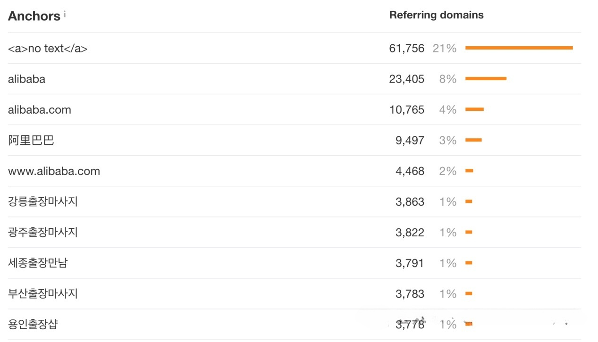

#### 2.dofollow VS nofollow

dofollow是一种标签，用于指示搜索引擎蜘蛛可以跟踪该链接。外部链接如果是dofollow性质的，可以为网站传递权重，从而影响排名算法。
nofollow是HTML页面中a标签的一个属性值。使用nofollow标签时，无法向网站传递权重，因此对排名算法没有影响。通常，这种nofollow属性的链接出现在博客评论、新闻发布以及付费广告中。
关于nofollow标签的使用，源于2007年之前，许多人在博客留言区大量发布自己网站的链接，此外，还有一些人利用脚本和程序自动生成大量毫无价值的垃圾评论。这导致垃圾评论泛滥，使得绝大多数网站的评论失去了参考和阅读的价值。
为了解决这个问题，谷歌、雅虎和微软共同推出了一个新的“nofollow”标签。通过在链接中添加nofollow属性，这些链接将不再被视为投票。此外，谷歌的政策明确规定，所有付费链接（例如广告或付费展示位置）都应使用nofollow属性，以表明这些链接不应影响排名计算。
例如，如果一个低质量网站的站长在燃灯SEO网站的评论中插入了这样的链接：它会变成“ This is a nice site!”的展示，这样在计算该网站的权重时就会被忽略。
如果想为你的网站选择传递权重的链接，可以考虑使用dofollow类型的外链，因为它们对谷歌SEO有积极影响。与此同时，如果nofollow类型的外链能够为你的网站带来流量，亦是一个不错的选择。

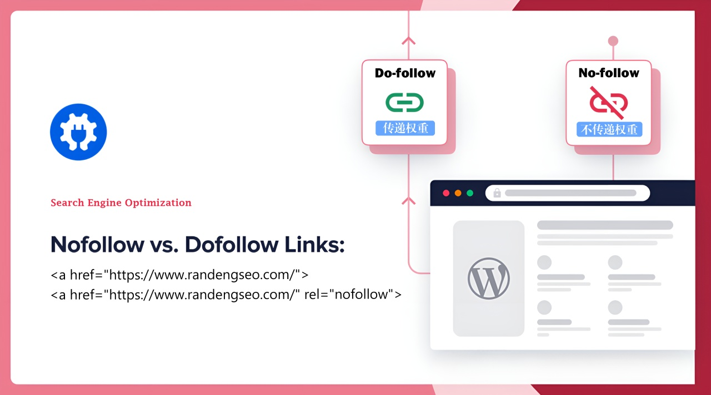

## 三、如何判断外链质量

#### 1.一定要具备相关性

相关性的网站是指与某个行业或其上下游行业相关的网站。例如，服装类网站可以在其他服装类网站上建立外部链接，而服装行业的上下游行业可能包括时尚、生活类或鞋类网站。如果一家服装网站出现在机械行业的网站上，那就是不相关的。
外部链接与你的网站可以在多个层面上相关，搜索引擎会评估页面与链接之间的整体关联性。具有高相关性的外链不仅可以提高网站的排名，还能带来精准的流量和转化率。
通常可以选择以下几种高相关性的网站：
- 相同产品的网站
- 产品的上下游产业。
- 或者目标客户关注的网站类型。

#### 2.外链是否具备高流量

通常会比流量少的网站带来的流量要多的多。流量较大的网站通常会吸引更多的访客，**因此在这些网站上进行外链建设**，往往能够带来比流量较少的网站更多的流量。
查看网站流量数据的工具有SEMrush、Ahrefs、SEO Quake工具。

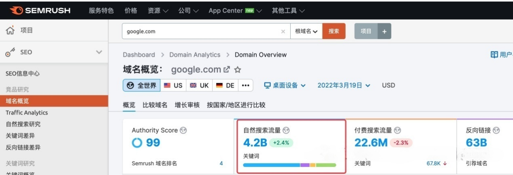

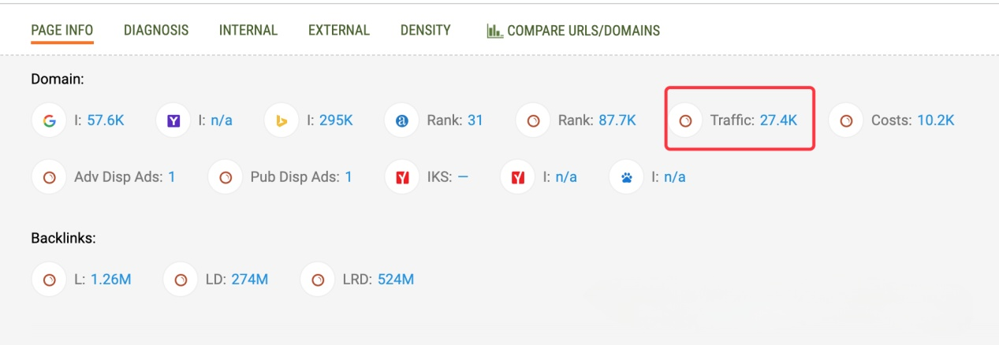

如果您想了解哪些外部链接为您的网站带来了流量，可以使用 Ahrefs 工具进行查看。此外，您还可以利用谷歌站长工具（Google Search Console）里面的links里面的External Links来查看具体网页的外链数量和外链来源。

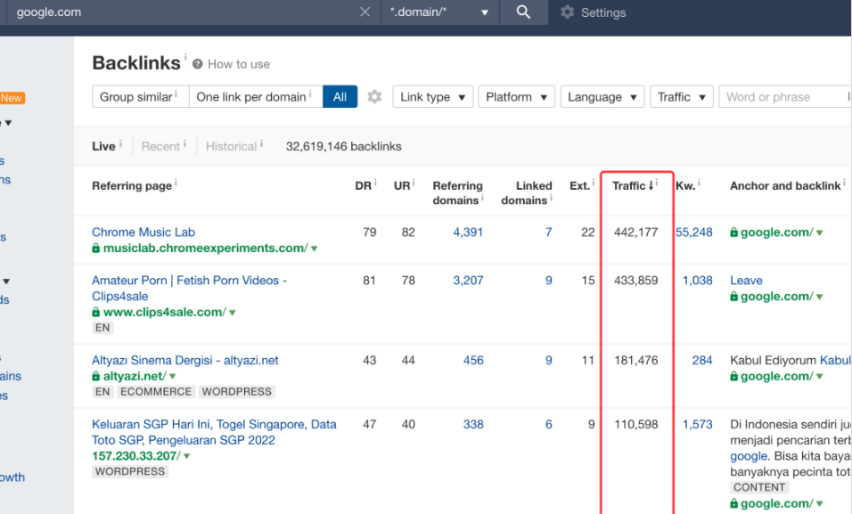

#### 3.外链是否具备高权重

外部链接的权重越高，网站的排名通常也会更好。外部链接的高权重主要体现在两个方面：链接来源域的权重、链接页面的权重以及链接所处位置的权重。一般来说，网站的年龄越长，其权重也会相应提升。
评估外部链接的域权重和页面权重有多种指标和工具可供使用：
以前，Google判断网站的权威性和可信度主要依赖于页面排名（PageRank，简称PR），其得分范围从0到10，得分越高表示网页越受欢迎和重要。然而，从2013年起，谷歌便不再使用PR算法。
目前，我们常用的评估网站权重的指标是DA和PA。这两个指标均由全球知名的SEO公司MOZ（https://moz.com/）提出，旨在衡量网站或网页在搜索引擎结果页面（SERP）中的排名能力。
- DA（Domain Authority）网站权重，反映了一个网站的实力。
- PA（Page Authority）页面权重，反映了网站某个页面的价值和质量。
- DA值或PA评分较高的外链，意味着这些外链具有较高的权重，能够为您的网站传递一定的价值。
**如何检查网站/网页的DA和PA？**
工具一：利用Website SEO Checker（https://websiteseochecker.com/）检查网站的DA和PA。

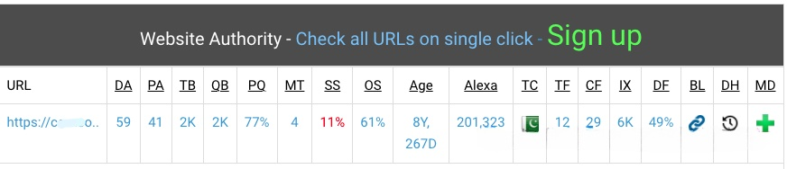

**工具二：MozBar（无需付费）**
MozBar是一款适用于Google和Firefox浏览器的插件，可以在以下网址下载：https://moz.com/products/pro/seo-toolbar。安装完成后，浏览器右上角会出现一个图标。接着，打开想要查看的网站。
判断外链位置的权重其实很简单。由于搜索引擎更看重内容中的反向链接，如果外链位于页面的主要内容区域，也就是页面的核心部分，通常会比放在页面底部、侧边栏或页脚中的链接拥有更高的权重。
在使用Ahrefs查看外链时，位于页面主要内容区域的外链会标记为“CONTENT”，如下所示：

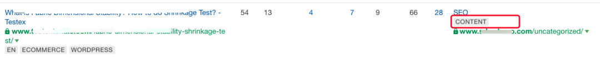

#### 4.导出链接少

导出链接指的是网站上导向别的网站的链接。导出链接会将网站本身的权重和PR传递给对方的网站。页面的导出链接越多，就说明这个网页的权重被稀释的越厉害，传递给你的权重就越少。假如一个页面的权重是100分，5个链接的话每个链接分到20分；100个链接的话只能一个链接分一分。
导出链接会将网页本身的权重传递给其他网站。如果一个网站的导出链接数量较多，那么该网页的权重会被分散，从而传递给你的权重也会变得很少。如果一个网站的导出链接数量过多，它就不再被视为高质量的外链平台。根据经验，外链来源页面的导出链接少于10个通常被认为是优质的。
因此，您需要定期检查自己网站外链的质量。如果您网站上的外链导出链接少于10条是正常的，但如果超过10条，就需要仔细审核这些外链的质量，或者考虑拒绝那些不合格的导出链接。
我使用的是Ahrefs工具，下面是导出链接异常的一些外部网站的截图。在下图中，Ext.（Shows the number of external links from the referring page.）就是导出的链接数量。

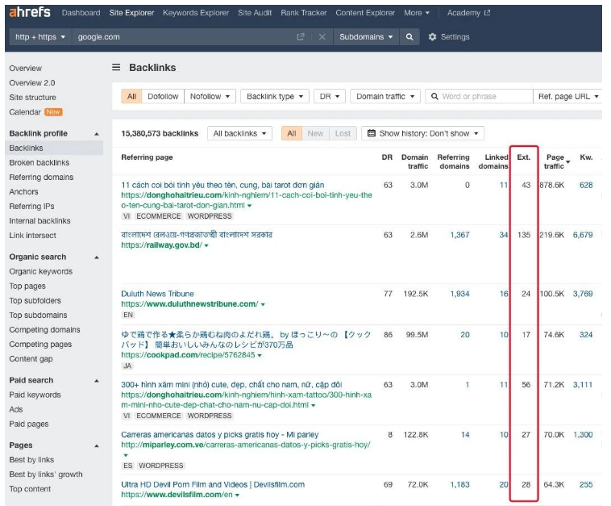

遇到有大量导出链接的网站，通常会对你的网站排名产生负面影响。这种情况下，你需要将这些高导出链接的域名提交到此处，以处理垃圾外链。
请访问此网址进行垃圾外链的提交：
https://www.google.com/webmasters/tools/disavow-links-main
除了关注链接的数量外，还应选择Dofollow类型的外链。Dofollow外链可以将权重传递到你的网站，有助于提升网站的排名。
**5. SS值低于1%**
SS（Spam Score）垃圾得分，SS得分是Google搜索引擎对网站的惩罚的积累得分。在选择外链时，SS值应该控制在1%以下。
检测SS得分值推荐可以使用该工具：
https://websiteseochecker.com/spam-score-checker/

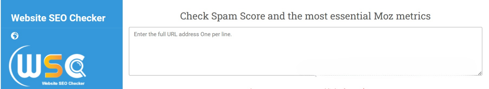

发布高质量外链的特征总的来说就这几点：外链网站跟你的网站相关度高、流量高、权威可信、导出链接少、SS值低于1%。
除了上述几点，还需要补充的是，高质量的外链能够体现出外链的稳定性。如果外链质量较差，外链数量可能会减少。燃灯SEO通过对几个网站的研究发现，网站外链数量大幅下降时，通常也会导致该网站流量下降。
您可以利用Ahrefs的外链分析工具来检查外链的稳定性：

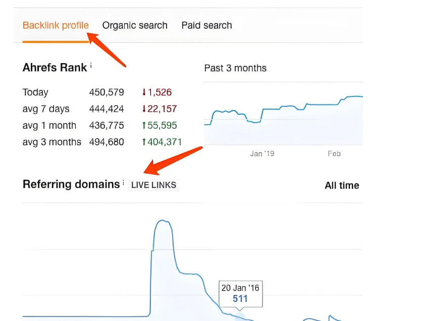

当然，获取高质量外链的难度相对较大。外链质量越高，意味着你需要投入更多的精力或资金。如果你的链接能够与多个高质量网站的链接同时出现在同一位置，谷歌就会认为你的网站质量更优。

## 四、整站外链的分布架构

既然要进行外链建设，你可能会想，是否只需为网站的首页进行外链呢？其实，网站的外链建设是一个系统性的过程：外链指向首页和其他页面的比例需要遵循**自然合理**的原则。这样，Google才会认为你的网站外链建设是合规的，从而使你所做的外链发挥积极的作用。
整个网站**首页的外部链接数量必定是最多的**，其次是其他重点页面。这个比例需要合理掌握：建议网站首页的外部链接数与内部链接数的比例如下：
- 首页链接最多，约占：20%~60%，并且首页的外链数量要超过其他任何页面的外链。
- 其他重点页面：占比小于20%，哪怕你认为再重要的页面，该页面的外链比例也不能超过总外链占比的20%。

## 五、高质量外链如何发布

优质的外链不仅能提高网站的排名，还能为网站带来精准的流量和转化率。既然好的外链可以稳步增加网站的流量，如何才能有效构建外链呢？接下来，我们将从几个方面探讨如何做好外链。

#### 1.高相关性

搜索引擎会评估链接网站的整体相关性、特定网页与链接之间的相关性，以及链接周围内容的相关性。
外部链接可以在多个层面上与你的网站相关，搜索引擎会评估网页及其链接的整体相关性。例如，如果你经营的是运动用品，那么一个专注于运动的站点显然与你的行业相关。此外，那些包含运动类内容的综合性网站也可视为相关网站。

#### 2.高流量

高流量通常有两种情况：一种是网页本身流量较高，另一种是外部链接为网站带来较高的流量。查看网站流量数据的工具包括SEMrush、Ahrefs和SEO Quake等。如果你想了解哪些外部链接为你的网站带来了流量，可以使用谷歌分析工具中的Referral渠道进行查看。

#### 3.外链数量的稳定

外链的稳定性直接影响其质量。如果外链数量突然增加或减少，谷歌会认为你的网站存在异常情况，外链的大幅减少可能导致网站流量下降。
因此，您需要定期检查自己网站的外部链接是否存在异常情况。如果网站的外链数量持续下降，这表明外链的质量不够稳定。

#### 4.合理搭配外链类型和锚文本

在进行外链建设时，除了选择多样化的外链类型外，还应关注外链的锚文本使用，确保锚文本的类型自然且按照适当的比例进行搭配。

#### 5.高质量的外链

高质量的外部链接首先源于高质量的页面内容，这意味着页面内容必须是原创的，并且对用户具有较高的阅读价值。
高质量的外链应尽量减少导出链接的数量。如果一个网站的外链导出链接少，说明它能够传递给你网站的权重比例更高。理想的高质量外链应当少于10个导出链接。
高质量的外链最好是dofollow类型，因为dofollow外链能够将页面的权重传递给你的网站，从而提高网站的权重，提升自然排名。
如果你的网站上只有一种类型的外部链接，或者所有的锚文本都是完全匹配的关键词，这样的情况对搜索引擎来说并不健康，明显是有异常和人为操作的，可能会对网站的排名产生负面影响。
需要特别注意的是，已经建立过外链的网站或已存在外链的网站就不要再进行建设了。每个网站只需有一条外链就足够了，换句话说，只有一条来自该网站的外链对你的网站是高质量的，其他在同一网站上的重复外链则没有任何效果了。

#### 6.外链类型的多种使用

在建设网站的外部链接时，必须确保外链来源的多样性。这种多样性包括网站类型、链接位置、不同的域名、不同的权重以及不同的地域等因素。
这样可以确保你网站上所有外链的种类丰富且位置分散，从而形成较为自然的外链特征。
外链的类型应该多样化，种类越多越好。网站的外链不仅包括博客链接，还应涵盖新闻外链和论坛等多种形式。通过多样化的外链，能够使整体效果看起来更自然。

#### 7.锚文本类型的多种使用

之前提到锚文本时，我们讨论了不同类型的锚文本，包括品牌锚文本、裸锚文本、关键词锚文本、普通锚文本以及其他各种相关的变体。
以下是网站健康的锚文本比例，这些比例应保持自然，避免过度使用某一类型的锚文本：
- 品牌锚文本占比至少应在45%上下。
- 裸锚文本约占30%。
- 关键词锚文本约占5%：
- 普通锚文本大约占10%。
- 其他相关变体的锚文本占比约为10%。

## 六、外链种类以及建设标准

根据外链平台的类型，燃灯SEO整理了谷歌SEO中常见的11种外链类型，并分享了这些外链的常用建设方法。

#### 1.博客外链

博客外链指的是通过发布文章在Guest Post博客、PBN外链、web2.0外链等类型的网站上建立的链接。国外有很多博客平台允许用户免费创建博客，利用这些博客发布外链不仅能够接触到更广泛的受众，还能吸引新访客并提升网站排名。
要获取外链，你需要主动与博客编辑沟通，向他们推销自己，并通过撰写高质量的文章来提及品牌，从而获得链接。寻找撰写博客的机会可以采取以下方法：
方法一：下面是用于在 Google 上搜索来宾发帖机会的关键词列表：
- 你的关键字+“guest post”
- 你的关键字+“submit guest post”
- 你的关键字+“guest post writer”
- 你的关键字+“guest blogger”
- 你的关键词+“contributing writer”
- 你的关键字+“guest posts wanted”
**方法二**：您还可以通过分析竞争对手的网站外链来进行外链建设。使用 Ahrefs 工具，只需输入竞争对手的网站 URL，即可获取该网站上所有的外链列表。
编辑博客帖子的要点：
- 以独特的视角向博客和读者分享新颖原创的专业知识。
- 你的博客应该为读者提供价值，而不是仅仅为了公司的利益。

#### 2.新闻外链(Press releases)

新闻外链（Press releases）是指通过向媒体记者发送新闻稿，与他们建立联系，并通过提到品牌名称来获取外部链接的手段。每家公司都应进行适当的公关，以维护和提升自身形象及影响力。新闻外链不仅能帮助企业进行有效的公关和营销，还能为网站带来流量并提高搜索排名。
新闻外链（Press releases）需要你主动去争取：与记者建立联系，提供各种类型的新闻稿内容，或者请求新闻网站在相关文章中提到你的品牌并为其添加外链。
新闻稿通常有以下几种类型：新品发布、上市/收购/合并、社会活动、迁址或新厂的落成、对外合作、行政招聘或公司设立的奖项活动等。另外，新闻稿的外部链接大多设为nofollow。

#### 3.论坛、问答平台外链（Forum Post）

论坛和问答平台的外链（如论坛、Reddit、Quora等国际知名论坛）也是非常有效的。在发帖或评论时，可以顺便附上自己的网站链接。
对于论坛和问答平台的外部链接，应该避免过度使用完全匹配的锚文本，建议以品牌锚文本为主。

#### 4.百科外链

提到网络百科全书，维基百科毫无疑问是其专业的典范。这是一个跻身全球十大最受欢迎网站的百科全书，它通过多种语言创建高质量的条目，为全球用户提供免费和开放的知识。
谷歌对维基百科的权重非常高，如果能将与自己网站相关的内容撰写成百科条目，并附上自身的链接，不仅有助于提升网站排名，还能为网站带来可观的流量。这需要在相关领域具备极高的权威性和专业性，才能获得维基百科的外链支持。
由于百科的外部链接获取非常困难，而且其质量极高，以下是关于如何制作维基百科外部链接的具体方法分享：
在维基百科上进行外部链接时，您可以选择三种方式：无效链接、损坏链接和独特链接。
死链（Dead Link）：死链是指不再有效的链接。通过将自己的内容链接到维基百科，可以更新和修复相应的死链，这为构建链接提供了一个良好的机会。
断链（Broken link）：与死链相同，首先识别出已损坏的链接，然后用相关且高质量的内容进行替换。
独特的链接（Unique link）：维基百科允许任何人参与内容的编写和修改。通过向维基百科添加新的内容，比如新增句子、段落或整篇文章，你可以实现外链的建设。
我们先来讨论一下如何查找无效链接和损坏链接。这类外部链接通常需要我们寻找死链，然后联系相关网站，用你的内容和网站进行替代。
**方法一：使用工具WikiGrabber**
（https://www.webpagefx.com/seo-tools/wikigrabber/）
在搜索框中输入关键词“谷歌SEO”，该网站会返回维基百科中的一些相关页面列表，这些页面需要添加引用或存在死链接。

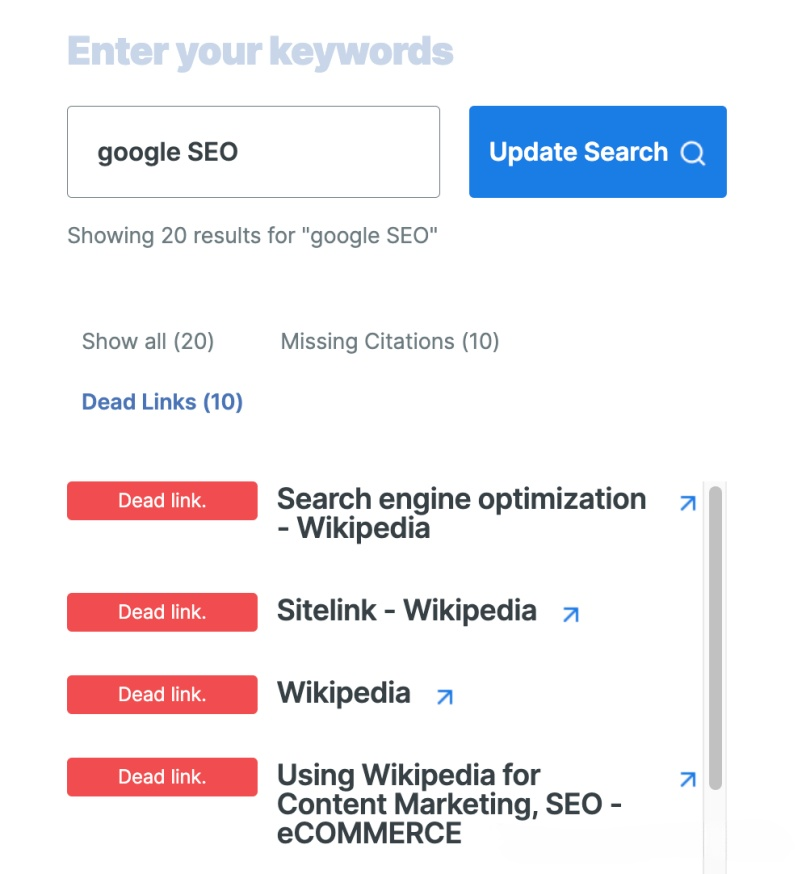

随意选择一个包含死链接的页面，按下Control + F键搜索“dead”，便能找到死链的位置。
**方法二：使用指令 site:网址 "关键词" "dead link"**
如果**方法一**的结果中没有发现任何死链接的页面，可以尝试使用谷歌搜索指令：
例如，我搜索的内容是site:wikipedia.org “googleseo”“死链接”

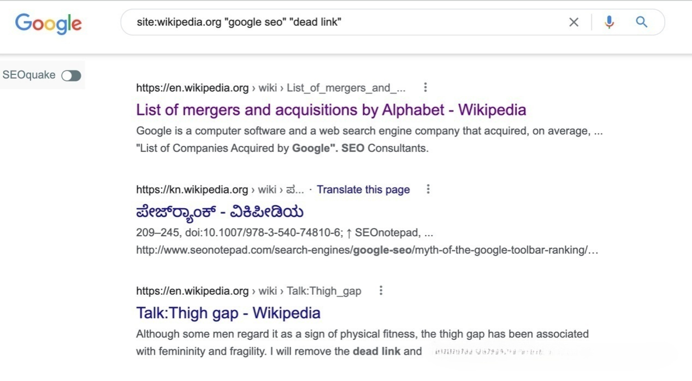

依次点击这些结果页面，然后在每个打开的页面上搜索“dead link”，这样你就能找到所需的死链。

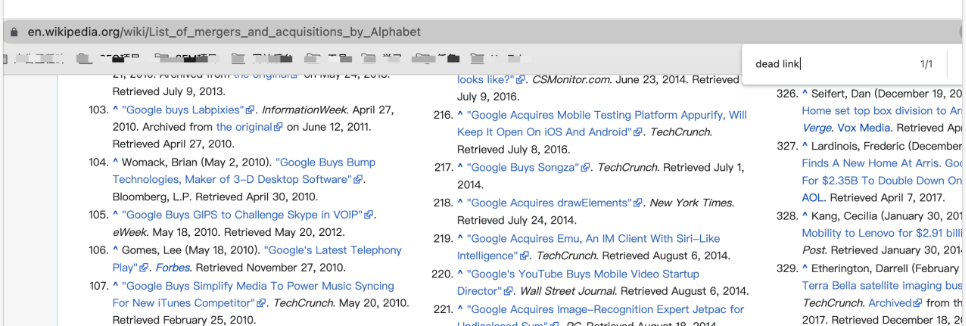

接着，将这个死链的网址复制并粘贴到Wayback Machine（链接：https://archive.org/web/）中。Wayback Machine会展示该页面在链路失效前的样子。你需要查看之前的页面内容，确认其是否与自己的网站相关。如果是相关的页面，可以在你的网站上寻找高质量的内容进行替代；如果不相关，则可以直接跳过，继续寻找其它相关的死链。
**如何制作独特链接（Unique link ）**
独特的链接：维基百科允许任何用户编写和修改内容。你可以编辑页面，并在合适的位置将自己的链接添加到现有文章中。此外，还可以通过添加新的句子、段落或文章来建立外部链接。
当然，任何更改都必须经过管理员的批准，未经批准的修改将会被删除。因此，内容的质量至关重要。
在选择词条时，越是热门的词条，其审核机制就越严格，审核通过的难度也随之增加。如果编辑的能力有限，建议可以先从一些冷门的相关词条着手，并合理地链接相关文章。虽然这些冷门词条更容易通过审核，但所带来的流量相对较少。
找到需要编辑的区域，点击“编辑”进入编辑页面。如果您对代码不太熟悉，可以选择“可视化编辑”。完成对文字、链接和引用的修改后，请点击保存。
保存后，我们就需要等待审核。有些编辑会很快被删除，而另一些可能过一段时间后才会被删除，因此我们需要经常回来查看这些编辑是否仍然有效。

#### 5.目录、黄页、本地商业目录

通常情况下，目录、黄页和本地商业目录（Directory、Yellow page、Local business cation）属于B2B平台及黄页外链的性质。
许多分类信息平台允许用户免费注册账户并发布信息，包括提交自己的网站等内容。在发布信息时，可以在描述或公司网址中链接到自己的网站。这种外部链接的优势在于操作简单且方便。
要查找网站目录、黄页以及本地商业目录，可以在谷歌中输入以下关键词进行搜索：Directory、黄页、Local business listing、本地目录、Yellow Pages USA、Directory login等。
需要注意的是，由于许多目录、黄页或本地商业目录便于获取，导致这类外链容易被滥用，因此这些外链平台上满是垃圾外链。在筛选时，你必须关注这些外链的质量，而不是数量。如果可能的话，最好选择一些可以付费的外链来源。否则，一不小心就会给自己的网站带来大量垃圾外链，最终会得不偿失。

#### 6.Profile外链

Profile外链也称为Profile Links、Forum Signatures、Social Bookmarking。是一种在社交媒体或其他网站上添加你网站链接的方式。
许多网站在注册后需要提供个人资料，这些填写的资料通常会在个人信息中显示，这就是所谓的个人资料外链。你可以将网址添加到个人或公司简介中。
通过创建个人资料网站获取外链是获得外链的最简便方式。燃灯SEO常用的Profile外链平台包括Facebook、Quora、Pinterest、Twitter和Telegram等。

#### 7.评论外链(Blog Comments)

在论坛中发布留言并附上个人链接的方式被称为评论外链。目前许多评论都是nofollow类型的。在建立链接时，应关注那些域名评分较高的网站，因为它们对排名的影响更大。
此外，不要过于强调锚文本，而是要注重留言的质量。
如果您准备使用评论外链，建议尽量选择那些具有dofollow特性的博客进行评论。只要您的评论有价值且质量高，就能吸引他人的关注和订阅。即便评论外链是nofollow属性的，仍然可以带来流量和潜在价值。
由于博客评论被越来越多地滥用来建立外链，很多评论仅仅是为了链接而缺乏对博客社区的实质性贡献，谷歌对此也相当警觉。
因此，建议大家在选择这种外链形式时要格外谨慎。在确保博客相关性的基础上，博客评论应当具有价值和高质量，而锚文本最好使用裸链接。

#### 8.友情链接(reciprocal link、Link exchange)

友情链接是与其他网站进行链接交换，以提升网站的外部链接，这是一种常见的网站优化手段。链接质量越高、相关性越强的网站，友情链接的效果则会更好。
你可以联系一些做网站的朋友，与他们进行外链交换。通常来说，友情链接是一种比较有效的外链建设方式。
在交换友情链接时，首先应选择同行业或内容相关的网站，其次要考虑流量较大的网站，因为这类网站能够直接为你带来流量。

#### 9.赞助商合作伙伴外链(sponsor link)

一些公司会赞助社会活动，因此活动主办方会在他们的官方网站上列出这些赞助商，并为赞助商的网站提供链接。这通常是获取政府或学校类外部链接的最常见方式。
此外，公司通常会与一些技术、生产材料或投资商等多个方面的合作伙伴建立合作关系。您可以向这些合作伙伴请求提供外链，通常来自赞助商或合作伙伴的外链质量较高。

#### 10.视频外链(video backlinks)

视频外链通常指的是YouTube的视频链接。在发布YouTube视频时，可以在视频介绍中添加你的网站链接。如果这段视频的观看次数较多，就能为你的网站带来流量。
除了为自己的视频添加外部链接外，你还可以与其他视频主播合作，让他们在视频中提到你的产品，并在YouTube视频的简介中提供指向你网站的链接。
总的来看，自己手动创建外链可以更好地控制外链的质量。例如，可以通过发布Web2.0博客、参与论坛问答、制作优质内容进行内容营销、利用信息图表、寻找死链、与行业知名人士和记者建立联系，以及通过品牌提及来获取外链等多种途径。
另一个构建外链的思路是分析竞争对手的网站，可以使用ahrefs或Analyze Backlinks等工具来查看他们的外链情况。找到那些能够手动获取的外链来源，如果竞争对手能够获得的链接，你也有机会获得。

## 七、付费外链服务如何寻找

除了手动制作外链，你还可以选择购买外链服务来辅助手动外链，但不要过于依赖这种购买形式。
**相关外链服务购买**：
一些自由职业者平台，如Fiverr、Seoclerks、Upwork和Freelancer等，均有人提供外链服务。然而，各个平台的服务质量和从业者水平参差不齐，因此你需要仔细挑选和筛选合适的服务提供商。
你可以通过社交平台，例如Facebook、Twitter、Snapchat和LinkedIn等，利用平台上的个人资料来搜索提供外链服务的兼职人员。相比其他社交平台，LinkedIn上的个人资料通常更加真实，因此燃灯SEO团队通常会在LinkedIn上寻找这类服务。

## 八、外链发布情况如何查询

#### 1.**方法一**

可以使用 Ahrefs 工具（https://app.ahrefs.com/）查看网站或网页的外部链接。点击“反向链接”后，就会显示所查询域名的所有外链信息。
这是查询主域名外链数量的方法：

这是查询特定网页外部链接数量的方法：

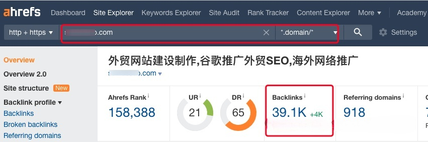

建议定期查看你自己网站上的锚文本比例，可以通过Anchors查看相关的锚文本情况。

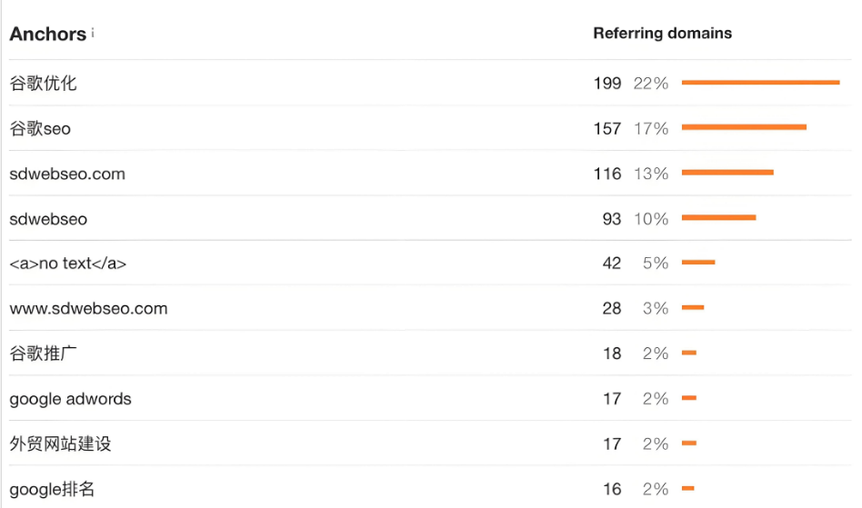

#### 2.方法二

Google Search Console是一个免费的工具，可以帮助您获取网站的自然搜索流量和性能数据。
点击links，找到External Links（外链数量），再点击外部链接列表中的网址，可以查看与该网页最常连接的外部链接。

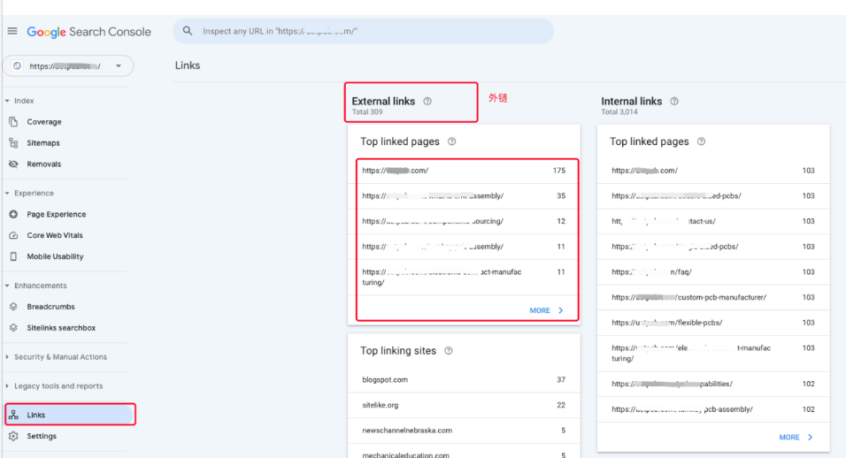

以下是对谷歌站长工具links具体各功能板块的说明：
- 外部链接（External links）：你的网站拥有多少个外部链接。
- 热门链接页面（Top linked pages）：你的网站中被链接次数最多的页面。
- 热门链接网站（Top linking sites）：指那些链接到您网站次数最多的网站。
- 最常见的引荐文字（Top linking text）：用于外部链接的常见锚文本。

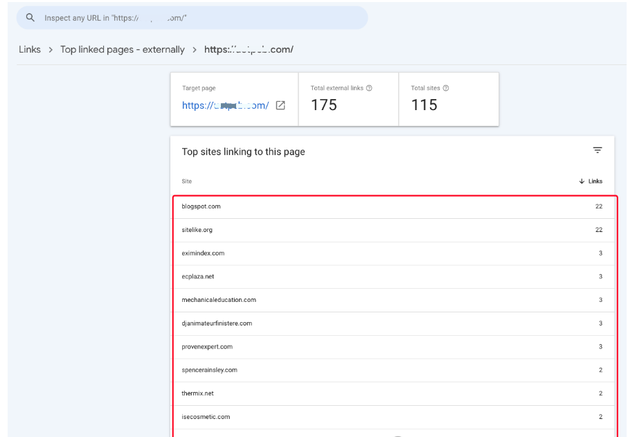

## 九、关于外链建设的补充问题

前面提到过外链的重要性，因此许多人认为网站上的外链数量越多就越好，但这其实并不一定正确，原因是什么呢？
首先，在进行外链建设时，必须保证外链的质量，而不应过于关注数量。外链的质量应优于数量。
其次，外链的数量每月不宜过多，原因在于需要以健康自然的方式进行外链建设，确保每月的增长保持平稳。
建议随着文章的更新，每月进行3-5条guest post外链、5-10条新闻源外链。此外，论坛、问答、Reddit等有助于引流和品牌建设的外链可以每月做大约10条，另外适量参与行业大博客的评论也有助于引流。
外链建设**以首页为主，辅之以内页**，整体比例为6:4。可以参考ahrefs工具或谷歌搜索控制台（Google Search Console），根据首页或内页的外链数量调整后续的外链比例。

## 十、网站如何屏蔽垃圾外链？

如果你在查看网站的外部链接数据时发现自己的网站链接到了许多垃圾、虚假或低质量的外链，而你又无法自行删除或让对方移除这些链接，你可以使用以下方法拒绝这些指向你网站的链接，从而保护你的网站不受垃圾外链的负面影响：
屏蔽外部链接的步骤如下：
**第一步**：安装谷歌搜索控制台 （https://search.google.com/search-console）
在按照相关提示验证网站所有权后，就可以正常使用谷歌搜索控制台。如果您之前已经安装过谷歌搜索控制台，可以直接跳到第二步。
**第二步**：创建一个包含要拒绝链接的列表，文件格式必须为文本文件，且文件名需以.txt结尾。
文档要求：每行只能列出一个要拒绝的网址或域名，格式如下。

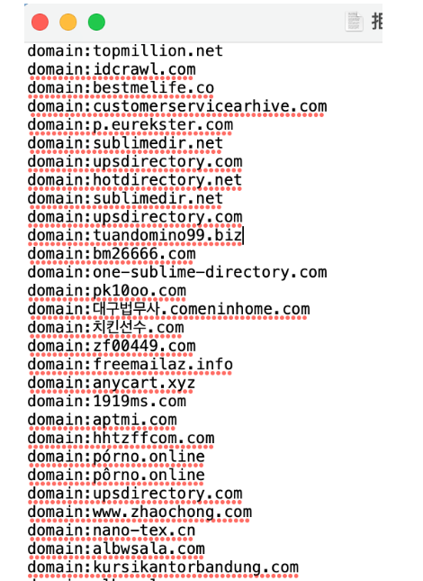

链接文件格式的具体要求如下所示：
- 每行只能指定一个要拒绝的网址或域名。
- 要拒绝某个域名（或子域名），请在前面加上“domain:”前缀，例如：domain:example.com。
- 文件必须为文本格式。
- 文件名应以 .txt 作为结尾。
- 网址的最大长度为 2048 个字符。
- 文件的行数最多为 10 万行（包括空白行和注释行），文件大小不得超过 2MB。

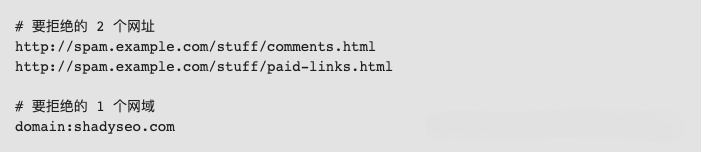

第三步：将垃圾外链的列表提交到此链接：
https://www.google.com/webmasters/tools/disavow-links-main，上传列表后，系统会提示被拒绝的域名数量。

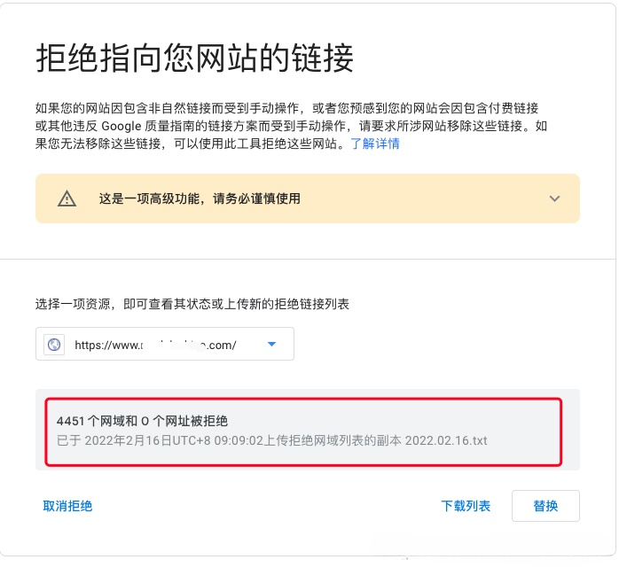
