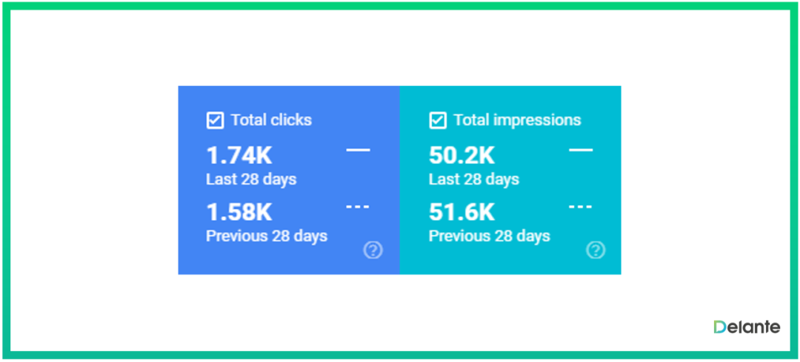
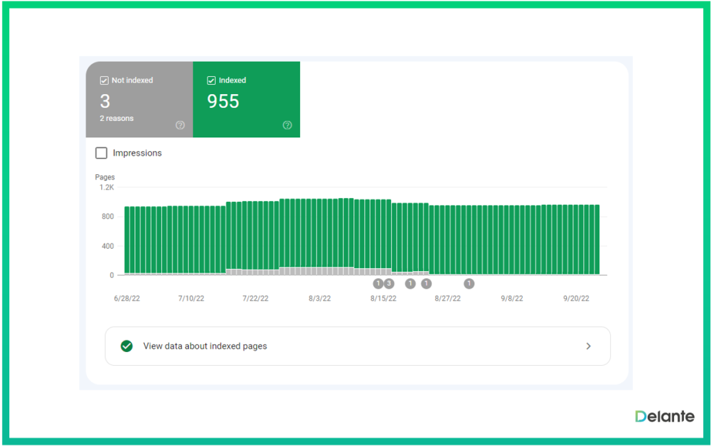
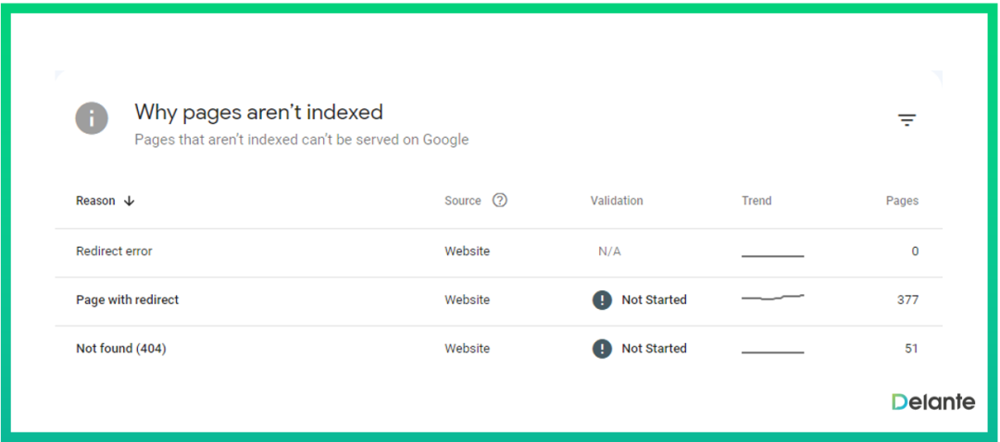
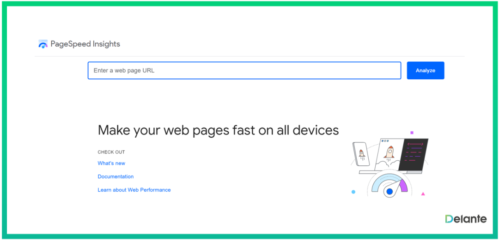

# 独立站SEO每天必须执行的 12 项任务

#### 1.监控 Google Search Console

Google Search Console 是每个 SEO 专家都熟知的基本工具。使用它，你可以轻松检查以下元素：
点击量 ——通过每日流量分析，你可以持续监控网站访问量是否增长。此外，借助这些数据，你可以轻松追踪进度，并检查执行的 SEO 活动是否达到了预期效果。
展示次数 ——如果你想检查你的网站在搜索结果中的曝光度是否提升，展示次数是评估其效果的指标。使用它，你可以查看你的网站在特定时间范围内出现在搜索结果中的次数。

最受欢迎的页面和关键词 ——Google Search Console 也是查看哪些关键词最具转化潜力的绝佳工具。由于排名经常波动，因此每天监控排名至关重要。这能让你快速响应任何变化或趋势，并相应地调整策略。
此外，GSC 还允许你检查哪些页面产生的自然流量最高 。如果你经常发布文章或新内容，则应每周至少检查几次 Google Search Console，以确保你的网站运行良好。
索引覆盖率报告 ——此报告可让你查看 Google 抓取的所有页面数量。它可以帮助你排查网站上的索引问题，并检查 Google 是否已抓取重要内容。

**2. 监控 Google Analytics**
监控 Google Analytics 是我们每日 SEO 任务清单上的另一项。通过 Google Analytics，你可以监控网站流量和受众群体。这些数据将帮助你规划营销工作并评估其效果。
你每天应该监测什么？
自然流量来源
记录的会话数
你的网站访问者数量
在特定页面上花费的时间
跳出率
用户人口统计——访问你网站的用户住在哪里，他们使用什么设备？
转换

#### 3.检查网站错误

这也是 Google Search Console 派上用场的地方。错误分析是你每天应该执行的最重要的 SEO 任务之一。
错误会对网站功能和搜索结果排名产生不利影响。如果你的网页存在太多问题，其在搜索引擎结果页面 (SERP) 中的排名可能会下降。
因此，持续监控网站错误并在错误发生时尽快将其删除至关重要。

你应该特别注意哪些错误？
404 – 当服务器无法找到特定页面时会发生此错误（404 页面未找到）
500 – 当内部服务器出现问题时出现（500 内部服务器错误）
错误的重定向——你网站上的每个页面都应该有一个正确的 301 重定向到页面的主版本（例如从 HTTP 到 HTTPS）
失效链接 – 这些链接不再有效。你应该尽快找到它们，并用有效链接替换。
重复内容 ——如果你的网站内容重复率过高，Google 可能会对你进行处罚。因此，请用新鲜独特的内容替换重复的短语。
不安全的页面——每个页面都应该有一个有效的 HTTPS 协议，没有此协议的页面被视为不安全的页面
**4. 监控网站速度**
在准备 SEO 每日清单时，别忘了网站速度监控。它是影响 Google 排名的重要因素，对搜索结果排名和用户体验都至关重要。
你是否正在寻找快速提升网站速度的方法？请关注以下几点：
图像尺寸，
重定向链，
服务器响应时间慢
未压缩的 HTML、CSS 或 JavaScript 代码。
一旦你提高了网站速度，你就应该不断监控它。
怎样才能快速完成？
最好通过 Google PageSpeed Insights 来做到这一点。 每周检查几次你网站的 URL，看看是否有变化，或者你的网站是否仍然加载迅速 。

特别注意网站在移动设备上的加载时间。
毕竟，越来越多的用户通过智能手机来完成交易！
**5. 审查关键词排名**
这一点可能不会让你感到惊讶，但你应该几乎每天检查搜索结果中最重要的关键字的位置，特别是如果：
你对网站进行任何更改，包括内容和技术修改，
当你的排名发生巨大变化时，Google 会宣布算法更新。
绝大多数SEO专家都声称要每天跟踪关键词排名。正如你所见，这项任务非常重要，所以加入这个小组吧！
如何追踪你的关键词排名？
当然，你可以手动操作，但这会花费很长时间。因此，使用Serprobots、Ahrefs或SEMrush等工具会更快。
**6. 建立网站反向链接**
Google 信任那些拥有大量来自可靠域名且参数高的反向链接的网站。
如果你想在搜索结果中排名靠前，你也应该关注丢失的反向链接并尝试修复它们。这是另一个快速有效的方法，可以帮助你恢复良好的页面可见性和排名。
许多人低估了反向链接，然而，毫无疑问，它们拥有巨大的 SEO 力量 。确保逐步增加指向你网站的反向链接数量，并持续从优质域名获取新链接。这将帮助你提升域名评级和域名权重。

#### 7.积极参与社交媒体

社交媒体不仅对创建品牌形象或改善与客户的沟通有着巨大的影响，而且对搜索引擎优化也有着巨大的影响。
根据 Moz 或 Ahrefs 等热门工具的数据显示，社交媒体平台的参数和流量都非常高。因此，在 Facebook、Instagram 和 Twitter 等多个社交媒体平台上活跃的企业在 Google 上的排名会更高。
此外，社交媒体平台是与用户建立关系的绝佳工具。发布有价值的内容，激发受众兴趣，提高用户参与度。在 Facebook 或 LinkedIn 上向你的粉丝推荐你博客上发布的文章。
你的公司参加过重要的行业活动吗？不妨在你的 Instagram 个人资料中添加照片。你有很多机会。吸引目标受众，并将自己定位为该领域的专家。

#### 8.保持内容新鲜

想向 Google 和用户展示你的网页提供最新、优质的内容吗？如果是这样，你应该注重定期更新你的网站。
我们周围的世界瞬息万变。如果你想跟上市场竞争对手的步伐，就应该竭尽全力，让你的产品和网站脱颖而出。你是否有两三年前表现不错的旧博客文章？为什么不更新它们，并用新的信息、图表、视频、图片或视频素材来补充呢？
向 Google 展现你积极主动，并致力于为用户提供前沿、高质量的内容。这将迅速提升你的曝光度和搜索结果排名。

#### 9.优化你的内容

内容为王，因此你应该格外重视内容。如果你想让谷歌喜欢你的网站，你必须提供一流的、符合 SEO 规范的内容，从而为用户带来价值。
满足用户需求且引人入胜的内容将很快进入前 10 个搜索结果。
创作新作品时应该关注什么？
它们应该根据目标受众的需求进行定制，
使用对你的业务很重要且具有巨大转化潜力的关键字，
专注于长篇内容——创作文章或博客文章，
你的内容应该是最新的，
添加对调查、案例研究或知名人物的引文的引用，可以增加内容的可信度。
**10. 警惕蚕食**
关键词蚕食是指网站上的多个页面针对同一个关键词进行优化。
为什么你应该在日常 SEO 清单中留意它并关注它？
如果两个页面竞争同一个关键词，搜索引擎排名就会被瓜分，从而稀释网站的流量。 这也会给用户带来困惑，因为当用户看到同一关键词的多个结果时，他们可能不知道该点击哪个页面。
如何检查你的页面是否被蚕食？
在 Google 中输入“site:websiteaddress.com”加上关键词，并分析搜索结果。
为了避免关键词蚕食，进行彻底的关键词研究以确定应为网站的每个页面分配哪些短语至关重要。
适当的优化和关键词分析将帮助你组织网站内容，并避免 Google 不确定特定页面应显示哪些关键词的情况。

#### 11.重复内容检查

重复内容是指相同的内容出现在多个网站或同一网站内的多个页面上。重复内容可能非常危险，并会损害网站在搜索结果中的排名。
从其他网站或你的网站复制内容将大大降低你的在线知名度，甚至可能导致 Google 的处罚。
值得一提的是，Google 会根据参数来确定内容的作者。因此，仅仅因为你先撰写了内容，并不意味着 Google 会承认你是作者。
如果该内容是由具有更高参数的网站从你那里复制的，那么它将被识别为作者。
如何检查重复内容？
你可以在 Google 中输入引号中的内容片段，看看有多少搜索结果。你也可以使用Siteliner之类的工具。它可以快速显示你网站上的内部重复内容。
要解决这个问题，只需为每个页面创建新的、独特的内容，并确保它包含特定于每个页面的关键字。
**12. 低质量内容清理**
这是我们每日 SEO 任务清单的最后一点 。低质量内容清理是删除那些不会给用户带来价值、对你的认知度产生负面影响的内容片段的过程。
这可能包括删除那些写得不好或与你的受众无关的内容 。要确定哪些内容应该删除，首先，你应该进行内容审核 ，找出那些不会给你带来任何好处的内容。
