# 网站SEO诊断步骤（附具体操作办法）

## 一、什么是SEO诊断?及诊断的意义

SEO诊断是通过系统化检查网站的技术架构、内容质量、外部链接等要素，识别影响搜索引擎排名的关键问题，并制定对应的优化修改策略的过程。
当然SEO诊断是需要经验和排查后的具体解决办法的，这样才可以找到网站排名下降的具体问题然后做具体的调整和优化。
比如，移动搜索量远超桌面搜索，而移动友好性又是Google极为看重的排名要素。

若网站在移动端显示不佳，如页面布局错乱、字体过小难以阅读、操作交互不便等，将严重阻碍网站的浏览，导致大量的潜在用户流失。
做SEO诊断是一个是个复习检查的过程，我自己的网站很多内容并不是一次就完成的。
很多都是做了很多修改，也是在一次次的复查和诊断以及修改过程中把一些这些诊断发现的问题给及时优化好。
通过系统化的检查和优化，你可以提高关键词排名、增加流量，并确保网站保持健康状态。
这些步骤为后续的优化工作奠定了坚实基础，避免盲目操作带来的低效结果。

## 二、SEO检测工具

配合一些SEO诊断工具，哪怕你是SEO新手也是可以很好的发现自己网站存在的问题。
**Ahrefs Webmaster Tools (AWT、Ahrefs 站长工具)**
Ahrefs Webmaster Tools是一款功能强大的综合性SEO工具，主要为网站管理员和SEO专业人员提供全面的网站分析和优化功能。

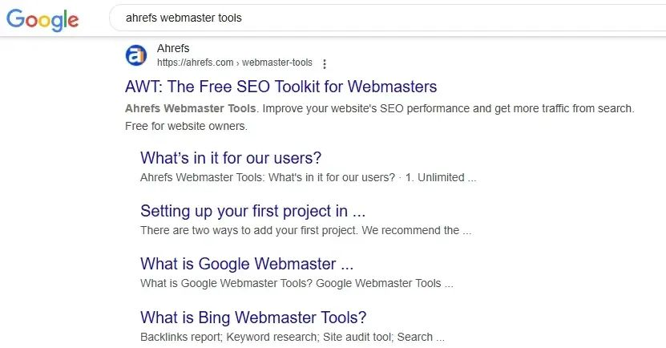

它可以帮助用户深入了解网站的SEO状况，免费功能包括：
- 网站审计：能够对网站进行全面扫描，检查页面是否存在技术问题，如断链、错误页面、重复内容等影响搜索引擎优化的因素。
- 反向链接分析：详细展示网站的反向链接情况，包括链接来源、链接质量、锚文本等信息，让用户了解网站的外部链接状况，评估链接对网站排名的影响。
由于Ahrefs真的是好贵，但是结合一些工具也是可以达到同样的效果，还降低了使用成本。
接下来我会详细说到怎么结合其他工具来配合使用的...

#### 1.Google Search Console(谷歌站长工具)

Google Search Console（谷歌搜索控制台）是谷歌提供的一款免费的网站管理工具，主要用于帮助网站管理员监控和维护网站在谷歌搜索结果中的表现。

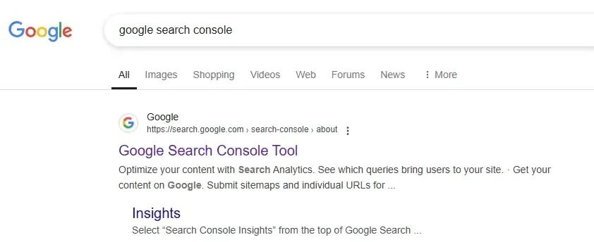

通过它，用户可提交网站地图，便于谷歌搜索引擎更好地抓取和索引网站内容。
还能查看网站的搜索流量数据，如关键词的展示次数、点击次数、排名啥的，可以及时了解用户的搜索行为和网站的曝光情况。
此外，它能检测并反馈网站存在的问题，像抓取错误、移动端适配问题等，方便管理员及时修复，以提升网站的搜索可见性和用户体验，是网站优化和管理过程中的重要工具之一。
使用这两个工具基本上就可以把网站存在的问题都给检测出来
当然Screaming Frog有些人也会在使用，但是那个工具我感觉太麻烦了且如果这两个工具都绑定好会方便很多。
不用输入网址用尖叫蛙爬半天，有些大网站可能要爬取好几个小时。
**01 网站SEO诊断步骤**
首先你要把自己的网站绑定上谷歌站长工具，这样才可以让Google Search Console分析出来你的网站问题。
用谷歌账号登录谷歌站长工具官网，点击 “开始使用”。

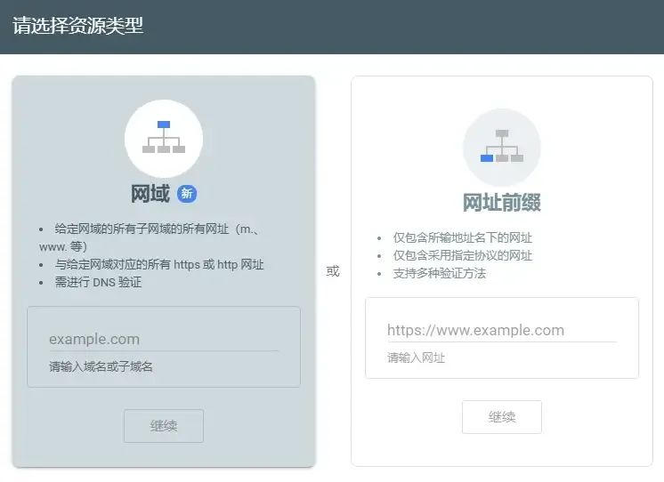

输入网站域名，选择 “添加域” 或 “URL 前缀”，前者可获取网站全面信息，后者可查看特定部分数据。
选择验证方式，常见有 HTML 文件验证、HTML 标签验证、DNS 记录验证等，按提示在网站添加相应代码或文件完成验证。
**02 关键词排名下降诊断**
我们做SEO的终极目的就是为了网站的成交和转化，那么首先我们的网站是需要有排名，这样才会有流量。
如果网站的关键词，就会对转化和成交造成很大的影响，所以检查自己网站的关键词排名就非常重要了。
当然我们后面做的一切诊断都是为了关键词排名稳定，或者上升。
接下来，详细告诉大家这个该怎么操作。
**（1）进入谷歌站长工具**

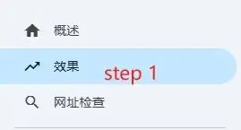

先找到“效果”这个菜单栏，然后点击进入。
**（2）选择自定义**

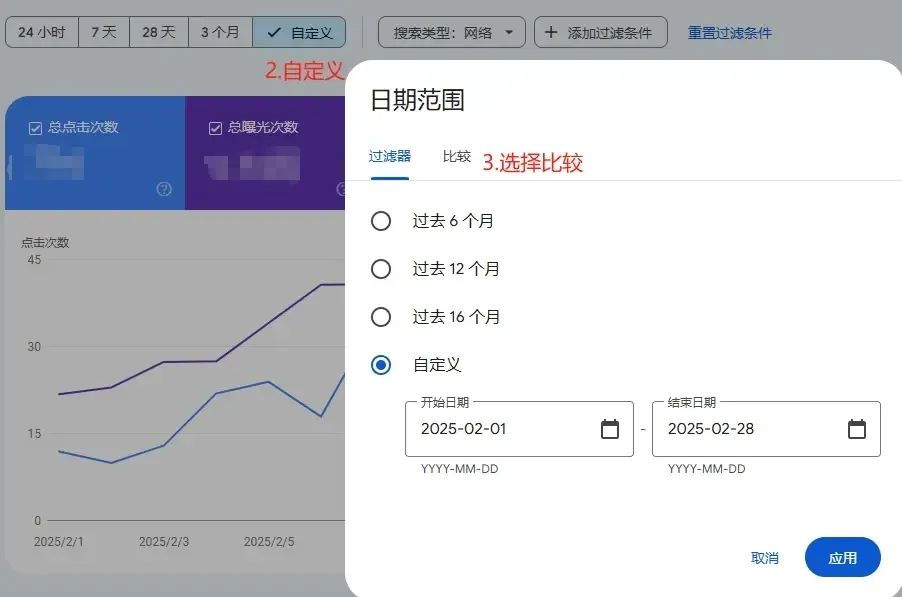

这个时候找到“自定义”按钮，点击一下就会显示过滤器和比较这两个对比框。
选择“比较”即可，然后进入下一步。
**（3）选择比较日期**

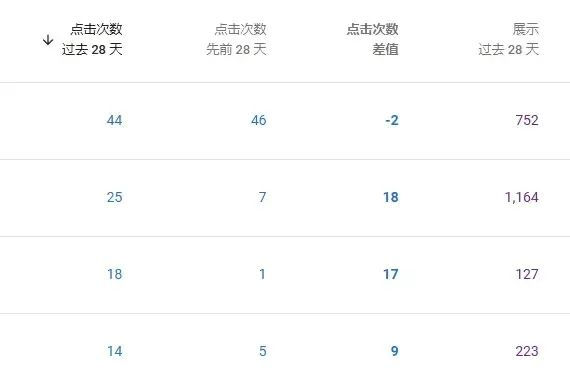

然后就可以检测出来哪些关键词，相比上个月或者前几个月有了明显的下降。
通过“点击次数差值”就可以很明显的看出，负数为降低，正数为增加。
**（4）分析点击次数下降的原因**
这个原因有3种：季节性波动、关键词排名不靠前、关键词没有热度。
- 季节性波动这个很正常，如果关键词是有搜索流量的且排名不错，那么说明就是季节性的影响。
- 如果有关键词有热度但是有排名且正好还在流量旺季，说明该关键词已经没有热度了，建议做新的关键词研究。
- 如果关键词有热度且排除了季节性波动的影响，那么大概率是关键词排名不靠前，没人点击。
如果关键词排名不靠前也是要做具体的分析：
- 排名难度过大
- 网站内容质量不高
- 没有满足用户搜索意图
清晰了以后就可以做针对性的布局了。
- 排名难度过大就算一个相关且竞争度不大的长尾词来排名，等把相关的长尾词都排上来再排大词自然会简单很多。
- 网站内容如果不高，建议是研究一下谷歌EEAT算法同时不要用AI写一些假大空的话，多增加一些实际的内容更加用户的参考价值。
- 了解关键词的搜索意图，比如用户搜索what is xx？的时候就要明白这是概念性的，这个时候就不要增加很多营销元素。
而是应该多关注一些基础概念的解释，这样的用户属于初级了解阶段，如果是潜在用户在认为你的这篇内容不错的情况下是有机会产生转化的。
如果用户是在购买决策的时候，那么就多些关于自己产品的特长和使用案例，让客户能更好地了解准备购买的产品。
这样才会消除购买疑虑，最终产生购买。
**04 检查404页面**
死链会影响用户体验和搜索引擎抓取效率。
定期使用Google Search Console检查网站，检测404错误页面。
404页面若处理不当，会带来诸多危害：
- 用户访问链接却看到404页面，会感到困惑、失望，降低对网站的信任度和好感度，可能直接离开，导致用户流失。
- 搜索引擎爬虫遇到大量404页面，会认为网站存在问题，降低对网站的抓取频率和信任度，影响网站整体权重和关键词排名。
- 用户因404页面而流失，直接导致网站流量减少，进而影响网站的广告收入、业务转化等，不利于网站的长期发展和运营。
所以如果发现404页面了，及时做好处理。
**（1）发现404页面**
通过路径编制索引-网页-未找到404

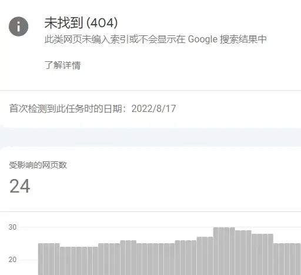

**（2）设计404页面**
设计一个友好的404页面，或者提供返回首页或推荐内容的链接，可以减少用户流失。

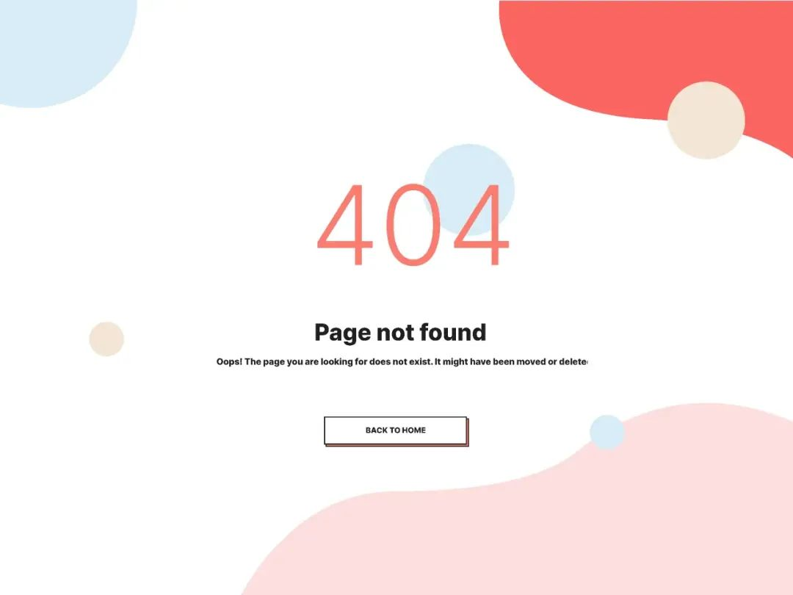

当然有个细节需要注意一下，提供返回首页是在404里面添加一个指向首页的链接，并不是做301重定向到首页。
**05 修复404错误**
**（1）实施301重定向**
301重定向是修复404页面的最有效方法之一。
它将用户和搜索引擎从失效的URL永久引导到新的目标页面，从而避免流量损失并保持SEO排名。
**（2）修复拼写错误或无效的URL**
拼写错误和无效URL是导致404页面的常见原因。
重定向拼写错误 URL 到正确页面（例：/machien → /machine）
在 robots.txt 中禁止抓取无效路径：
User-agent: *
Disallow: /machien/
Disallow: /product/
**（3）恢复被误删的重要页面**
如果404页面是由于误删重要内容导致的，可以通过以下步骤恢复页面：
- 检查备份记录：登录主机控制面板，查看最近的备份文件。
- 执行恢复操作：选择合适的时间点，恢复被删除的页面。
- 验证恢复结果：检查文件结构和内容，确保页面正常显示。
- 处理多余文件：逐一检查新增文件，删除不必要的内容。
- 预防措施：定期备份数据并启用自动备份功能，减少数据丢失的风险。

#### 2.绑定Ahrefs站长工具

前面已经绑定了Google search console，那么我们绑定绑定Ahrefs站长工具就很简单了。
通过谷歌账号就可以直接登录“绑定Ahrefs站长工具”了。

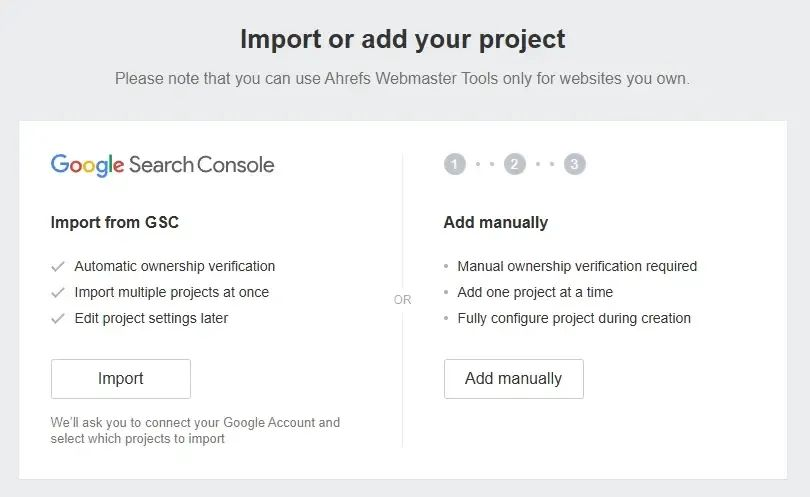

然后选择GSC导入，就可以把自己GSC的数据导入到ahrefs了。这个工具是GSC的补充，两者配合好了就可以解决很多问题了。

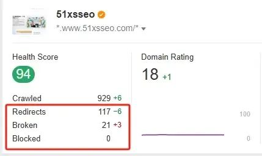

抓取、重定向、死链等问题，下面这4个如果出现问题，那么就会影响网站的Health Score（健康得分）。
所以安装了Ahrefs就可以很直观的看到这些问题。

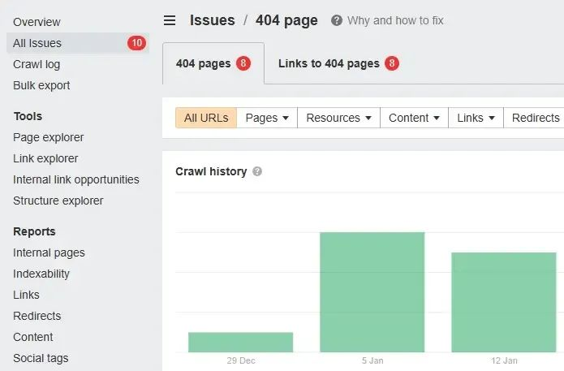

如果不知道怎么解决，这个工具旁边也是给到了具体的解决办法的建议。
点击查看即可，当然有些技术问题还是需要依靠经验来解决的，但基本上可以解决70%的问题。

## 三、SEO检查项目

**01 域名与主机**
**（1）域名历史与权重**
域名的历史对网站的SEO表现有着重要影响。
一个拥有较长历史的域名通常会在搜索引擎中获得更高的权重。
这是因为老域名在互联网上积累了更多的信任度和权威性。搜索引擎更倾向于信任这些经过时间考验的域名。
如果你想利用域名历史提升网站的权重，可以选择一个有良好历史记录的老域名，确保域名的稳定性，并持续更新网站内容。
这些方法能够帮助你在搜索引擎中获得更高的排名，同时提升用户对网站的信任感。
**（2）主机稳定性与速度**
主机的稳定性和速度直接影响网站的用户体验和SEO表现。
一个稳定的主机可以确保网站在任何时间都能正常访问，而快速的加载速度则能降低用户跳出率。
选择一个可靠的主机服务商，并定期监测主机的性能，是优化网站的重要步骤。
以下是一些适合独立站的主机推荐：
**Hostinger**
价格：最低2.99美元/月。
优势：在全球拥有众多数据中心，包括美国、香港、新加坡等地，可提供快速的访问速度。
提供多种类型的主机服务，如共享主机、VPS、云主机等，能满足不同阶段独立站的需求。有超过2900万用户选择，用户基础庞大，稳定性有一定保障。
**InterServer**
价格：最低2.50美元/月。
优势：提供无限宽带、无限存储和无限域名托管，资源充足。技术支持优秀，能及时解决用户遇到的问题。数据中心位于美国洛杉矶和新泽西，适合面向欧美市场的独立站。
**Bluehost**
价格：最低2.95美元/月。
优势：知名度高，是很多新手建站的选择。
与WordPress官方有合作，对WordPress建站支持友好。
数据中心分布广泛，包括美国、香港、欧洲、印度等地，可根据目标市场选择合适的节点。
**SiteGround**
价格：最低1.99美元/月。
优势：在主机性能和安全性方面表现出色，提供免费的SSL证书、每日备份等安全功能。
有专业的客服团队，提供24/7的技术支持。
数据中心位于北美、欧洲和新加坡，能为不同地区的用户提供较好的访问体验。
**GreenGeeks**
价格：最低2.95美元/月。
优势：主机采用绿色能源，比较环保。
提供50GB的存储空间，对于一般的独立站来说足够使用。
在性能方面也有不错的表现，能保证网站的快速加载。
**02 网站加载速度**
**（1）页面加载时间检测**
网站加载速度是影响用户体验和SEO排名的关键因素。你可以使用工具（如Pingdom或GTmetrix）定期检测页面加载时间。
这些工具能够帮助你识别加载缓慢的页面，并提供优化建议。
图片、代码和缓存优化
优化网站加载速度需要从多个方面入手：
减少HTTP请求数量，合并JavaScript和CSS文件。
使用async和defer属性异步加载JavaScript脚本，避免阻塞页面渲染。
启用浏览器缓存策略，利用Cache-Control和ETag头部减少重复下载资源。
压缩图片文件大小，使用现代图片格式（如WebP）。
通过这些优化措施，你可以显著提升网站的加载速度，从而改善用户体验和SEO表现。
**03 Https与安全性**
**（1）SSL证书配置**
HTTPS不仅能保护用户数据，还对SEO排名有积极影响。
谷歌早在2014年就宣布HTTPS是排名因素之一。
使用SSL加密的网站通常会获得额外的排名优势。
例如，Cloudtec公司在迁移到HTTPS后，其前10名的搜索引擎排名几乎翻了一番。
配置SSL证书时，选择可信的证书颁发机构（如GlobalSign或Let's Encrypt），并确保证书的有效性。
这样不仅能提升网站的安全性，还能增强用户对网站的信任。

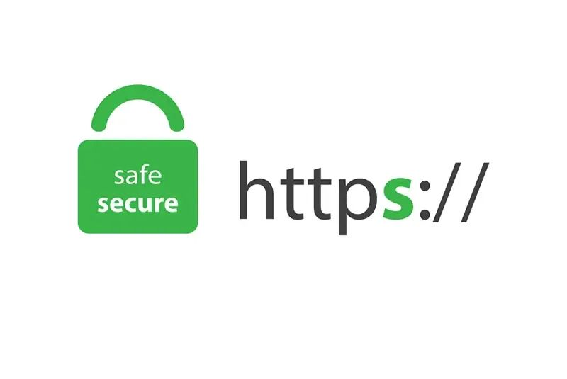

**2)网站安全性检查**
网站安全性是SEO诊断的重要环节。定期检查网站是否存在漏洞，防止黑客攻击和恶意软件感染。
你可以使用安全扫描工具（如Sucuri或SiteLock）来检测潜在威胁，并及时修复问题。
一个安全性高的网站不仅能保护用户数据，还能避免因安全问题导致的搜索引擎惩罚。
通过以上基础检查，你可以为网站SEO诊断步骤打下坚实的基础。
这些优化措施不仅能提升网站的搜索引擎排名，还能改善用户体验，帮助你在竞争中脱颖而出。
**03 robots.txt与sitemap**
**（1）robots.txt文件设置**
在网站SEO诊断步骤中，robots.txt文件是一个不可忽视的部分。
它是一个简单的文本文件，用于告诉搜索引擎哪些页面可以抓取，哪些页面需要屏蔽。
通过合理设置robots.txt文件，你可以有效控制搜索引擎抓取的范围，避免不必要的页面被索引。
设置robots.txt文件时，你需要确保以下几点：
**1.1明确抓取规则**
通过Allow和Disallow指令，指定允许或禁止抓取的路径。
例如，Disallow: /private/可以阻止搜索引擎抓取/private目录下的内容。
**1.2避免屏蔽重要页面**
确保没有误将重要页面（如首页或产品页）屏蔽。
错误的设置可能导致搜索引擎无法索引关键内容。
**1.3测试文件有效性**
使用Google Search Console中的robots.txt测试工具，验证文件是否正确配置。
提示：robots.txt文件虽然能限制搜索引擎的抓取，但它并不能完全阻止用户访问受限制的页面。因此，敏感信息应通过其他方式保护，而非仅依赖robots.txt。
**（2）XML网站地图检查与提交**
XML网站地图是搜索引擎了解网站结构的重要工具。
它以XML文件的形式列出网站的所有页面，并提供页面的更新频率、优先级等信息。
主动提交XML网站地图，可以帮助搜索引擎更高效地抓取和索引网站内容。
在检查和提交XML网站地图时，你可以参考以下步骤：
- 生成网站地图：使用工具（如Screaming Frog或Yoast SEO插件）生成XML格式的网站地图。确保地图中包含所有重要页面，并排除重复或无效链接。
- 验证地图内容：检查网站地图是否正确反映网站结构。确保每个URL都能正常访问，并避免出现404错误。
- 提交到搜索引擎：通过Google Search Console或百度站长工具，将XML网站地图提交给搜索引擎。
提交后，定期检查抓取状态，确保搜索引擎能够顺利抓取所有页面。
定期更新XML网站地图，尤其是在添加新页面或删除旧页面后。
这样可以确保搜索引擎始终掌握最新的站点结构。
通过合理设置robots.txt文件和优化XML网站地图，你可以显著提升搜索引擎对网站的抓取效率。
这不仅有助于提高网站的索引率，还能为后续的优化工作打下坚实基础。

## 四、网站SEO关键词分析诊断步骤

#### 1.关键词研究

**（1）高价值关键词挖掘**
关键词研究是网站SEO诊断步骤中不可或缺的一环。
通过挖掘高价值关键词，你可以精准定位目标用户并提升网站流量。
使用专业工具（如谷歌关键词规划师、Ahrefs或SEMrush）能够帮助你快速找到与业务相关的关键词。
这些工具不仅提供关键词的搜索量和竞争度，还能帮助你发现潜在的关键词机会。
此外，分析竞争对手的关键词策略也是挖掘高价值关键词的重要方法。
通过研究竞争对手的关键词布局，你可以找到他们忽视的关键词，从而抢占市场空白。
跨境电商领域尤其需要关注不同市场的搜索习惯和文化差异，进行多语言关键词研究，确保关键词与目标市场的需求相匹配。

**（2）用户搜索意图分析**
理解用户的搜索意图是选择关键词的关键。
用户搜索意图通常分为三类：
- 信息型
- 导航型
- 交易型
你需要根据业务目标选择最合适的关键词。
例如，如果目标是提高产品销售，优先选择交易型关键词。
如果目标是增加品牌曝光，则可以选择信息型关键词。
通过分析用户搜索意图，你可以确保关键词与用户需求高度匹配，从而提高页面的点击率和转化率。
这种方法不仅能提升SEO效果，还能改善用户体验。

#### 2.关键词布局

**（1）标题、描述和正文中的关键词分布**
关键词布局直接影响页面的相关性和独立性。
每个页面应围绕一个核心关键词展开内容创作，并将关键词合理分布在标题、描述和正文中。
标题和H标签是关键词布局的重点区域，因为搜索引擎会优先抓取这些位置的内容。
为了避免关键词堆砌，你需要确保关键词的使用自然流畅。
例如，在描述中使用关键词时，可以结合用户的搜索意图，创造吸引人的文案。正文中则可以通过同义词和相关词扩展内容，增强页面的语义相关性。
**（2）避免关键词堆砌**
关键词堆砌不仅会降低用户体验，还可能导致搜索引擎的惩罚。
为了避免这种情况，你需要控制关键词的密度，确保关键词的使用符合语法规则且不显得生硬。
一个有效的策略是将关键词分布在页面的不同部分，而不是集中在某一段落。
通过这种方式，你可以提高页面的可读性，同时保持SEO优化效果。

#### 3.URL结构

**（1）URL简洁性与关键词包含**
优化URL结构可以提升用户体验和SEO表现。
简洁的URL不仅易于用户理解，还能帮助搜索引擎更高效地抓取页面内容。
你可以在URL中包含描述性关键词，明确页面主题。例如，将www.example.com/page?id=123优化为www.example.com/product-category/product-name。
以下是URL结构优化的具体好处：
- 提升用户体验，提供易于理解的页面内容指示。
- 包含描述性关键词的URL有助于SEO。
- 简单的URL结构有利于Google的抓取和索引。
- 通过优化URL结构，你可以同时改善用户和搜索引擎的体验。
**（2）动态参数优化**
动态参数过多的URL可能导致搜索引擎抓取困难。
你需要减少URL中的动态参数，避免重复内容的生成。例如，将www.example.com/product?id=123&color=red&size=large优化为www.example.com/product/red-large.
此外，使用规范标签（Canonical Tag）标记主要页面，防止搜索引擎将动态参数视为重复内容。
通过这些优化措施，你可以提升网站的抓取效率和排名。

## 五、网站内容质量分析诊断步骤

#### 1.内容原创性

**（1）重复内容检查**
重复内容会严重影响网站的SEO表现。搜索引擎算法通常将重复内容视为低质量或无价值的内容，这可能导致网站排名下降。
为了避免这种情况，你需要定期检查网站内容的重复性。
以下是一些确保内容原创性的有效方法：
- 提供有价值的内容，确保内容对用户有实际帮助。
- 避免抄袭，使用原创表达方式传递信息。
- 定期更新内容，保持网站的活跃度和新鲜感。
- 通过这些措施，你可以提升网站内容的独特性，增强搜索引擎对网站的信任。
**（2）独特价值内容**
独特价值内容是吸引用户和搜索引擎的关键。你需要确保每篇文章都能为用户提供新的见解或解决实际问题。
例如，针对用户常见问题提供详细解答，或分享行业最新趋势和数据分析。
创建独特内容时，关注目标用户的需求。通过深入研究和创新表达，你可以让内容更具吸引力，同时提升网站的权威性。

#### 2.内容相关性

**（1）内容与目标关键词的相关性**
内容与目标关键词的相关性直接影响页面的SEO排名。
搜索引擎会优先展示与用户搜索意图匹配的内容。
你需要围绕目标关键词设计内容，确保关键词自然融入标题、段落和小节中。
避免关键词堆砌，保持内容的流畅性和可读性。
通过优化内容相关性，你可以提高页面的点击率和用户停留时间。
**（2）满足用户需求的信息**
高质量内容不仅需要相关性，还要满足用户的实际需求。
用户访问网站时，通常希望快速找到答案或解决问题。
你可以通过以下方式优化内容：
- 提供清晰的结构和易于理解的语言。
- 使用图表或案例分析增强内容的实用性。
- 针对不同用户群体，提供个性化的解决方案。
满足用户需求的信息能够提升用户体验，同时增强搜索引擎对页面的评价。

#### 3.内容更新频率

**（1）旧内容更新**
定期更新旧内容是保持网站活跃度的重要策略。你可以检查旧文章是否包含过时信息，并根据最新数据或行业趋势进行修改。
例如，更新统计数据或添加新的案例分析。
通过更新旧内容，你不仅能提高页面的时效性，还能吸引搜索引擎重新抓取页面，从而提升排名。
**（2）保持内容时效性**
时效性是内容质量的重要指标，用户更倾向于信任最新的信息。
你需要制定内容更新计划，确保网站始终提供最新的行业动态和解决方案。
例如，在新闻类网站中，及时发布热点事件的分析文章可以显著提高流量。
在技术类网站中，定期更新教程和工具使用指南能够吸引更多用户访问。
通过保持内容时效性，你可以增强用户对网站的信任，同时提升SEO表现。

## 六、网站SEO技术优化诊断步骤

#### 1.代码优化

**（1）CSS、JS文件压缩**
优化CSS和JavaScript文件是提升网站性能的关键步骤。
未压缩的代码会增加页面加载时间，影响用户体验和SEO表现。
你可以通过工具（如UglifyJS或CSSNano）压缩代码，减少文件大小。
压缩后的文件不仅能加快加载速度，还能降低服务器的带宽消耗。
此外，减少HTTP请求数量同样重要。合并多个CSS或JS文件为一个文件，可以显著减少请求次数，从而提升网站性能。
**（2）删除无用代码**
无用代码会拖慢网站速度，浪费服务器资源。
定期清理HTML、CSS和JavaScript中的冗余代码，确保代码简洁高效。
例如，删除未使用的CSS样式或过时的JS函数，可以提高页面加载速度。
加载速度是用户评价网站质量的重要因素。研究表明，响应缓慢的网站会导致用户流失，并可能因高跳出率而影响搜索引擎排名。
以下是提升网站性能的其他方法：
- 优化图片和媒体文件大小，避免加载过大的资源。
- 使用内容分发网络（CDN），将内容缓存到全球服务器。
- 配置浏览器缓存，加快重复访问时的加载速度。
- 优化Web服务器配置，提高响应效率。
通过这些措施，你可以显著提升网站性能，同时改善SEO效果。

## 七、网站外链分析诊断步骤

#### 1.外链质量

**（1）外链来源权威性**
外链的来源权威性直接影响网站的SEO表现。高质量的外链不仅能提升网站的权重，还能增强搜索引擎对网站的信任度。
你需要重点关注以下几个方面：
- 域名权重（DA）：选择权威性高的域名作为外链来源。权威域名的链接能有效传递权重，提升网站的可信度。
- 相关性：确保外链来源与网站内容高度相关。相关性强的外链更容易吸引精准流量，提升转化率。
- 自然点击率：通过Google Analytics（GA）分析外链的点击率，评估外链对自然流量的贡献。点击率的提升通常与关键词搜索量密切相关。
- 曝光量：使用Google Search Console（GSC）查看外链带来的展示次数，关注外链对网站曝光度的影响。
通过以上方法，你可以有效评估外链的质量，为网站SEO优化提供有力支持。
**（2）垃圾外链清理**
垃圾外链会对网站的SEO表现造成负面影响。
你需要定期检查外链，识别并清理低质量或恶意链接。以下是一些常见的垃圾外链特征：
来源于低质量或无关网站。
包含过多的广告或垃圾内容。
使用过度优化的锚文本，显得不自然。
清理垃圾外链时，可以使用Google的拒绝链接工具（Disavow Links Tool），提交不可信链接的列表，避免这些链接影响网站的权重。

#### 2.外链数量

**（1）外链增长趋势分析**
外链数量的增长趋势是评估SEO效果的重要指标。
稳定且自然的外链增长能够提升网站的排名和流量。
以下是外链增长对SEO的具体影响：
- 排名提升：高相关性的外链能显著提高网站的搜索引擎排名。
- 精准流量：优质外链带来的流量更具针对性，转化率更高。
- 权威性增强：权威外链传递的权重能让网站更具可信度。
你可以通过GA和GSC监控外链的增长趋势，确保外链的数量和质量同步提升。
**（2）确保外链数量稳定**
外链数量的突然波动可能引起搜索引擎的警惕，甚至导致惩罚。
你需要采取以下措施，确保外链数量的稳定增长：
- 定期发布高质量内容，吸引自然外链。
- 与行业相关网站建立长期合作，获取持续的外链支持。
- 避免使用黑帽SEO手段，如购买外链或批量生成链接。
通过稳定的外链增长，你可以为网站的长期发展奠定坚实基础。

#### 3.低质量链接清理

**（1）低质量外链识别**
低质量外链会稀释网站的权重，甚至导致排名下降。你可以通过以下方法识别低质量外链：
- 检查外链来源网站的权威性和相关性。
- 分析外链的锚文本是否过度优化或无意义。
- 使用SEO工具（如Ahrefs或SEMrush）检测外链的质量评分。
识别低质量外链后，记录这些链接的详细信息，为后续清理工作做好准备。
**（2）提交拒绝请求**
清理低质量外链的最佳方法是提交拒绝请求。
你可以通过以下步骤完成操作：
- 收集所有低质量外链的URL。
- 创建一个文本文件，列出需要拒绝的链接。
- 登录Google Search Console，使用拒绝链接工具上传文件。
网址是：https://www.google.com/webmasters/tools/disavow-links-main
提交拒绝请求后，定期检查外链状态，确保清理工作取得预期效果。
通过清理低质量外链，你可以提升网站的整体权重，改善SEO表现。
定期进行SEO诊断至关重要。它能帮助你及时发现问题并调整策略，确保网站始终保持最佳状态。
