# 五大高阶方法优化 独立站SEO（实操保姆级教程）

## 一、使用合理的站点结构

## 1.1 使用合理的网站层次结构

通过合理的层次结构优化站点结构，访客和搜索引擎可以更轻松地找到内容。确保网站上的页面通过 内部链接相互连接。例如，在访问100percentpure时，你可以直接从顶部菜单访问不同的类别，比如 “畅销品”、“护肤品”和“头发”。

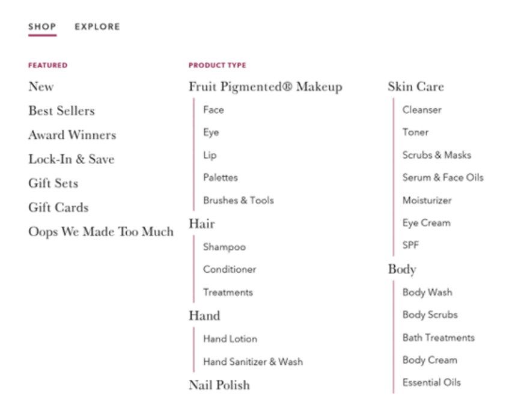

查看首页导航时，你会发现 100percentpure 遵循许多在线商店使用的页面层次结构，例如：

- 主页链接连接到类别、子类别和产品。

- 包含丰富的“头发”、“护肤”、“身体”等不同分类的分类页面。

- 子类别页面清晰可见，如“沐浴露”、“洗发水”和“保湿霜”。

- 产品页面展示产品信息

<mark>顶部菜单并不是浏览100percentpure站点的唯一方式。其主页还通过直接连接到产品页面来突出显示 一些产品，例如“新产品”部分。</mark>

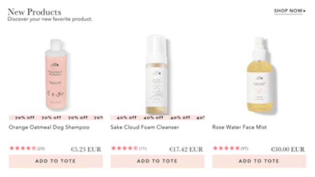

<mark>它还利用底部菜单或页脚链接到其他重要页面，如“退货和换货”和“支持”页面。在这些位置，你也可 以找到链接到类别页和子类别页的入口。</mark>

## 1.2 使用扁平而宽阔的网站结构

使用扁平而宽阔的网站结构可以使访客在主页上仅需几次点击即可轻松找到你网站上的内容。具体来 说，你的主页应该链接到类别页面，类别页面应链接到子类别页面，子类别页面应链接到具体的产品 页面。

这种方法下，你的网站架构将呈现如下结构：

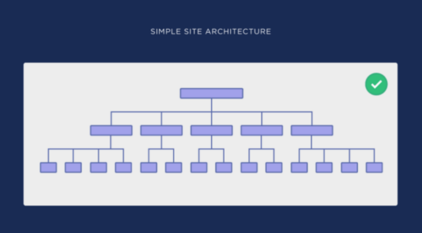

<mark>与这种狭窄而深层的结构相反，扁平而宽阔的网站结构更为浅显。</mark>

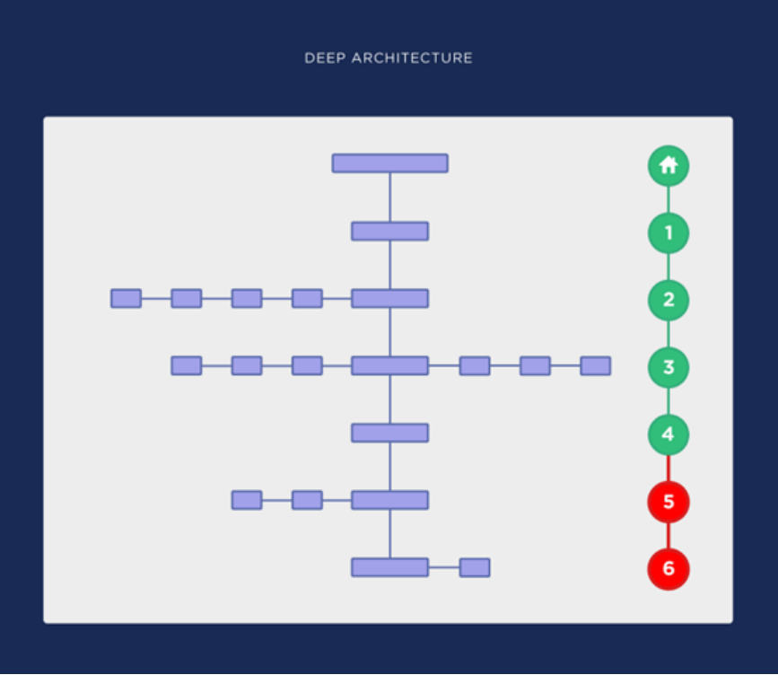

使用像上面这样的导航菜单有助于确保你的网站结构合理，并确保所有页面都能得到良好的可见性和完全集 成。为了确保没有任何孤立的页面缺乏与网站上其他页面的连接，你可以使用Semrush的站点审核等工具。

## 1.3 为什么这很重要？

在线商店可能有数万个页面。孤立页面和断开的链接会使搜索引擎难以发现你网站的所有内容。通过在页面 之间添加内部链接，你可以为搜索引擎创建路径，使其能够有效地查找和索引你的所有内容。这样，你的更 多内容就有机会在搜索结果中获得更好的排名和展示。

## 二、进行关键词研究

关键字是人们在搜索引擎中使用的术语。有时它们以问题的形式出现，比如“正确的护肤程序是什么？” 有时直接以购买意图的形式出现，比如“购买护发素”。为了吸引使用与你的业务相关的关键字进行搜索 的访问者，你需要在Shopify上的内容中加入这些关键字。这样做可以告诉搜索引擎你的内容与这些关 键字相关，从而有机会在搜索结果中排名和展示。

要实现这一点， **第一步是进行关键字研究** 。

## 2.1 为你的商店寻找关键词

有很多工具可以找到关键词机会。我们将首先向你展示如何手动操作。然后使用像 Semrush 和 Exploding Topics 这样的工具。

让我们从一个基本的关键词研究技巧开始：首先使用 Google 搜索与你的商店相关的术语，例如“遮瑕 膏与粉底”。然后，浏览搜索结果页底部的“相关搜索”。这些相关搜索项通常会显示与你输入的关键词 相关且可能感兴趣的其他搜索查询。

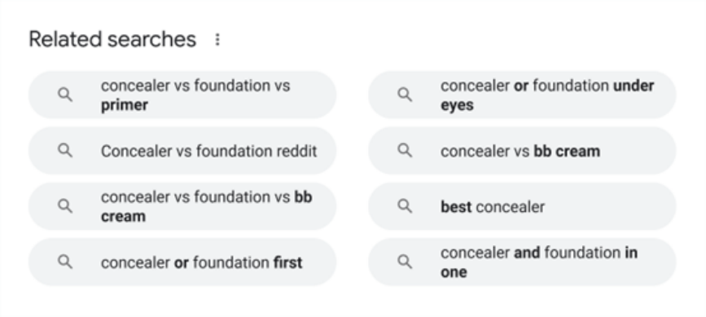

### <mark>除此之外，还有“人们经常问”部分。</mark>

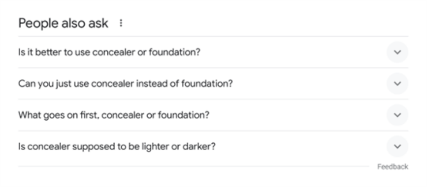

这些建议基于真实搜索。除了在Google上搜索外，你还可以在亚马逊、Pinterest甚至竞争对手的网站 上搜索产品，以查找相关结果，从而获得更多相关关键词的想法。虽然手动研究可能需要大量工作 量。

相反，我们建议你使用 Exploding Topics 或 Semrush 等工具对目标关键词进行深入分析。Exploding Topics特别适合查找与你的商店相关的快速增长主题，但需要注册Pro订阅。以下是使用Exploding Topics查找趋势的示例：检查趋势数据库并选择你商店产品所在的行业，比如护发。

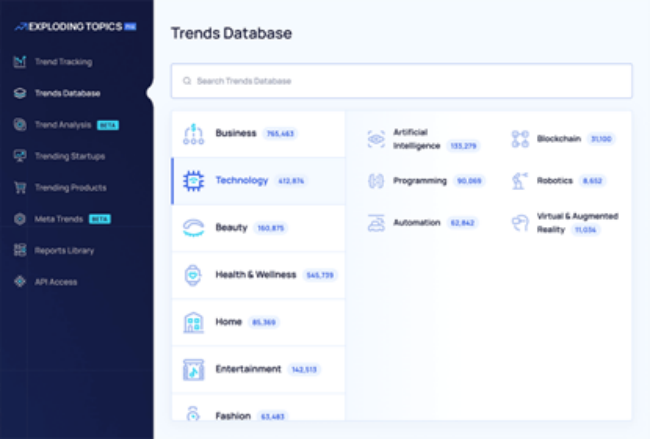

<mark>你可以使用Exploding Topics获取一个流行的主题列表，并使用过滤器找到适合销售或撰写内容的产 品。为了查找最新趋势，你可以选择“时间范围”>“1 年”。通过使用过滤器，你可以选择只查看品牌相关 的主题（适合你的商店）或非品牌的主题（通常是你可以撰写内容的产品类别）。</mark>

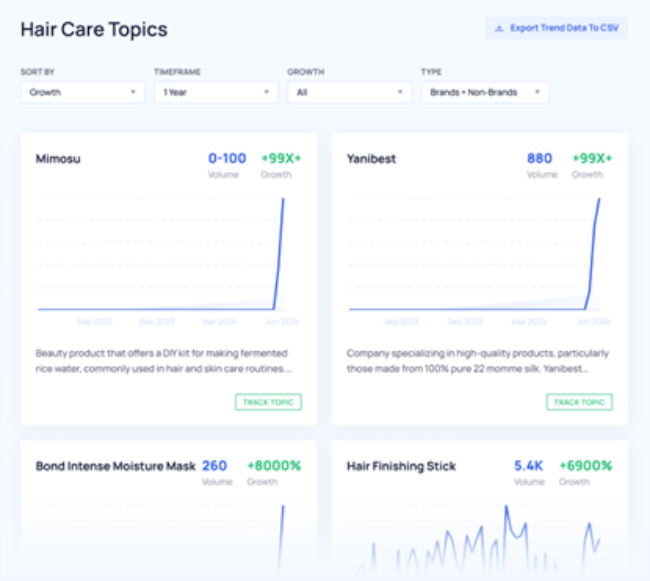

<mark>在Semrush上，你可以在关键词魔术工具中输入一个相关关键词，并获得相关关键词列表：</mark>

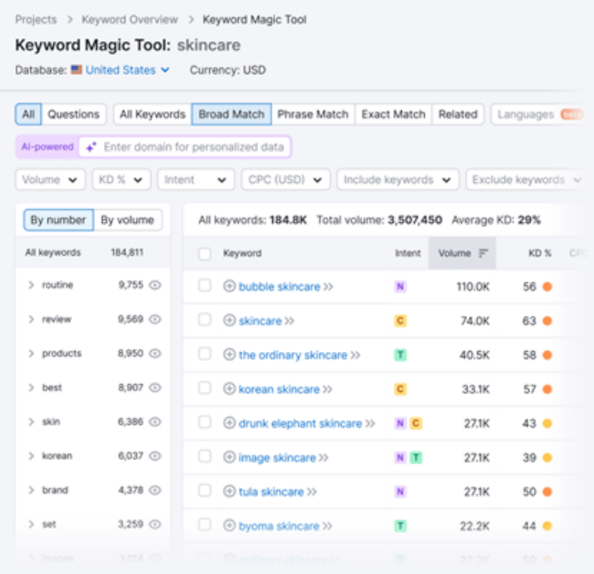

<mark>通过将你喜欢的关键词添加到关键词策略生成器来跟踪它们。只需点击“创建列表”。</mark>

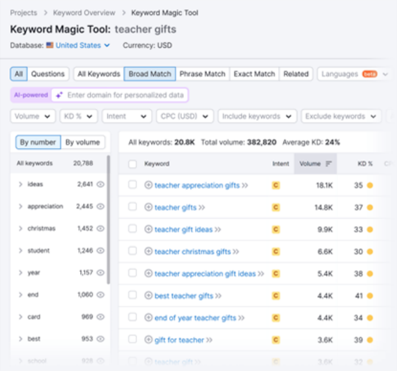

## 2.2 确定关键词的优先级和聚类

确定关键词的优先级和聚类是关键的一步。创建与你的商店相关的多个关键词列表后，你需要对它们 进行分组和优先排序。以下是一些关键指标，例如对于关键词“教师礼物”：

- ⏺意图：搜索此关键字的普通用户的目的。意图可以是信息性的（查找信息）、导航性的（寻找特

- 定网站）、商业性的（研究产品或服务，但不立即购买）或交易性的（想要购买）。

- <mark>⏺搜</mark> 索量：每月平均搜索此关键词的次数。

- <mark>⏺关</mark> 键字难度 (KD%)：衡量关键词的竞争难度，从0到100的范围，数字越低意味着你的内容在该

- 关键词上竞争越小。

要确定关键词的优先级，重点关注具有足够搜索量和相对较低关键词难度的关键词。将你的关键词列 表按照搜索量最高的顺序排序。你可能会看到一些具有高搜索量的关键词，这是很好的！但要注意， 许多高搜索量的关键词可能竞争激烈，因为已有很多高质量的内容涉及这些关键词。使用关键词难度 （KD%）列的信息来判断哪些高搜索量的关键词是可行的目标。

_<mark>>>></mark>_ <mark>专业提示</mark>

<mark>对于大多数网站来说，寻找关键词难度低于</mark> _<mark>50%</mark>_ <mark>的关键词通常是一个不错的策略，但实际的理想</mark> _<mark>KD%</mark>_ <mark>取决于你网站的权威性和行业竞争情况。</mark>

在根据搜索量和可实现的关键字难度对关键字进行优先排序后，重要的是考虑关键词的意图。尽管导 航性关键词对于Shopify SEO的帮助有限，但整合交易性、商业性和信息性关键词可以增加很多价值。 例如：

- <mark>⏺交</mark> 易性关键字（如“去角质清洁剂”）特别适用于产品页面

- <mark>⏺商</mark> 业性关键字（如“教师圣诞礼物”）可以为类别或子类别页面带来流量

- <mark>⏺信</mark> 息性关键字（如“教师感恩周”）可以吸引人们对博客的关注

审查你的关键词列表，并开始预测如何最好地利用这些关键词。优先选择那些具有明显和最有价值应 用的关键词。接下来，让我们将你的优先关键词列表分组到主题分类中。每个分类中通常包含以下两 种类型的页面：

- <mark>⏺聚</mark> 合页面：涵盖广泛的主题（例如“Mac 键盘”），同时链接到具有更具体信息的分类页面

- <mark>⏺分</mark> 类页面：深入介绍聚合页面上提到的特定子主题（例如“Macbook 无线键盘”）

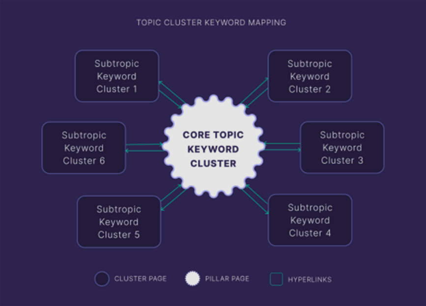

<mark>要在Semrush中组织主题分类，可以使用关键字策略生成器来分析单个关键字，并获取包含多个关键 字的相关主题分类。例如，如果你输入“键盘”并点击“创建列表”，Semrush会提供一个主题概览，展示 不同的次要关键词（如“机械键盘”和“蓝牙键盘”）如何连接在一起，并以聚合页面和子页面的形式呈 现。</mark>

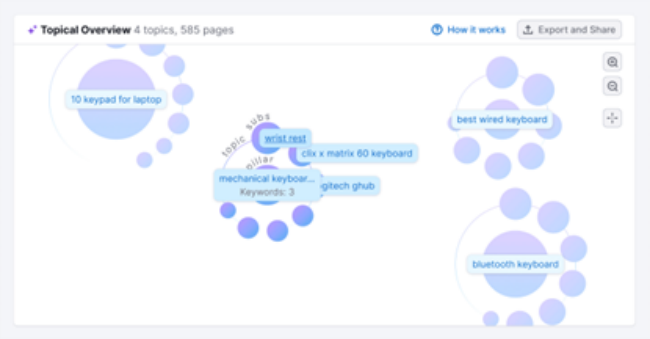

向下滚动后，你可以看到可用作聚合页面的主要关键字列表。通过点击这些关键字，你可以获取相关 的次要关键字列表，例如“游戏套装”和“桌面键盘支架”。这些信息可以帮助你构建更为详细和精确的内 容结构，确保覆盖广泛的主题并提供更具体的细分内容。

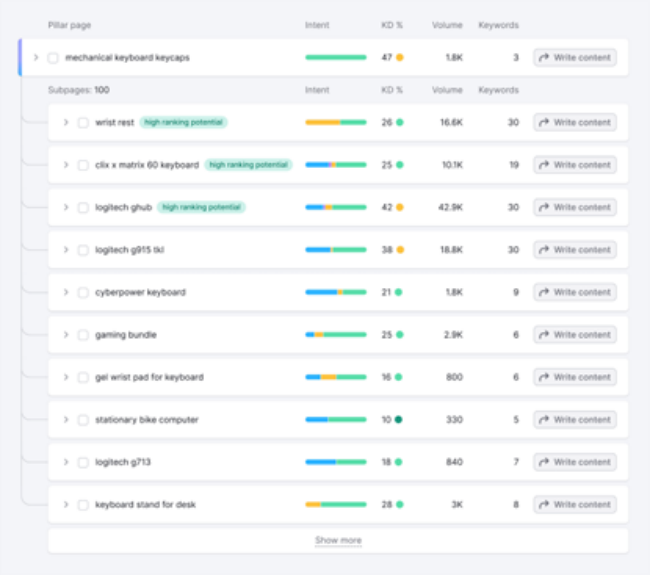

<mark>优先使用关键词战略构建器中的信息来确定可能的主题分类。考虑关键词的数量、难度、搜索量以及 分类中关键词的平均意图。</mark>

## 三、开始内容营销

一旦你拥有包含主要和次要关键字的分类列表，就该围绕它们创建内容了。

## 3.1 为你的目标关键字创建内容

为你的目标关键字创建内容非常重要，因为内容的质量和相关性直接影响搜索引擎结果的排名和用户 体验。以下是关键点的优化建议：

如果你想从头开始创建内容，我们推荐使用Semrush 的SEO写作助手。你可以直接从关键字策略生成 器将关键字发送到写作助手，只需点击关键字旁边的“编写内容”按钮。这样可以确保你的内容与目标关 键字的意图高度匹配，帮助你在搜索引擎结果中获得更好的展示和点击率。

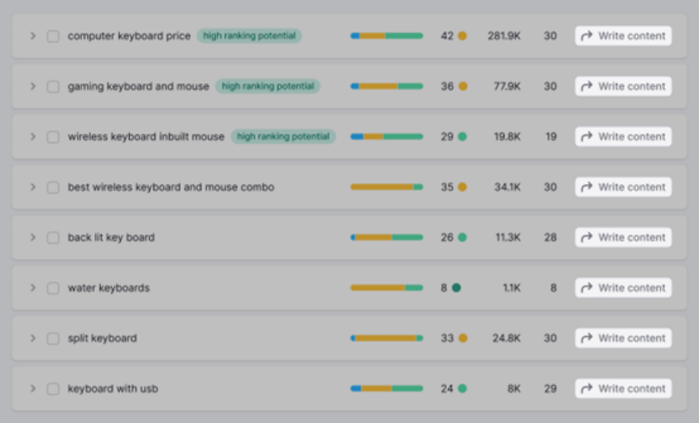

SEO写作助手将在写作过程中帮助你专注于目标关键词。它不仅会提供具体的建议和实例，确保你在 内容中正确使用关键词，还会改进冗长或复杂的句子。此外，你可以利用AI生成更多与已有内容相关 的SEO优化短语，或者使用AI的帮助撰写全新的内容。

## 3.2 在标题中包含你的目标关键词

在标题中包含目标关键词对于SEO至关重要。对于交易性关键词，如“黑色 Timberland 靴子”，简单地 在页面的H1标题中使用关键词即可。但对于信息性关键词，确保标题能够准确传达内容的广泛性质， 例如“越野跑鞋的终极指南”。

如果你需要帮助来生成潜在标题，可以使用 AI 工具（如ChatGPT）为你的文章推荐潜在标题。

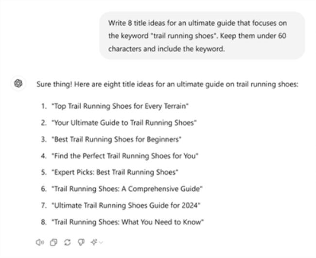

## 3.3 提供与目标关键词搜索意图相关的信息

你的目标是创建与搜索目标关键词的人的平均意图相匹配的内容。例如，创建交易关键词内容的最佳 位置是在产品页面上。信息关键词非常适合包含在博客文章中。但这不仅仅是你放置关键词的地方。 你还需要确保你的内容与该关键词高度相关。并且对可能搜索它的人来说真正有价值。例如，不要只 在产品页面上放置交易关键词。包括访问者到达后会发现有用的信息，例如产品评论、送货信息或尺 寸和合身度详情。

## 3.4 为你的内容使用合理的结构

合理的网站结构使购物者和搜索引擎可以轻松查看页面上的内容。因此，请将你的页面清晰地组织成 易于快速扫描、易于解读并帮助访问者实现其目标的结构。对于信息内容，请包含主题概述的介绍。 如果文章很长，请包含列出页面标题的目录。撰写博客时，请包含涵盖主要关键字内不同子主题的副 标题，以便全面涵盖目标分类。

## 3.5 包含指向其他页面的内部链接

围绕分类创建内容时，请确保聚合页面和分类页面相互链接。分类与其他分类相连以建立权威。对于 产品页面，请包含指向相关产品的链接。以及同一产品的变体。

## 3.6 为你的内容使用高质量图像

在你的内容中使用高质量图像，并附上描述性替代文本和文件名。对于产品页面，使用 Semrush 的 Ecommerce Booster 为你的商店优化图像。它会审核你的图像、生成替代文本并删除图像背景。

## 3.7 使用号召性用语 (CTA)

将CTA放置在内容中的几个点，引导读者执行你希望他们接下来执行的操作。比如阅读附加内容或进 行购买。

## 3.8 优化页面 SEO

此时，你已经为Shopify商店创建了大量关键词丰富、符合SEO要求的内容。但仍有机会改进页面 SEO。

例如，你可以在以下位置添加目标关键词：

**H1 标签：** 不仅限于你创建的新内容。还适用于你网站上的所有相关标题。

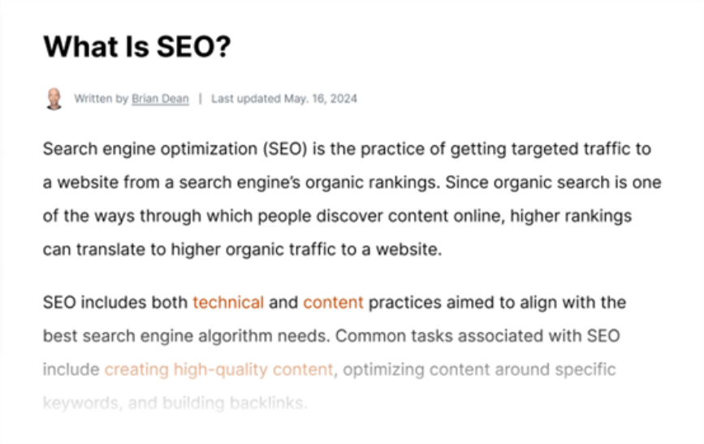

标题标签定义显示在 SERP 上的页面标题。为避免混淆，它们应与页面的 H1 相同或相似。 **元描述：** 这些内容概括页面并显示在 SERP 中。它们应提供页面概述，鼓励读者点击（使用 CTA）并 包含目标关键字。

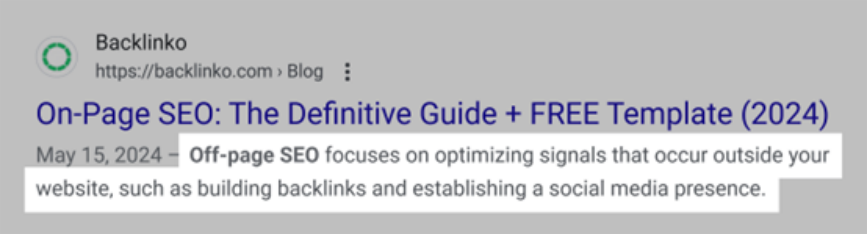

**URL 段：** 这是 URL 末尾的部分。它应该易于阅读并包含目标关键字。避免使用以下段： examplestore.com/boots/82371；相反，如果可以，请将其替换为examplestore.com/boots/blacktimberland-boots/

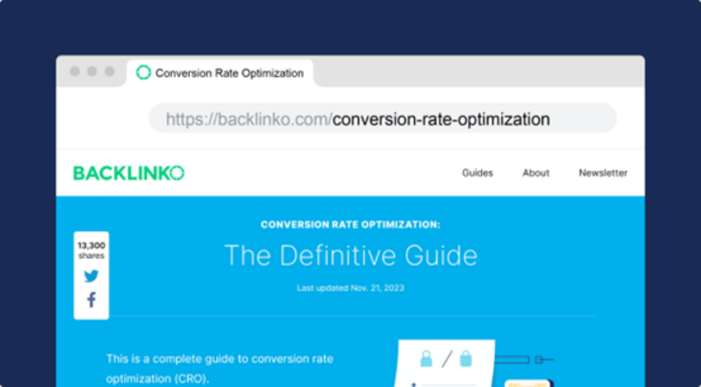

<mark>使用 Semrush 的页面 SEO 检查器等工具来确保你的页面标题、标题、副标题和正文包含最重要的关 键字。该工具将捕捉你可能错过的机会。并帮助你在尽可能的情况下整合关键字，而无需关键字堆 砌。</mark>

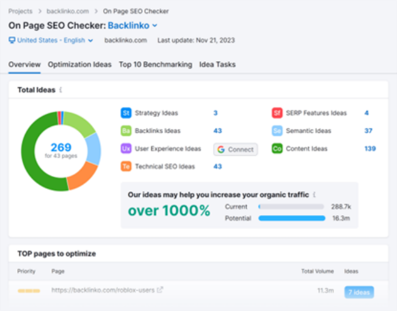

## 四、评估你的技术SEO

优化页面 SEO 后，下一步是解决任何技术 SEO 问题，以下是五个最佳实践：

## 4.1 检查你的 Shopify 商店的规范域名

正如我们在本指南开头所解释的那样，使用自定义域名可以帮助你建立品牌。但它的技术 SEO 方面也 很重要。尽管有多种方式可以输入你的域名（store.com、www.store.com 或 store.myshopify.com，但 Shopify 会自动选择一种作为首选域名。或者，用 SEO 术语来说，就是规范 URL。要识别任何技术 SEO 问题，请转到 Shopify 域名面板以检查 Shopify 设置为首选的 URL 是否是你想要的。为了使你的 主域名简短而简单，请选择不包含“www.”或“.myshopify.com”的版本，因此最终结果看起来像 “store.com”。最后，为了避免重定向，请坚持使用你的首选版本并始终链接到你域名的同一版本

**4.2 将你的站点地图提交到 Google Search Console**

现在让我们转到最有价值的（免费）技术 SEO 工具：Google Search Console 可帮助你检测站点速 度、移动优化和站点地图问题。首先在 GSC 上提交你的站点地图。Shopify 会自动生成并更新你的站 点地图。因此，你只需将你的站点地图地址（例如 https://example.com/sitemap.xml）复制到 GSC 中 的“站点地图”菜单中即可。

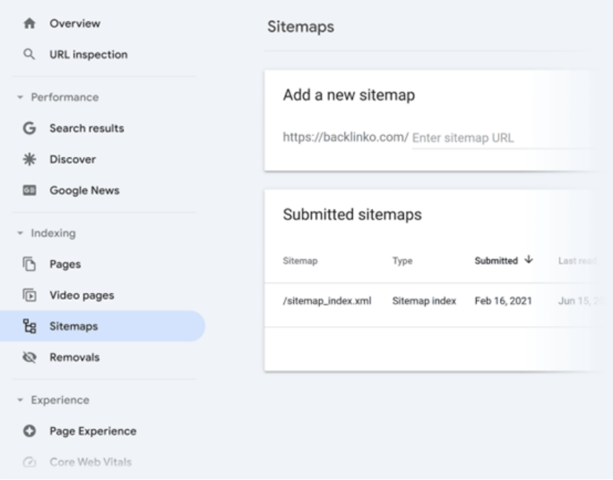

<mark>有了这些信息，Google 就会抓取你的网站。当你转到“索引”>“页面”时，你将看到结果数据。</mark>

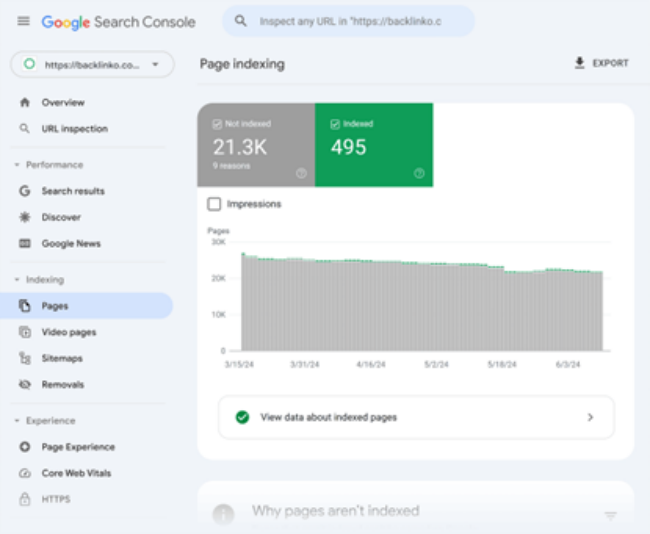

使用此报告查看Google发现的问题。例如404和重定向错误。你可以通过在Shopify设置中添加URL重 定向来轻松修复404。当尝试从你的网站收集网络数据的机器人遵循从一个页面重定向到另一个URL但 遇到阻止其到达最终目的地的错误时，就会发生重定向错误。

要解决重定向错误，请在GSC中识别受影响的页面。然后在Shopify设置中检查该页面上显示的重定 向。你可能需要删除不必要的重定向或使用正确的最终目的地更新它们。修复这些问题后，请务必定 期检查GSC中的“页面”报告以识别任何新错误。

## 4.3 使用 Google Search Console 识别慢速页面

页面速度（或你的网站加载所需的时间）在2024年仍然是一个确定的排名因素。它是核心网络生命力 的一部分，这是Google用来衡量用户体验的一组指标。

要在GSC中检查这些，请转到“体验”>“核心网络生命力”。你将看到标有“差”、“需要改进”或“好”状态的 页面列表。如下所示：

<mark>GSC还会指出导致页面加载缓慢的问题。有时这些问题很容易解决：例如，用压缩图像替换未压缩的 大型图像。并使用 JPG、WEBP 或 PNG 等格式来处理文件。在其他情况下，提高页面速度可能需要 技术帮助。例如，当你的网站上有不必要的代码元素（如HTML或JavaScript）时。</mark>

## 4.4 在你的产品页面上包含结构化数据

结构化数据是一种代码，可告知搜索引擎你页面上的内容。这也称为架构标记。它可以帮助产生丰富 的结果，例如你直接在SERP上看到的评级或价格详情：

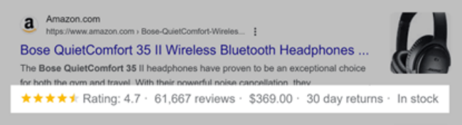

要为你的商店实现结构化数据，我们建议你使用Shopify应用，例如 Schema Plus for SEO（每月14.99 美元，可免费试用）。或者Webrex AI SEO Optimizer Schema（免费）。或者，使用Google的结构化 数据标记工具手动实现结构化数据。

要使用结构化数据标记工具，请选择URL和要为其构建结构化数据的内容类型（即产品）。你将能够 使用相关信息突出显示页面的部分内容，例如评论数量或产品价格。

Google生成标记代码后，通过编辑主题将其添加到你的商店。为此，请转到“在线商店”>“主题”>“更多 操作”>“编辑代码”，编辑你的主题文件，然后将代码添加到 <head> 标记上方。它看起来类似于此： _<script type="application/ld+json">_

_{ "@context": "https://schema.org", "@type": "Organization", "name": "example", "URL": "example", "logo": "example" } </script_

## 4.5 为目标关键词创建单独的产品页面

为在线商店创建内容时，为你想要定位的每个产品相关关键词创建一个产品页面尤为重要。这也包括 产品变体。因此，如果你的商店有一个Timberland靴子的产品页面，并且你想要定位“黑色Timberland 靴子”和“棕色Timberland靴子”等关键词，请为它们创建单独的产品页面，而不是使用原始产品的参数 化 URL。

❌避免使用如下所示的URL：

www.example.com/men/shoes/timberland-waterproof-boots?color=black&size=9 ✅相反，使用如下所示的 URL：

www.example.com/men/shoes/timberland-waterproof-boots-black?size=9

_<mark>>>></mark>_ <mark>提示</mark>

<mark>要在你的商店中使用单独的产品页面而不是参数化</mark> _<mark>URL</mark>_ <mark>。</mark>

## 五、建立优质链接

反向链接是指向你网站的其他网站上的链接。搜索引擎将此视为你的网站值得信赖且声誉良好的信 号。由于权威性会影响你的排名能力，因此链接建设会对你的SEO性能产生巨大影响。在这里，让我 们来看看一些特别适合Shopify的策略：

## 5.1 使用 Semrush 寻找反向链接潜在客户

开始建立反向链接的一个简单方法是要求其他网站链接到你的商店。你可以使用Semrush的链接建设 工具来实现这一点。设置项目后，你将找到反向链接潜在客户列表。这些网站涵盖了你定位的相同关 键字。并且可能愿意链接到你。Semrush可让你将你的电子邮件帐户与该工具连接起来。然后，只需 从仪表板直接联系即可。你甚至可以直接在工具中跟踪潜在客户的状态。

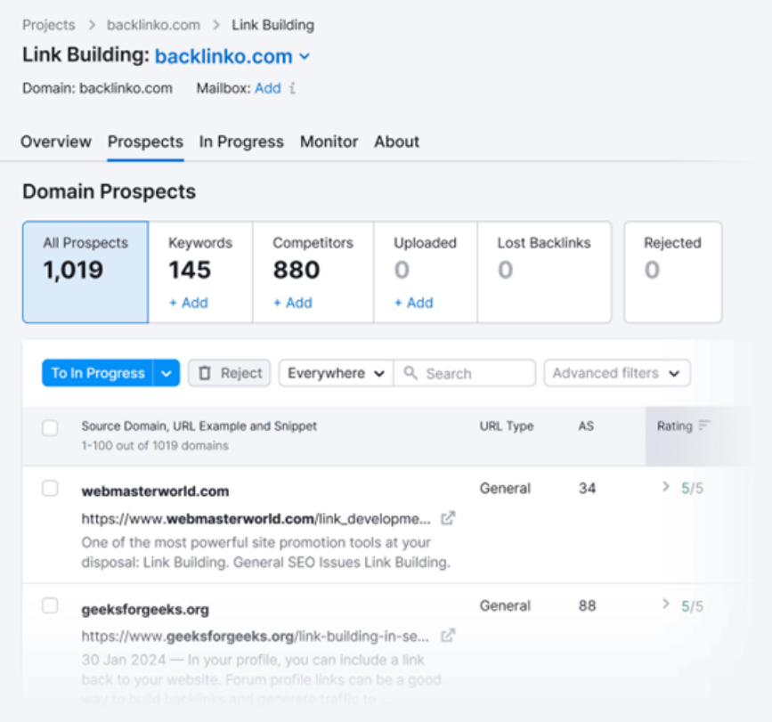

找到好的潜在客户后，请他们提及你。记住，你的推广活动要具体。并让潜在客户知道你希望他们的 链接指向哪里。

- 使用摩天大楼技术获取反向链接

摩天大楼技术在 2013 年变得流行，因为它使 Backlinko 网站的自然流量在短短 14 天内翻了一番。这 种技术仍然很有效，尽管现在有更多高质量内容，它需要做更多的工作。 摩天大楼技术有三个步骤?

- 1.找到值得链接的内容或已经生成大量链接的资产

- 2.制作该内容的改进版本（更长、更及时、更全面或设计更好）

- 3.联系已经链接到类似内容的潜在客户，并建议链接到你的（改进的）内容

### 不确定如何联系潜在客户？

### 使用此模板开始：

_Hey [Name],    I was searching for some articles about [Your topic] today and I came across this page: [URL]I noticed that you linked to one of my favorite articles – [Article title]    Just wanted to give you a heads-up that I created a similar article.    It’s like [Name of the article], but more thorough and up-to-date:    [URL]    Might be worth a mention on your page.    Either way, keep up the awesome work!    Cheers,    [Your Name]_

Semrush的反向链接差距工具还支持摩天大楼技术。它能列出链接到竞争对手但未链接到你网站的页 面。通过直接联系这些网站，你可以请求他们将链接指向你的内容。

### ▶ 创建反向磁力链接

反向磁力链接是一种吸引反向链接和分享的有效内容形式。举例来说，这份SEO工具列表已经积累了 超过10.8K个反向链接。创建反向磁力链接的一个好方法是编写详尽的指南或全面的列表，涵盖该主题 的所有方面。

进行研究也是吸引反向链接的一种有效途径，特别是如果你包含有吸引力的图表和图形。其他网站可 能会引用和分享这些图表，从而增加你页面的链接数量。

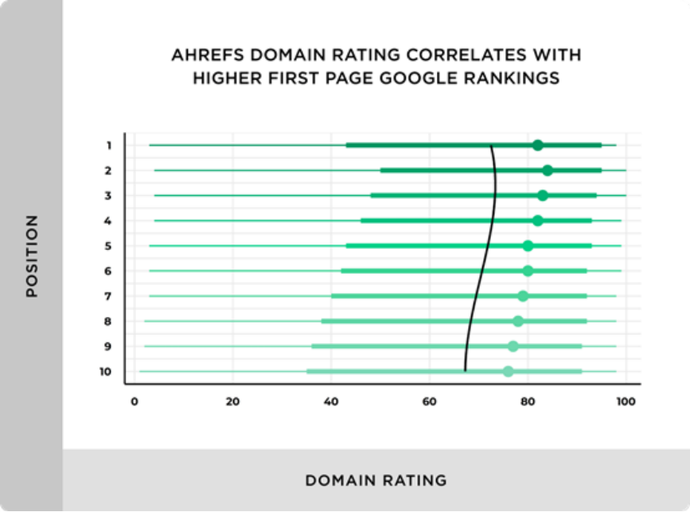

## 5.2 查找提及但未建立反向链接的网站

在其他网站上提及你的品牌或商店也是获得链接的简单机会。使用 Semrush 的品牌监控工具跟踪提及 你品牌的网站。特别是那些没有任何链接到你网站的网站。

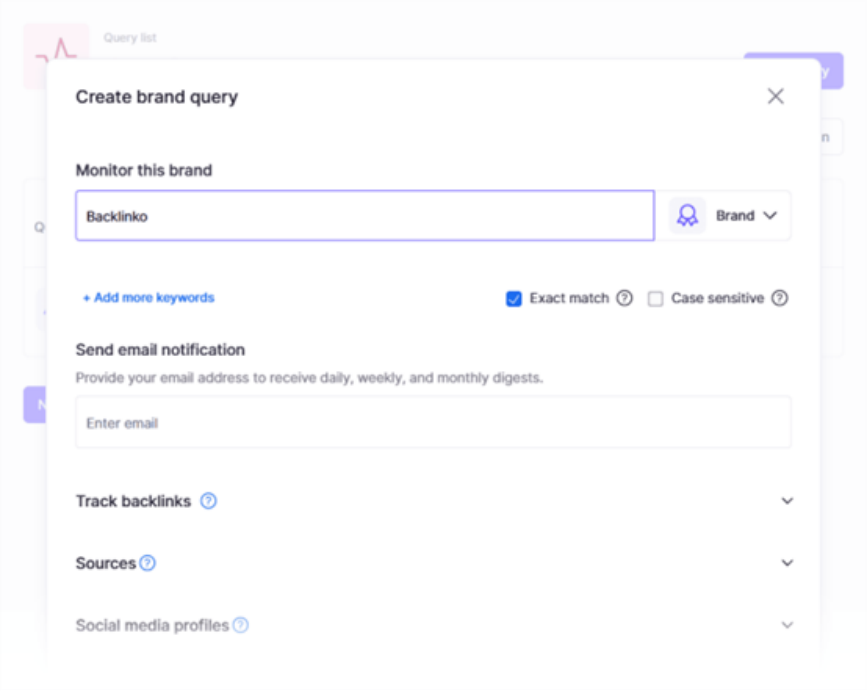

为此，请在品牌监控工具中创建搜索查询。在“跟踪反向链接”部分填写你的反向链接 URL。该工具将 开始跟踪你的品牌提及，无论是否有指向你网站的反向链接。然后，你可以在工具中浏览提及时使用 “提及详情”>“反向链接”过滤器。

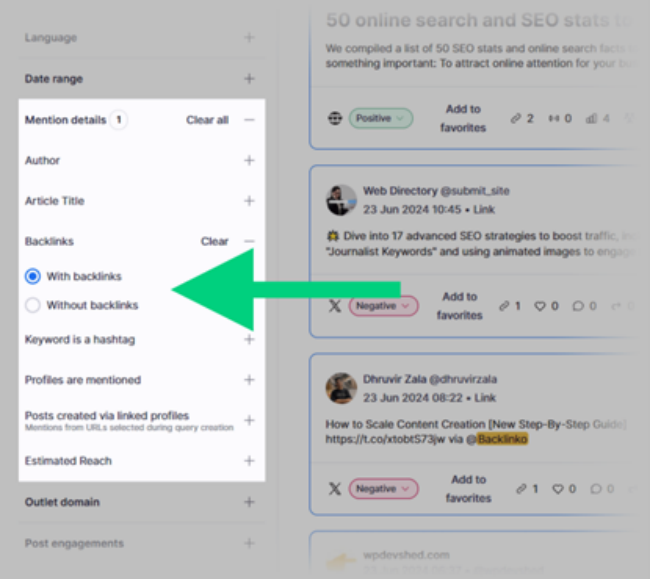

为了增强外链效果，请将其与链接构建工具结合使用，以接触那些温和地要求链接的网站。

**5.3 做客座帖子**

为其他网站撰写文章也可以创造收集链接、建立权威和吸引流量的机会。怎么做？当你在外部网站上创建客 座帖子时，请添加一个自然融入内容的链接。使用我们之前提到的链接构建工具来寻找你可以为其撰写涵盖 目标关键字的客座帖子的潜在客户。列出竞争对手和目标关键字后，你将有一个要过滤的潜在客户列表。单 击“进行中”下拉菜单。在这里，你还可以将潜在客户移动到“客座帖子”列表。

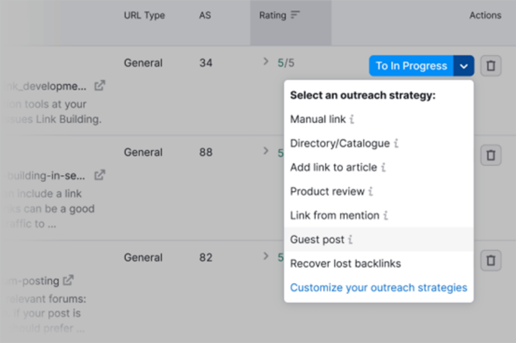

<mark>最后，使用Semrush的主题研究工具输入关键字并获取你可以在客座帖子中涵盖的主题的内容创意。</mark>
