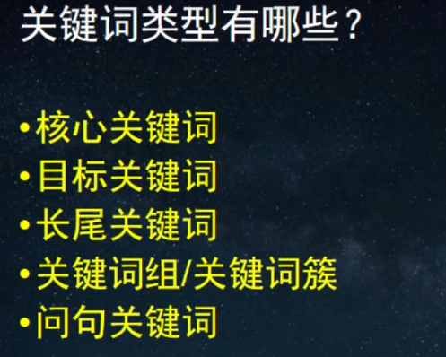
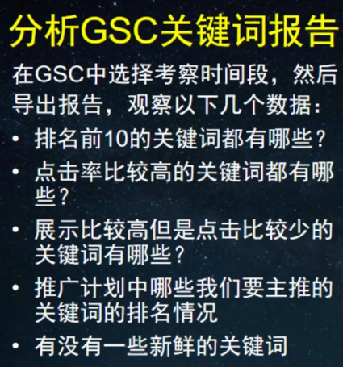
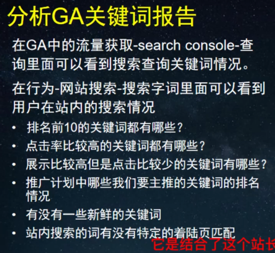
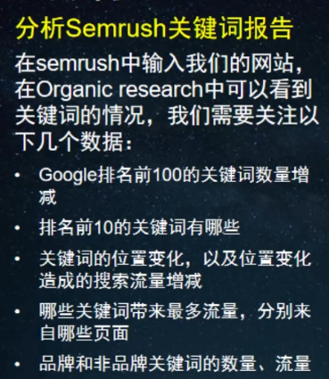

**https://isearchfrom.com/**
**关键词拓展：插件**

**如何找到具有竞争优势的关键词？**
7. 关键词难度，semrush看kd，考虑竞争难度小的关键词
8. 看关键词趋势，搜索量和搜索趋势
9. 分析关键词搜索结果页，看搜索结果数量，用时多少，排名靠前的网站是否是权威网站。数量多，权威网站多的关键词竞争较大。
10. 关键词的商业价值，交易类/信息类
搜索目标关键词，查看搜索结果前三的网站，在semrush上查看目标关键词给它带来的流量，估算一下行业的平均转化率，再乘以客单价，可以大致评估这个关键词排名到前三的商业价值。

**如何利用GSC、GA分析已有关键词**

**如何利用Semrush进行关键词分析？**
