## 品牌独立站冷启动 **—** 谷歌 **SE0**

谷歌SEO的正确道路—慢一点更持久

#### 给SEOer的一些心里话

1. 心浮气躁的人，做不了SEO。因为SEO见效没那么快，起码短期内没那么快。但是，也 不要一竿子打死，这个可以炼，SEO真的是一个修心的过程。 2. SEO的手法有很多，每个人选的路也各不相同，Jack尊重每个人的选择，不批判，也不 褒奖。

但是，如果你选择了激进(黑帽SEO)的手法，你就要做好将来某一天被谷歌惩罚算总账的 打算，他可能会迟到，但是不会缺席。

3. 万事皆可“SEO”，人生就是不断SEO的一个过程，提高自己的曝光和流量，提高自己在 工作中的排名，提高自己的生活质量，etc.

#### **什么是谷歌** SEO **？谷歌** SEO **有没有确定正确的操作方法？**

- 谷歌SEO就是在谷歌上做排名，提高网站在谷 歌的流量和排名。

   - 但是谷歌SEO道路千万条，到底那一条能把排名 做上去？

- SEO的操作思路和手法很多。

   - 哪一条做上去之后能稳定住？

   - 自己操作网站的思路到底对不对？

- 白帽SEO、黑帽SEO、灰帽SEO等，Jack主要 给大家介绍下白帽SEO的做法。

- SEO代运营公司的操作方法到底能不能把排名做 上去？

- Jack今天要分享的内容就是要帮大家解决上面这 些问题：告诉大家一条绝对正确的笨办法！

### 绝对正确的谷歌SEO操作思路和手法

一句话：站内SEO+站外SEO+持续性优质内容输出

网站站内S E O ( O n Pa g e S E O ) 做好，定期更新高质量内容(产品或者博客内容)，建设高质量外链(高 质量相关性Guest Post、高质量新闻源链接等)，不断为网站引流(Google Adwords、SNS、行业论 坛、问答平台)。

这种方法坚持半年以上，大部分网站都会在谷歌获得很好地排名(大部分外贸站其实都属于中低难度) ，除 非巨大难度，一般情况下都可以收获非常多的流量。

#### 战略要点：2个基本点、3个动力源

基本点 基本点 动力源 动力源 动力源

关键词挖掘、筛选、布局要做好 站内SEO必须要做好，网站没有大小毛病 定期更新(频率越快越好)高质量内容(文章和产品) 高质量相关性外链建设(一定是高质量相关性)

为网站引流(最简单的adwords、Facebook广告、其次论坛、问答平台等)

#### 内容目录

- 1

- 3

- 5

- 关键词方面

- 1 关键词挖掘工具

- 2 关键词布局

- 高质量内容更新方面

- 1 什么是高质量内容

- 2 如何创作高质量内容

- 外链建设简单讲解

- 1 外链介绍&建设

- 2 外链购买简单讲解

2

###### 4

###### 6

- 站内seo方面+on page seo方面

- 1 判断网站站内seo有没有问题的几个要点

- 2 页面SEO简单讲解

- 如何判断外链质量？

- 1 外链类型

- 2 判断要点

###### 引流方面

- 1 引流的意义(adwords对排名有没有好处)

- 2 引流渠道

基本点1 **关键词部分** 关键词挖掘工具 关键词布局讲解

#### 关键词发掘工具—谷歌关键词规划师

- 发掘关键词的要点是：把核心词的同义词、近义词、长尾词找出来。

- 使用工具才可以尽可能全的找到想要的关键词，工具包括：Kwfnder.com、Ahrefs 、 Google  Keyword Planner(谷歌关键词规划师)、Semrush 、Ubersuggest等。

- 关键词工具使用方式简单讲解：以led display为例。(找同义词、近义词长尾词)

#### 关键词维度分析

- 通常我们判断关键词有这么几个维度：月度搜索量，SEO竞争难度，单次广告点击 价格等。

一般关键词月搜索量不能太少，比如说一个月50次，如果你的行业很偏门，那只能 将就下，关键词月度搜索量500-3000都是蛮适合做站内SEO的。

关键词的SEO竞争难度一般不要太高，在20-30左右就差不错了，关键词难度一般 和关键词搜索量成正比，搜索量越大难度也越大。

关键词单次广告点击价格是直接和谷歌广告相关的，单次广告点击费用太高，比如 说6美金以上，我们就不太建议投放谷歌广告了，因为成本太高了。

- 按照50个点击转化1个询盘这个概率，你一个询盘成本就300美金了，这个成本还是 蛮大的，因为询盘转化成订单还需要有个比较漫长的过程。

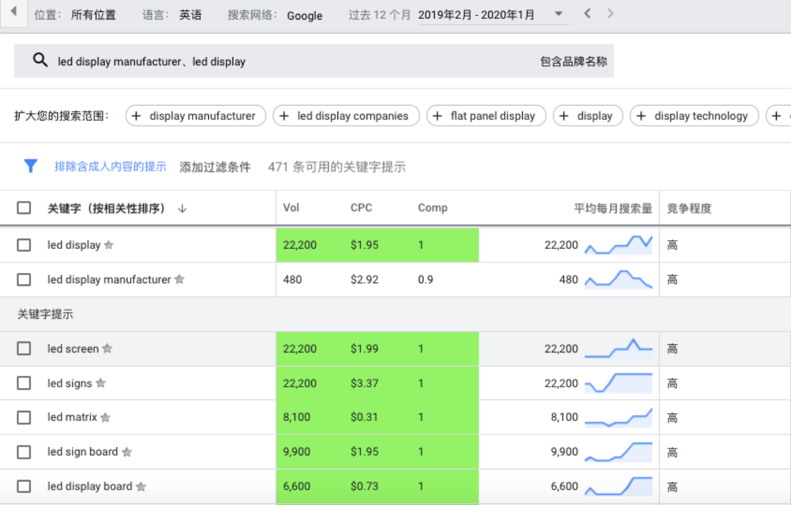

**LED Display 关键词维度分析**

#### 关键词维度分析

我们以LED Display LED显示屏这个关键词为案例，这个关键词在谷歌月度搜索量有 22000次，单次点击价格是1.95美金，这个词竞争度是1，那是很难做上排名的。 我们用谷歌关键词规划大师，他会推荐led display manufacturer，LED显示屏制造商 这个关键词。这个词在谷歌月度搜索量有480次，单次点击价格是2.92美金，这个词竞 争度是0.9。

通过数据对比你会发现，led display manufacturer，LED显示屏制造商这个关键词搜 索量比LED Display LED显示屏这个关键词少很多，但是单次广告点击价格还要贵一美 金，为什么呢？因为制造商这个关键词更加精准，买家在谷歌是想找LED显示屏制造 商的，而不是单块的LED显示屏。

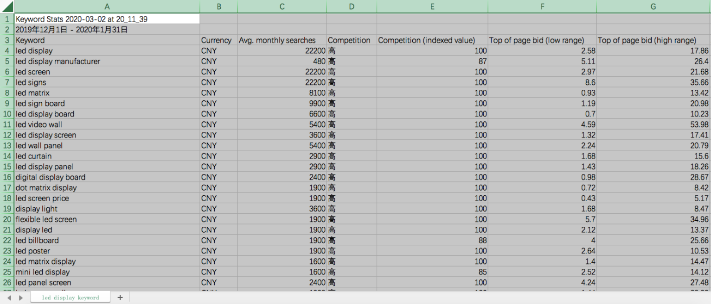

**LED Display 关键词优化筛选**

#### 关键词优化分析

我们通过筛选过滤从谷歌关键词规划大师下载的led display这个关键词表格，可以发 现led display manufacturer这个厂家词比led display supplier这个词数量和搜索量 都要多很多，而led display factory这个词是没有搜索量的。

然后在网站的about us这个版块增加一些led display manufacture这个厂家词，比如 说XXX company is one of the largest manufactures of led displays and led screens in China and is engaged in the design, production, wholesale and retail distribution of products for the led display market.

这句话一笔带过XXX公司是中国最大的LED显示屏制造商之一，然后公司业务覆盖LED 显示屏的设计，生产，批发，零售这几个方面。既做了谷歌关键词优化，有比较到位 提及了公司定位和服务范畴，给客户一个比较专业的印象。

#### LED Display 关键词优化筛选

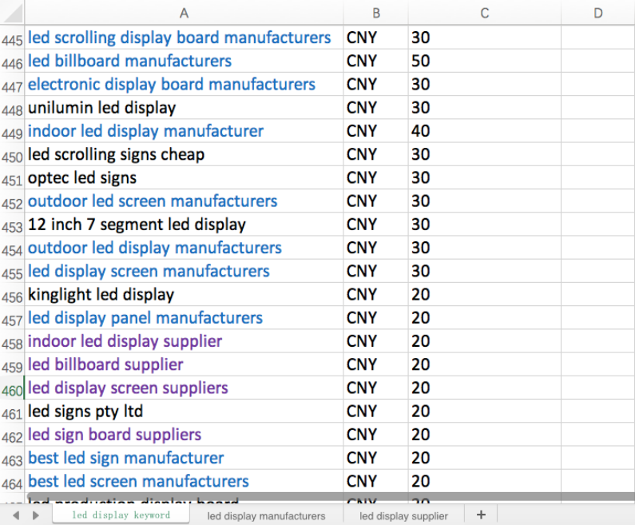

同理我们也可以在网站的产品详情页介绍里面增加一些led supplier这些厂家词，在介绍产品特征的时候，不经意的带过就 可以了。

不必要强行加入关键词，那样子客户阅读体验不好。 博客新闻页面也可以增加一些厂家词，都是可以大大提高你的网 站这个厂家词在谷歌的排名。

# 基本点2

**站内** SEO **部分** 网站必须满足的站内SEO要素 On-Page SEO如何处理

#### ON-PAGE SEO **简单讲解**

- 1、站内标题、描述、H1标签

- 2、关键词的密度、LSI关键词以及TF-IDF关键词的植入

- 3、页面的文案

- 4、站内的内链以及导出外链

- 5、301、404的异常链接检测

- 6、搜索者意图分析

- 7、单页面的速度测试

- 8、链接建设策略

#### On Page SEO--站内标题、描述、H1标签

假如我们网站是www.abc.com, 我们想要建立一个on page seo的博客主页面，我们可以 这么做。首先确定这个主关键词是on page seo, 其次确定URL是 <u>www.abc.com/blog/on-page-seo。</u>

再次确认这个标题是on page seo abc.com, 然后写个描述(15 things you need to know about on page seo for 2020), H1标签也可以是15 things you need to know about on page seo for 2020。

#### On Page SEO--站内标题、描述、H1标签

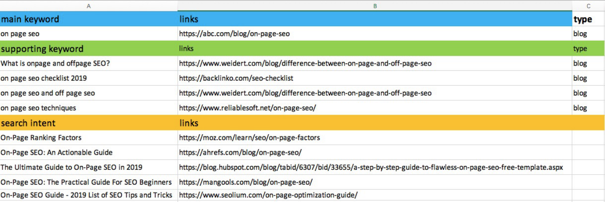

其次我们需要准备一些子关键词(Supporting Page Keywords)，这些关键词作为主关键 词on page seo的支撑，他们分别是：

What is onpage and offpage SEO? 月搜索量40, 竞争度0.01;

on page seo checklist 2019 月搜索量170, 竞争度0.07;

on page seo steps 月搜索量320, 竞争度0.1;

on page seo techniques 月搜索量1600, 竞争度0.08;

#### On Page SEO--站内标题、描述、H1标签

我们可以发现这些排名靠前的网站URL都比较简短，很多带有on page seo这个关键词， 这进一步说明on page seo优化的时候需要优化URL。

随着我们进一步深入研究，我们会发现on page seo的搜索意图是guide, tips, 这些操作指 南，所以针对guide, tips这种操作指南型的博客，我们可以借鉴摩天楼大法，把我们on page seo这个页面做上去。

因为目前市面上大部分是2019年的on page seo博客文章，最多的也是11个guide, 我们做 出15个guide，又是针对即将到来的2020年，到时候博客排名肯定会排名很靠前。

#### On Page SEO--站内标题、描述、H1标签

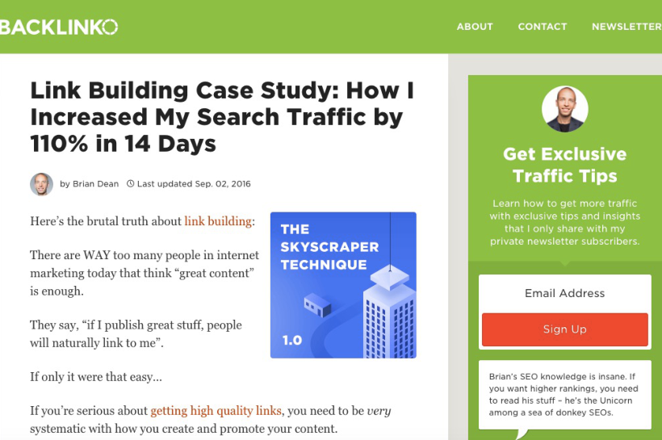

PS: (skyscraper technique摩天楼大法是backlinko创始人 brain dean发明的,并且写在了他的博客上面，附上了他的博客 链接，关于怎么使用摩天楼大法的，有需要的可以去看看) (https://backlinko.com/skyscraper-technique)。

#### On-Page SEO 关键词的密度、LSI关键词以及TF-IDF关 键词的植入

- 在Google Panda熊猫算法更新之前，关键词密度越大，排名靠前的机会就越大。

- 那个时候很多SEOer在垃圾页面大量填充关键词，排名可以很快靠前，很多网站用这 种方式来欺骗谷歌。

- Google随后更新了熊猫算法，致力于打击低质量垃圾页面，让那些垃圾网站填充关键 词获得好排名的时代一去不复返。

- Google还是会分析关键词密度，但是关键词维度增加了LSI关键词。关键词密度可以 用Surfer检查单页面数据，查看Surfer给的关键词密度建议，现在不再流行关键词百 分比说法。

**On-Page SEO 关键词的密度、LSI关键词以及TF-IDF关 键词的植入**

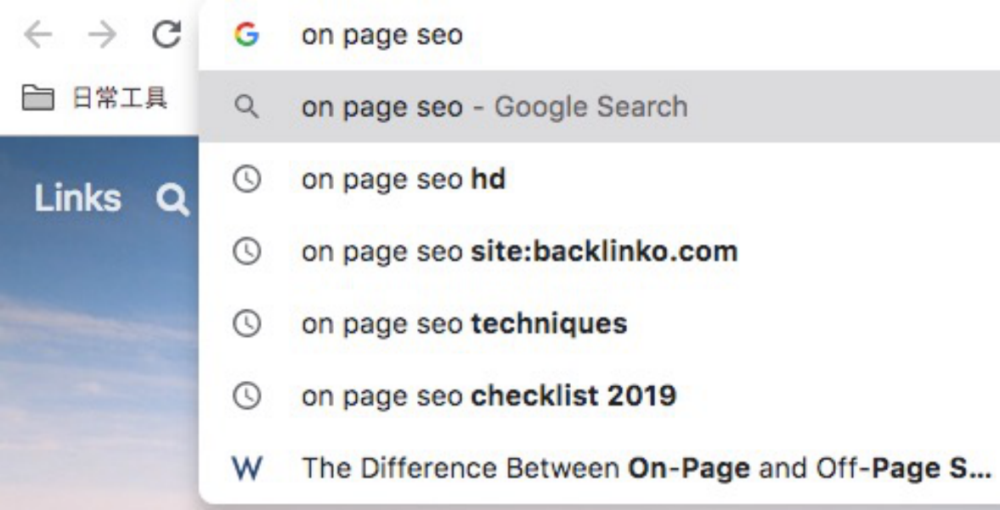

#### On-Page SEO 关键词的密度、LSI关键词以及TF-IDF关 键词的植入

- LSI，是Latent Semantic Indexing(隐性语义索引)的缩写，LSI关键词指的是与与 主关键字在语义上相关的关键词。

- LSI关键词可以解除网页上关键字密度的限制，之前关键词密度超过一定程度，网站就 会被被Google处罚。

- 现在我们可以使用LSI关键字，我们可以放心地添加密切相关的关键字。因为Google 算法更新后已经很智能了，他会理解我们页面的内容，使用LSI关键词，同一个页面， 主关键词很多相关关键词都会有排名。所以我们需要使用LSI关键词。

#### On-Page SEO 关键词的密度、LSI关键词以及TF-IDF关 键词的植入

- 和LSI关键词一样TF-IDF,关键词也有利于提高单页面排名，TF-IDF是terms frequency-inverse document frequency(术语频率-逆文档频率)缩写，是一种用于信息检索与文本挖掘的常用加权技术。

- TF-IDF关键词在这某文章中的出现次数越高，则表明这个关键词对于这篇文章的重要性越高。

- 比如我们之前提到的15 things you need to know about on page seo for 2020这篇文章，如果我们 只使用on page seo这个关键词，密度很大的话，很容易被谷歌惩罚。

- 但是如果我们增加LSI TF-IDF关键词：on page seo checklist, on page seo techniques, on page seo steps，这样的关键词越多，主页面www.abc.com/blog/on-page-seo/排名反而越高。

#### On-Page SEO 页面的文案

- 文案需要注意的几点：

- 1. 文案体现专业性，多查资料

- 2. 借鉴同行的文案内容，学习优点

- 3. 如果不必要的话，避免使用大的长的单词，比如能用near就不用proximity

- 4. 使用更多的短句+短段落

- 5. 以口语化形式书写

- 6. 检测文案可读性(benchmark readability) 用Hemingway App检测分数，

   - 5-6分就OK

- 7. 可以考虑外包，外包前列明文章大纲，到相关平台找老外写

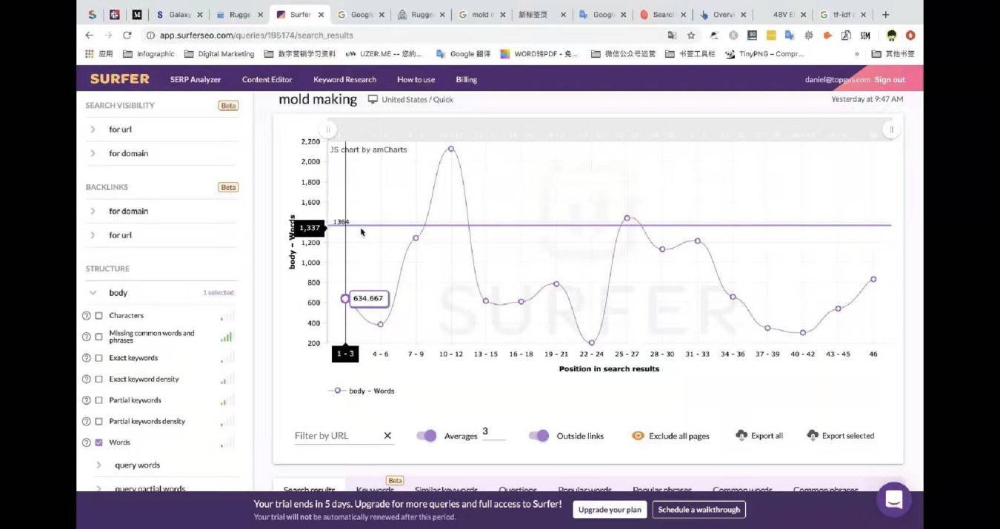

**On-Page SEO 页面的文案**

#### On-Page SEO 页面的文案

Surferseo这个工具可以分析排名前五十网站的数据，包括文章内容字数，关键词 数量和密度，图片alt属性优化提示等。

PS: 这个可以1美金试用七天，用双币信用卡开通下就OK了，Jack亲自试过。

Surferseo实验发现排名前五十页面内容文字在1000字左右，我们可以大概参考下 1000字这个指标。

对于文案语法错误，可以使用grammarly这个工具检查，如果大家用的是正版的 office软件，可以在word文档安装grammarly插件，直接在word文档检查好语法 错误，再放到网站上。

#### On-Page SEO 站内的内链以及导出外链

网站内链优化其实没啥诀窍，就是把LSI关键词相关的网页集中链接到一个主页面，比如说主页面 是www.abc.com/blog/on-page-seo。

我们下面可以搞几个子页面www.abc.com/blog/on-page-seo-guide, www.abc.com/blog/on-page-seo-checklist, www.abc.com/blog/on-page-seo-offpage-seo，这样子可以把权重集中到www.abc.com/blog/on-page-seo这个页面。 关于导出外链，这个可以借鉴权威性很强的外链，比如说https://backlinko.com/on-pageseo, 我们可以说借鉴了brain dean的这篇文章，给他一个do-follow链接，这样子也会增加我们 的权重。

#### On-Page SEO 301、404的异常链接检测

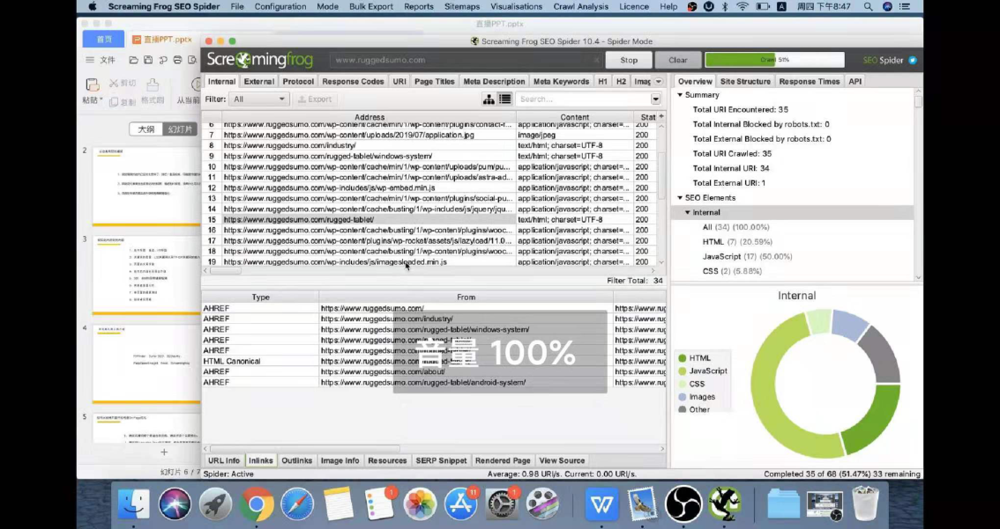

301 重定向，也被称为永久重定向 (permanent redirect), 是一种服务器 端的重定向，能够被搜索引擎蜘蛛适当 地处理。

404错误是当用户输入了错误的链接时， 返回的页面。意味着链接指向的网页不 存在，即网站原始网页的URL失效。

网站301、404的异常链接检测可以使 用screamingfrog这个SEO工具检测， 通过查看Inlink页面，找出网站存在的 301, 404问题，然后修正过来。

也可以用Ahrefs这个工具，毕竟 Ahrefs是目前地球上外链最强工具。

#### On-Page SEO 搜索者意图分析

搜索者意图(search intent) 与我们进行特定搜索的原因有关。

我们为什么要搜索？我们搜索需要得到什么答案？

我们是否要搜索特定的网站？或者，我们是否因为想要购买东西而进行搜索？

举个例子当我们在谷歌搜索how to do on page seo 的时候，表明我们需要信息类资料，可能是 YouTube视频，也可能是博客。

当我们搜led display manufacture 的时候，表明我们想要找到LED显示屏的制造商，等等。 随着技术的进步，Google越来越能够确定人们的搜索意图。Google希望将适合搜索词以及特定搜索查 询的意图的页面排名最高。

这就是为什么必须确保我们的帖子或页面符合受众搜索意图的原因。

#### On-Page SEO 搜索者意图分析

我们可以通过LSI和TF-IDF关键词分析，找出符合搜索者意图的关键词和网址，并整理成Excel表格，后 期针对性创作符合搜索者意图的高质量文案。

#### On-Page SEO 单页面的速度测试

单页面的速度测试建议使用google speed test, 把桌面端和移动端分别做个测试，这个分数越高越好， 分数越高表明网速越快，跳出率越低。输入单页面网址进去，看下速度分就可以了。 我们通过google speed insight 这个工具分析网站手机和桌面端的访问速度，方便我们深入了解同行 的网站打开速度。

还是以https://thecaliforniabeachco.com/这个Shopify网站为案例： 网站移动端打开速度41，桌面端打开86，这个网站打开速度还是蛮不错的。 一般网站测速显示的都是网页端打开速度比移动端快。

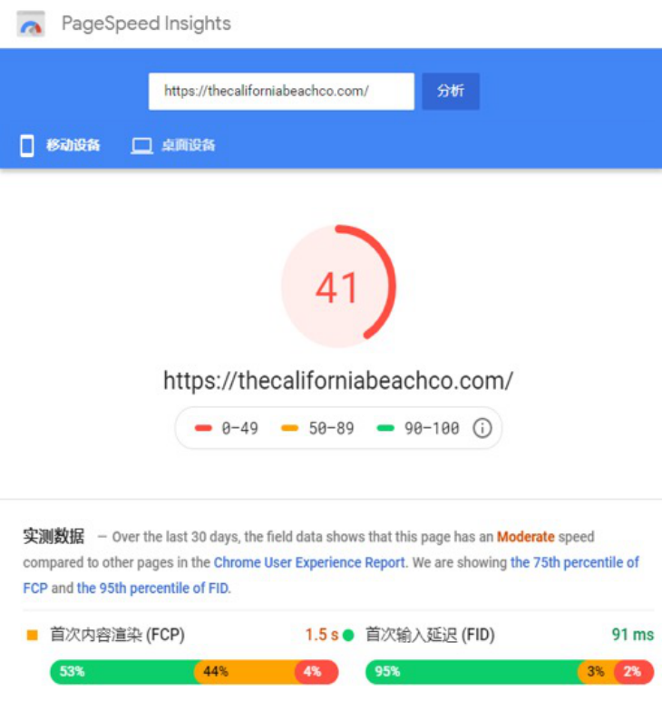

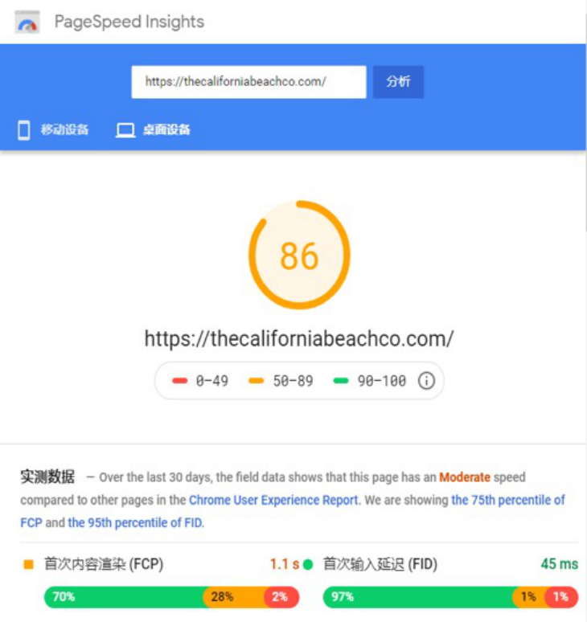

**On-Page SEO 单页面的速度测试**

#### On-Page SEO 链接建设策略

在网站刚上线的时候，我们没有任何外链前提下，我们可以先建设pillow link。pillow link包含： Web 2.0外链(blogger.com/wordpress.org这种博客网站)； Press Release 新闻稿外链(适合B2B)； Directory 目录站外链； Citation 外链(适合B2C)；

在网站有了一定基础外链之后，我们可以搭建一些Authority Link, APL (Authority Privacy Link)隐私权重传递外链。

PBN (Private Blog Networks) 外链，不建议在Fiverr买便宜PBN外链(很多做黑帽SEO的会用很多 PBN外链)。

Guest Post (客座博客)链接，需要自己去outreach 联系对方站长，很费时间和精力，不过效果很不错。

#### On-Page SEO 涉及到6款工具介绍

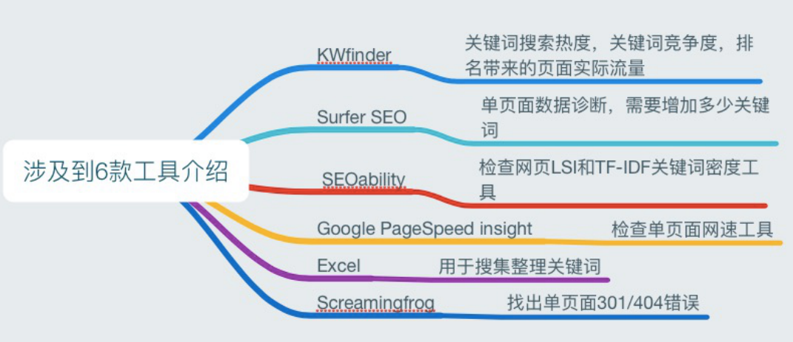

KWfinder：关键词搜索热度，关键词竞 争度，排名带来的页面实际流量

Surfer SEO：单页面数据诊断，需要增 加多少关键词

SEOability：检查网页LSI和TF-IDF关键 词密度工具

Google PageSpeed insight：检查单 页面网速工具

Excel：用于搜集整理关键词 Screamingfrog：找出单页面301/404 错误

动力源1

**高质量内容更新** 什么是高质量内容？ 如何创作高质量内容？

#### 什么是高质量内容？

- 客观方面，判断高质量内容是一件很主观的事，但简单说至少要满足这几个标准：

- 1.内容是手写原创的。

- 2.尽可能减少任何语法和拼写错误。

- 3.内容不能太短，500词只能说普通质量，高质量沾点边也得1000词以上。

- 4.版面尽可能精致一些。

#### 什么是高质量内容？

- 主观方面：

- 1.内容是不是思路清晰符合逻辑。

- 2.内容是不是切实解决了用户问题，满足了用户需求。

- 3.内容是不是不俗套、很有心意？是否有广度、深度(深度广度牵扯seo)，并提出了很有 意义的想法或思路。

- 4.文章是否吸引人并且足够让人信服。

#### 如何创作高质量内容？--自己创作

- 要有自己的高标准，低质量凑数的内容坚决不写不发。

- 先分析关键词，通过关键词将用户所有需求了解清楚，力求全部涵盖。

- 查看竞争对手的内容，了解思路，学习优点，弥补缺点。

- 要体现专业性、多查资料，确认说的每一句话都准确可信。

#### 如何创作高质量内容？--外包

- a) 列明文章大纲，到相关平台花高价找老外写

- b) 满足上面四条质量的，价格一般在100美金 c) 1000词，中低质量的10美金1000词。

动力源2

**外链建设** 判断外链质量的前提：先了解外链类型 发外链和买外链相关事宜

#### 站外 **SEO-- 3** 种外链类型介绍

在SEO届有句比较有名的话: 内容为王，外链为皇，足以说明外链在提高网站在谷歌排名的重 要性。

外链布局属于SEO优化的站外优化，外链顾名思义就是外部网站的链接，链接到你的网站。 因为主要是在其他人网站上做的，所以叫站外优化。

现阶段外链类型，我们按照外链传递权重的大小依次分类，可以分为3个类型: 有效传递权重 的外链，传递非常少权重的外链，不能传递权重的外链。

站外 **SEO-- 3** 种外链类型介绍

#### **3** 种外链类型 **--** 有效传递权重的外链

1. guest post 客座博客，客座博客我们可以在谷歌搜索自己行业的客座博客投稿，比如说"led display" "guest post"这个谷歌搜索指令，可以出现很多可以给led display这个行业投稿的客座博客。 我们找到这些网站，用Excel表格搜集好这些站长的联系信息，电话，邮箱，之类的，然后准备好几个 outreach邮件模板，去给站长发邮件。

有的站长是看文章内容的，一个是你的outreach邮件内容，一个是你网站上博客的内容，如果这两个都 挺不错的，那么站长可能会给你一条外链。

有的站长是需要你的产品做测评的，测评OK后，才会决定给你一个外链，这种情况下你需要准备好测评 的产品，给站长快递过去，一般样品测试OK，都会给你外链的。

还有一种站长是需要你给钱，才会给你外链的，这种情况下可以先评估下他外链质量，如果确实值得做， 我们需要像公司申请经费了。

#### **3** 种外链类型 **--** 有效传递权重的外链

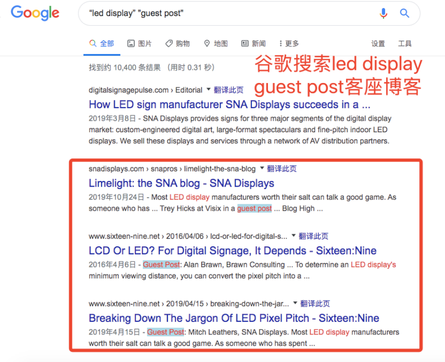

以上这三种就是比较常见的客座博客外链的获取方法，和 外贸开发客户很类似。

也是需要先找到匹配的网站，在用email hunter这些公司 找出电话邮箱等联系方式，然后电话邮件慢慢跟进。 至于样品测评，就是外贸中的给客户打样，只不过看收不 收打样费了。

#### **3** 种外链类型 **--** 有效传递权重的外链

2. apl (authority private link)，权威私人外链，apl外链目前不算完全白帽SEO外链，也不是黑帽SEO 外链，有点偏向灰帽SEO外链。

这种外链一般需要你掌握很多外链资源，这种外链形式一般是需要购买的，不是做出来的，因为一般都 是批量批量购买的。

apl外链排名效果也是蛮不错的，被谷歌惩罚概率比较低，所以网站前期适合做一些apl外链提升网站排 名，再做些guest post客座博客外链，夯实下网站外链基础。

#### **3** 种外链类型 **--** 有效传递权重的外链

3. pbn (private blog network)，pbn其实和apl有点类似，都是批量生产外链，类似于国内的做站群。

pbn属于黑帽SEO外链范畴，前期效果很不错，很适合做黑产的公司，去年11月份的清迈SEO大会，蛮多嘉宾做在线赌 博SEO的，就是用了大量pbn外链做起来的。

因为很多产品不能做谷歌和Facebook广告，比如说电子烟，成人用品等，常规的站内SEO和客座博客又很费时间。 所以大部分公司会做PBN，快速成单，等网站被谷歌惩罚了，再换个网址从新开始，属于我党当年的地下游击队模式。 pbn优点就是排名快，缺点就是容易被谷歌惩罚，掉的也快，一旦排名掉了，基本上就是万劫不复了，不可能再恢复起 来，只能重新建站，从0开始。

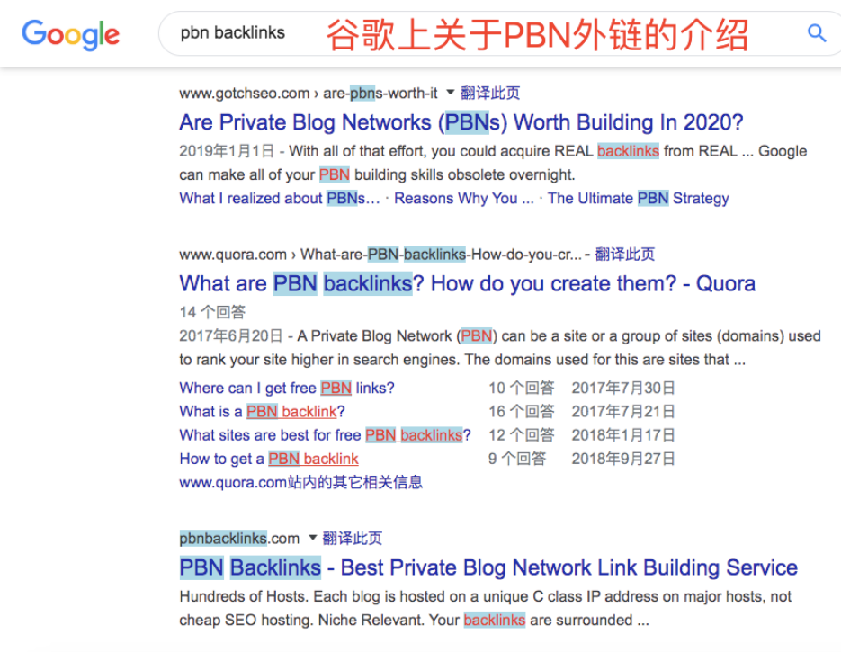

站外 **SEO-- 3** 种外链类型介绍

#### **3** 种外链类型 **--** 有效传递权重的外链

4. partnership，产品上下游外链，partnership外链很适合同一个行业的，或者产品上下游相关的，以led display LED 显示屏为例。

上游的芯片设计公司，中游的封装公司，下游的组装公司，终端的舞台租赁公司，大学礼堂，教堂礼拜等都可以做相关 外链。

这种上下游外链质量很高，因为行业相关性很大。

如果大家和客户关系比较不错，可以让客户网站给我们做一条外链，有十几个行业客户给我们做外链我们网站排名就很 不错了。

同理，让供应商朋友在他们网站给我们做外链，也是个不错的问题，做外链有时候拼的其实是人脉和资源了。

#### **3** 种外链类型 **--** 有效传递权重的外链

5. edu & gov，教育和政府网站外链，这种外链因为不是商业型网站，所以权威性很高，一 条外链相当于好几条一般的客座博客外链。

这种外链一般也是可遇不可求的，如果你的产品刚好给大学实验室供货，可以给他们免费提 供样品，让对方给你一条外链。

如果你们公司做了一些福利和慈善事业，出现了在政府报纸上面，你可以和他们商量，在政 府网站给你做条外链。

#### **3** 种外链类型 **--** 传递非常少权重的外链

1. forum profile，论坛简介外链，一般是在行业论坛注册账号，然后在自己的个人介绍那里，填写上公司的网址，这种网 址就是论坛简介外链，这种外链大部分都做过。

2. web 2.0 post，就是类似于知乎天涯上面创建个人主页，然后不断写文章，文章放上一部分公司的网址，这种就是web 2.0 外链了。国外一般在谷歌的blogger, quora上面发帖，给自己网站做web 2.0 外链。这种外链可以传递比较少的权重， 但是引流效果很不错，可以给网站带来不错的流量。

3. directory，行业目录站外链，行业目录站外链一般需要我们在谷歌上搜索，一般是关键词+intitle: directory， [keyword] + intitle:directory，我们以led display led显示屏为案例，在谷歌搜索led display的目录站外链，就会出来led display行业相关的行业目录站外链。

4. citation 一般是做本地SEO外链的，类似于美团大众点评上面注册商家，再联系方式那里放上我们的外链。国外比较有 名的citation 外链就是yelp点评网站了，大部分对yelp都有所了解了。

#### **3** 种外链类型 **--** 传递非常少权重的外链

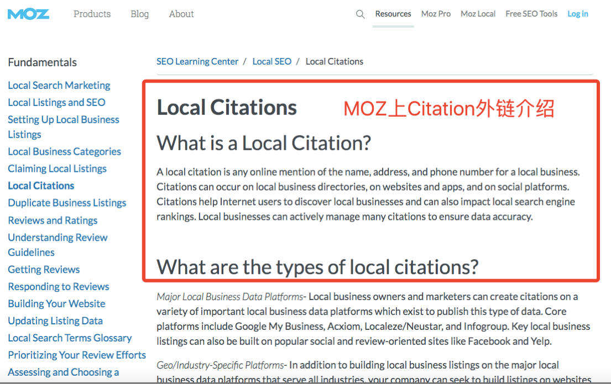

如果你想了解citation 外链更多资料，可以 访问帽子的这篇文章： https://moz.com/learn/seo/localcitations。

#### **3** 种外链类型 **--** 不能传递权重的外链

1. blog comment，博客评论外链顾名思义就是在别人博客下面评论留言留下自己的网址，给自己网站做一条外链。博客 评论外链目前无法给网站传递权重，但是可以给网站引流。

2. social bookmark 社交媒体书签，用户在社媒网站把我们的网址设置成他的浏览器书签，下次打开浏览器书签就可以进 你的网站。社交媒体书签外链目前无法给网站传递权重，但是可以给网站引流。

3. forum comment，论坛评论外链和博客评论外链差不多性质，在论坛下面评论留言留下自己的网址，给自己网站做一 条外链。论坛评论外链目前无法给网站传递权重，但是可以给网站引流。

4. social media link，社交媒体外链，就是在自己的Facebook，YouTube频道放上自己的网址，社交媒体外链目前无法给 网站传递权重，但是可以给网站引流。

5. image share link，visual.ly 这种图片分享网站，你在这个上面分享图片，留下你的网址，给自己做条外链。图片分享 外链目前无法给网站传递权重，但是可以给网站引流。

注: 虽然有些链接权重低，但还是可以适当做一些，增加网站信任度。为后期做高权重的外链做下铺垫。

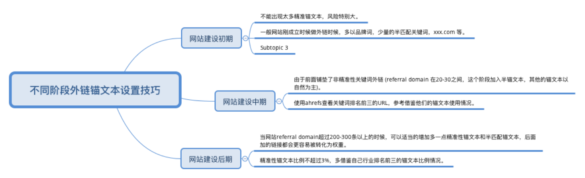

**3** 种外链类型 **–** 外链锚文本设置

#### 外链建设--如何买外链？

- 买行业论坛相关性外链，关键词+Forum，比如说LED Display Forum

- 上Fiverr、Upwork等外包平台

- 朋友推荐，比如说Jack参加清迈SEO大会认识几个做外链的国外机构

- 如何判断外链的好坏：

- 传递权重大小(dofollow)；收录；是否为真实网站；相关性、专业度；流量和关键词情况。

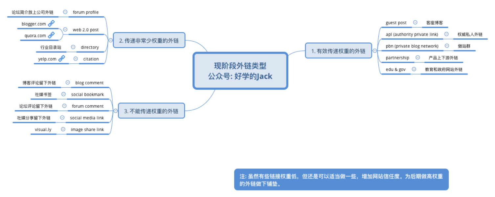

外链类型 **–** 判断购买外链质量

动力源3 **引流方面**

为什么要引流？ 引流渠道和方法

#### 为什么需要引流

- 谷歌官方明确的影响谷歌排名的因素主要有三个：1.内容。2.外链。3.rankbrain。

- rankbrain主要根据网站的CTR、用户停留时间、跳出率、直接访问流量等判断网站的质量。

- 如果没有流量，rankbrain收集不到用户体验数据，也就无从判断网站质量，导致排名提升延误。

- 所以网站前期引流很重要，用户体验好的网站有几率会迅速获得谷歌排名。

#### 引流途径

- Adwords引流(最简单直接，缺点就是花钱)

- Facebook广告引流(流量更大、价格低，缺点不精准，更适合商城站)

- Youtube、Ins等网红引流(流量极大，转化高，缺点价格高、阶段性、适合B2C)

- 论坛、问答平台引流(低价，花费精力多，前期效果不明显，后续持续性好，且有 外链效果)

- EDM引流。

###### 总结：网站起飞步骤

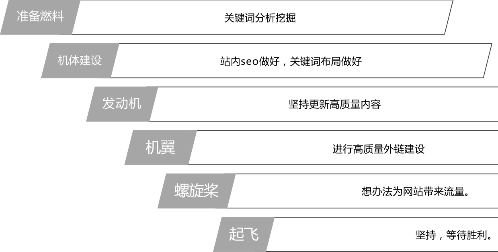

<!-- Start of picture text -->
准备燃料 关键词分析挖掘 机体建设 站内seo做好，关键词布局做好 发动机 坚持更新高质量内容 机翼 进行高质量外链建设 螺旋桨 想办法为网站带来流量。 起飞 坚持，等待胜利。 <!-- End of picture text -->
