# 独立站必备：

**Google Trends超详细实战教程**

#### 1、Google Trends 介绍

Google Trends 是实时抓取全球用户的搜索行为，能捕捉到词汇热度的瞬间变化。我们通过词语搜索量的变化趋势能判断它是否属于新出现的词汇或长期存在的稳定需求。
网址：
https://trends.google.com/
下面和平会详细给大家介绍 Google Trends 的使用
如何用 Google Trends 判断词语的新旧？
新词的特征：
- 搜索量突然暴增：新词通常因技术突破、社会热点、流行文化或突发事件而诞生，短期内搜索量会急剧上升
- 搜索量快速回落：热度消退后，搜索量会逐渐回归日常水平，趋势图呈现「陡升→缓降」的尖峰形态。
老词的特征：
- 搜索量长期稳定：老词通常是技术术语、基础概念或日常需求，搜索量波动平缓，趋势图接近一条水平线。
- 季节性/周期性波动：部分老词可能有规律性波动（如“春节”“世界杯”），但整体趋势稳定，无突发性暴涨。

#### 2、Google Trends 基础使用

**2.1 界面及过滤条件**
我们直接在首页搜索 coffee

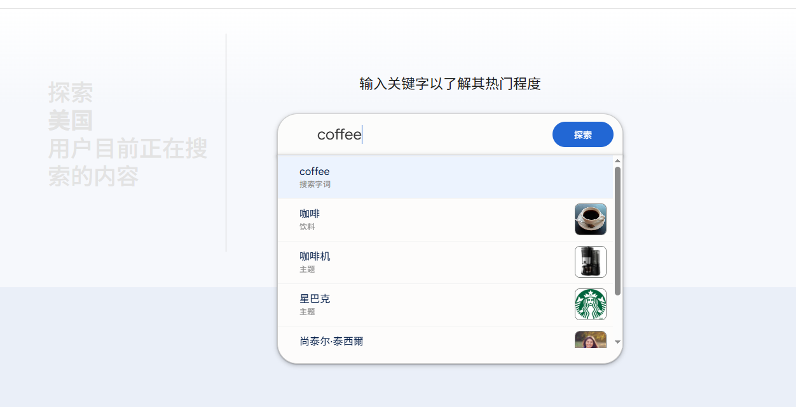

接下来就会来到「探索」页面，你就能看到 coffee 这个词在过去 1 天的搜索趋势

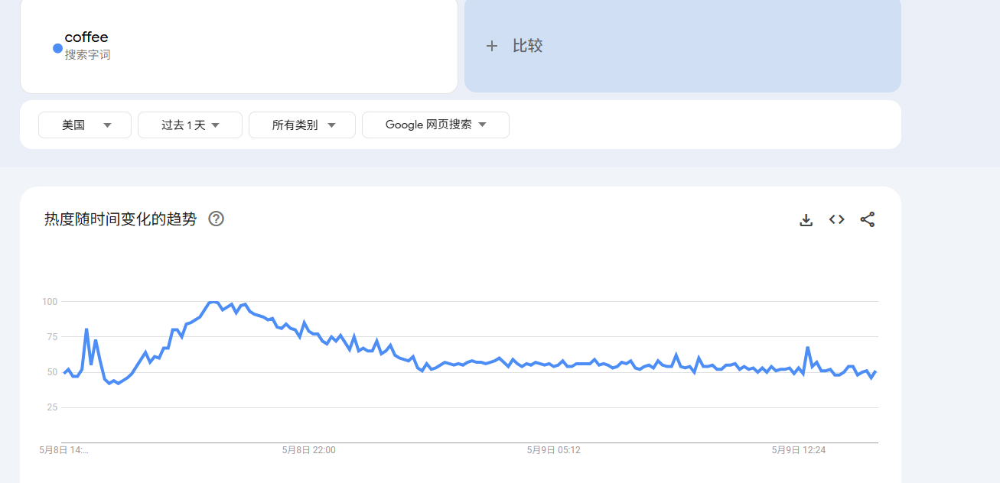

**筛选条件**
**1）地区筛选**
点击下拉框可切换
- 国家/地区：精确到州/省（如「美国-加利福尼亚州」）
- 全球范围：选择「全世界」显示全球聚合数据
**2）时间筛选**
- 实时数据：过去1小时/4小时
- 短期趋势：过去1天/7天（适合热点事件追踪）
- 长期趋势：自定义时间段（2004年至今，最长5年跨度）
**3）类别筛选**
细化搜索场景
- 电商类：仅显示购物相关搜索（如「coffee maker」）
- 新闻类：过滤新闻事件引发的搜索波动
- 餐饮类：适用于食品饮料行业分析
选择错误类别可能导致数据偏差（如「coffee」选科技类会过滤掉大部分数据）
**4）搜索来源**
- 网页搜索：默认全网搜索量
- 图片搜索：分析视觉内容需求（适合产品设计参考）
- Google News：监测媒体报道热度
- Google Shopping：电商平台搜索趋势
- YouTube：视频内容搜索行为
**2.2 搜索词和搜索主题**
搜索词 - Search term
搜索主题 - Topic
我们在搜索框搜索一个词语的时候，可以选择是搜索词还是搜索主题

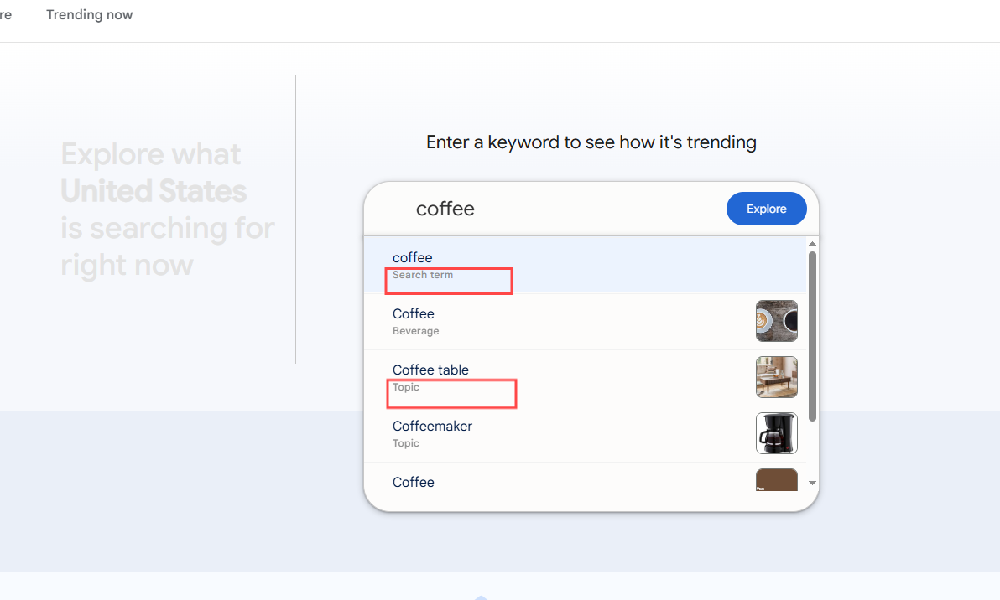

Search Terms（搜索词） 和 Search Topics（搜索主题） 是两种不同的数据匹配模式，直接影响结果范围与准确性。

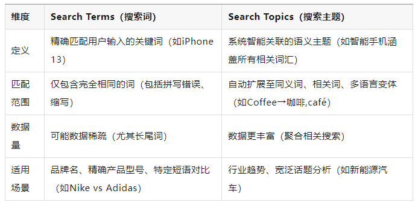

**使用场景举例：**
比如现在要分析「咖啡」的搜索趋势
- 如果用Search Terms输入coffee
仅统计用户直接搜索“coffee”的精确匹配数据，忽略cafe、coffee shop等变体。结果可能低估实际热度（尤其非英语国家用户可能搜索本地语言词）。
- 如果用Search Topics选择Coffee主题：
系统自动聚合所有相关词（包括cappuccino、咖啡、قهوة等语言变体），并排除无关词（如人名“Coffee”）。反映整个咖啡品类的真实趋势。
**总结：**
Search Terms = 精准狙击（显微镜视角）
Search Topics = 全局扫描（卫星视角）
**2.3 谷歌热度**
谷歌趋势反应的是搜索词的热度而不是搜索量。
所你没办法知道有多少人搜索了某个特定词语，所有的搜索数据被简化为一个叫搜索兴趣的指标，范围是 0-100，这样可以更好的保护 google 用户的隐私。
所以你虽然不能用这个数据来判断多少人搜索了某个特定的词语，但是你能够用它来查看这个词的流行程度，即随着时间的推移发生了什么样的变化。

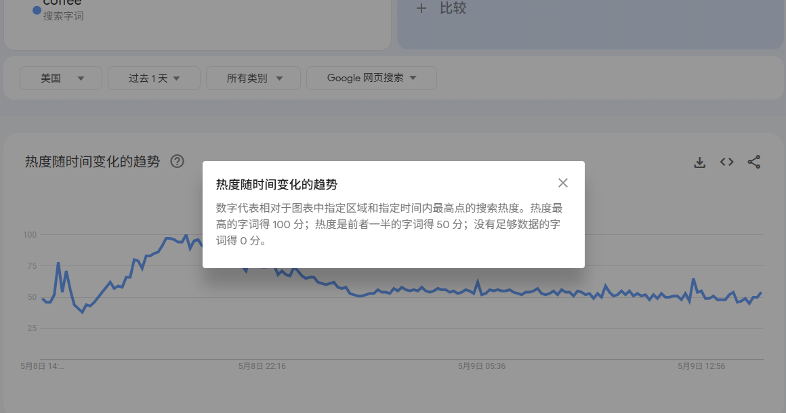

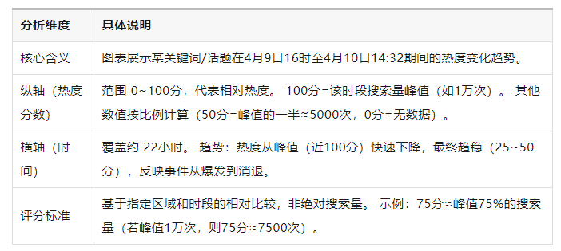

#### 3、explore/探索的使用

**3.1 关键词趋势查看**
假设你有一家咖啡店，你想了解所在地区用户的喜好。
我们在 Google Trends 主页输入 cappuccino（卡布奇诺），然后选择 coffee drink 主题

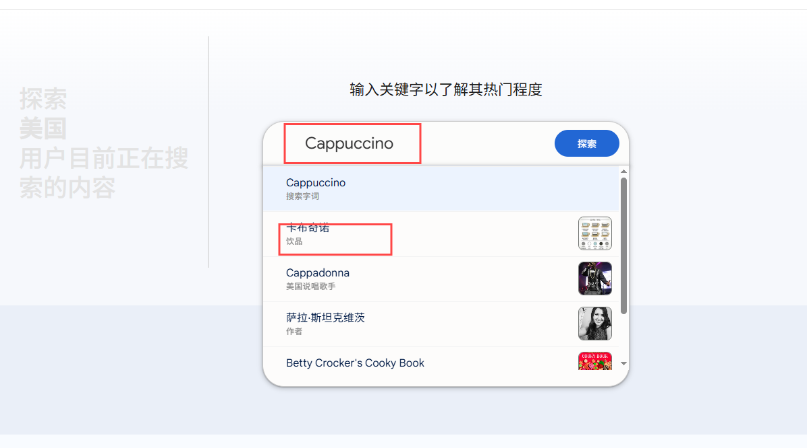

接下来就会跳到 explore/探索页面

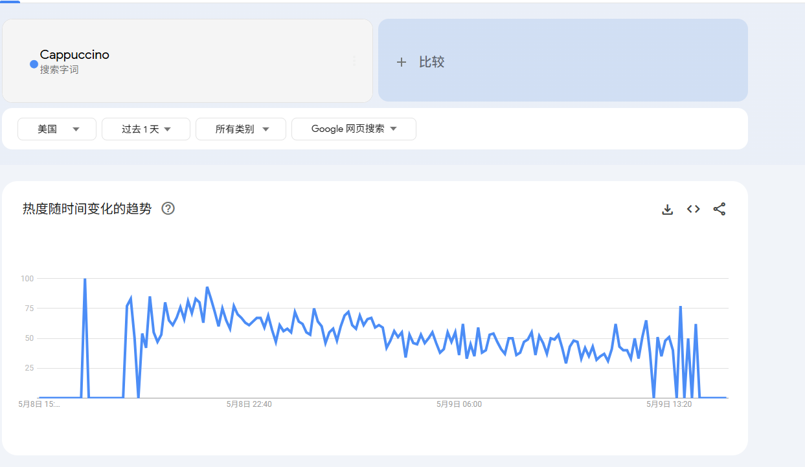

接下来我们添加对比词，latte（拿铁）和 espresso（浓缩咖啡）

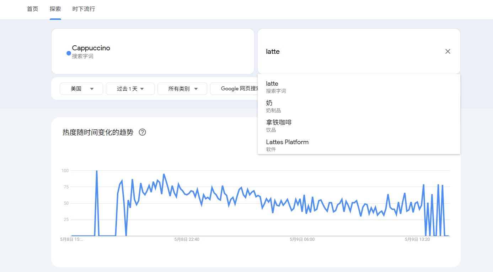

注意，最好是同类比较，因为我们前面 coffee 选择的是 Topic ，那再添加对比词的时候最好对比词也选择 Topic
**主题与主题对比**
**搜索词与搜索词对比**
因为一个主题可能会包含多个搜索词，将主题与搜索词进行比较可能会产生数据偏差

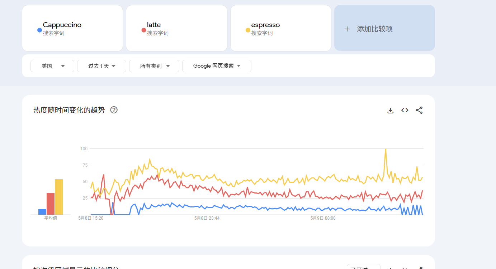

搜索页面中有 4 个筛选器，可以帮助你更加有针对性的搜索
（1）地区
- 比如，你现在正在写一篇关于巴西咖啡消费模式变化的文章，那么我们就可以把区域换成巴西来观察数据趋势
（2）时间
- 如果你对长期趋势感兴趣，你可以选择观察过去 5 年的数据趋势，或者你也可以自定义时间范围
（3）分类
- 你可以探索特定领域中的趋势，比如你可以选择饮食这个分类，来观察咖啡的变化趋势
（4）来源
- 你可以选择搜索来源是 Google 网页、图片、新闻、购物、youtube
**3.2 留空关键词查看**
我在 Explore 页面不输入任何关键词，把关键词留空，然后直接选择下面的筛选条件，这样我就可以知道某个位置、某个时间段、某个类别、或者某个平台，常见的搜索主题和搜索词

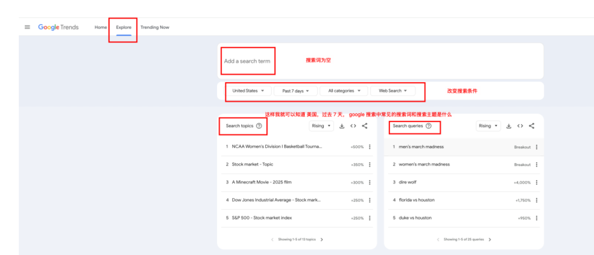

**3.3 怎么去看搜索趋势**
**左边的柱状图**
每一条柱状图代表着你的搜索词或者搜索主题，我们对比了 3 个Topic ，所以有 3 条柱状图
它们展示的是各自的平均搜索兴趣，你可以把它理解成一个高层次视角，通过这个视角去判断各个 Topic 的热度谁高谁低

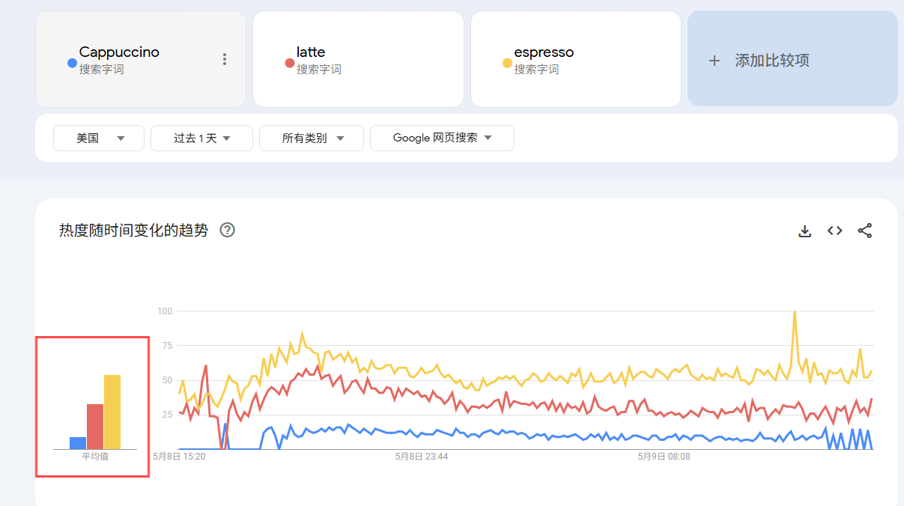

**右边折线图**
折线图反映随着时间变化，热度的趋势。
如果折线图跌到 0 ，表明你的搜索词没有足够大的样本
如果你切换不同时间段，发现折线图很多跌到 0 了，这代表在这个时间段该搜索词的数据量不足，搜索这个词的人太少了。

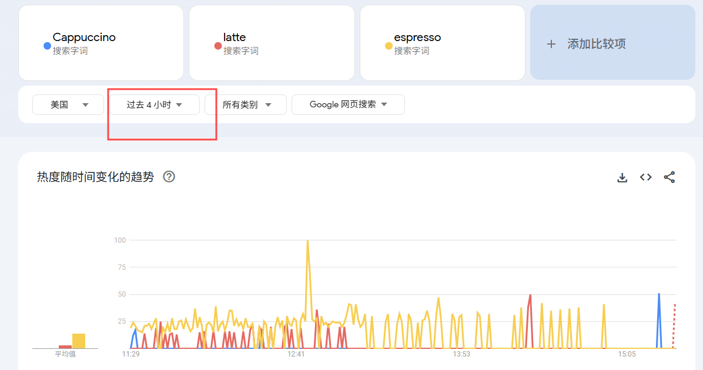

你可以换一下筛选条件，比如原来地区选的是美国，然后我把地区换成全球，再看看数据

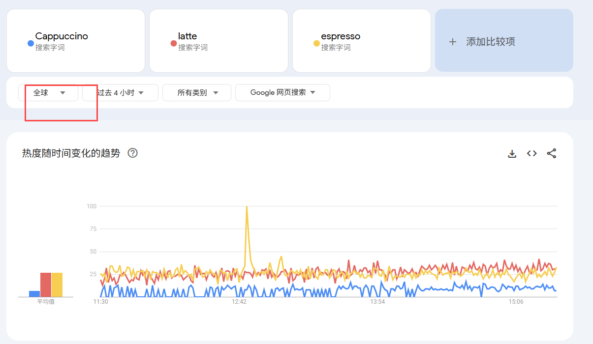

**3.4 不同地区的细分数据**
如果你把区域选成全球，那么这里你就会看到按照国家/地区划分的搜索兴趣
如果你的区域选择的是国家/地区，在这里你就会看到按照子区域划分的搜索兴趣
区域的阴影越深，表示搜索兴趣越高

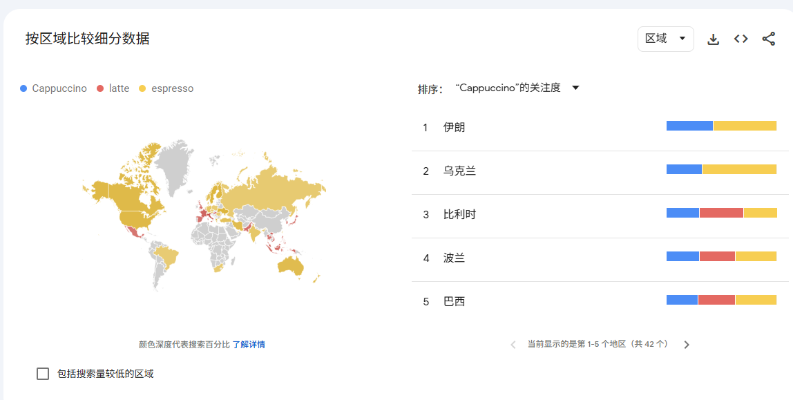

把鼠标放在地图上的某个区域，可以显示这个区域的搜索兴趣

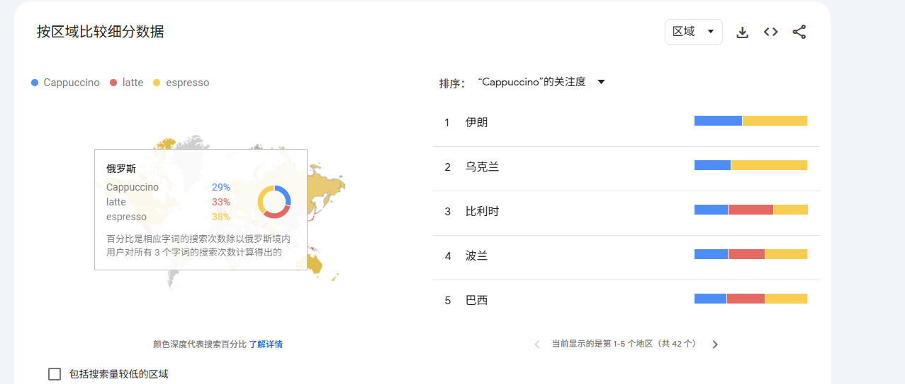

**3.5 关键词的关联词**
显示跟你输入的搜索关键词相关的关联词

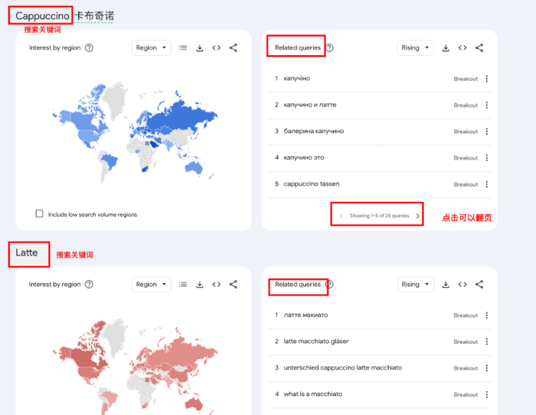

**指标含义**
Rising：根据近期搜索量激增的幅度筛选
百分比：表示特定搜索词在选定时间段内的搜索量增长幅度，
Breakout：在选定时间段内增速超过 5000%的词

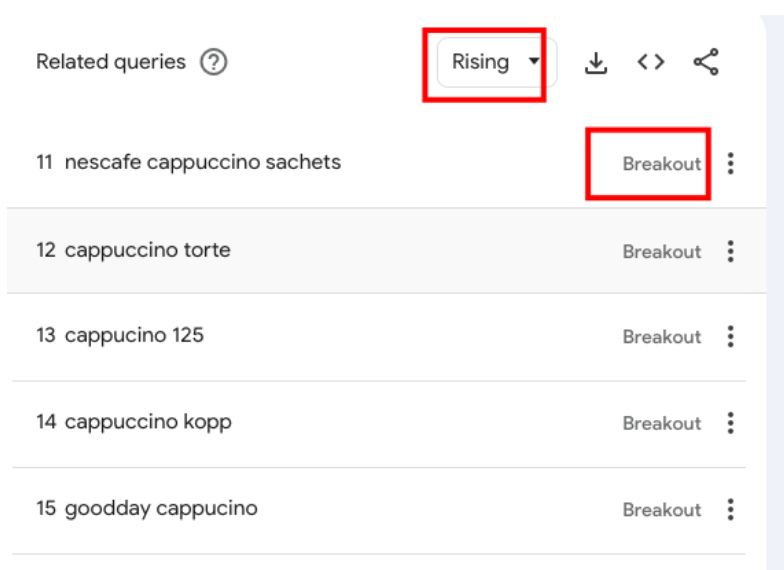

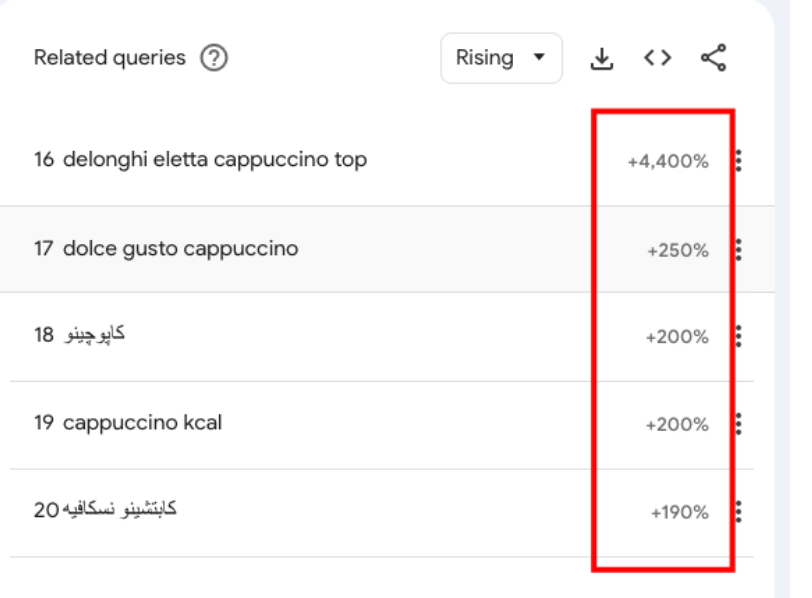

Top：根据搜索兴趣筛选
按照 Top 排序，出来的都是按照搜索兴趣从高到低，但是这些词不一定是增长最快的，但一定是搜索兴趣最高的

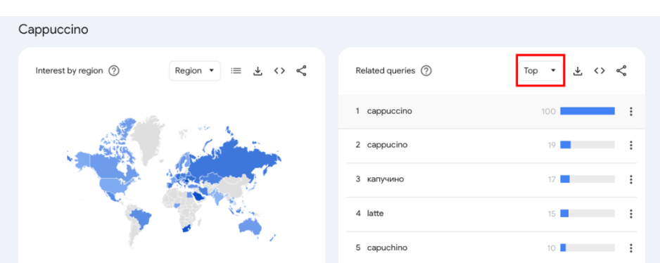

**3.6 使用注意点**
1）Google Trends 展示的不是搜索量，而是搜索量的近似值，可以理解成搜索兴趣
Google Trends 提供的不是搜索的准确数值，所以应该避免使用「我们的 Google 搜索量增长了 100%」之类的说法
这只是一个近似值，你可以说「搜索兴趣增长了 100%」
2）关键词比较功能
如果你想比较两个关键词，直接使用 「Add comparison」

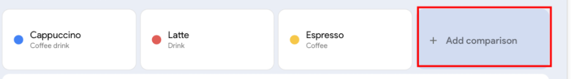

不要把两个关键词分别都搜索一遍，因为他们的标准化指数不一样，所以这样得到的结果是不准的**4、高级功能**
在上面我们介绍了 Search Topic 和 Search terms ，在我们使用 Google Trends 中使用 Topic 搜索比 terms 搜索相对来说会好一点
因为 terms 是精确搜索，Topic 相对来说搜索范围更大
但是如果没有符合你搜索条件的 Topic，你可以使用标点符号来准确找到你需要的内容
**4.1 标点符号**
如果你搜索 「boat trip」不带任何标点符号，那么搜索结果中，这两个词的顺序就是任意的，结果不会包含任何拼写错误的词、变体以及复数形式

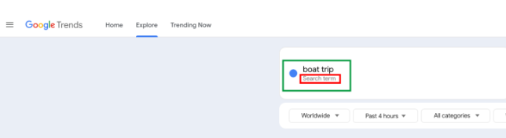

我们可以在搜索关键词中使用标点符号，包括
- 引号
- 加号
- 减号
1）引号
搜索带引号的 「"boat trip"」会显示可能带有前面的单词或者后面的单词

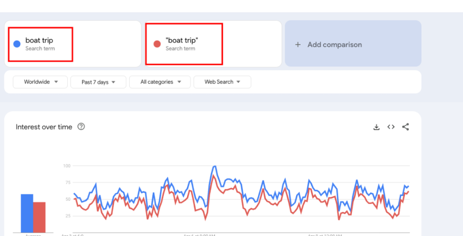

2）减号
搜索带减号的 「"boat -trip"」结果包含单词 boat 不包含单词 trip

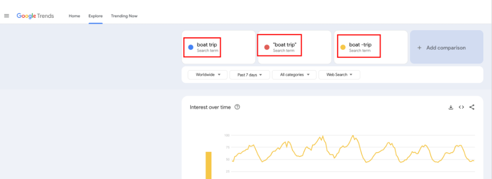

3）加号
搜索带加号的 「"boat +trip"」结果包含 boat 和 trip

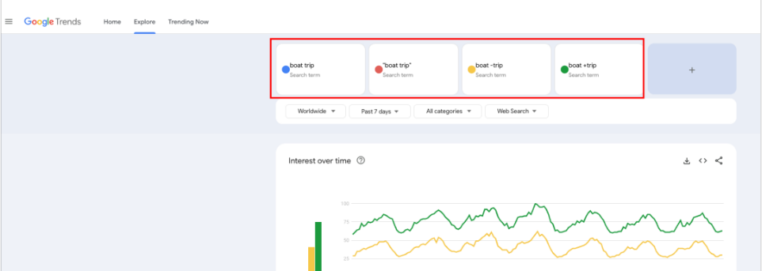

加号的热度始终会高于引号和减号，因为他包含的结果最广泛。
**4.2 高级比较模式**
**同关键词不同时间维度对比**
假设你有一家英国旅行社，你想知道用户对 boat trip 是否感兴趣，随着时间推移，用户对 boat trip 的兴趣是怎么样的
1）我们直接查看过去 5 年 「boat trip」的关键词趋势
从这张图我们能看出来 「boat trip」有非常强的季节性，英国夏季搜索明显多于冬季

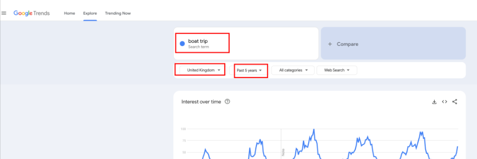

2）我们来分析逐年的趋势
首先把时间筛选，改成过去 12 个月，时间范围也就是，24年4月~25年4月

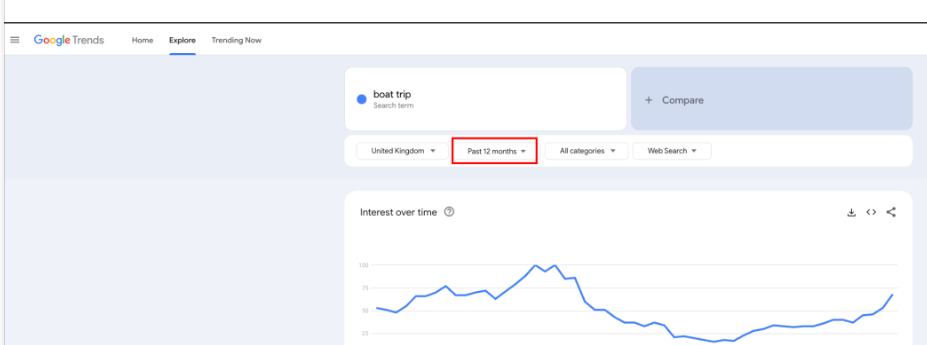

接下来我们添加一个一模一样的关键词，只不过把时间范围自定义成 23年4月~24年4月

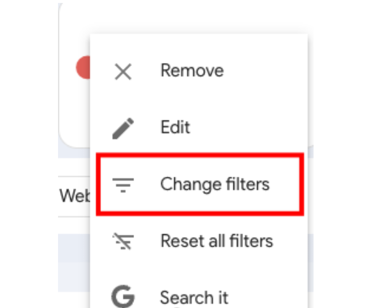

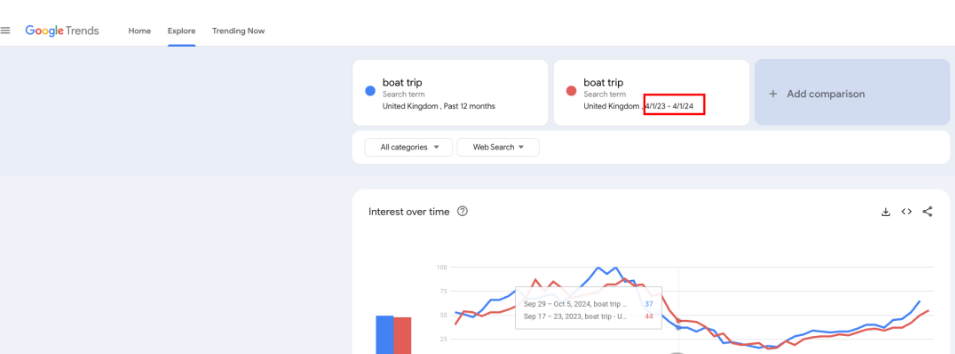

同样的方法，我们添加同样关键词，时间范围分别是 22年4月~23年4月    21年4月~22年4月     20年4月~21年4月
这样你就可以看到过去 5 年，每一年这个关键词在英国的趋势是什么样的

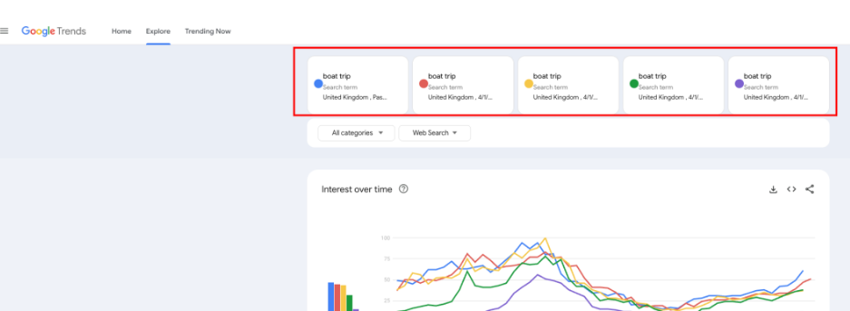

**同关键词不同地区维度对比**
假设你现在在英国，你想要把业务拓展至美国，我们还是先看英国过去 5 年 「boat trip」的搜索趋势
然后我们添加同样的关键词，**地区选择美国**，时间也是过去 5 年
你可以看到美国的搜索兴趣很低，很显然不适合在美国开展业务
同样的方法，我们可以横向对比 5 个市场

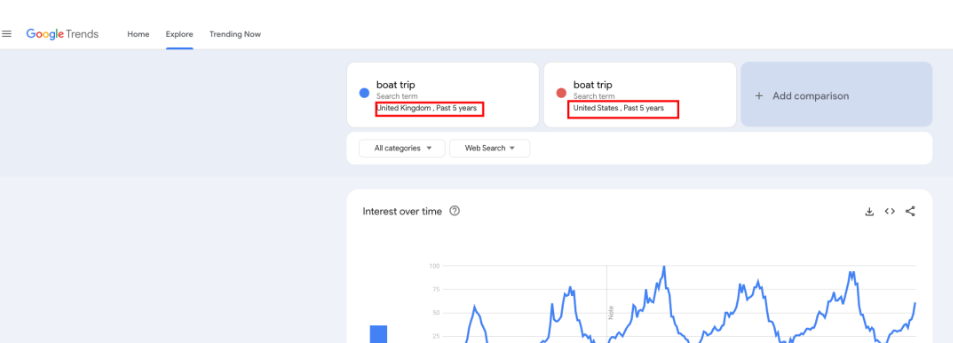

**4.3 导出分享数据**
**1）链接分享**
如果你想要把你自己 Google Trends 分析的趋势分享给朋友，只需要复制链接，然后发送给朋友即可。你所做的筛选条件都会在链接的 url 上有所体现，朋友看到的页面和你的页面都是一致的。
**2）网站嵌入**
把嵌入代码直接粘贴到 HTML 代码中即可

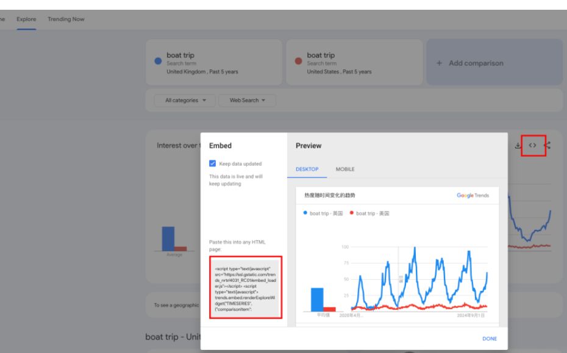

**3）下载 CSV**
直接点击下载按钮下载即可。
下载之后就可以针对 csv 文件数据进行分析

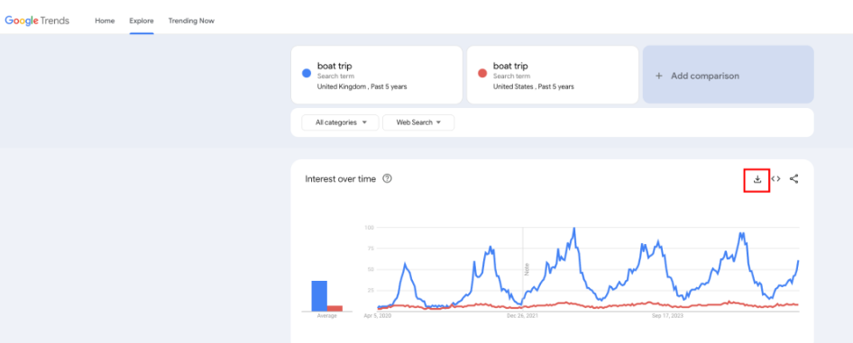

#### 5、Trending now 使用

我们可以查看最新的趋势，从而知道最近流行的话题，以及这些流行词与你目标词的关系。
**指标解释：**
① Trends
当下的流行搜索词,这一列每个词在你选择的时间段内，都是搜索量比较大的词
② Search volume
搜索量，过去 24 小时内该关键词的搜索量估算值
③ Started
趋势开始时间，该关键词的搜索量开始显著上升的时间点。例如，14 hours ago 表示 14 小时前该词条突然进入高热度状态
④Trend Breakdown
趋势细分入口，点击后可查看该关键词的 详细趋势分析
⑤ Past 24 Hours
趋势图表，直观展示该关键词 过去 24 小时的搜索量变化趋势
绿色表示这个趋势热度还在持续，灰色表示热度已过

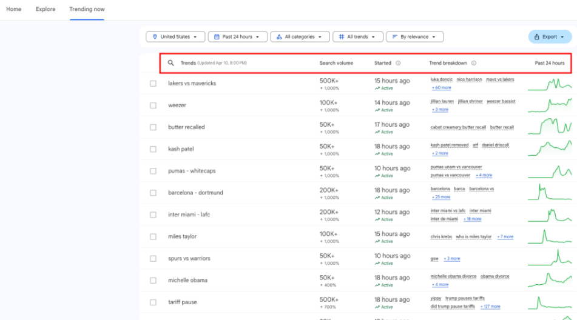

⑥ Active
表示搜索量比平时的搜索量要多，目前还处在热度状态

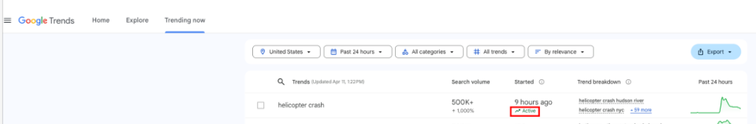

#### 6、Google Trends 应用场景

**6.1 验证产品创意是否有市场需求**
比如说，你现在想要开发一个 「AI 简历生成器」，但是不确定需求是否真实存在。
这时候你可以：
1）在 Google Trends 输入关键词 "AI resume builder"，查看过去 5 年的搜索趋势。

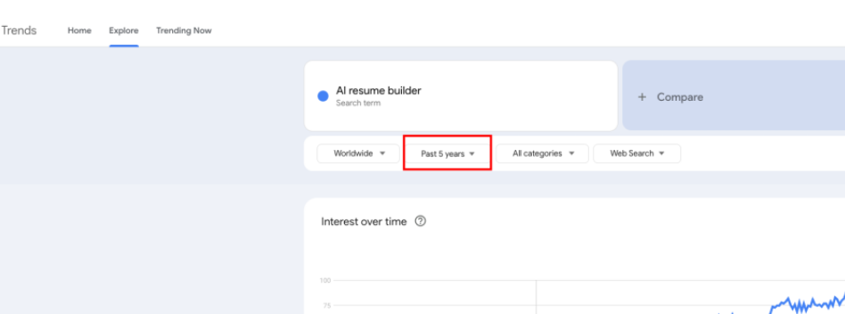

2）发现搜索量在 2023 年暴涨，且往后几年都在持续上升 → 验证需求真实存在。

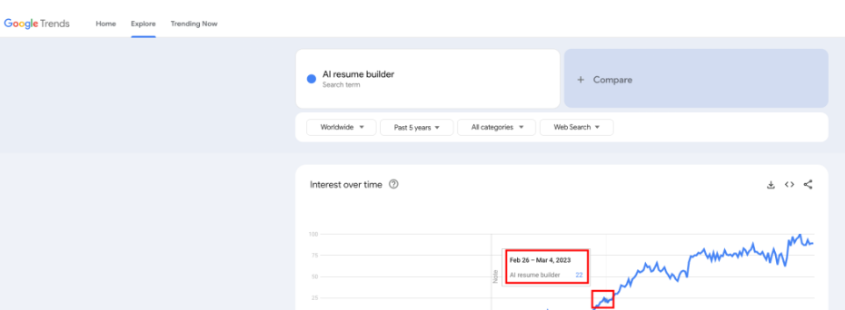

**为什么可以得出这个结论呢？**
① 主动搜索行为代表问题待解决
当用户主动在搜索引擎输入一个关键词（如 “AI resume builder”），说明他们遇到了某个问题，并希望通过工具、服务或信息来解决它。
② 搜索量暴涨 = 需求集中爆发
搜索量短期内激增，意味着大量用户在同一时间段遇到了相同痛点，且现有解决方案可能不足。
③ 排除热点干扰
如果搜索量只是短暂飙升后快速回落（如某明星代言引发的短期流量），可能只是“虚假需求”。如果能持续上升（如3个月以上）表明需求具有延续性，而非昙花一现。
从折线图我们可以看出，过去 5 年趋势一直是在上升。
**Tips:**
**用户的搜索词越具体，需求越真实**
长尾关键词的搜索量增长（比如带功能描述的词汇），更能反映用户愿意为具体解决方案付费。

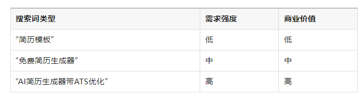

**6.2 分析市场需求**
我们使用 Google Trends 分析关键词，除了能看到关键词热度折线图，还能看到关联主题（Related topics）和关联查询（Related queries）这两项数据展示

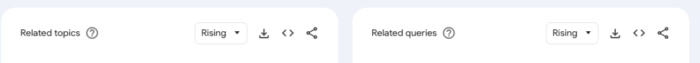

通过这两个功能，我们可以进一步分析：
- 需求场景：用户搜索后还会搜什么？
- 需求强度：搜索词是否包含 “免费 vs 付费”、“教程 vs 工具” 等关键词？
所以我们其实更想知道的是，用户搜索这个关键词背后的意图是什么。
下面我们就使用 Google Trends 的「相关查询」和「关联主题」来分析需求。
**什么是「关联查询」和「关联主题」？**
在 Google Trends 搜索任意关键词（如 “AI resume builder”），页面下方会出现两类数据：
- 相关查询（Related queries）：用户搜索该关键词时，同时或前后搜索的其他关键词。
  1. 例如：搜索 “红烧肉做法” 的人，可能还会搜 “糖色怎么炒”。
- 关联主题（Related topics）：与主关键词属于同一类别或场景的其他主题。
  2. 例如：搜索 “AI resume builder” 的关联主题可能是 “ATS”（简历筛选系统）。
**怎么样用这两类数据判断需求场景？**
假设你发现关键词 “AI resume builder” 搜索量暴涨，但不确定用户需要什么功能。通过以下步骤分析：
**步骤1：查看「相关查询」**
操作：在 Google Trends 输入 “AI resume builder”，下滑到「相关查询」部分，按「上升」排序（Rising），看到以下结果：

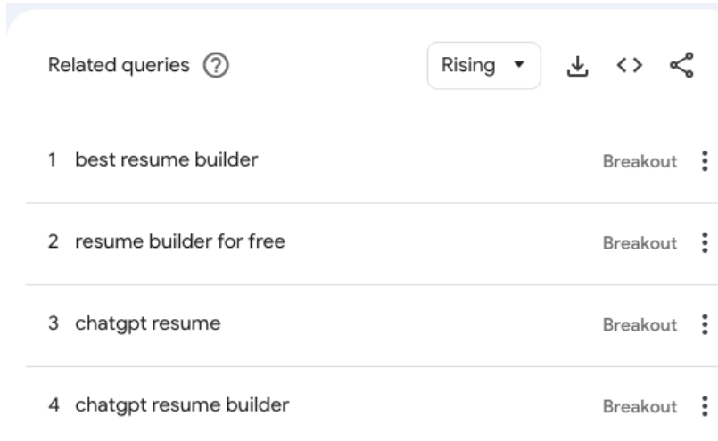

**需求场景分析：**
1）用户的核心需求是什么？
主关键词：“AI resume builder”（AI简历生成器）
相关查询透露出三类场景：

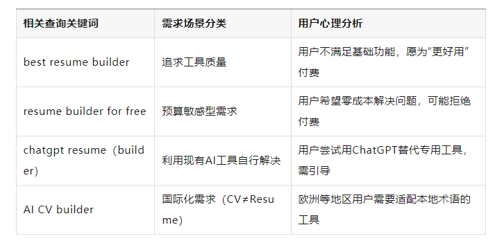

2）如何推导需求场景？
场景1：工具质量优先的求职者
- 证据：关键词 “best resume builder”（搜索量Breakout）
- 用户行为链：用户先尝试通用工具 → 效果不佳 → 主动寻找“最好”的解决方案
- 需求强度：高（用户愿意为“最好”支付溢价）
- 产品方向：突出“专业评测Top 1”“HR推荐”等信任背书，强调差异化功能（如行业定制模板）。
场景2：零成本解决方案需求
- 证据：关键词 “resume builder for free”（搜索量Breakout）
- 用户行为链：用户想快速解决问题 → 优先寻找免费工具 → 可能因功能限制转向付费。
- 需求强度：中低（需通过免费版引流，再转化付费）
- 产品方向：提供免费基础版 + 付费解锁高级功能（如ATS兼容性检测）。
场景3：ChatGPT替代方案
- 证据：关键词 “chatgpt resume” 和 “chatgpt resume builder”（搜索量Breakout）
- 用户行为链：用户知道ChatGPT的通用能力 → 尝试用其生成简历 → 发现效果不专业 → 寻找专用工具。
- 需求强度：中高（用户已意识到AI的价值，但需要更垂直的解决方案）
- 产品方向：开发“ChatGPT+专业简历库”的集成工具，宣传“比直接使用ChatGPT更高效”。
**需求强度分析：**
关键词中的“强度信号”
（1）强需求信号
- “best”：用户进入对比选择阶段，商业价值高。
- “chatgpt resume builder”：用户明确需要AI与工具结合，需求具体。
（2）弱需求信号
- “free”：用户价格敏感，付费转化难度大。
- 无功能描述词：如未出现“ATS”“custom template”等，说明需求尚未细化。
**步骤2：查看「关联主题」**
操作：在「关联主题」部分，发现以下高关联度主题

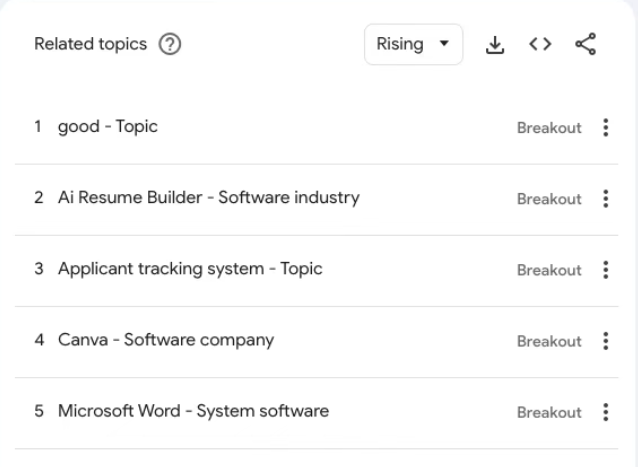

- "good - Topic"（Breakout）
  1. 可能是用户搜索 "good resume builder" 或 "good AI tools" 等短语的泛化归类，反映用户对“优质工具”的筛选需求。
- "Ai Resume Builder - Software industry"（Breakout）
  2. 明确指向 “AI简历生成工具” 这一细分赛道，且归类于“软件行业”，说明该工具已被市场认可为专业软件。
- "Applicant tracking system - Topic"（Breakout）
  3. 企业招聘系统中的 简历筛选系统（ATS），与简历生成工具强关联，用户需要确保简历能通过机器筛选。
- "Canva - Software company"（Breakout）
  4. 用户正在对比 Canva（知名设计工具），说明部分用户尝试用设计工具制作简历，但需更专业的解决方案。
- "Microsoft Word - System software"（Breakout）
  5. 传统文档工具 Word 的关联，反映用户从 “手动排版”向“自动化生成” 过渡的需求。
**需求场景分析：**
1）核心场景，生成符合ATS标准的简历
证据链：
- 主关键词 “Ai Resume Builder” + 关联主题 “Applicant tracking system”。
- 用户行为逻辑
- 用户痛点：简历被企业ATS系统过滤 → 搜索AI生成工具 → 验证工具是否解决ATS兼容性
产品方向
- 需强调工具内置 “ATS优化”功能（如关键词匹配、格式标准化）。
- 提供 “简历通过率检测”报告，直接解决用户担忧。
2）竞争场景，与传统工具（Word/Canva）争夺用户
证据链：
（1）关联主题中出现 Canva 和 Microsoft Word，且均为“Breakout”状态。
（2）用户行为逻辑
- 用户习惯：过去用Word写简历 → 发现效率低 → 尝试Canva美化 → 仍不满足 → 转向AI工具
产品方向：
- 开发 “一键从Word/Canva导入”功能，降低迁移成本。
- 宣传 “比Canva更智能，比Word更高效” 的核心优势。
3）质量筛选场景，用户寻找可靠工具
证据链：
（1）关联主题 “good - Topic”（可能包含“good resume builder”等搜索）。
（2）用户行为逻辑
- 用户不信任普通工具 → 搜索“good”“best”等评测类关键词 → 筛选优质产品
产品方向：
- 主动发布 第三方评测报告（如“2024最佳AI简历工具Top 5”）。
- 在官网突出 “行业认证”“用户案例” 等信任背书。
**需求强度分析：**
1）从“Breakout”状态判断爆发性需求
Breakout的定义：搜索量增长率超过500%，或从零搜索突然爆发。
截图中所有关联主题均为Breakout，说明：
- 整个 “AI简历生成”赛道处于高速增长期；
- 用户需求从传统工具（Word/Canva）向AI工具迁移的趋势显著。
2）需求强度排序

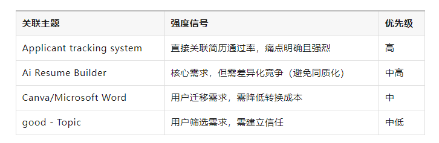

**为什么关键词类型能反应需求强度？**
核心逻辑：搜索词越具体，付费意愿越强
想象你准备点外卖：
- 弱需求场景：你搜“附近有什么吃的”（泛需求，可能随便看看）
- 强需求场景：你搜“小龙虾外卖 2人套餐 免配送费”（明确需求，准备下单）
同理，用户在搜索工具时的用词，直接暴露了他们的意图阶段：

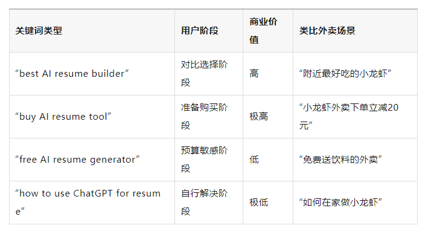

**总结：从关键词到用户画像**
通过分析相关查询和关联主题，你可以构建一个用户行为路径图：
用户痛点 → 搜索主关键词 → 遇到问题 → 搜索关联词 → 需求升级
