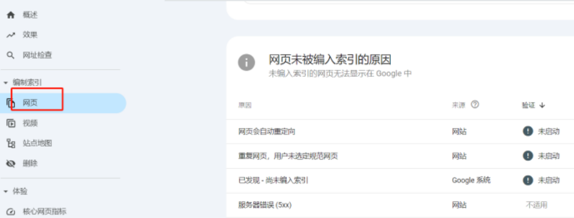
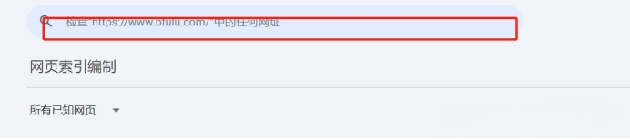
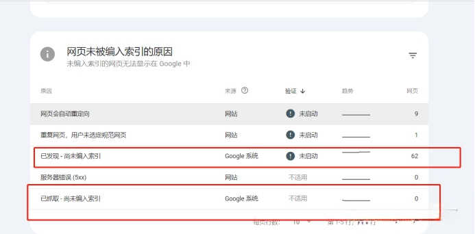
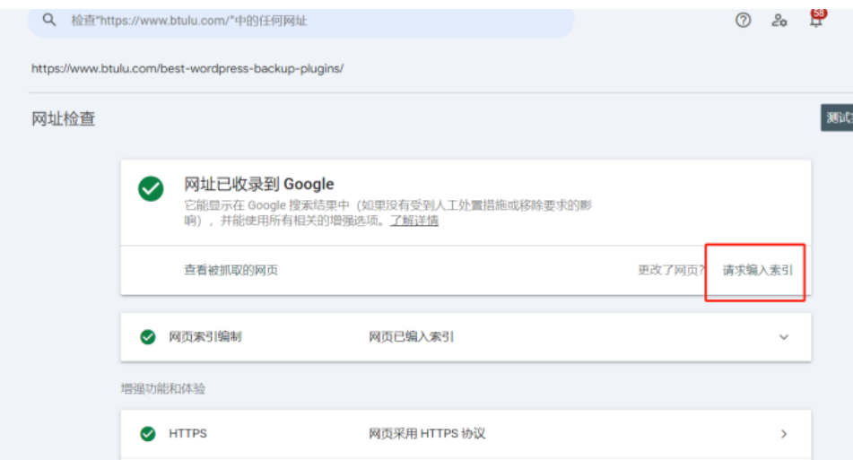
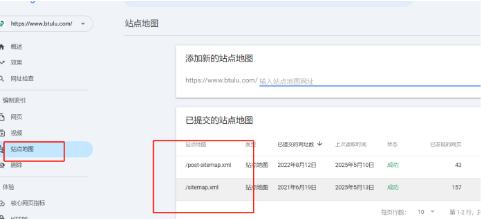
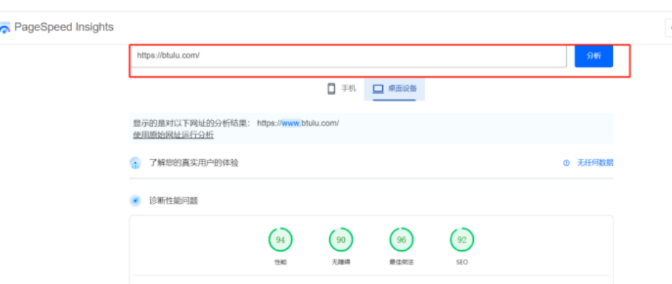
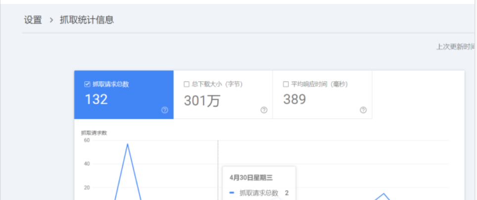
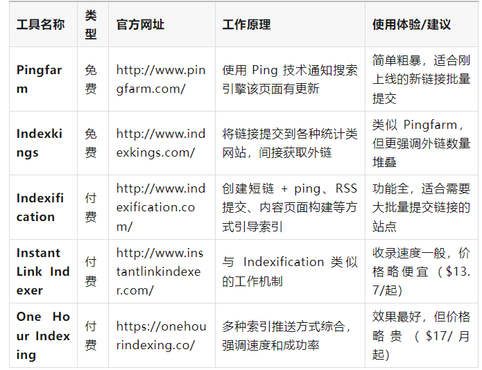

# 独立站提高页面谷歌收录率技巧

独立站刚上线，却迟迟没有收录页面？
发布新内容，Google 爬虫迟迟不来？
也许不是你内容不好，而是你没用好Google Search Console！
作为跨境独立站的运营者，你可能已经知道提交Sitemap、加外链、写原创内容这些基本操作。但你是否了解一些数据分析和工具。
今天我们简单介绍使用Google Search Console 加快页面收录。

## 一、为什么GSC是独立站运营必备工具之一？

Google Search Console 是一款谷歌官方免费站长工具。它能帮助你：
- 提交 Sitemap，加快抓取收录
- 查看页面是否被索引及索引状态
- 分析关键词排名与点击情况
- 检查技术问题（如移动端适配、结构化数据错误）
- 了解爬虫访问频率和抓取深度
简单来说，它是你与 Google “交流对话窗口”。如果你想让Google 更了解你，您就必须学会看懂它反馈给你的一些信号。

## 二、3个GSC基础检查方法

**01编制索引报告**

GSC 左侧栏**「**编制索引**」**>「网页」
这个报告告诉你：哪些页面被谷歌收录了，哪些没收录，以及没收录的原因是什么。
**常见状态说明：**

#### 1.已收录（Indexed）：没问题

#### 2.已抓取-尚未索引（Crawled - currently not indexed）

含义：Google 已访问该页面，但暂未决定收录。
优化建议：
- 检查页面内容是否足够独特/有价值；
- 增加页面内链/外链，提高权重；
- 使用GSC 的“URL 检查工具”主动推送索引。

#### 3.检测到异常（如 404、重定向、服务器错误）

含义：页面无法正常访问或被错误配置屏蔽。
优化建议：
- 修复页面错误；
- 检查robots.txt 是否误设了 Disallow；
- 使用移动端友好性检测工具，排查移动适配问题。
实操技巧：
每周定期导出“未被索引的有效页面列表”。从列表里筛选出内容质量高但未收录的页面。你可以重新优化标题、内容，并使用“URL 检查工具”重新提交。

**02 URL 检查工具：即时诊断收录问题**
路径：GSC 首页顶部搜索框，输入你要检查的 URL

你将看到以下关键信息：
- URL 是否在 Google 索引中
- 是否允许抓取（robots、noindex）
- 是否在Sitemap 中
- 最后一次抓取时间
- 移动端可用性
使用技巧：
- 新发布的优质文章，用此工具手动推送，让页面快速进入Google 索引队列；
- 页面更新后，也可重新提交，促进快速再抓取；
- 对“尚未收录”的页面，用它判断是技术问题，还是内容问题。
**03 Sitemap 提交报告**
路径：GSC 左侧栏「索引」>「网站地图」

通过提交网站XML Sitemap，您可以告诉Google：
“我网站有哪些页面，哪些是重点页面，快来抓我！”
提交规范建议：
- URL 总数不要太大，建议分模块提交（如 blog.xml、product.xml）
- PS：可以使用Rankma SEO 插件自带的地图生成
- 保证 Sitemap URL 返回状态码为 200；且无死链
- 定期更新Sitemap地图；
注意事项：
如果Sitemap 地图提交后显示存在大量“发现但未索引”页面。说明内容质量或技术配置存在问题。您应回头结合Coverage 报告逐条排查。

## 三、其他技术方法

除了以上3个基础的方法，您还可以通过一些技术方法解决：
**增强功能& 技术诊断：**

#### 1.移动端可用性报告

Google 优先移动端抓取；若你的页面在手机端体验差，它也可能严重影响收录。
常见问题如：
- 元素点击太近
- 文本太小
- 页面宽度未适配
我们建议使用PageSpeed Insights 或 Lighthouse 工具测试并优化。

#### 2.结构化数据报告

此外，你也可以使用Schema.org 语法为文章、产品、评论添加结构化数据。此方法有助于提升页面在搜索结果的可读性（如星级、作者等）。
GSC 会检测这些标记是否有误。如果有误，你需要尽早修复，否则可能影响排名和收录。

## 四、提高独立站收录率的7个方法

总的来说，概括起来就是下面7个方法可以更好的提高独立站收录率：
**方法1：每周手动提交重点页面**
你以为sitemap 地图提交完就万事大吉？其实不是。
如果页面没收录，你可以把最近发布的几篇重点内容单独整理出来，比如产品页、专题页、重要文章。
打开GSC 后台，用“URL 检查”功能，一条一条手动提交。
建议频率：每周提交5~10 条最重要的新页面；可以每天有规律提交。
PS：谷歌URL提交每天是有限额额，用完了其实也提交不了,因此，你可以先提交集合页或者专题页，让谷歌收录了页面，让谷歌蜘蛛顺着这个页面去爬取其他页面。
**方法2：增加新页面爬取“入口”**
谷歌爬虫就像个机器人。如果爬取页面入口太少，它根本找不到。
因此，您可以把发布最新的文章链接，放在首页、分类页、推荐页里。甚至您可以建一个“最近更新”板块，把它们集中展示。
这样一来，爬虫来抓取时，才知道去哪儿找新内容。
**方法3：外链“引蜘蛛”**
Google 有个特性，如果一个链接在别的平台被点开了，它会更关注这个页面。
你可以在Reddit、Quora、LinkedIn 这些地方发帖、留评论，顺带挂上你文章的链接。
**方法4：清理“无效面”**
如果你的网站里有太多无效页面，比如重复内容、几百字的水文、打不开的页面。如果太多这种无效页面的化，Google 会判定你整个站质量低，消耗他的蜘蛛，因此会减少抓取。
这个时候，你也可以用GSC 的“覆盖范围”报告，看看是否有一堆“未收录”的低质量页面。
没必要留的，我们建议干脆删掉；有些相似话题可以合并、太少的内容可以重写。不要让它们占坑又不出力。
**方法5：查看“日志”，确认爬虫到底来没来**
很多人以为页面没收录，就是页面不好，其实有时候是爬虫根本没来过，特别是新站，你不定期更新的话，或者没有太多外链时候，经常会遇到这个问题。
您可以让技术同事（或主机商）帮忙调一下访问日志，看看Googlebot 有没有抓取你的页面。
如果根本没访问，那就要在内链、地图、外链上想办法“引进来”。
PS：如果这个有难度你也可参考GSC设置>抓取统计信息。如果抓取请求太少了，说明蜘蛛不活跃。

如果蜘蛛不活跃怎么办呢？就是我们需要通过外链吸引蜘蛛。您可以先做些免费基础外链+付费 Guest Post 等结合。
如果您站大，有很多数据需要收录，也可以参考一些免费和付费的外链索引工具（虽然这个是针对发外链的，对站内页面同样适合）。
**外链索引工具推荐清单（附原理说明）**

**使用小贴士：**
- 免费工具适合偶尔使用或新手测试；
- 付费工具更适合SEO从业者或内容量大的网站；
- 如果是刷外链，并不建议频繁批量刷无效外链，避免被判定为垃圾行为；
- 索引工具不是万能的，**页面本身质量+站内结构优化**才是收录的根本保障。
**方法6：做专题页 + 系列内容**
谷歌越来越喜欢“成体系”的内容。
比如你做了一个“跨境选品”的专题页，下面有10篇文章分别讲选品渠道、调研方法、爆品案例……
这种结构比一篇篇独立文章更容易被收录，也更容易排上去。
**方法7：文章是干货**
谷歌现在强调“内容有帮助”，不是纯堆字就能混过去。
写文章的时候，您可以多加些实操步骤、案例图表、常见问题解答。
例如：如果你写“如何选独立站服务器”，那就加上不同服务器对比表、优劣势，选购建议、预算等等内容，一篇内容让人看了就能明白，能马上做决策。
**最后的建议：**
新站页面受否能块收录，归纳起来就是3个方面：
1）蜘蛛够不够？不够可以通过外链引蜘蛛。
2）页面是否是能被蜘蛛顺利发现？如果您导航不清晰，也没啥内链，是个孤立页面，那你就通过站内权重页面，多引荐。
3）内容是否真的实用？这个很重要，如果内容体验差，即使收录了，排名也不好。只要质量好，迟早会收录（如果想快点，GSC主动提交只要质量没问题，绝对能收录）。
