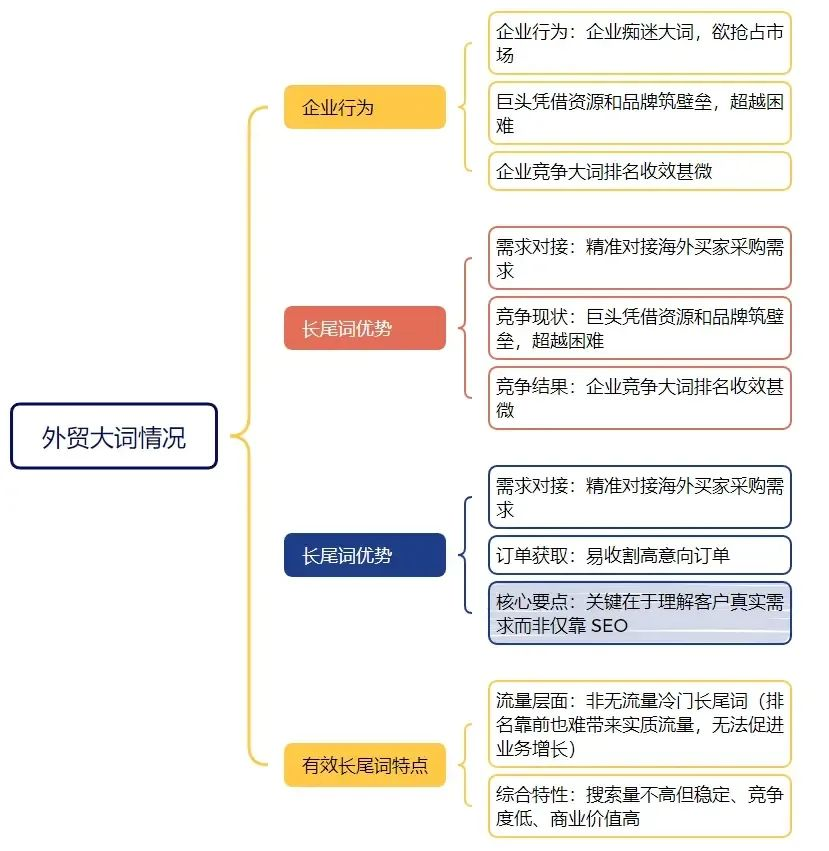
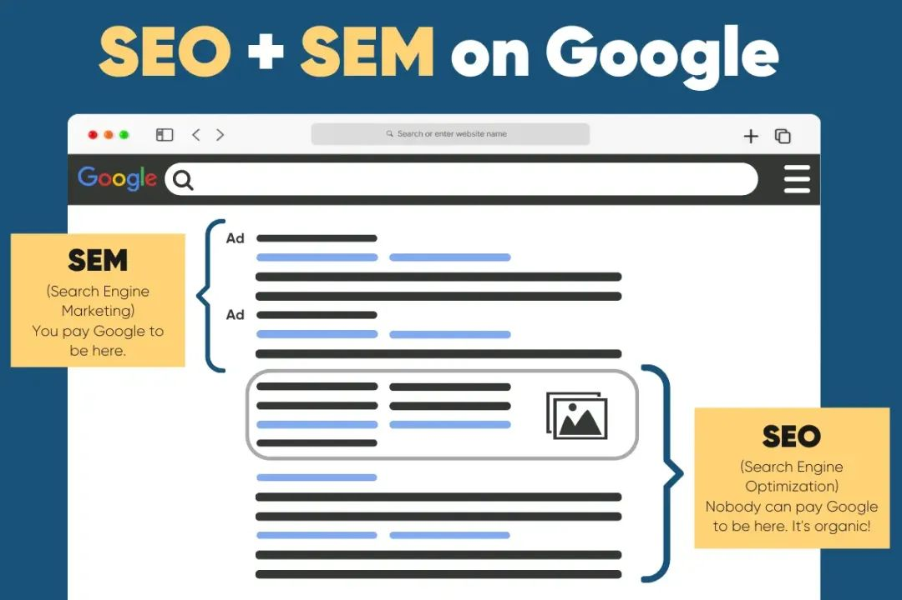
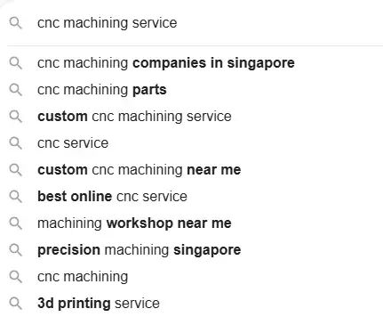
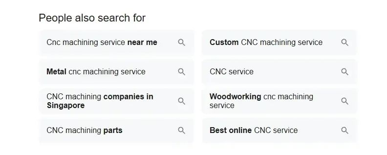
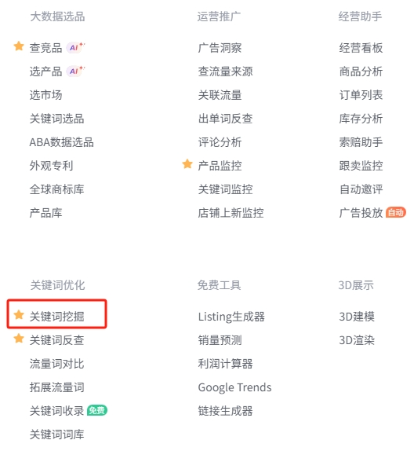
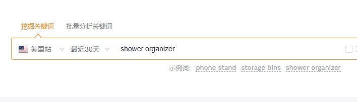
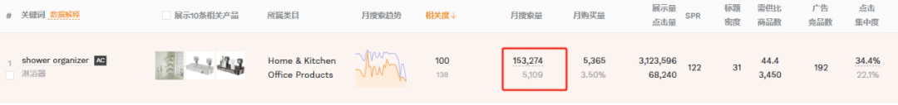
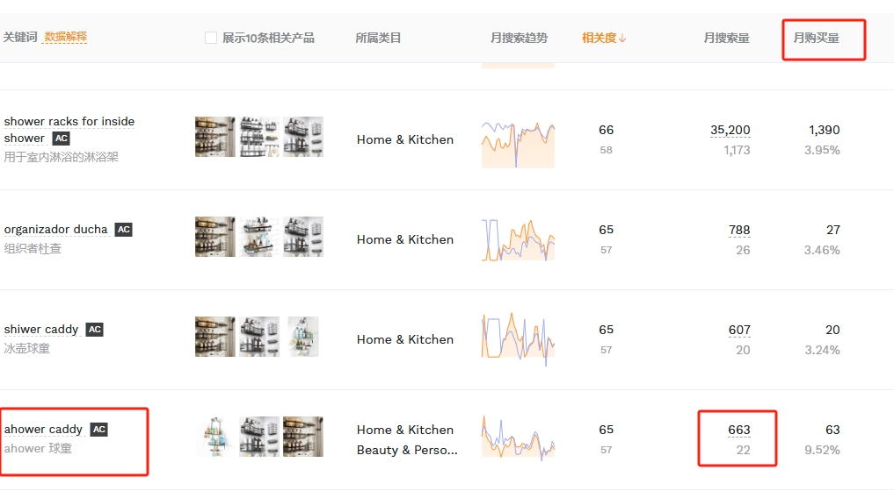

# 独立站长尾词挖掘和布局策略

长尾关键词是在SEO优化和排名策略中一个非常重要的元素，其核心价值体现在精准性、竞争门槛和用户意图匹配度三方面。
由于竞争较小，新网站或权重较低的网站更容易在长尾关键词上获得排名。
且因为需求比较具体带来的搜索量也是很精准，反映用户处于信息搜索后期或购买决策阶段。
所以带来的转化也会更高。
下面会具体给大家介绍长尾关键词在SEO排名和流量获取中的作用和操作办法...

## 一、什么是谷歌长尾词？

谷歌长尾词是谷歌搜索引擎上用户可能会搜索的长尾关键词。
一般是较长或者更加具体的关键词或者短语，当用户在谷歌接近购买和决策或使用语音搜索的时候会使用这类关键词。
虽然长尾词的搜索量比一些大词流量少很多，但由于搜索的用户通常已经非常明确了自己的需求，所以能带来更好的购买和转化。
比如有个学生想买一本书，搜索“书”就是非常热门的关键词，且这种关键词宽泛没有具体的购买意图，他可能只是想了解书的定义、历史，或者随便看看有什么书。
很难判断他真正想买哪种类型的书，导致商家很难精准地满足他的需求。
而如果他搜索高二数学辅导书籍，这就是一个精准的长尾词了，这样商家布局就很有针对性了。
商家可针对性推荐人教版 / 苏教版同步练习、压轴题解析等细分关联书籍，这样更容易产生购买和转化。

所以通过这个直接的例子来告诉各位伙伴，大词排上来的确可以获得不错的流量但是难度太高了。
自己经常排大词是因为要证明自己的SEO实力，如果是想要提升询盘和店铺转化，那**1个大词，不如100个刚好需要。**

## 二、关键词竞争减少=成本降低

在SEO或Google Ads中，关键词的竞争程度直接影响你需要投入的时间、金钱和资源。
如果挑选的都是那些大词或者竞争程度很高的关键词，那么就需要花更多的时间在内容优化、外链优化和SEO策略上。
如果挑选了精准的长尾关键词，那就可以减少内容创作和SEO优化的时间和成本了。
因为竞争激烈的关键词，往往需要更高质量、更深入、更全面的内容才能有排名的机会。
且前面也给各位仔细解释了为啥长尾词的转化效果更好，自然也能带来精准的流量和潜在客户。

不管是谷歌广告还是其他类型的广告，都是根据关键词的竞争程度来出价的，也就是说如果某个关键词竞争越大，那CPC出价也就越高。
如果选择的都是竞争很大的关键词，自然广告的点击价格就会越高。
同时企业需要投入更多预算才能获取流量，且转化效果可能因泛流量而不尽人意。
所以如果关键词的竞争变小时，广告的点击价格自然也会降低，这意味着同样的广告预算可以用更低的成本获得更多的流量。
同时每次点击成本降低了，而在转化率保持不变的情况下，广告投入回报率就会相应提高。
你就可以以更低的成本获取更好的客户转化。

## 三、如何挖掘长尾关键词？

很多伙伴喜欢用semrush或者类似的关键词工具来挖掘，但是下面的办法可以让你找到更加全面的长尾关键词。

#### 1.利用搜索引擎建议

使用谷歌搜索引擎挖掘出来的关键词是最能体现用户的真实搜索意图的，操作办法也是非常的简单。
输入目标关键词然后鼠标点击搜索框，就会出现相关的提示搜索了。

这些关键词不仅相关且既然能提示出来，说明用户搜索对应关键词的时候这些提示出来的关键词也是会被一起搜索或者也会进行点击查看的。

拉到底部还会出现people also search for的提示，这些关键词同样也是用户关注的。

#### 2.细分现有的内容

整理现有的和用户产生的内容是个不错的办法。
将用户经常会问到的问题和相关内容以长尾关键词的形式整理出来，并附上简洁明了的答案。
阅读完现有的内容后，可能会产生哪些具体和深入的问题？
比如这篇内容就以长尾关键词为主，后面可能衍生：
- 如何布局长尾关键词内容？
- 如何挑选转化率高的长尾词？
- 如何通过people also ask产生用户信任
这些问题以及衍生出来的话题和长尾词都是很好的稀缺内容，不仅满足用户搜索意图还能在谷歌上获得不错的排名。

#### 3.关注与网站业务相关的关键词

思考用户在搜索你的产品或服务时，可能会使用哪些关键词。
主要是要理解用户处于搜索的哪个阶段。
**（1）信息收集阶段**
这种阶段是处理初级了解阶段，属于信息的收集阶段。
具体了解提供哪些产品和服务，比如：
- 什么是耐高温尼龙？
- 耐高温尼龙有社会面好处？
- 耐高温尼龙的常见问题
**（2）比较评估阶段**
用户处于产品的比较阶段，这个时候布局的信息需突出自身产品的特点，最好用对比的形式来展示。
- 你的产品vs 竞争对手的产品
- 尼龙6和尼龙66对比
- 尼龙6的应用
- 尼龙6有哪些优点
**（3）购买决策阶段**
前面的信息如果都了解清楚了，那么现在就进入购买和决策阶段了。
- 尼龙6价格
- 尼龙生产厂家
- 尼龙6加工定制
他们可能已经准备购买，正在寻找具体的产品或购买渠道，而这些关键词都是进行购买和决策的。

#### 4.利用相关工具生成长尾关键词

一些常规的工具比如semrush，ahrefs或者Google Keyword Planner都可以帮助你你找到特定关键词衍生出来的长尾关键词。
通过这些工具可以更好地发觉每个关键词的流量，竞争难度和扩展相关的长尾关键词。
同时通过工具可以具体了解有多少人正在搜索这个关键词，这可以帮助你判断投入时间和精力优化这些关键词是否值得。
如果这个词搜索的人很少但排名却很容易，虽然有排名但是带来的意义并不大。

#### 5.分析竞争对手

分析竞争对手并不是简单的用semrush把竞对的域名放进来然后看一下竞对有哪些关键词。
然后只是简单的把这些关键词收集整理了，但并没有做二次挖掘，一些关键词竞争是很大的。
就算复制过来也只是看着好看，排名又不是自己的，可以通过竞对的关键词来挖掘一些长尾关键词。
不仅可以避开激烈的正面竞争，更容易在搜索结果中获得靠前的排名。
同时如果有竞争对手未优化的长尾关键词可能代表着市场上尚未被充分满足的用户需求或信息缺口。
你可以通过创建高质量的内容来填补这些空白，从而吸引新的用户和潜在客户。

## 四、如何优化长尾关键词？

优化长尾关键词和大类的关键词优化并无很大差别，都是需要先挖掘对应的关键词，然后再做针对性的优化和布局。
通过下面的详细优化布局，可以让网站能够更好地捕捉到这些搜索量较小但具有高度针对性的关键词，从而提升网站的整体流量和排名。

#### 1.分析用户搜索意图

只有了解了用户真实的搜索意图，才能更加有针对性的布局对应的内容。
并不是原创的内容都会有好的排名结果，而是高度相关的原创内容才会更加容易获得用户和搜索引擎的认可。
才能提升用户在网站上的停留时间，让搜索引擎认为是受欢迎的，这样才能带来积极的排名。
一般来说长尾关键词因为比较具体所以搜索意图也是比较清晰的，比如“如何优化长尾词？”这个长尾词已经就很明确了。
我们只要围绕着这个话题做出具体的内容指导就可以了，所以如果一开始还搞不懂某个关键词的搜索意图那可以先从优化长尾关键词开始。
等后面长尾词可以顺利的排上来，其实一些大词就是把多个用户搜索意图组合在一起，所以先把单个的需求先满足。
后面坐大词排名自然也会比较稳当了。

#### 2.编写高质量内容

关于写高质量的内容，这边还是给大家说一下这个办法。
首先如果是选定好了一个长尾关键词，那么首先我们是需要针对这个长尾词中的每一个要素进行内容组织。
比如这一篇写的主要是长尾关键词是什么，以及如何做排名优化的。
所以关于长尾关键词的定义以及优化细节都要写清楚，而不是蜻蜓点水只是说了一个大概并没有提供详细的指导。
所以建议是把想要写的东西都做好详细的段落分类，这样条理就很清晰。
我们只要把每个大纲下面的内容写清晰就好了。

#### 3.优化标题、描述和页面结构

使用长尾关键词优化网页标题、描述和页面结构，让搜索引擎更好地理解网页内容。
**（1）优化标题**
将你最重要的长尾关键词自然地融入到网页标题中。
最好将关键词放在标题的开头，因为搜索引擎更重视标题前部的词语。
确保标题准确地概括了页面的主要内容，并与你想要优化的长尾关键词高度相关。
**（2）优化描述**
在描述标签中自然地包含你的目标长尾关键词。
编写具有吸引力的描述，突出页面的核心价值和特点，诱使用户在搜索结果中点击你的链接。

#### 4.进行内链优化

将相关的内容和页面都链接到一起，这样可以帮助搜索引擎更好的理解网站的内容。
这样不仅用户可以找到更多关于该内容的话题，且搜索引擎也认为内容是有全面和参考价值的。

## 五、长尾关键词挖掘工具

关键词工具比较常规的就不给各位详细说明了，如果是要挖掘长尾关键词的话，这两款工具是可以了解一下的。

#### 1.卖家精灵

卖家精灵是一款针对亚马逊运营全链路，从产品调研、关键词研究到广告投放、竞品分析，提供多维度数据支撑的工具。
可量化市场机会，通过筛选维度（如搜索量、竞争度、价格带）精准定位细分市场。
对于2C的卖家是一款非常实用的工具，如果是亚马逊和跨境独立站卖家都是可以使用这款工具来挖掘精准的关键词的。
网址是https://www.sellersprite.com/
如果我们想挖掘精准的产品转化关键词就可以使用这个工具来惊喜的挖掘了。
首选进入工具页面，找到关键词挖掘的栏目。

然后点击进入，输入想要挖掘的关键词：

可以根据具体的国家来选择最适合自己的关键词。

发现这个关键词的竞争程度很大，且商家布局的密度也是非常的高，如果现在贸然选择这个关键词自然会淹没在茫茫的竞争大潮中。
所以我们需要改变一下策略...

可以选择这种虽然关键词搜索量不高但月购买量还不错的关键词来进行布局和产品优化。
这样不断的挖掘，虽然单个产品的购买量没有大词带来的转化高，但如果可以发掘很多这种类似的关键词就可以带来很好的总体转化了。

#### 2.其他关键词挖掘工具推荐

除了使用常规的semrush，ahrefs或者Google Keyword Planner还可以使用卖家精灵来进行更加精细化的挖掘。
具体的长尾词挖掘思路其实都差不多，只要按照这个思路配合自己顺手的关键词工具即可。
关于长尾关键词的概念以及挖掘方法都详细的告诉给大家了，如果每天花一些时间好好研究一下这些长尾关键词，网站流量和询盘转化率定会显著提升。
同时也要有计划和目的的把这些长尾关键词转化成优质的内容，这些只要行动起来就会发现真香啊...
