# 谷歌5大发掘新关键词技巧

做海外营销的都知道，关键词是打开流量大门的钥匙。但作为网站所有者，你的一大挑战是：**如何在现有排名关键词之外，挖掘更多新的关键词？因为新关键词的排名不仅能提升流量，还能吸引更多人关注你的内容、产品或服务。**
那么，应该怎样找到这些新的关键词呢？接下来，我将分享5种实用策略，帮你为网站找到新的关键词，并告诉你它们是如何提升你的排名和业务的。
***一、Google 关键字规划师***
Google 关键字规划师是一款免费工具，可以为你的付费搜索活动找到新的关键词。在使用这一工具之前，你可以先登录你的 Google Ads 账户，随后点击“发现新关键词”按钮。

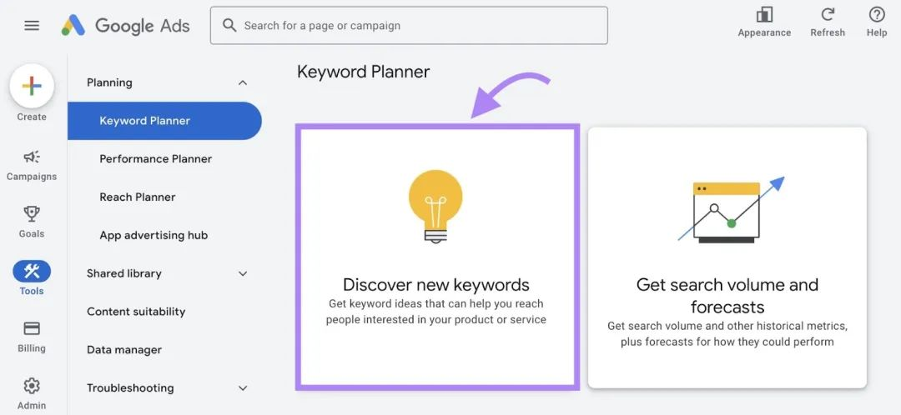

如果你已经准备好关键词，可以直接点击“从关键词开始”标签。然后输入与你的业务以及网站网址相关的种子关键词，并点击“获取结果”。

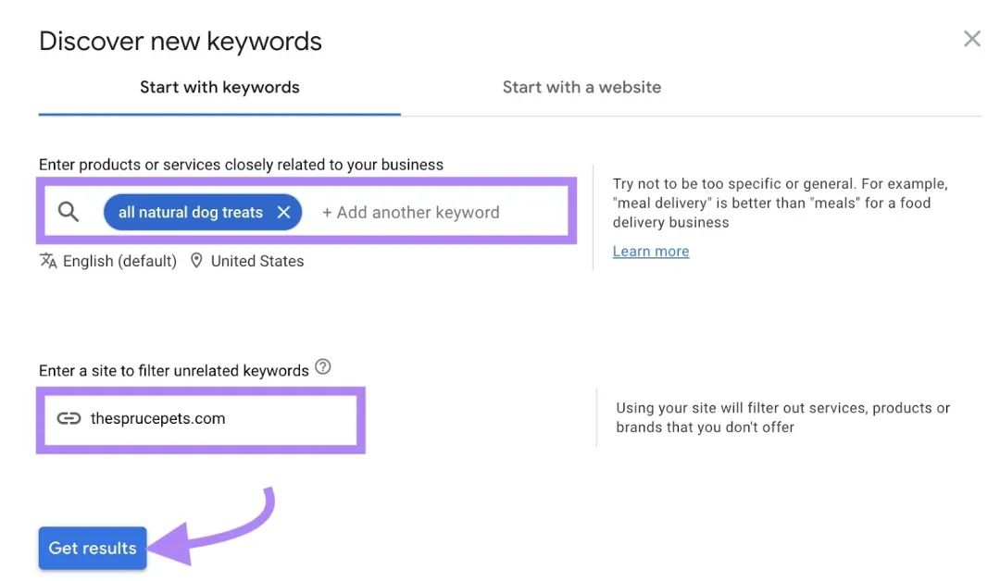

这将显示与广告系列相关的关键词变体，供你选择。这时候，我们可以重点关注“平均每月搜索量”“竞争程度”和“页面顶部出价”这三列数据。这些指标反映了在付费搜索结果中排名靠前的难度，以及每次用户点击你的广告时你所需支付的费用。

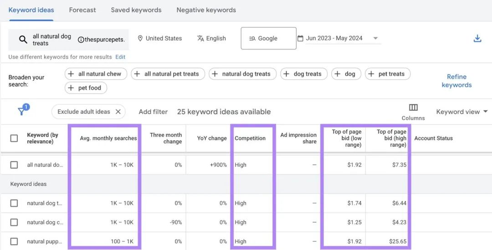

点击右上角的“优化关键词”，使用筛选条件来定制列表。

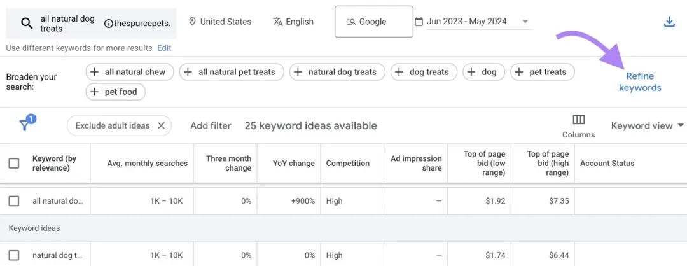

例如，如果你不想对包含“饼干”的关键词出价，可取消选中该关键词左侧的复选框。

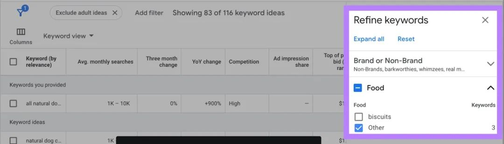

如果你还没有确定关键词，可点击“从网站开始”标签，输入你的网站网址。如果你只投放特定产品或服务的广告，也可以在文本栏中输入相关页面网址，点击“获取结果”。

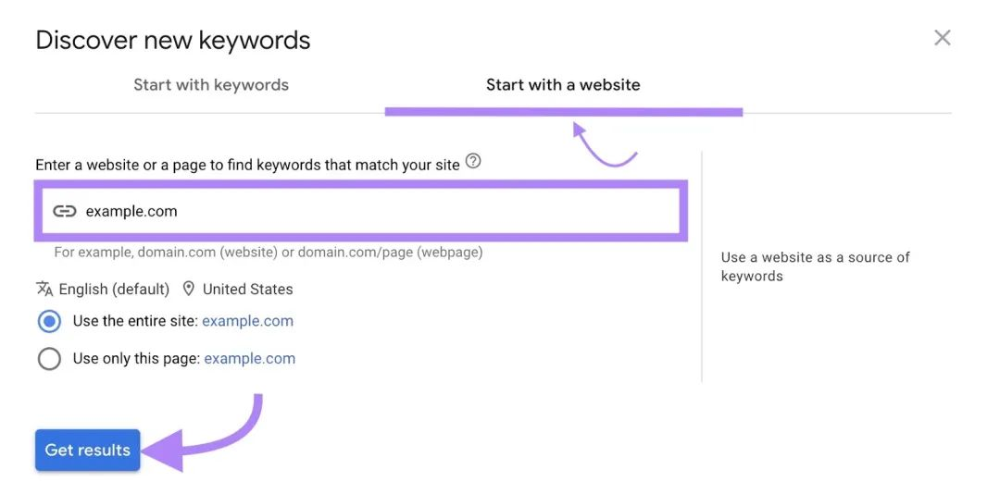

Google 关键字规划师会根据你的产品、服务或网站内容推荐关键词，将它们添加到广告系列中，帮助你吸引新的受众。
为你的广告投放打下坚实的基础。
***二、Google Search Console***
你可以去 Google Search Console（GSC）里，看看那些已经有排名但还没专门撰写内容的关键词。
Google Search Console 同样是一款免费工具，它不仅可以帮助你追踪网站在搜索结果中的表现，还能监控技术 SEO 的情况。

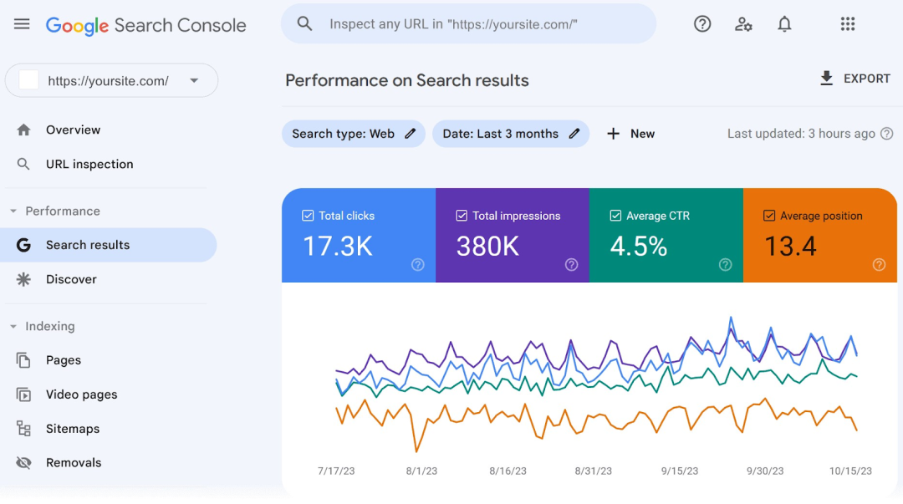

此外，GSC 还会列出你参与排名的查询（关键词），帮助你发现更多潜在的机会。

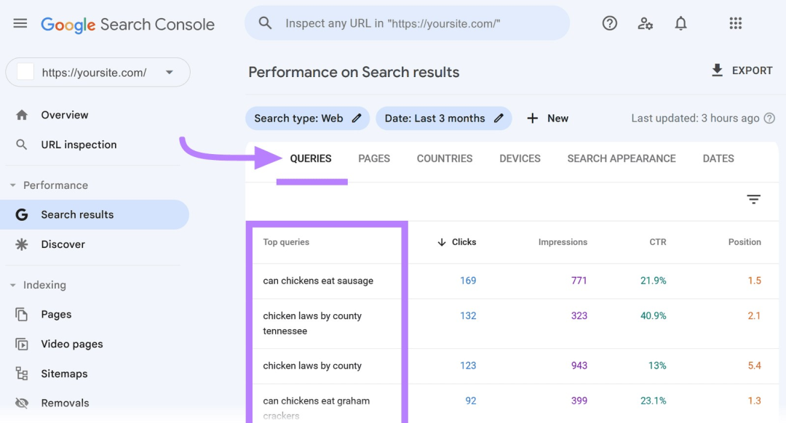

要在 GSC 中查找不同的关键词，请前往“效果”标签下的“搜索结果”（某些账户可能看不到“搜索结果”，这种情况下请直接点击“效果”）。

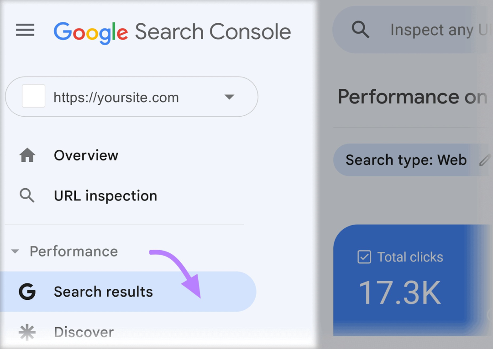

接下来，切换到“平均排名”。

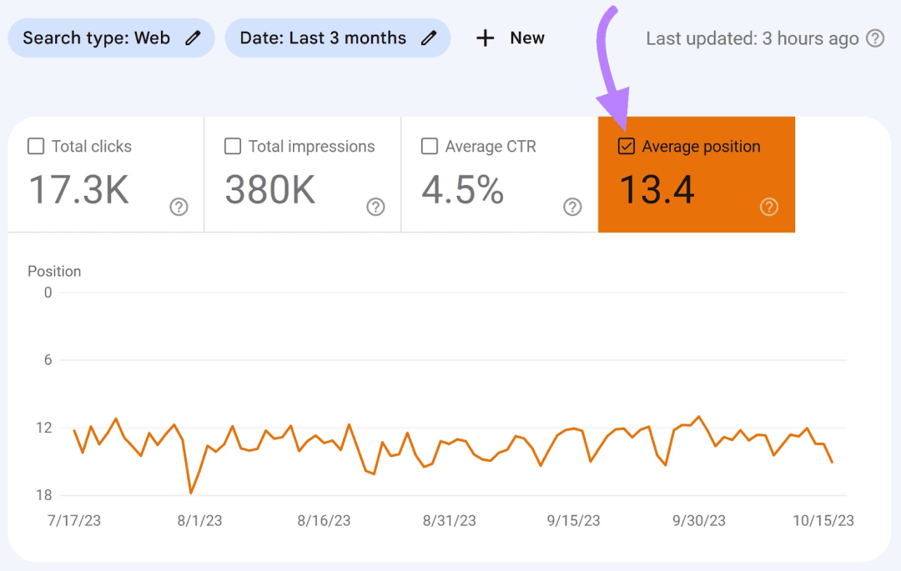

向下滚动，直到看到你排名的所有关键词。

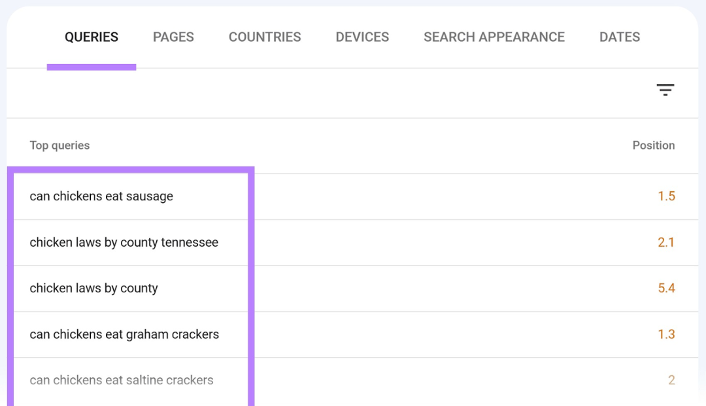

现在，浏览列表，识别那些你已经排名但尚未创建内容的术语。在“性能”选项卡下，点击“+新建”，选择“页面...”。

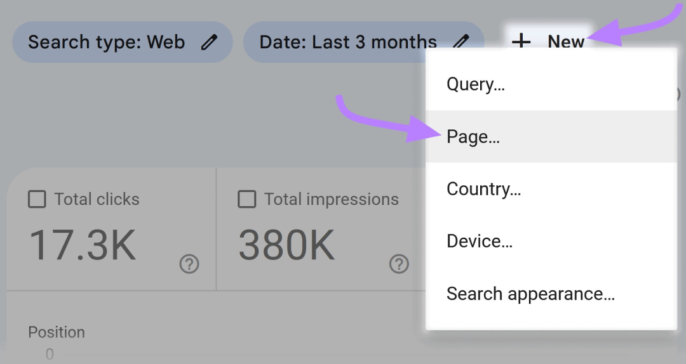

输入你想要查看查询的 URL，然后在下拉菜单中选择“精确 URL”，最后点击“应用”。这样你就可以查看特定页面所排名的查询。

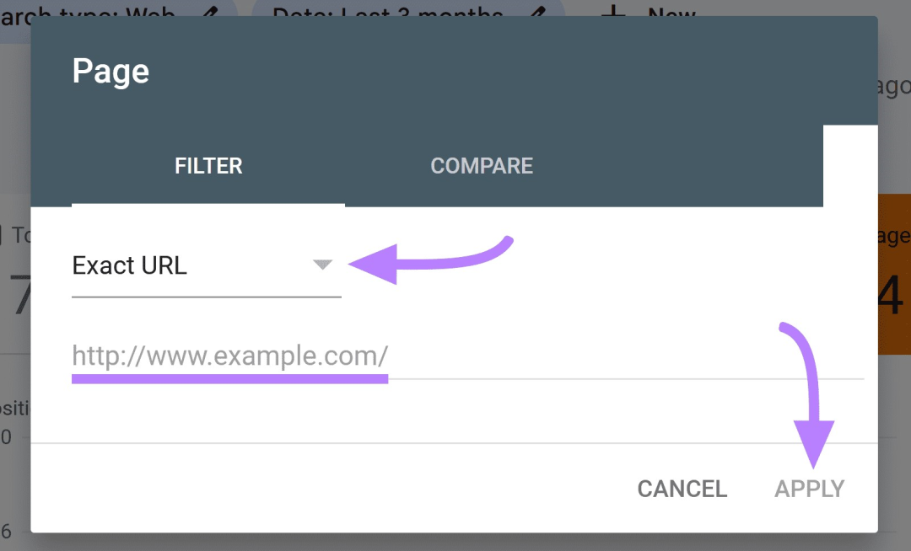

你可以通过这种方式，在博客、文章或网站文案中找到新的关键词机会。
***三、People also ask***
“People also ask”是 Google 搜索结果中的一项功能，它会显示与搜索查询相关的问题，特别适合用来查找新的长尾关键词（即高度精准的搜索查询）。
如果搜索结果中有“People also ask”框，你通常会在搜索结果的顶部附近看到它。

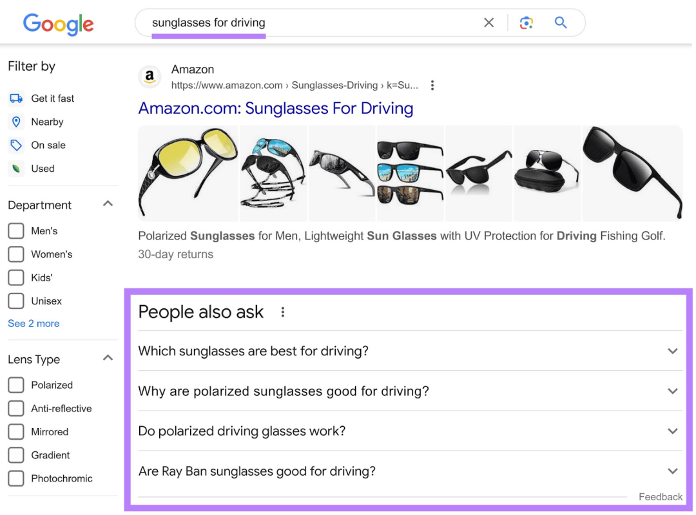

比如，当你搜索“驾驶用太阳镜”时，可能会看到“为什么偏光太阳镜适合驾驶？”和“雷朋太阳镜适合驾驶吗？”等问题提示。

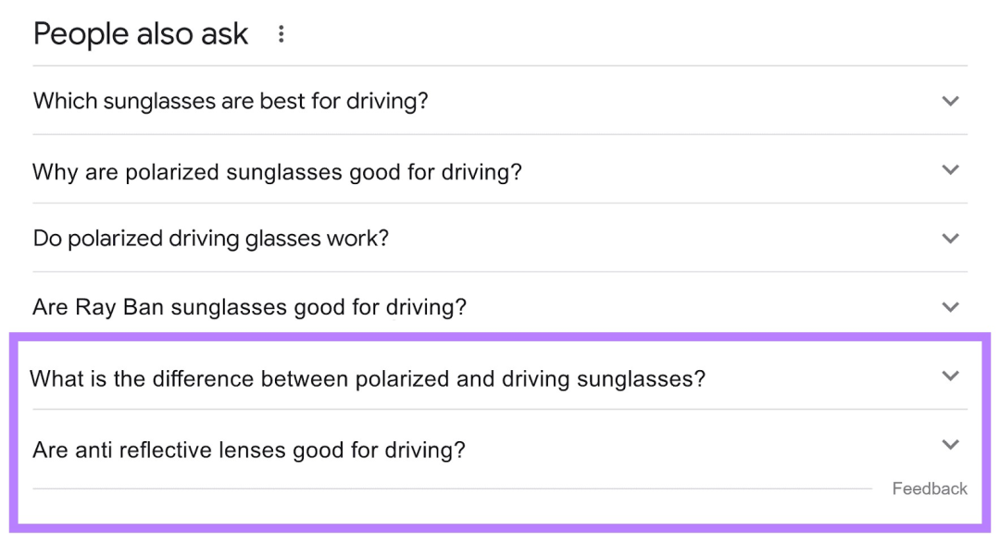

点击这些问题的下拉菜单，还能看到更多相关的关键词创意，比如“偏光太阳镜和驾驶太阳镜有什么区别？”和“防反光镜片适合驾驶吗？”
你可以继续点击这些问题，直到找到你内容中尚未回答的部分。然后，围绕这些关键词创建新的博客文章或文章，以填补内容空白。
***四、Google 自动完成***
Google 的自动完成功能在你输入时会提供相关搜索建议，这可以帮助你发现其他相关的搜索查询。比如，当你输入“太阳镜”时，Google 会推荐一系列相关查询，比如“男士太阳镜”和“开车时戴的太阳镜”。

随着你输入更多字母，这些建议也会实时更新。比如，当你在“太阳镜”后面加上字母“n”时，自动完成的建议就会相应变化。

你可以通过输入与你的利基市场和产品相关的关键词，来查看相关的搜索建议。继续探索这些搜索建议，直到找到那些你尚未撰写内容的短语。此外，你也可以输入你的品牌名称，看看人们都在搜索哪些与你的业务相关的内容。

这些品牌相关的搜索可能会激发你创建新页面的灵感，比如免费样品页面或者预约咨询电话的页面。
***五、Google 相关搜索***
相关搜索是 Google 中与初始查询相关的其他搜索建议，和“People also ask”以及 Google 的自动完成功能一样，它也能帮助你生成新的关键词创意。
Google 会在搜索结果的底部显示相关搜索。比如，当你搜索“驾驶太阳镜”时，就会看到如下相关搜索结果：

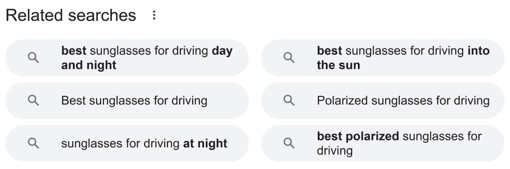

这些相关搜索是可点击的。如果你点击其中一个，比如“驾驶用偏光太阳镜”，Google 会带你进入新的搜索结果页面，并在底部显示一个全新的相关搜索列表。

你可以通过重复这个过程，不断挖掘出更多的相关关键词。
以上就是为你介绍的五种为网站寻找新关键词的方法，希望能帮助你在 SEO 优化的道路上更进一步。
