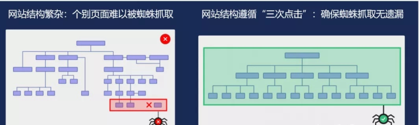
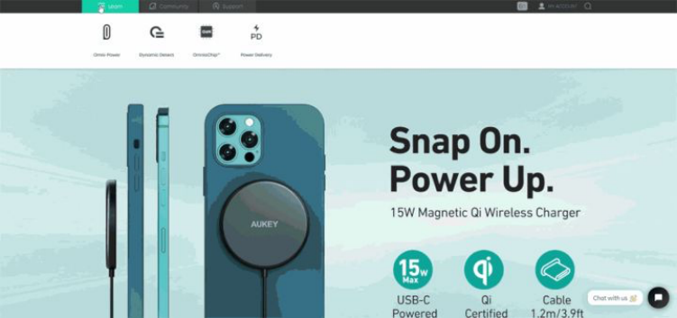
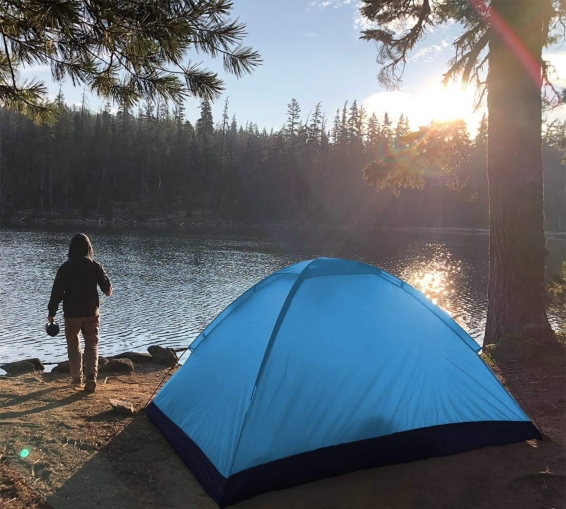
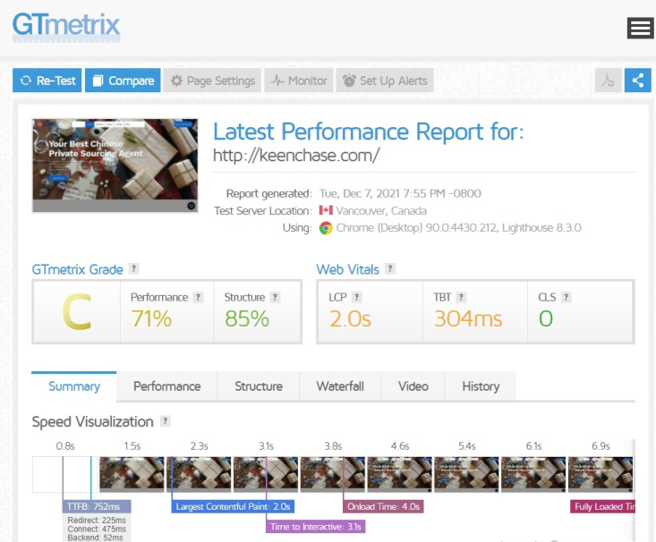
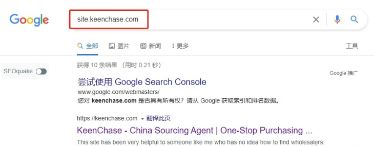
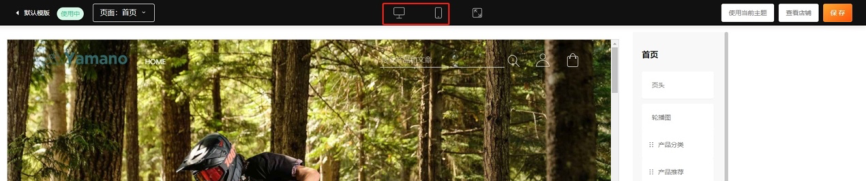
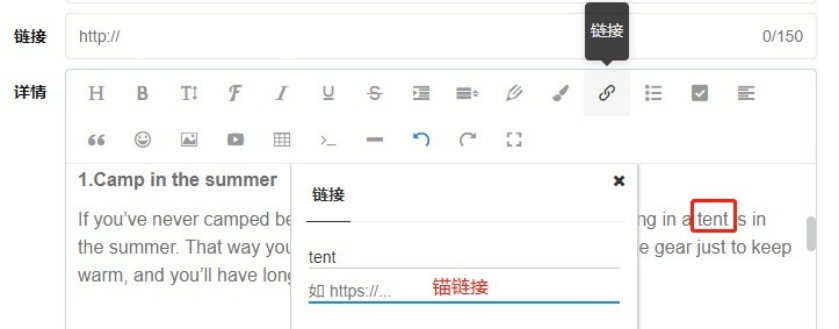

# 谷歌SEO 站内优化，这8 个细节不能忽略！

流量是独立站人的心头肉，SEO 优化（搜索引擎优化）这个免费的自然流量，就成了一个

香饽饽，今天我就告诉你8 个SEO 站内优化细节，赶快执行吧！

01 合理规划关键词，简化网站结构

关键词规划是建立网站架构的关键步骤。你的网站能否被目标客户搜索到，能否转化更多 的订单，很大程度上取决于关键词规划阶段。

概括来说，关键词规划分为3 步：

- 查找与你的产品相关的关键词，并确认这些关键词具备搜索量（有潜在客户搜索）

- 按相关度和竞争度对关键词分组

- 将分好组的关键词布局到网站的特定页面，以更好地满足用户的搜索意图

这里要提醒大家，网站结构最好遵循“三次点击”：即着陆页是否可通过三次以内的点击到

达。通常来说，扁平化的网站架构更有利于蜘蛛抓取，也方便用户快速获取信息。而“深

度”结构的网站不仅显得内容繁杂，也会面临蜘蛛抓取遗漏的风险。

为什么网站结构要遵循“三次点击”

观察国内那些名列前茅的品牌独立站，往往会发现同样的规律：这些网站内容丰富，但结

构却很清晰，大部分网页都满足“三次点击”原则，在首页导航栏就能通览网站全部内容。

而这也是一条做好SEO 站内优化的铁律，无论算法如何变化，保障访问体验，永远都是优 化工作的核心。

2020 出海品牌50 强：Aukey 官网架构

02 创建有含义的产品标题和描述

对于产品Title 和Description，千万不要再把关键词进行无意义地堆砌啦！随着谷歌算法

的更新，创建一条便于理解的有含义的标题和描述，更为重要！

产品标题怎么算合适呢？我们先看一个例子：

这顶帐篷的标题是

2-person tent, 2-person camping tent suitable for outdoor play, two doors and

windows, breathable mesh, windproof and waterproof camping tent, easy to install,

with storage bag.

这个标题好不好？很明显，答案是否定的。

因为谷歌根本无法根据标题确定此页面的内容。更糟糕的是，这显然是堆砌关键词，违反

了谷歌的优化准则。如果被谷歌发现，很可能会受到处罚。

那么，什么才是好的产品标题呢？

还是那顶帐篷，标题可以这么写：2-person camping tent with storage bag (Multi-

colored).

如果你的产品SKU 很多，用这个标题无法指代清晰，也不用担心，只需要在标题末尾添加

产品型号，这也是一个好的标题。

产品描述也是同样的道理，避免使用专业难懂的词汇，通俗易懂的描述更能拉近与客户之

间的距离。

所以，标题和产品描述要有指向性，我们需要从客户的需求及场景出发，可以加上品牌

词。

03 添加图片Alt 标签

Alt 标签是做SEO 优化时，必须关注的图片说明性标签。它的最基本功能是提高用户体

验。ALT 标签是大家的通常称呼，准确来说它是图片标签的一个属性。它的写法是

，加Alt 标签很简单，但要注意以下几点。

- 言简意赅，不要用多余的说明文字，如“这张图片”

- 注意描述文本与图片的相关性

- 最好可以把文章关键词嵌入其中

- 避免关键词堆砌

04 页面加载速度很关键

如今，用户愿意等待时间越来越少，花十几秒去刷新一个页面的体验太糟糕，所以网站打 开loading 速度比任何优化点更加重要。打开时间越短，用户满意度越高，对于搜索引擎 是一样的道理。所以优化一上来先考虑提速有哪些点可以做，如CDN，代码优化，压缩图

片，服务器升级，缓存优化，多用纯静态页面等优化手段。

这里我推荐一个测试工具 https://gtmetrix.com/，输入你想要测试的网址，根据测试出来

的问题，针对性的优化。

05 把不重要的页面设置为No-index

在我们的独立站店铺中，有的页面仅仅是用于完成一些功能性的动作，比如会员账号登陆 页面、购物车页面、付款页面等，这些页面是不需要被用户搜索到的——因为这些页面大 概率不能满足目标用户的搜索意图，可能导致谷歌对网站排名的评分下降。针对这些页 面，我们可以把它们设置为No-index，这样可以告诉谷歌爬虫，这些页面不需要被收

录。

06 提交Sitemap（站点地图）

简单说，站点地图就是你网站的URL 列表。它的作用是指路，能告诉搜索引擎哪些内容可

用以及如何到达，协助 Google 爬网程序更快地建立索引。

只要生成了站长地图，就可以上传到Google Search Console（GSC，谷歌站长工具）

了。一般在GSC 上传了站长地图几天或者一周后，谷歌就会收录店铺的页面了。

那么，怎么判断店铺有没有被收录呢？

也非常简单，在谷歌搜索框中使用site:yoursite 这个指令即可。

如 http://keenchase.com 有10 个页面已经被收录，而下面的结果就是收录的页面。

07 移动端适配

有数据统计，2019 年有超过 60% 的谷歌搜索来自移动设备，并且这一数字每年都在增

长。

用MFSHOP 搭建的独立站，在店铺装修这一步就充分考虑了“移动端友好”，点击即可切

换电脑端/移动端预览。

要查看你的网站目前对移动设备的友好程度，可以在 Google 中输入“Google Mobile-

Friendly Tool”。 这将打开一个框，输入你想要 Google 评估的网站 URL 即可。

08 合理部署网站内链

搜索引擎在考察独立站质量时，除了页面中的文字、图片、视频等内容，还会探查页面上

的锚文本和锚链接。这些内链是引导站内 SEO 权重的关键要素。

那么，什么是锚文本和锚链接呢？

其实就是被加入了超链接的文本——这些加入了超链接、点击后可以跳转到其他页面的文

本被称为锚文本（Anchor Text）；相应地，所链接到的网页被称为锚链接（Anchor

Link），独立站内的锚链接也一般被我们称为内链。

在MFSHOP 建站后台文章管理—去添加—详情，选择锚文本，添加锚链接即可。

内链传递的其实是页面之间的权重，在实际操作中，我们可以把有明显上下级关系的页面

联系起来，也可以把并列的页面联系起来。

同理，在更新博客、新闻时，也要根据文章的内容，在文中插入链接，导向相关的产品页

面。这样，页面的权重就会不断流动，搜索引擎更偏爱页面之间有互动的独立站。

总的来说，站内优化（On Page SEO）其实就是通过各个纬度，把一个页面做到极致的过

程，继而在谷歌上取得最好的关键词排名。所以，掌握以上8 个细节，站内优化不再怕。
