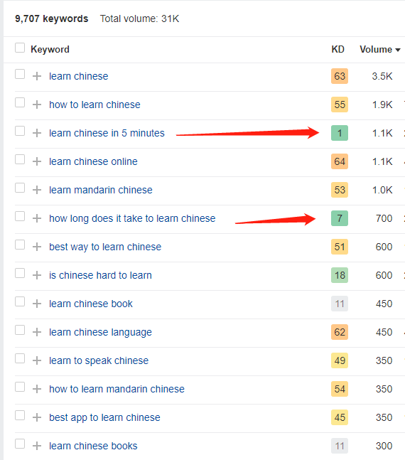
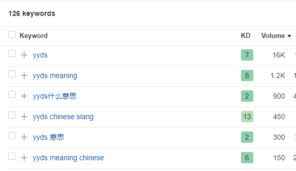
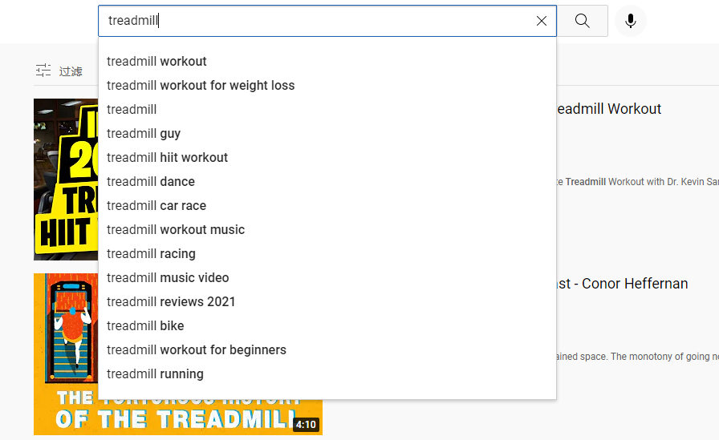
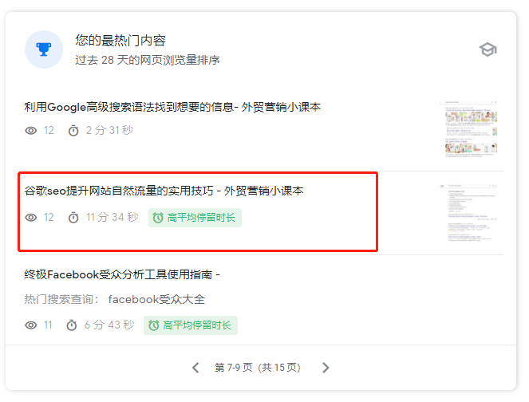

# 谷歌关键词SEO优化技巧

## 一、谷歌关键词优化技巧概述

#### 1.关键词定位的重要性

关键词定位就像用户在大海里寻找珍珠一样，用户会尝试各种关键词的搜索来寻找他们想要的答案。
如果我们的网站内容正好和用户搜索的关键词相匹配，那就是客户在大海里找到了自己想要的珍珠。
以好关键词定位可以让我们的网站被那些挖掘宝藏的人知道。让你的网站在广大的互联网中脱颖而出，被更多人看到和利用。

#### 2.关键词与搜索引擎结果页（SERP）的关系

它们两的关系就像我们在地图上输入目的地一样。当我们在搜索引擎中输入一个关键词进行搜索时，就相当于告诉搜索引擎你正在寻找特定的信息，就像告诉地图你要去某个地方一样。
关键词与搜索引擎结果页（SERP）的关系非常密切。当用户在搜索引擎中输入关键词时，搜索引擎将根据关键词与网页内容的匹配程度，对网页进行排序，然后将与关键词相关的网页在SERP中展示出来。
就是我们通常看到的相关网页链接，这个就是SERP。就像我们在高德地图上看到去目的地有不同的去法一样。
所以，关键词是搜索引擎中的目的地，它会告诉搜索引擎我们具体想找什么。
而SERP就是搜索引擎给我们的回应，它展示了不同的网页信息，帮助我们找到自己想要的信息。
而有些时候导航会把路给导错，搜索引擎有的时候也是给不到我们想要的信息。
但一般大类的搜索都是没有问题的，就像我们用高德地图导航到一个特别偏僻的地方，这个时候有很大概率把我们导得不知道东南西北。

## 二、谷歌关键词优化方法

#### 1.关键词选择策略

根据目标受众和用户意图，选择与网站内容相关且具有一定搜索量的主关键词。同时，**关注长尾关键词，这些是更具体、更具有商业价值的关键词短语。**
了解关键词真正的搜索意图也是非常重要的，如果我们不了解该关键词真正的搜索意图。那么哪怕布局再多的内容也是说不到点子上的，这样自然就不会有很好的排名。
了解了关键词的搜索意图以后我们就要开始布局相应的关键词了，选择对的关键词会直接影响到我们后续网站的转化率。
**理解核心关键词的重要性:**核心关键词是用户通过搜索引擎关键词搜索找到相关网站并且在网站上购买产品和服务的关键词，是网站重点布局和优化的关键词。
核心关键词最直接的理解就是通过谷歌搜索让你的目标客户找到你的网站关键词，只有这些能把目标客户吸引到你网站的关键词才是真正的核心关键词。
这也是为什么**核心关键词那么重要的原因了，因为它是决定你的网站或者店铺能不能带来销量和转化的核心因素没有之一。**

#### 2.网站如何确定核心关键词？

谷歌网站确定核心关键词的方法包括关键词研究、竞争对手分析和受众需求考虑。 通过研究相关关键词、了解竞争对手的关键词策略以及理解受众需求和搜索意图，可以确定与网站内容相关且具有潜在价值的核心关键词。
这些关键词应具备适当的搜索量和竞争度，并可与长尾关键词和地理定位关键词结合使用。
在网站中，**核心关键词应合理地出现在标题、描述、内容、URL、图片标签和链接文本等位置，以优化网站在谷歌搜索结果中的排名和曝光度。**
选择核心关键词的标准其实并不是刚开始可以是关于业务的衍生词，我举个例子大家就可以很容易理解了。
比如我之前做的谷歌SEO优化项目是做对外汉语学习的，那么核心词就是learn chinese or mandarin online。
那么衍生出来的业务词：
- Chinese math course online
- Learn mandarin for 5-7 years old child online
是不是都可以布局到相关的业务版块上面了？之后又可以找到一些目标客户搜索的疑问需求词了：
- how long does it take to learn mandarin?
- how fast can l learn conversational chinese?
**而布局这些核心关键词才能把真正需要你业务的潜在用户吸引过来**，不然过来的都是无效流量虽然是优化到了谷歌首页了，但是对自己的业务并没有很大的帮助。
那这些核心短词我们可以先布局到网站得首页或者栏目页面上，让每一个页面有一个核心关键词这是最重要的。
只有确定了这些核心关键词并且加以合理的优化才能获得真实且有效的流量。

## 三、如何选择核心关键词？

#### 1.寻找难度低的关键词

当然使用关键词工具来挖掘的时候一定要看好关键词的难度，这一点也是很重要的。
太难的关键词是没有那么快排到首页的，我们可以找那种难度低但是流量又很不错的词作为前期优化的重点。

难度太高，排名会很困难；难度太低的有些是没有人搜索的，所以我们要把这两年结合在一起使用才会收到不错的效果。一般使用semrush即可查看了。

#### 2.查看竞争对手的关键词

挖掘竞争对手的关键词是我最喜欢做的事情了，因为人家已经帮你检测过哪些词流量高哪些词流量一般，哪些词难度并不是很高但是流量非常的不错。
当然别看别人啥词流量高你也跟着做，这样一般操作下来都死的很惨。因为别人是花了时间去积累的，凭什么我们一做就可以上来啊？
所以选择合适我们前期猥琐发育的核心词是非常关键的，因为核心词的配套内容可以给你衍生出来很多内容。

像这个yyds就是我之前从竞争对手那边挖掘的，流量很大而且目标客户也是对汉语感兴趣的用户，带来的收益自然不会差。

#### 3.从YouTube上面挖掘

油管也算得上第二大搜索引擎了，上面可以挖掘到很多核心关键词和用户需求。这些需求不能能帮助你找到核心关键词还能找到用户的真实需求，一般用户需求我们可以在视频下面的高赞评论里面挖掘到。
而我们在使用搜索引擎的时候发现有些我们想要找的内容其实搜索引擎是找不到的，这个时候如果你写上去了那就是稀缺内容了。谷歌肯定会给予你不错的排名啊，因为真的很稀缺啊。

#### 4.从其他平台挖掘

国外的主流社媒或者是亚马逊这种购物平台都是你挖掘的素材基地，因为原理已经告诉给大家了。具体怎么操作我就不一个个的赘述了，和油管上挖掘需求是一个道理。只要你找到了就登记到表格中，做好需求内容。

#### 5.产品的核心词长尾关键词怎么挖掘？

其实还是上面的挖掘原理，通过各大社媒和谷歌系平台的挖掘我们可以发现用户在使用某个产品真正的需求在哪里？

通过跑步机在油管上面的搜索我们可以发现用户对于跑步机的减肥效果是很看重的，那么你在布局内容的时候是不是可以着重把这些需求点写上来？
产品标题写treadmill for weight loss然后内容着重写为什么我的跑步机可以减肥，然后着重强调一下哪些办法可以更好的配合这款跑步机使得用户可以真正的减肥，虽然其他跑步机也同样可以减肥。
但是就你着重说了，而其他产品都是在说自己的产品质量怎么样，性能怎么样。而这些东西没有一个使用感官的脑补，但是你写了这些就是满足了用户的需求而买你的产品不仅仅是买，而是给他了信心！
这些词我们可以通过社媒，谷歌以及锻炼的论坛上慢慢挖掘，并不是一朝一夕的事情。是一个长期积累的过程，当你积累到一定量了肯定销量也不会差的。

#### 6.怎么分辨是不是核心关键词？

这个刚开始是没有办法来分辨的，只能在优化过一段时间以后来用户的反馈。就前面说的一样能吸引目标客户同时能给你带来高滞留时间的关键词一定是核心词了。高滞留时间意味着你的内容是肯定受欢迎的，这是排名的一个非常重要的信号！

通过google search insight（在谷歌站长里面可以找到）我可以发现哪些关键词匹配的内容给我带来了非常高的滞留率，那就可以确定哪些内容我是可以继续做精细的优化的:
- 扩展更多的话题为排名创造契机（说白了就是增加滞留时间）
- 挖掘相关该关键词相关的需求（比如说扩展更多的话题是不是这个话题的延续了？）
- 不断更新你的核心内容（文章是可以添加新的内容来做再次更新的，这样就会越来越全面了）
通过认真研究和选择关键词，并将其优化与网站内容和用户意图相匹配，可以提高谷歌搜索引擎中网站的排名，并增加有针对性的有机流量。
这个也是当时自己遇到的一个问题就是想到什么写什么，最后感觉很自我良好。想着自己那么用心写出来的内容应该会有不错的排名和阅读量吧。
但现实往往是让自己备受打击的，完全没有人看，和自己时间的付出完全不对等。
使用好关键词工具可以让我们的网站内容规划更有策略性和目的性。

## 四、关键词布局和优化

#### 1.网站排名分析基础条件

做网站的排名之前我们要把这些基础的网站情况了解清楚，这样可以更好的为后期的排名打好基础。这些分析包括:
**一个使用了很久的网站:**网站存在的时间越长，那么域名的年龄自然网站的信任值也就会越高。以如果想短时间内获得排名需要有这个先天条件，这也是为什么很多人喜欢使用老域名建站做排名的原因了。
**进行初始关键词研究分析:**初始的关键词研究可以帮助我们把和自己产品相关以及业务相关的关键词都做一个整体的分析和梳理。
- 关键词要和自己的业务相关。
- 前期不要挑选竞争力太高的关键词虽然流量高但是很难排。
- 选择流量高同时排名难度低的关键词，具体的可以使用谷歌关键词挖掘工具来寻找。
**和自己业务相匹配的关键词:**选择和自己业务最相关的关键词，不仅提高关键词和网页内容的匹配程度。同时相关的业务匹配关键词可以更好的衍生话题，提高用户对该产品的理解程度。

## 五、了解竞争对手网站的排名情况

#### 1.域名和网址

- 标题标题标签如何包含关键字？
- 排名的内容类型产品页面? 博客文章? 视频？
- 排名的企业类型它们是大品牌? 小企业? 新闻网站？
查看排在前面的竞争对手并充分了解他们排名是如果布局的，我们做好精细的分析就可以让我们自己的网站排名变得更好，而排名搜索竞争其实就是把排在你前面的竞争对手超过即可。

#### 2.关键词搜索意图

关键字越具体(即长尾关键字) ，就越容易衡量搜索者的意图，也就越容易提供那些搜索者可能正在寻找的东西。
下面的关键词就随着字数的不断增加，搜索的需求也更加的明显了。
- 眼镜
- 折扣眼镜
- 折扣眼镜架
- 给孩子们打折的眼镜架
问问自己，什么样的内容最适合这个关键词？
即使是第一关键词排在了谷歌的前面但是这个关键词的搜索意图不是特别的具体，在布局内容的时候就需要布局更多的内容来满足用户的搜索需求。
这个人可能只是在寻找眼镜的图片或者是偏光太阳镜并没有明确的购买意图。
一个电子商务企业主要是要把有商业价值的关键字排到谷歌前三页，而不是把这种竞争程度很高同时搜索的意图很模糊的关键词排在前面。

#### 3.将内容概念化

在谷歌SEO中，关键词的优化是提高网站在搜索引擎结果中排名和可见性的关键因素之一。关键词优化涉及到筛选、优化和布局关键词，以使其与网站内容相关且有价值。 通过关键词研究和竞争对手分析，筛选出适合网站的关键词。
然后，在网站的标题、描述、正文内容和URL等位置合理地应用关键词，以增加相关性和可读性。
关键词的密度和分布也需要谨慎控制，避免过度使用或堆砌。 关键词的布局应自然融入网站内容，提供有价值的信息给用户，并符合谷歌的搜索算法要求。
正确的关键词优化可以吸引有针对性的流量，提高网站的曝光度和流量质量，进而增加网站的机会和潜在客户。 有很多方法可以对关键词进行排名，包括但不限于:
- 一篇博客文章
- 产品页面
- 链接的索引或目录(指网站上或网站周围的其他网页)
- 权威指南
- 一个视频

#### 4.优化关键字和内容

将前面的工作都准备好了，接下来我们就可以开始针对这些细节来做关键词优化部署了。
这一套方法下来，你可以感受到谷歌对你的友好，流量的美妙。
而我自己也是一直在用这些办法把自己网站的关键词排到了前面并且内容也是获得了认可，所以还没有用的同学可以马上用起来了。
在做关键词排名之前，做好对自身和竞争对手的网站分析可更清晰的理出关键词排名的细优化点。不管大家的网站是新站还是老站做好下面所说的分析工作，会让你的网站排名更好！
