# 谷歌关键词规划师

**定位高价值关键词实操方法**
谷歌的关键词规划师是谷歌广告平台上一个免费的关键词研究工具。它可以告诉你人们在谷歌上搜索哪些词，这些词有多热门，以及投放广告的成本大概是多少。
这个工具主要是为**付费点击广告（PPC）关键词研究**设计的（即为广告寻找关键词）。但也可以用它来进行**搜索引擎优化（SEO）关键词研究**（为你的网站寻找关键词）。
下面是如何使用谷歌关键词规划师的详细步骤：
**第 1 步：访问关键字规划器**
要访问 Google 的关键字规划器，请转至 Google Ads 中该工具的网址。
如果还没有就需要：登录或创建 Google账户
确保账户处于专家模式，而不是智能模式。 （如果右上角的导航菜单中没有“设置”图标，则表明处于专家模式。）
可以通过转至“工具”>“规划”>“关键字规划师”来访问关键字规划师。

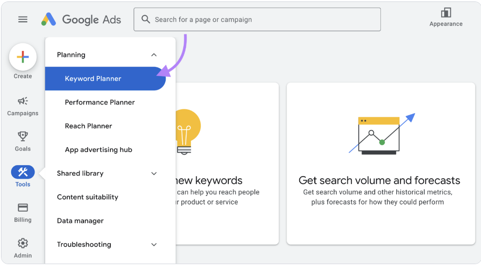

**第二步：发现新的关键词**
进入关键词规划师后，选择“发现新的关键词”。
（只有在你已经选定了关键词的情况下，才选择“获取搜索量和预测”。）

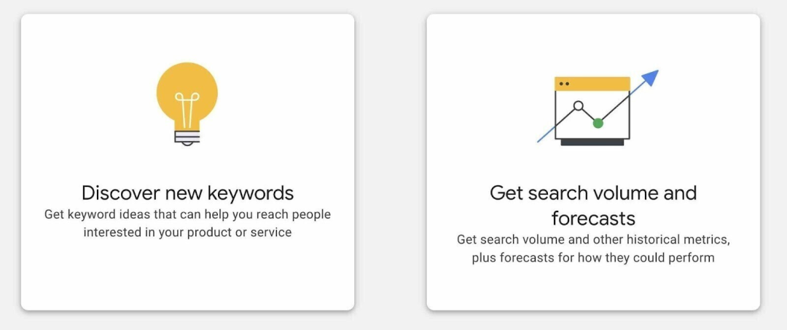

然后你有两个选择：
- 从关键词开始：
 该工具会根据你输入的词语生成关键词建议。
- 从网站开始：
 该工具会扫描你选择的域名或页面，生成关键词建议。你可以从自己的网站或竞争对手的网站获取灵感。
添加你的关键词或URL（取决于你选择的方法）。
然后，选择你的目标语言和地区。你可以选择国家、地区、城市等。
完成后，点击“获取结果”。

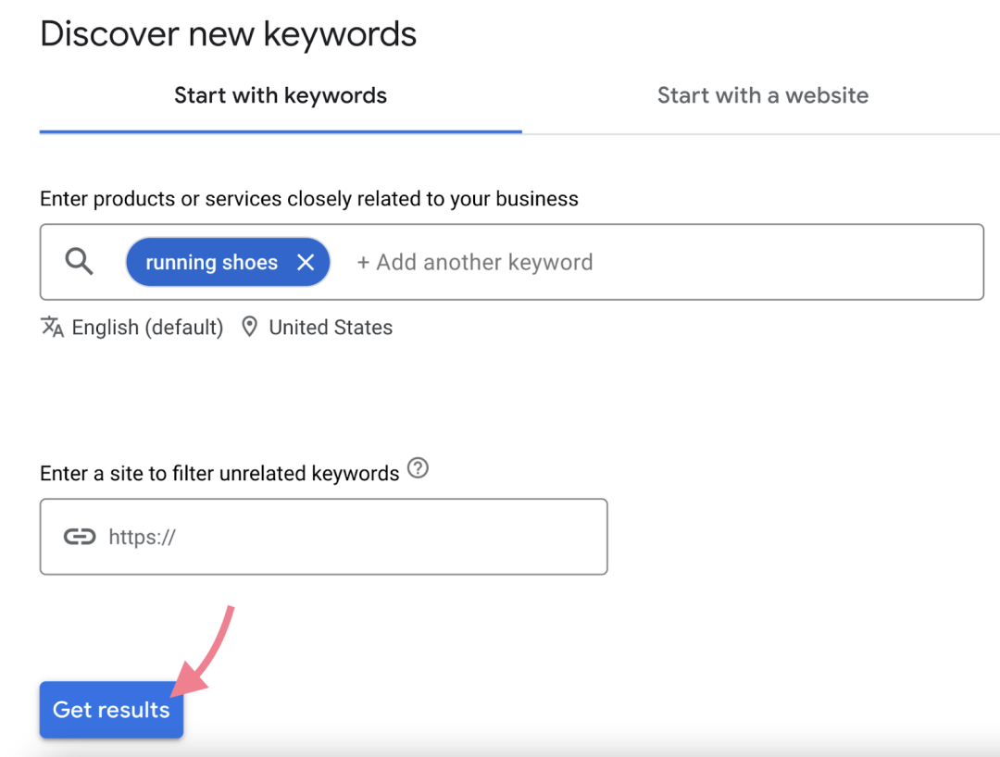

关键词规划师会展示关键词建议以及各种指标。
**第三步：优化你的关键词列表**
优化关键词列表可以让你专注于可能想要定位的相关关键词——即你有最大机会展示并获得转化的词语。
进入“添加筛选条件”>“关键词”，筛选包含或不包含特定词语的关键词。
如果你想包含/排除含义相似的词语，选择“语义匹配”而不是“文本匹配”。
例如，一个奢侈品牌可能想要避免包含“便宜”或类似词语的关键词：
如果你使用了“从关键词开始”选项，你可以在“优化关键词”部分找到常见的词语。
点击“全部展开”，取消勾选任何不相关词语旁边的框（例如，你不销售的品牌名称）。这将从你的结果中删除相应的关键词。

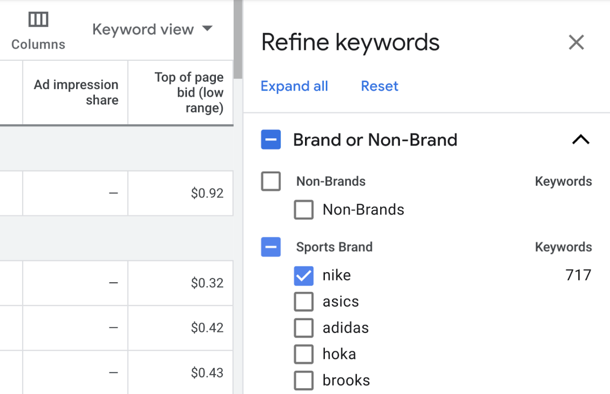

如果你计划进行广告活动，你可能想要将不相关的关键词保存为**否定关键词**。这些搜索词可以防止你的广告展示。
只需使用复选框选择不相关的关键词。然后，点击“⋮ 更多”>“添加为否定关键词”。
你需要为每个否定关键词选择合适的**关键词匹配类型**：
- “广泛匹配”意味着如果查询包含你的否定关键词，无论词语顺序如何，你的广告都不会展示。
- “词组匹配”意味着如果查询包含你的否定关键词，且词语顺序与你指定的顺序相同，你的广告就不会展示。
- “精确匹配”意味着只有查询与你输入的否定关键词完全匹配时，你的广告才不会展示。
**第四步：查看搜索量**
关键词搜索量是每个月平均搜索某个关键词的次数。它可以让你了解你的结果可能获得的浏览量。
谷歌的关键词规划师在“平均每月搜索量”列中显示搜索量：

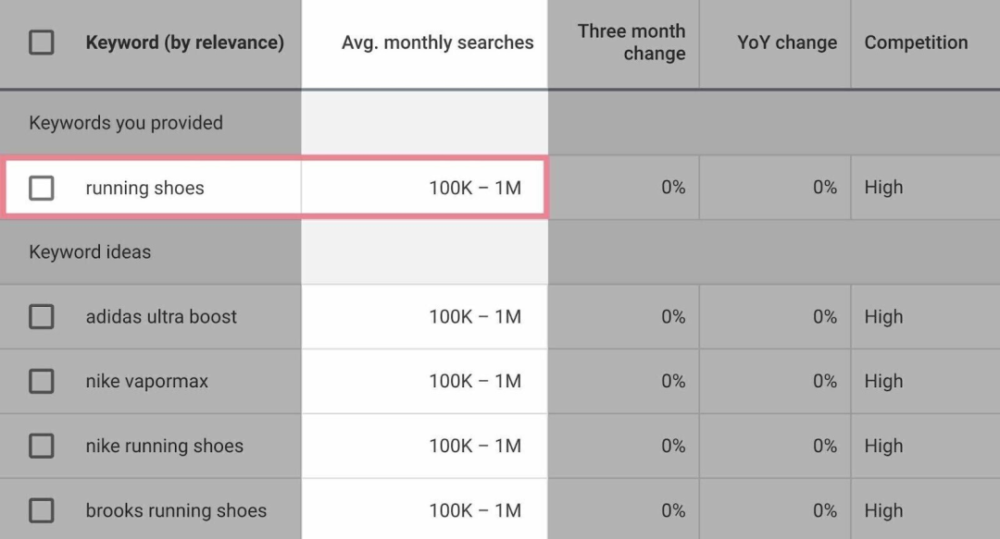

正如你所看到的，这些估计非常宽泛。因此，很难比较关键词并找到最佳机会。
要获得更精确的估计，请使用Semrush进行关键词研究。
例如，这是关键词魔术工具的一些结果：

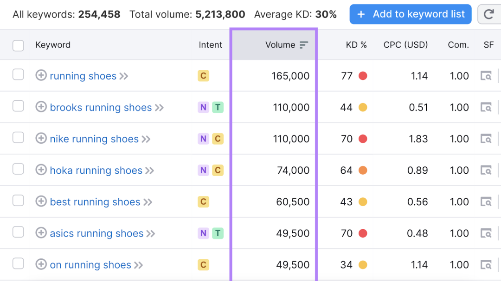

虽然关键词规划师告诉你“跑步鞋”每月有10万到100万次搜索，但关键词魔术工具告诉你大约是165,000次。
**第五步：区分PPC关键词和SEO关键词**
你用于P    PC广告活动的关键词通常与你在网站上使用的关键词不同。因为它们服务于不同的目的。
（也有例外。例如，你可能会在产品页面上使用与引导至该产品页面的广告活动相同的关键词。）
要确定哪些词语你想用于付费广告，哪些更适合你的网站，你需要分析每个词语的**搜索意图**（搜索者想要实现的目标）。
搜索意图主要有四种类型：
- 导航型：用户想要找到特定的网站或页面。
- 信息型：用户想要了解某个主题的更多信息。
- 商业型：用户想要在做出购买决定之前进行研究。
- 交易型：用户想要完成购买等操作。
后两种通常最适合广告活动。因为它们表明用户几乎准备好购买。
一旦你知道你想用于广告的词语，你可以通过勾选它们旁边的框并点击“添加关键词以创建方案”（之后，“添加关键词”）来保存它们。

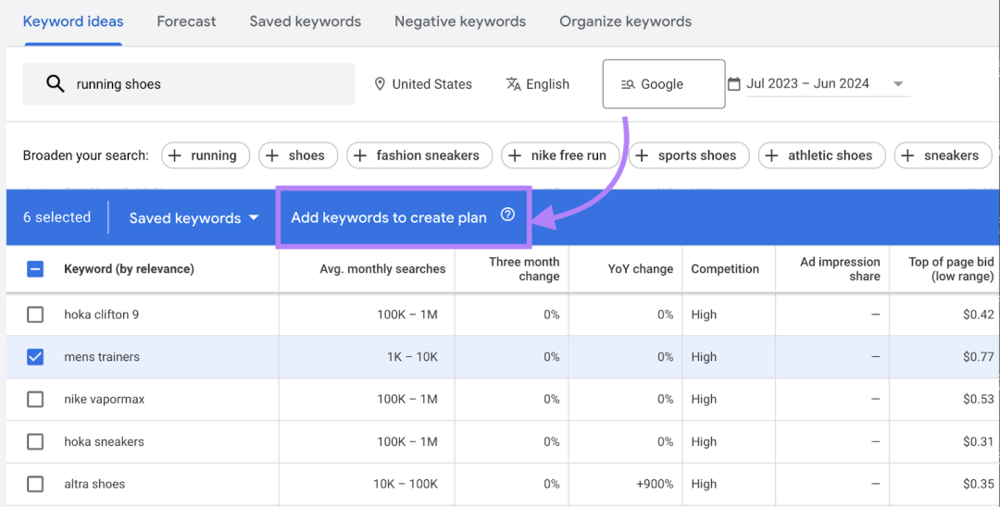

要在后续步骤中仅访问这些PPC关键词，请转到关键词规划师中的“已保存的关键词”选项卡。
**第六步：评估竞争水平（以及PPC关键词的成本）**
如果许多网站竞争相同的关键词，那么在搜索结果页面上获得突出位置就会更难。在广告方面，成本也会更高。
让我们探讨如何评估PPC和SEO关键词：
**评估PPC关键词**
关键词规划师提供四个指标来帮助你衡量广告竞争和估算成本：
（1）竞争程度（索引值）
- 通常填充的可用广告位百分比。数字越高，获得位置就越难。
（2）页首出价（低端范围）
- 广告商历史上为页首广告位出价的较低端。它可以让你粗略了解此广告空间中的最低
**每次点击费用**。
（1）页首出价（高端范围）
- 广告商历史上为页首广告位出价的较高端。它可以让你粗略了解此关键词的最高每次点击费用。
（2）竞争程度
- 可以是“—”（如果数据不足）、“低”、“中”或“高”。它反映了与其他关键词相比，竞标此关键词的广告商数量。
**小贴士：**
点击“添加筛选条件”（从“关键词建议”主选项卡中），根据这些指标（和其他指标）筛选你的关键词结果。

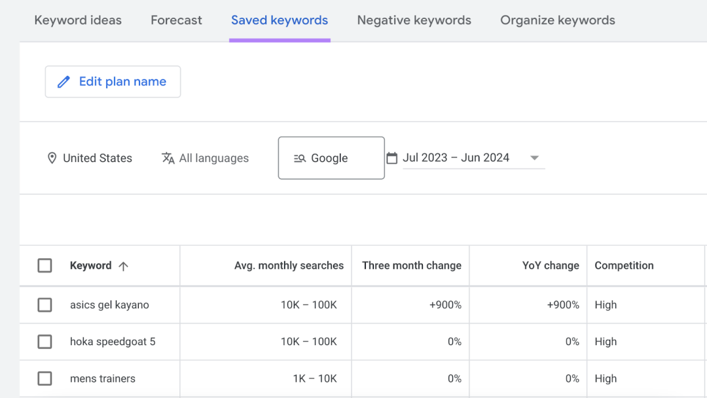

**评估SEO关键词**
关键词规划师中的竞争指标可以让你大致了解你自然排名某个关键词的可能性。毕竟，广告位的竞争越激烈，自然排名的竞争也就越激烈。
但**关键词魔术工具**是衡量**SEO排名难度**的特别好的选择。
输入你的域名，查看每个关键词建议的个人关键词难度得分（PKD%）。这衡量了你的特定域名达到排名前10的自然结果的难度。
你可以在页面顶部附近找到此指标（和其他指标）的筛选器：

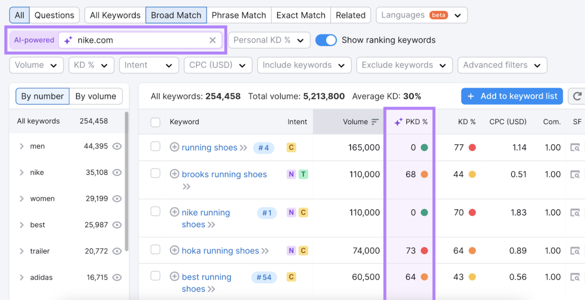

找到想要定位的关键词后，你可以继续创建**SEO内容**。
**第七步：获取PPC预测**
要查看使用你保存的PPC词语的广告活动可能会产生的效果，请转到关键词规划师中的“预测”选项卡。

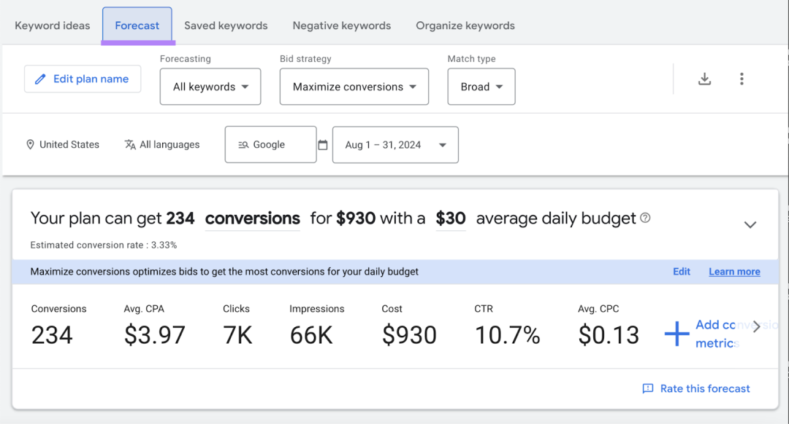

尝试不同的出价策略、广告活动日期和预算，查看预测结果。并尝试设计一个支持你的业务目标的广告活动。

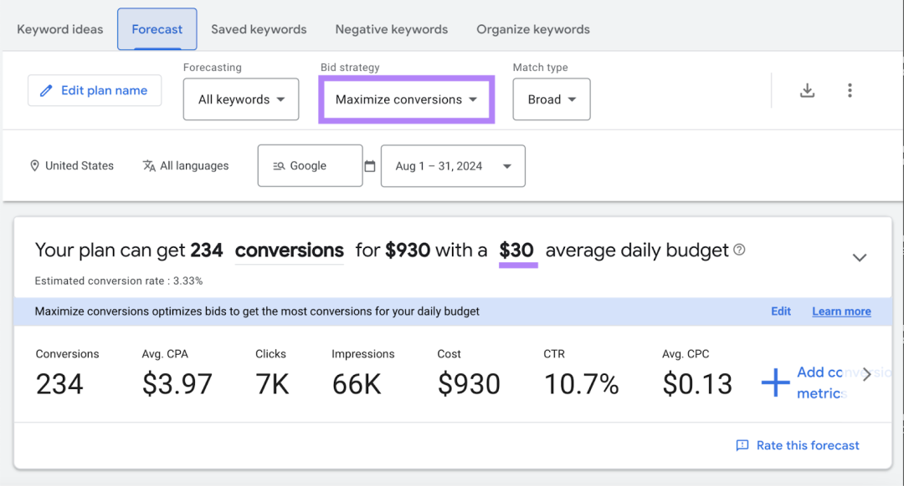

如果你准备好继续你的计划，点击“创建广告活动”，然后按照说明操作。
**将关键词研究提升到一个新的水平**
Semrush的**关键词魔术工具**是谷歌关键词规划师的一个很好的替代品。
它允许你：
- 收集更精确的关键词搜索量
- 检查你的SEO排名潜力
- 查找触发所需
**SERP功能**的关键词
- 查看每个关键词的搜索意图类别
- 一键查看搜索结果页面
