# 谷歌独立站SEO入门指南

在出海过程中，优化网站的SEO，要根据当前情况使用合适的策略，才能真正发挥其作用。**每个网站的情况并不一样，有的是刚起步的新站，有的是流量下滑的老站，它们都有各自需要攻克的难题和机会。**
所以，我们需要找到适合自己网站的优化重点。跟着下面提供的框架，就可以帮你做到这一点：

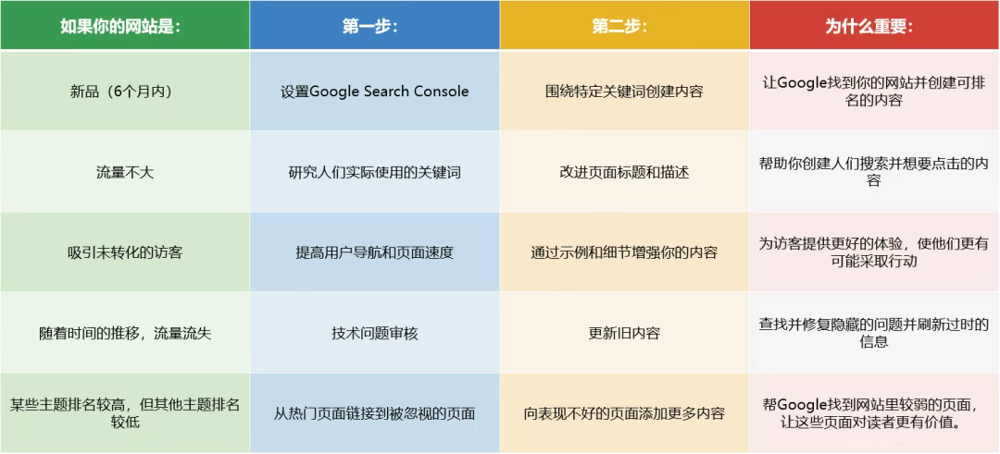

在出海过程中，优化网站的SEO，要根据当前情况使用合适的策略，才能真正发挥其作用。**每个网站的情况并不一样，有的是刚起步的新站，有的是流量下滑的老站，它们都有各自需要攻克的难题和机会。**
所以，我们需要找到适合自己网站的优化重点。跟着下面提供的框架，就可以帮你做到这一点：
**一、*****创建高质量的网站内容***
高质量的内容是SEO成功的基础。如果缺乏吸引人且有价值的内容来满足用户需求，其他优化工作也很难充分发挥作用。而创建高质量内容，首先要了解目标受众在Google等搜索引擎中搜索的内容。

#### 1.找到并定位正确的关键词

找到并定位正确关键词是创建高质量内容的关键。关键词是用户在Google等搜索引擎中输入的词语或短语，合适的关键词有利于提升网站在搜索引擎中的可见性。了解受众的搜索内容，可以帮助确定网站要涵盖的主题，从而更好地满足用户需求。

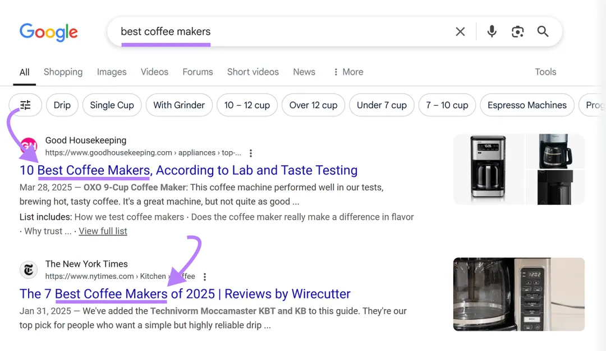

进行关键词研究可参考以下方法：
- 从所在领域的一个主要、广泛的主题开始，如销售咖啡设备可从“咖啡机”入手。
- 使用关键词研究工具查找相关搜索。
- 寻找搜索量相对较高且难度分数较低的关键词。

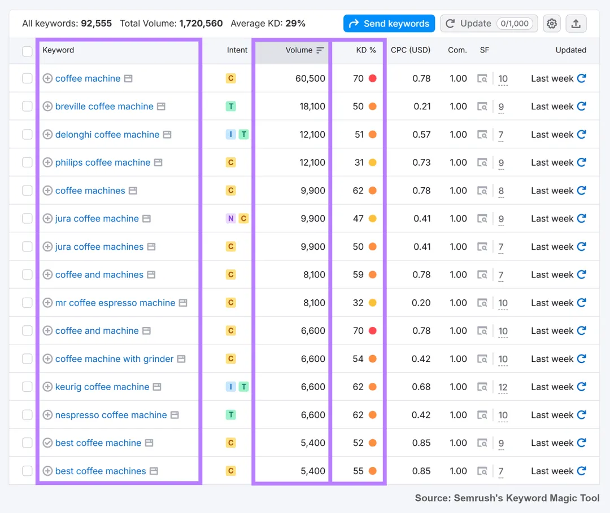

在选择关键词的过程中，关键在于找到那些搜索量足够多且竞争不太激烈的关键词，这样排名才有实现的可能。确定关键词后，可以按以下步骤在网站上有效定位：
- 策略性地放置关键词，将其包含在页面标题、URL、H1标题以及内容的前100个字中。
- 自然地使用关键词，以读者听起来自然的方式整合，避免关键词堆砌，以免损害用户体验和排名。
- 为主要关键词创建专门的页面，每个重要关键词都应有专门的优化页面，而不是试图在一个页面上为多个不相关的关键词排名。
- 包含关键词变体，在内容中使用相关术语和同义词，增强相关性并改善自然语言处理信号。

#### 2.识别并匹配搜索意图

创建高质量内容时，不仅要选好关键词，还要找准搜索意图。每次搜索都是用户想找到答案、解决问题或寻求行动方法，精准把握用户需求，能帮我们确定合适的内容类型，内容越贴合需求，谷歌就越可能将其排在前面。搜索意图主要有以下四种类型：
- **交易意图：**用户想完成操作，如购买东西，像“在哪里购买研磨咖啡包”。
- **信息意图：**用户想了解更多内容信息，如“如何使用咖啡研磨机”。
- **商业意图：**用户购买前研究选择，如“最好的手动咖啡研磨机”。
- **导航意图：**用户想找到特定页面或网站，如“2025年精品咖啡博览会”。

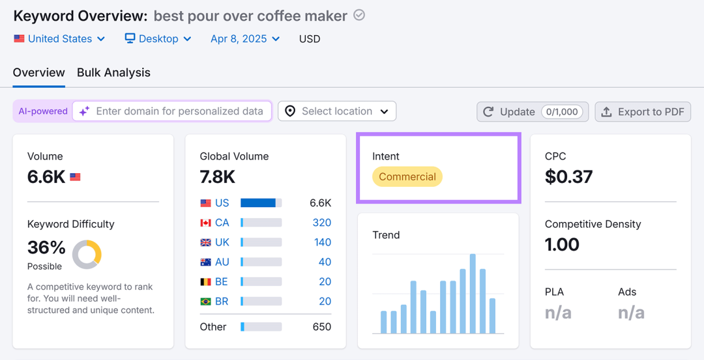

#### 3.提供高质量、有用的信息

提供高质量、有用的信息，即创建有独特价值且能彻底解决读者问题的内容。如果想让Google向更多人展示内容，需要比已排名内容更优质。内容真正有价值的因素包括：
- 包含原创见解，添加自己的经验、观点、研究或调查数据，分享独特的案例研究。
- 全面涵盖主题，完整回答主要问题及读者可能提出的相关问题。
- 使其易于理解，将复杂想法分解成简单步骤，使用相关示例，添加解释关键概念的视觉效果。

#### 4.使用清晰的内容结构

使用清晰的内容结构，即通过HTML标题标签（H1、H2、H3等）按逻辑层次结构组织信息，可以帮助读者和搜索引擎轻松理解。这些标签就像路标，显示内容中重要部分及相互关系。具体来说：
- **H1标签：**是页面最重要的标题，通常用于概括整个页面的核心主题，相当于文章的“大标题”，也称为“一级标题”。一个页面一般只使用一个H1标签，它应尽量靠近HTML中的<body>标签，以便让搜索引擎最快领略主题。

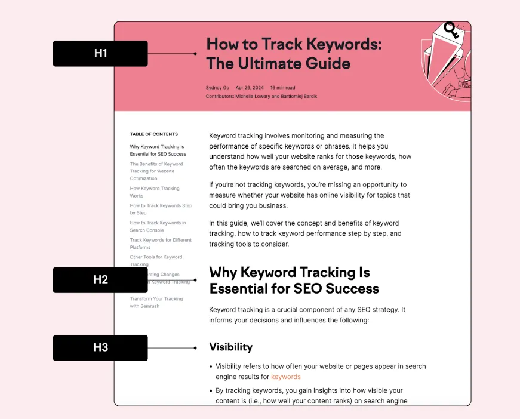

- **H2标签：**表示一个段落的标题，或者说副标题，可用于部署长尾关键词。它可以有多个，用于组织内容的各个部分。
- **H3标签：**表示段落的小节标题，效果跟<strong>差不多，一般是用在段落小节。它也可以有多个，用于进一步细分内容。
- **H4-H6标签：**基本很少用到，是告诉搜索引擎这些不是很重要的内容。在内容较多时，可以用来说明一些不重要的内容。
**二、*****让你的网站更容易被理解***
接下来，我们可以探讨一些可以帮助访问者和搜索引擎理解和浏览你网站的元素。

#### 1.撰写吸引人的标题和元描述

- **标题标签：**
标题标签是用户在搜索结果中看到的蓝色、可点击的标题，对搜索引擎排名很重要，因为它展示了页面内容。虽然谷歌可能会重写它，但精心设计标题标签仍是SEO的重要实践。

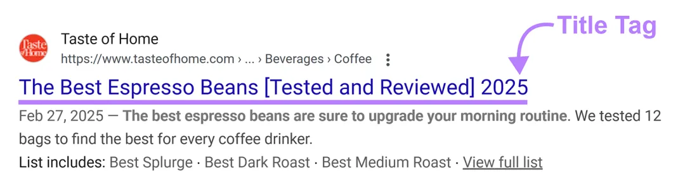

其优化方法包括：将主要关键词放在开头附近；保持在60个字符以内，以免被截断；使标题与搜索意图相匹配；使标题标签和H1相似。
- **元描述：**
元描述是显示在搜索结果标题下方的简短摘要，虽不是直接的排名因素，但吸引人的元描述能提高点击率。

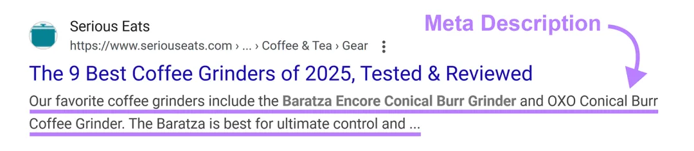

优化元描述的方法包括：长度保持在105个字符以内；自然地包含你的目标关键字；添加明确的CTA（“了解如何”、“发现原因”、“找出答案”）；突出特定优势或独特卖点等。

#### 2.使用内部链接连接你的页面

使用内部链接连接你网站的页面，即在网站的不同页面之间添加相关链接，这既有利于访问者，也有利于搜索引擎。
- **对于访问者：**内部链接可以帮助用户轻松发现更多内容，不需要返回搜索结果就可以找到相关信息，从而改善用户体验。当用户在网站上停留时间更长且浏览多个页面时，这向搜索引擎表明网站内容满足了用户需求。
- **对于搜索引擎：**内部链接可以帮助搜索引擎发现网站上的新页面，了解页面之间的关系，以及网站的整体结构。这些因素都有助于提升网页在相关关键词中的排名。

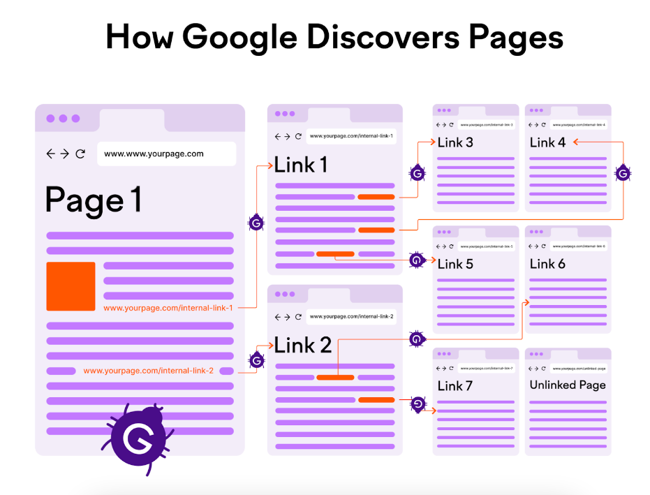

#### 3.使用简单的URL段

使用包含目标关键词的简洁URL段，可以提升排名并便于记忆。它虽然是次要排名信号，但可以帮助搜索引擎理解内容主题，让用户清楚链接指向。要优化你的URL，有5个关键点：
- 描述性强但简洁。
- 包含你的主要关键字。
- 使用全部小写字母。
- 用连字符分隔单词。
- 避免使用特殊字符和数字。

#### 4.包含并优化图像

优化图像不仅有利于改善用户体验，还能增加网站在Google图像结果中出现的机会。在上传图像前，应使用描述性文件名，如“french-press-brewing-technique.jpg”，而非默认的“IMG_0123.jpg”。
同时，为图像添加准确且包含目标关键字的替代文本（Alt文本），这不仅能让视障用户通过屏幕阅读器理解图像，还能向Google提供图像内容的背景信息。
**三、*****利用反向链接来建立权威***
优化网站的SEO时，利用反向链接建立权威很重要。获取其他网站的链接能有效提升Google排名，因为这表明其他网站信任你的内容。
首先，要创建值得链接的内容。通过开发有价值的资源，吸引其他网站自然引用。以下内容类型容易吸引链接：
- **原创研究：**提供第一方数据、行业调查或趋势分析，分享他人所没有的独特见解。
- **综合指南：**全面深入地涵盖某个主题，成为你所在行业的权威参考资料。
- **视觉资产：**如信息图表、图表或自定义图像，以直观的方式解释复杂的概念，并且易于共享。
- **工具和计算器：**提供免费的交互式资源，帮助你的受众解决特定问题。
例如，我们的免费网站流量检查器已获得177K个反向链接，因为它使营销人员能够即时访问竞争对手的数据，而这些数据通常需要使用多个付费工具才能收集。

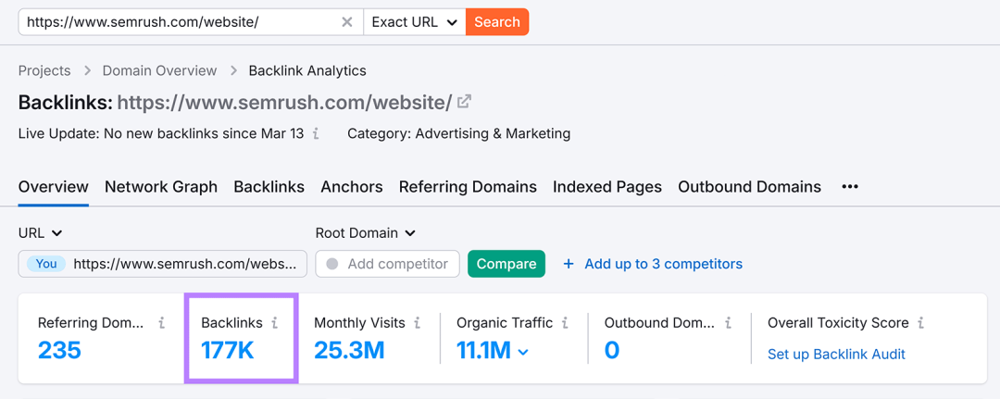

其次，进行简单的链接推广。这意味着联系相关网站，直接请求他们链接到你的内容。虽然创建值得链接的内容是链接建设的基础，但战略性推广可以加速反向链接的获取。以下是链接拓展的简单三步流程：
- **寻找潜在的链接机会：**寻找那些链接到类似内容、资源页面以及提及你品牌但未包含链接的网站。
- **联系前做好调查：**了解目标网站的受众和内容风格，找到合适的联系人，并明确你对其内容感兴趣的具体部分。
- **发送个性化、简洁的电子邮件：**在邮件中提及他们页面的具体内容，解释你的内容如何增加价值，并建议你的链接适合放置的位置。
**四、*****检查你网站的技术SEO***
好的SEO包含一些技术元素，这些会影响Google访问和理解你网站的能力。不过，技术SEO的基础知识检查和修复并不复杂，主要关注以下几个方面就可以了：
首先，要确保Google可以找到你的网页。
为了让网页出现在搜索结果中，Google需要找到、读取并索引它们。以下是三个步骤：
**1.创建Google Search Console账户：**GSC是免费工具，能帮你了解Google如何看待你的网站。设置后，查看“索引”>“页面”，检查哪些页面被索引，哪些未被索引及原因，点击条目可获取更多信息。

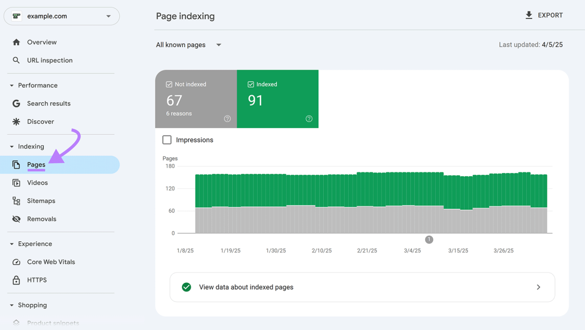

**2.提交网站地图：**网站地图告诉搜索引擎应索引哪些URL，检查是否有自动生成的版本，如果没有，用生成器工具创建并提交到GSC的“索引”>“站点地图”。

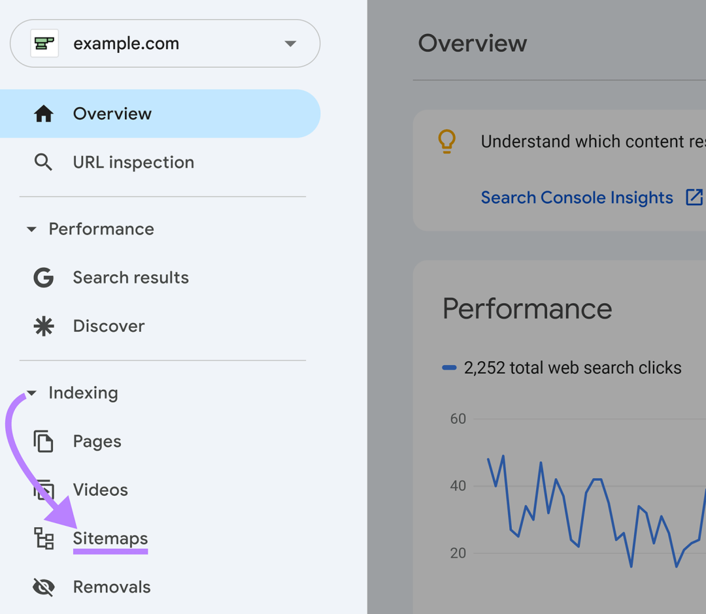

**3.查找并修复损坏的链接：**无效链接指向不存在的页面，不利于SEO和用户体验。在GSC的“索引”>“页面”报告中查找“404”错误，还可使用站点审核工具查找更多问题。

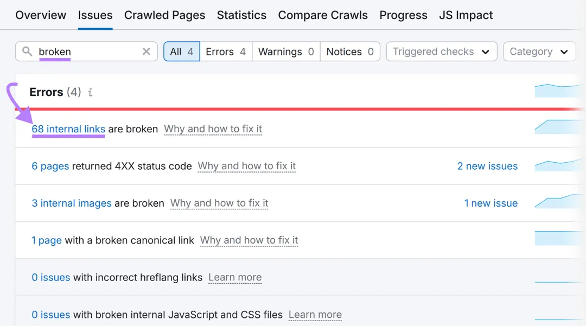

其次，是提升页面速度。
页面速度影响SEO和用户体验。以下是提高速度的方法：
- **测试速度：**用Google的PageSpeed Insights工具，输入网址，查看评分和问题。
- **优化图片：**上传前压缩和调整图片大小，避免文件过大。
- **精简代码：**删除不必要的主题、插件或脚本，减少额外代码。
- **升级主机：**考虑升级主机以提升速度。还可启用浏览器缓存和使用CDN。

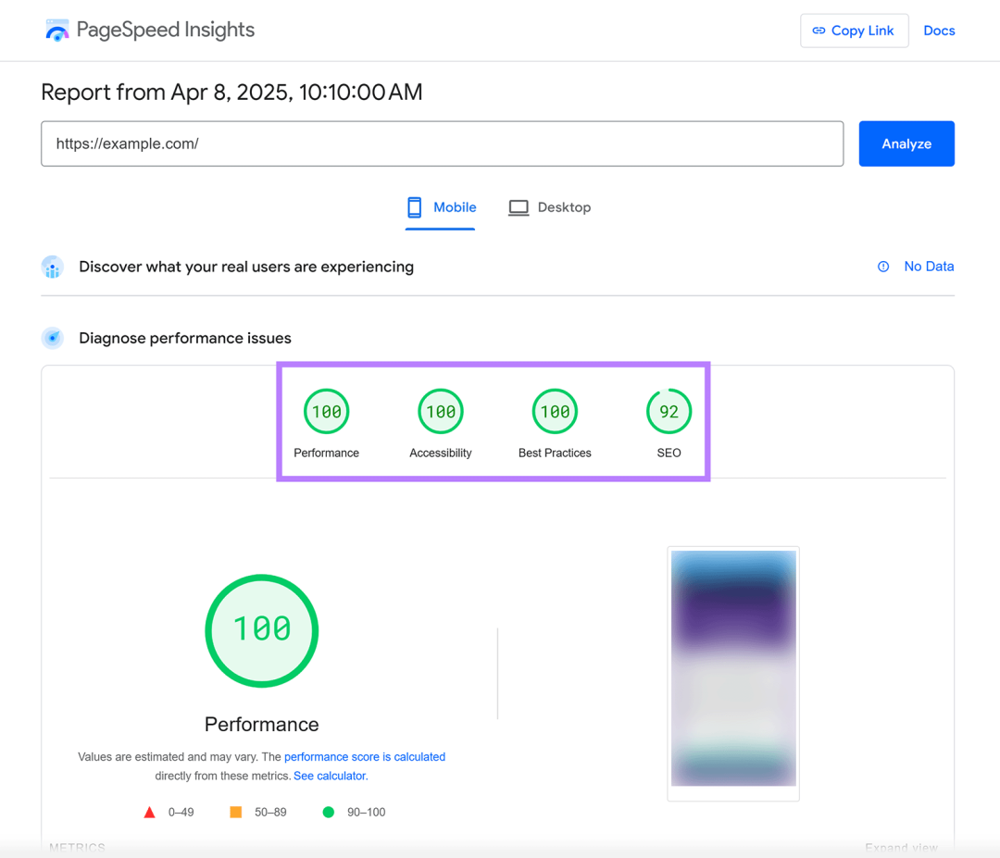

最后，是针对移动设备进行优化。
Google使用移动优先索引，主要关注网站在移动设备上的表现。以下是优化方法：
- **测试移动体验：**用PageSpeed Insights检查“移动”标签，查看表现和改进机会。
- **使用响应式设计：**确保网站能自动适应不同屏幕尺寸。
- **检查文字大小和间距：**确保文字清晰可读，按钮足够大，方便点击。

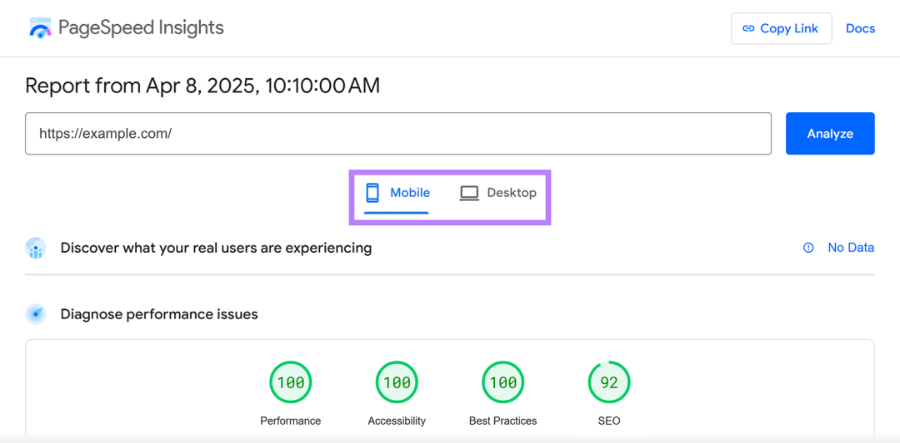
